<!-- # Kubernetes — Documentation Complète et Pédagogique

> **Public cible :** Débutants et profils intermédiaires  
> **Secteurs couverts :** Banque · Assurance · Énergie · Transport · Éducation · Santé  
> **Version Kubernetes :** 1.29+

--- -->

## Table des matières

- [Introduction](#introduction)
- [Quelques concepts avant de commencer](#quelques-concepts-avant-de-commencer)
- [Chapitre 1 — Outils Desktop](#chapitre-1--outils-de-type-desktop)
- [Chapitre 2 — Offres Managées](#chapitre-2--offres-managées)
- [Chapitre 3 — Solutions de déploiement automatisées](#chapitre-3--solutions-de-déploiement-automatisées)
- [Chapitre 4 — Infrastructure as Code (IaC)](#chapitre-4--solutions-infrastructure-as-code-iac)
- [Chapitre 5 — Systèmes d'exploitation Kubernetes](#chapitre-5--le-système-dexploitation-kubernetes)
- [Chapitre 6 — Plateformes de management de clusters](#chapitre-6--plateformes-de-management-de-clusters-kubernetes)
- [Chapitre 7 — Méthodes inclassables](#chapitre-7--méthodes-dinstallation-inclassables)
- [Conclusion](#conclusion)

---

## Introduction

### Kubernetes, c'est hype ?

Kubernetes (abrégé **K8s**) est devenu en quelques années la référence absolue pour orchestrer des conteneurs en production. Né chez Google en 2014 et donné à la Cloud Native Computing Foundation (CNCF), il est aujourd'hui déployé dans des banques, des hôpitaux, des réseaux d'énergie et des plateformes éducatives aux quatre coins du monde.

Mais pourquoi autant d'engouement ? Parce que Kubernetes résout des problèmes concrets :

- **Scalabilité automatique** : votre application de crédit bancaire reçoit 10× plus de trafic le lundi matin ? Kubernetes scale automatiquement.
- **Haute disponibilité** : un nœud tombe en panne dans votre datacenter énergétique ? Les pods redémarrent ailleurs en quelques secondes.
- **Déploiements sans interruption** : mise à jour du dossier patient sans coupure de service ? Kubernetes gère les rolling updates.
- **Portabilité** : même manifeste YAML sur votre laptop, en cloud AWS, Azure ou dans un datacenter on-premise.

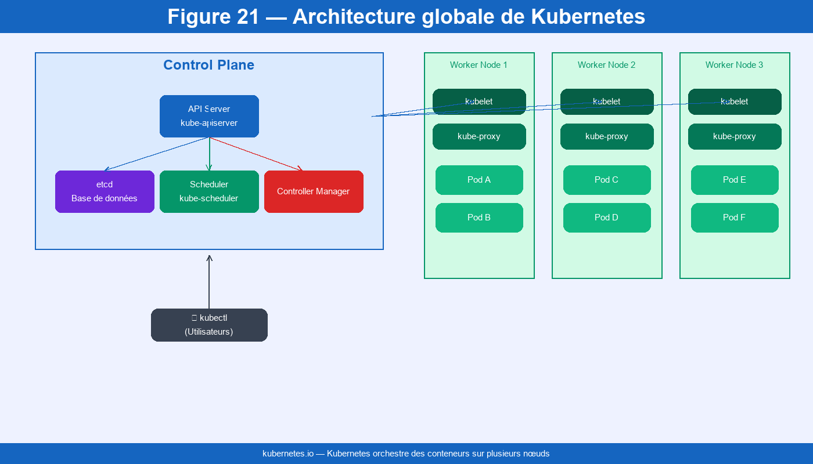

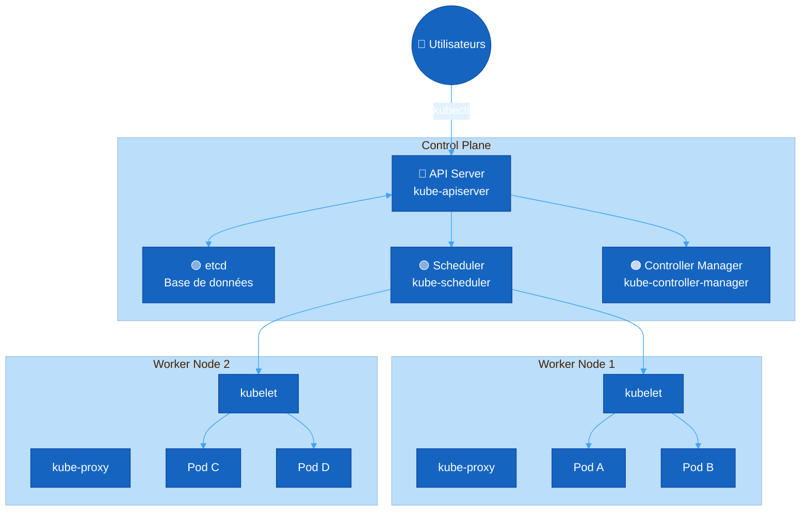

*Figure 21 — Architecture globale de Kubernetes : le Control Plane orchestre les Worker Nodes*

### Ce que ce livre n'est pas

Ce document n'est pas un simple manuel de référence. C'est un **guide pratique** qui vous accompagne de l'installation locale (sur votre laptop) jusqu'aux déploiements en production multi-cloud, avec des exemples concrets tirés de six secteurs d'activité.

Il ne remplace pas la [documentation officielle Kubernetes](https://kubernetes.io/docs/) mais la complète avec du contexte métier et des cas d'usage réels.

### Ressources utiles

| Ressource | URL | Usage |
|-----------|-----|-------|
| Documentation officielle | kubernetes.io/docs | Référence complète |
| Playground interactif | killercoda.com | Pratiquer sans installation |
| CNCF Landscape | landscape.cncf.io | Cartographie de l'écosystème |
| Kubernetes Slack | kubernetes.slack.com | Communauté |

---

## Quelques concepts avant de commencer

Avant de plonger dans les outils, il est essentiel de maîtriser le vocabulaire Kubernetes. Cette section est votre dictionnaire de référence.

### Le Pod — l'unité de base

Un **Pod** est le plus petit objet déployable dans Kubernetes. Il contient un ou plusieurs conteneurs qui partagent le même réseau et le même stockage.

```yaml
# Exemple : Pod simple pour une application de consultation de compte bancaire
apiVersion: v1
kind: Pod
metadata:
  name: consultation-compte
  namespace: banque
  labels:
    app: consultation
    secteur: banque
spec:
  containers:
  - name: api-compte
    image: banque/api-compte:v1.2.0
    ports:
    - containerPort: 8080
    resources:
      requests:
        memory: "128Mi"
        cpu: "250m"
      limits:
        memory: "256Mi"
        cpu: "500m"
```

### Le Deployment — gestion du cycle de vie

Un **Deployment** gère un ensemble de Pods identiques (replicas) et assure les mises à jour sans interruption.

```yaml
# Exemple : Deployment pour un système de gestion de sinistres (Assurance)
apiVersion: apps/v1
kind: Deployment
metadata:
  name: gestion-sinistres
  namespace: assurance
spec:
  replicas: 3                    # 3 instances pour la haute disponibilité
  selector:
    matchLabels:
      app: gestion-sinistres
  template:
    metadata:
      labels:
        app: gestion-sinistres
    spec:
      containers:
      - name: sinistres-api
        image: assurance/sinistres:v2.1.0
        ports:
        - containerPort: 9090
  strategy:
    type: RollingUpdate
    rollingUpdate:
      maxUnavailable: 1          # max 1 Pod indisponible pendant la mise à jour
      maxSurge: 1                # max 1 Pod supplémentaire pendant la mise à jour
```

### Le Service — exposition réseau

Un **Service** expose un ensemble de Pods sur le réseau. Il agit comme un load balancer interne.

```yaml
# Exemple : Service pour exposer l'API de suivi des trains (Transport)
apiVersion: v1
kind: Service
metadata:
  name: suivi-trains
  namespace: transport
spec:
  selector:
    app: suivi-trains
  ports:
  - protocol: TCP
    port: 80
    targetPort: 8080
  type: LoadBalancer             # Expose sur Internet avec une IP publique
```

### Le Namespace — isolation logique

Les **Namespaces** permettent de partitionner un cluster entre équipes ou applications.

```yaml
# Créer des namespaces par secteur dans un cluster mutualisé
kubectl create namespace banque
kubectl create namespace assurance
kubectl create namespace energie
kubectl create namespace transport
kubectl create namespace education
kubectl create namespace sante
```

### ConfigMap et Secret

```yaml
# ConfigMap : configuration non sensible (Énergie)
apiVersion: v1
kind: ConfigMap
metadata:
  name: config-compteurs
  namespace: energie
data:
  REGION: "ILE_DE_FRANCE"
  INTERVALLE_RELEVE: "15m"
  FORMAT_DONNEES: "JSON"

---
# Secret : données sensibles chiffrées (Santé)
apiVersion: v1
kind: Secret
metadata:
  name: creds-base-patients
  namespace: sante
type: Opaque
data:
  username: YWRtaW4=       # base64 de "admin"
  password: cGFzc3dvcmQ=   # base64 de "password" (utilisez des vrais mots de passe !)
```

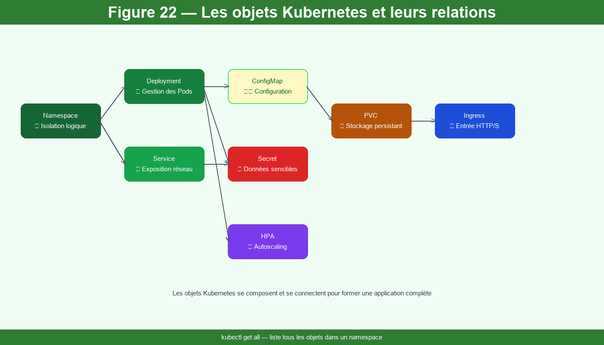

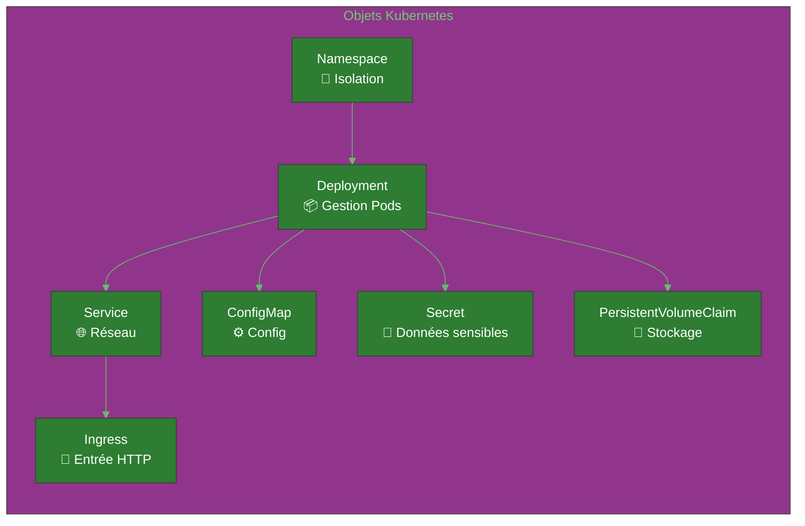

*Figure 22 — Les objets Kubernetes et leurs relations*

### Vue d'ensemble par secteur

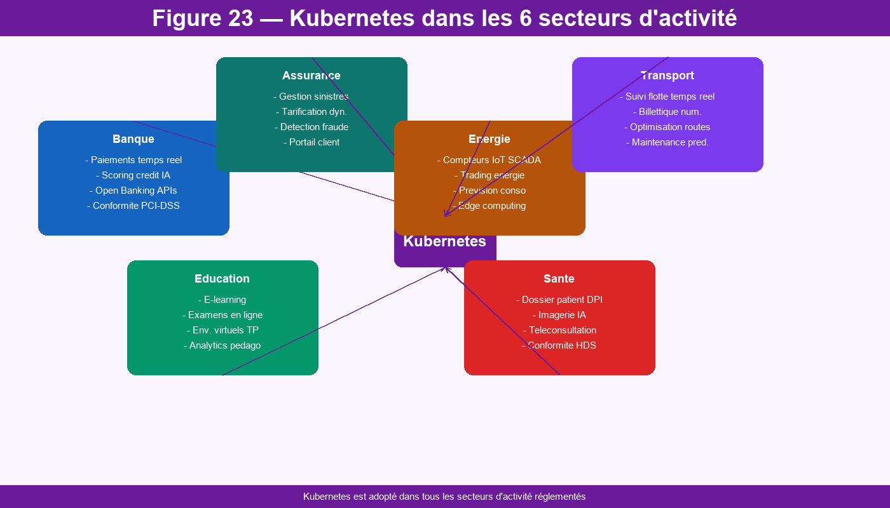

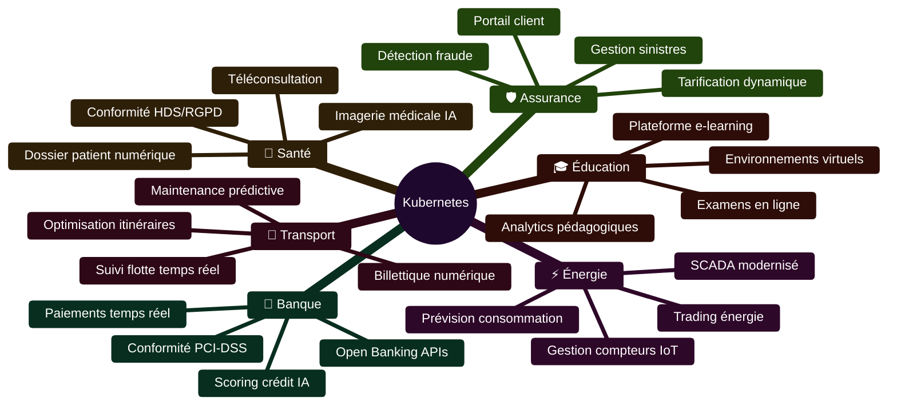

*Figure 23 — Kubernetes dans les six secteurs d'activité*

---

## CHAPITRE 1 — Outils de type Desktop

> **Objectif :** Installer Kubernetes localement sur votre poste de développement pour apprendre, tester et développer sans infrastructure cloud.

Ces outils sont parfaits pour :
- Apprendre Kubernetes sans frais
- Développer et tester des applications avant déploiement en production
- Reproduire des environnements de production en local

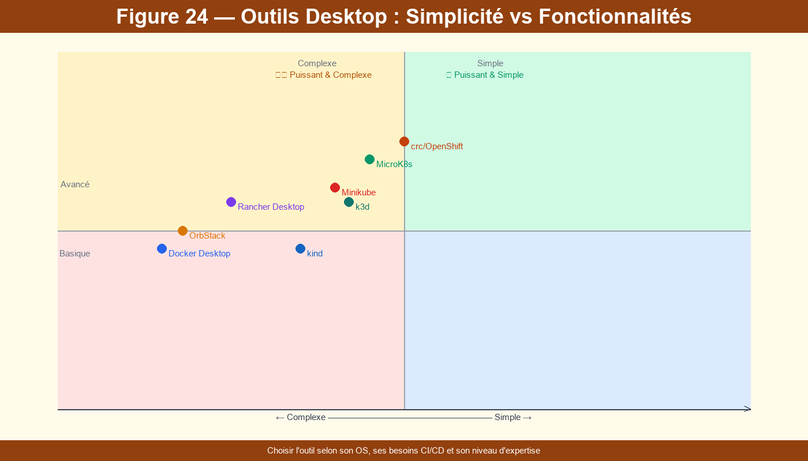

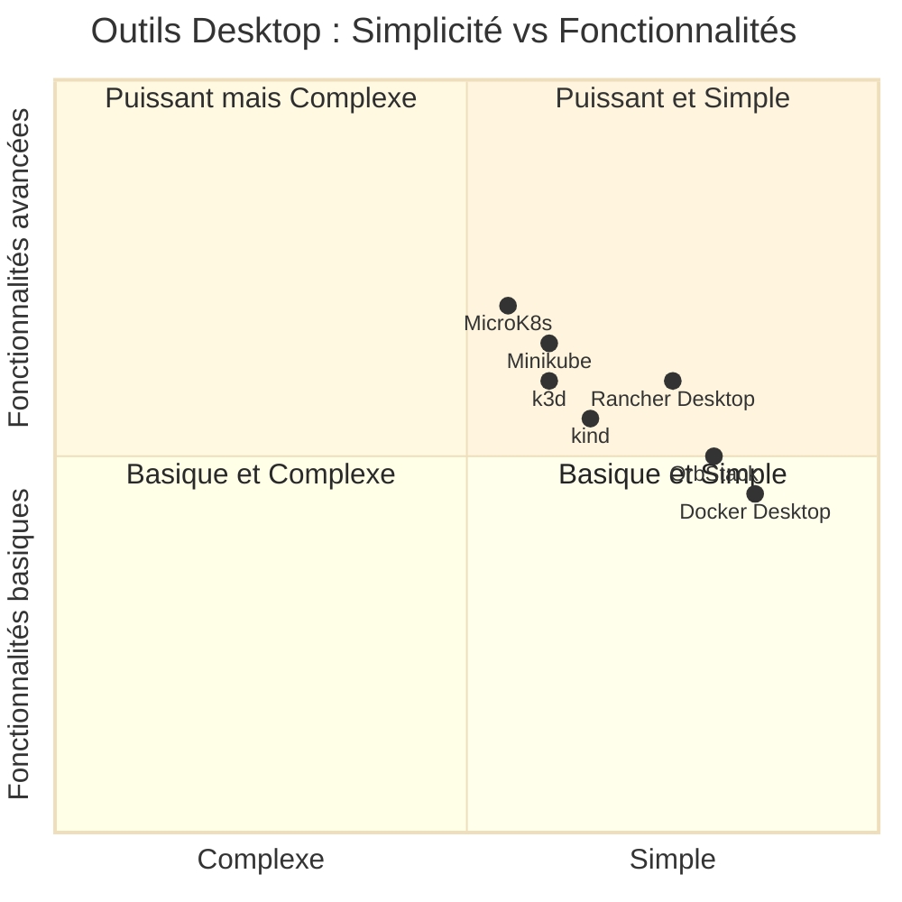

*Figure 24 — Positionnement des outils desktop*

---

### 1 — kind : Kubernetes IN Docker

#### Introduction

**kind** (Kubernetes IN Docker) crée des clusters Kubernetes en utilisant des conteneurs Docker comme "nœuds". C'est l'outil officiel de la communauté Kubernetes pour les tests d'intégration.

**Points forts :**
- Léger et rapide (cluster créé en ~1 minute)
- Multi-nœuds sur une seule machine
- Idéal pour CI/CD (GitHub Actions, GitLab CI)
- 100% open source

#### Système requis

| Composant | Minimum | Recommandé |
|-----------|---------|------------|
| OS | Linux / macOS / Windows | Linux |
| RAM | 4 Go | 8 Go |
| CPU | 2 cœurs | 4 cœurs |
| Docker | 20.10+ | Dernière version |
| kubectl | 1.27+ | Dernière version |

#### Installation et déploiement

**Étape 1 — Installer kind**

```bash
# Linux / macOS (ARM64 ou AMD64)
curl -Lo ./kind https://kind.sigs.k8s.io/dl/v0.22.0/kind-linux-amd64
chmod +x ./kind
sudo mv ./kind /usr/local/bin/kind

# macOS via Homebrew
brew install kind

# Windows via Chocolatey
choco install kind
```

**Étape 2 — Créer un cluster simple**

```bash
# Cluster mono-nœud (débutant)
kind create cluster --name mon-premier-cluster

# Vérifier le cluster
kubectl cluster-info --context kind-mon-premier-cluster
kubectl get nodes
```

**Étape 3 — Créer un cluster multi-nœuds**

```yaml
# fichier: kind-config-multinode.yaml
kind: Cluster
apiVersion: kind.x-k8s.io/v1alpha4
name: cluster-production-like
nodes:
- role: control-plane
  kubeadmConfigPatches:
  - |
    kind: InitConfiguration
    nodeRegistration:
      kubeletExtraArgs:
        node-labels: "ingress-ready=true"
  extraPortMappings:
  - containerPort: 80
    hostPort: 80
    protocol: TCP
  - containerPort: 443
    hostPort: 443
    protocol: TCP
- role: worker
  labels:
    zone: a
- role: worker
  labels:
    zone: b
- role: worker
  labels:
    zone: c
```

```bash
kind create cluster --config kind-config-multinode.yaml
kubectl get nodes
# NAME                              STATUS   ROLES           AGE
# cluster-production-like-control-plane   Ready    control-plane   2m
# cluster-production-like-worker          Ready    <none>          90s
# cluster-production-like-worker2         Ready    <none>          90s
# cluster-production-like-worker3         Ready    <none>          90s
```

**Étape 4 — Déployer une application de test**

```bash
# Déployer nginx
kubectl create deployment nginx --image=nginx:latest
kubectl expose deployment nginx --port=80 --type=NodePort

# Accéder à l'application
kubectl port-forward svc/nginx 8080:80
# Ouvrir http://localhost:8080
```

#### Aller plus loin

**Charger une image locale dans kind (sans registry)**

```bash
# Construire l'image localement
docker build -t mon-app:v1.0 .

# Charger dans kind (évite de pousser sur DockerHub)
kind load docker-image mon-app:v1.0 --name mon-premier-cluster

# Déployer
kubectl run mon-app --image=mon-app:v1.0 --image-pull-policy=Never
```

**Installer Ingress NGINX**

```bash
kubectl apply -f https://raw.githubusercontent.com/kubernetes/ingress-nginx/main/deploy/static/provider/kind/deploy.yaml
kubectl wait --namespace ingress-nginx \
  --for=condition=ready pod \
  --selector=app.kubernetes.io/component=controller \
  --timeout=90s
```

> **Cas d'usage Banque** — Utiliser kind en CI/CD pour tester l'API de paiement avant chaque déploiement en production :

```yaml
# .github/workflows/test-api-paiement.yml
name: Test API Paiement
on: [push, pull_request]
jobs:
  test-kubernetes:
    runs-on: ubuntu-latest
    steps:
    - uses: actions/checkout@v4
    - name: Installer kind
      uses: helm/kind-action@v1.9.0
      with:
        cluster_name: test-paiement
    - name: Déployer API paiement
      run: |
        kubectl apply -f k8s/api-paiement/
        kubectl wait --for=condition=ready pod -l app=api-paiement --timeout=60s
    - name: Exécuter tests d'intégration
      run: ./scripts/test-integration-paiement.sh
```

> **Cas d'usage Santé** — Tester le déploiement du dossier patient numérique en local avec données anonymisées :

```bash
kind create cluster --name test-dossier-patient --config kind-config-multinode.yaml
kubectl apply -f k8s/dossier-patient/
kubectl apply -f k8s/test-data/patients-anonymises.yaml
```

#### Avantages et inconvénients

| ✅ Avantages | ❌ Inconvénients |
|-------------|----------------|
| Très rapide à démarrer | Nécessite Docker |
| Multi-nœuds natif | Pas d'interface graphique |
| Idéal CI/CD | Performances limitées (conteneurs dans conteneurs) |
| Léger en ressources | Pas de LoadBalancer natif |
| Gratuit et open source | Réseau virtuel (pas d'accès direct aux nœuds) |

---

### 2 — MicroK8s

#### Introduction

**MicroK8s** est une distribution Kubernetes légère développée par Canonical (l'éditeur d'Ubuntu). Elle se distingue par son système d'**add-ons** qui permet d'activer des fonctionnalités (DNS, stockage, monitoring, Istio...) en une seule commande.

**Pourquoi MicroK8s ?**
- Installation en 5 minutes via snap
- Add-ons officiels (dashboard, prometheus, istio, knative...)
- Parfait pour Raspberry Pi (ARM64)
- Supporte les clusters multi-nœuds

#### Système requis

| Composant | Minimum | Recommandé |
|-----------|---------|------------|
| OS | Ubuntu 18.04+ / autres Linux | Ubuntu 22.04 LTS |
| RAM | 4 Go | 8 Go |
| CPU | 2 cœurs | 4 cœurs |
| Disque | 20 Go | 50 Go |

#### Installation

**Sur Ubuntu / Linux (via snap)**

```bash
# Installation
sudo snap install microk8s --classic --channel=1.29/stable

# Ajouter l'utilisateur au groupe microk8s
sudo usermod -a -G microk8s $USER
sudo chown -f -R $USER ~/.kube
newgrp microk8s

# Vérifier le statut
microk8s status --wait-ready
```

**Activer les add-ons essentiels**

```bash
# DNS (obligatoire pour la résolution des noms de service)
microk8s enable dns

# Tableau de bord
microk8s enable dashboard

# Stockage local
microk8s enable hostpath-storage

# Registre d'images local (utile pour développement)
microk8s enable registry

# Vérifier tous les add-ons
microk8s status
```

**Utiliser kubectl avec MicroK8s**

```bash
# Option 1 : utiliser microk8s kubectl
microk8s kubectl get nodes

# Option 2 : aliaser kubectl
alias kubectl='microk8s kubectl'

# Option 3 : exporter la config kubeconfig
microk8s config > ~/.kube/config
kubectl get nodes
```

**Accéder au Dashboard**

```bash
microk8s dashboard-proxy
# Ouvrir https://localhost:10443 et utiliser le token affiché
```

#### Aller plus loin

**Cluster multi-nœuds avec MicroK8s**

```bash
# Sur le nœud 1 (master)
microk8s add-node
# La commande affiche : microk8s join 192.168.1.10:25000/TOKEN

# Sur le nœud 2 (worker)
microk8s join 192.168.1.10:25000/TOKEN

# Vérifier
microk8s kubectl get nodes
```

**Activer le monitoring (Prometheus + Grafana)**

```bash
microk8s enable observability
# Accès Grafana
microk8s kubectl port-forward -n observability svc/kube-prom-stack-grafana 3000:80
# admin / prom-operator
```

> **Cas d'usage Éducation** — Déployer une plateforme e-learning (Moodle) sur MicroK8s dans un lycée :

```bash
# Activer les add-ons nécessaires
microk8s enable dns hostpath-storage ingress

# Déployer Moodle via Helm
microk8s enable helm3
microk8s helm3 repo add bitnami https://charts.bitnami.com/bitnami
microk8s helm3 install moodle bitnami/moodle \
  --set moodleUsername=admin \
  --set moodlePassword=MonMotDePasse \
  --set service.type=ClusterIP \
  --set ingress.enabled=true \
  --set ingress.hostname=moodle.lycee-local.fr

# Accès : http://moodle.lycee-local.fr
```

> **Cas d'usage Énergie** — Déployer un tableau de bord de supervision des compteurs Linky sur un serveur edge :

```bash
# MicroK8s sur Raspberry Pi 4 (ARM64) en sous-station électrique
sudo snap install microk8s --classic --channel=1.29/stable
microk8s enable dns hostpath-storage

# Déployer le collecteur de données Linky
kubectl apply -f - <<EOF
apiVersion: apps/v1
kind: Deployment
metadata:
  name: collecteur-linky
  namespace: energie
spec:
  replicas: 1
  selector:
    matchLabels:
      app: collecteur-linky
  template:
    metadata:
      labels:
        app: collecteur-linky
    spec:
      containers:
      - name: collecteur
        image: energie/collecteur-linky:v1.0
        env:
        - name: MQTT_BROKER
          value: "mqtt://192.168.1.100:1883"
        - name: INTERVALLE
          value: "15m"
EOF
```

#### Avantages et inconvénients

| ✅ Avantages | ❌ Inconvénients |
|-------------|----------------|
| Add-ons officiels en 1 commande | Principalement Ubuntu/Linux |
| Supporte ARM64 (Raspberry Pi) | Moins répandu que Minikube |
| Cluster multi-nœuds natif | snap parfois bloqué en entreprise |
| Mises à jour automatiques | Interface snap pas universelle |
| Parfait pour edge computing | |

---

### 3 — Docker Desktop

#### Introduction

**Docker Desktop** est l'outil de référence pour les développeurs sous Windows et macOS. Depuis la version 2.0, il intègre Kubernetes directement, ce qui en fait l'option la plus simple pour démarrer sur ces plateformes.

**À qui s'adresse-t-il ?**
- Développeurs Windows ou macOS
- Équipes qui utilisent déjà Docker Desktop
- Débutants souhaitant éviter la complexité réseau

#### Système requis

| Composant | Windows | macOS |
|-----------|---------|-------|
| OS | Windows 10/11 Pro/Enterprise | macOS 12+ |
| RAM | 4 Go (8 Go recommandé) | 4 Go (8 Go recommandé) |
| CPU | x86-64 avec virtualisation | Apple Silicon ou Intel |
| Espace | 10 Go | 10 Go |

#### Installation

**Windows**

```powershell
# Via Winget
winget install Docker.DockerDesktop

# Ou télécharger depuis docker.com/products/docker-desktop
```

**macOS**

```bash
# Via Homebrew
brew install --cask docker

# Ou télécharger depuis docker.com/products/docker-desktop
```

**Activer Kubernetes**

1. Ouvrir Docker Desktop
2. Aller dans **Settings → Kubernetes**
3. Cocher **Enable Kubernetes**
4. Cliquer **Apply & Restart**
5. Attendre que l'indicateur passe au vert

```bash
# Vérifier l'installation
kubectl config use-context docker-desktop
kubectl get nodes
# NAME             STATUS   ROLES           AGE   VERSION
# docker-desktop   Ready    control-plane   2m    v1.29.1
```

#### Aller plus loin

**Déployer l'application complète en local (banque)**

```yaml
# stack-banque-local.yaml
apiVersion: apps/v1
kind: Deployment
metadata:
  name: api-banque
spec:
  replicas: 2
  selector:
    matchLabels:
      app: api-banque
  template:
    metadata:
      labels:
        app: api-banque
    spec:
      containers:
      - name: api
        image: node:18-alpine
        command: ["node", "server.js"]
        ports:
        - containerPort: 3000
        env:
        - name: DB_HOST
          value: postgres-service
        - name: NODE_ENV
          value: development
---
apiVersion: v1
kind: Service
metadata:
  name: api-banque-service
spec:
  selector:
    app: api-banque
  ports:
  - port: 3000
    targetPort: 3000
  type: NodePort
```

```bash
kubectl apply -f stack-banque-local.yaml
kubectl get svc api-banque-service
# Accéder via http://localhost:NODE_PORT
```

> **Cas d'usage Assurance** — Développeur Windows testant l'API de souscription d'assurance auto :

```bash
# Le développeur a Docker Desktop avec K8s activé
kubectl apply -f k8s/assurance/souscription/
kubectl port-forward svc/souscription-api 8080:80
# Tests avec Postman sur http://localhost:8080/api/souscription
```

#### Avantages et inconvénients

| ✅ Avantages | ❌ Inconvénients |
|-------------|----------------|
| Interface graphique intuitive | Licence payante pour entreprises > 250 employés |
| Intégré à Docker | Mono-nœud uniquement |
| Idéal Windows/macOS | Consommation mémoire élevée |
| Mise à jour automatique | Kubernetes parfois instable après mise à jour |
| Aucune configuration réseau | Moins de flexibilité que les alternatives |

---

### 4 — Rancher Desktop

#### Introduction

**Rancher Desktop** est l'alternative open source et gratuite à Docker Desktop, développée par SUSE (Rancher). Il gère à la fois les conteneurs (via containerd ou dockerd) et Kubernetes (via k3s).

**Avantage clé :** 100% gratuit, même en entreprise.

#### Système requis

| Composant | Minimum |
|-----------|---------|
| OS | Windows 10/11, macOS 12+, Linux |
| RAM | 8 Go recommandé |
| CPU | x86-64 ou ARM64 (Apple Silicon) |

#### Installation et déploiement

```bash
# macOS
brew install --cask rancher

# Windows via Winget
winget install suse.rancherdesktop

# Linux : télécharger l'AppImage depuis rancherdesktop.io
```

**Premier démarrage**

1. Lancer Rancher Desktop
2. Choisir la version Kubernetes (ex: 1.29.x)
3. Choisir le runtime : **containerd** (recommandé) ou dockerd
4. Attendre l'initialisation (~2-3 minutes)

```bash
kubectl get nodes
# NAME                   STATUS   ROLES                  AGE   VERSION
# rancher-desktop        Ready    control-plane,master   3m    v1.29.4+k3s1

# nerdctl remplace docker avec containerd
nerdctl run -d -p 8080:80 nginx
nerdctl ps
```

#### Aller plus loin

```bash
# Installer Helm (gestionnaire de paquets Kubernetes)
# Rancher Desktop inclut Helm
helm repo add stable https://charts.helm.sh/stable
helm repo update

# Exemple : déployer une base de données PostgreSQL
helm install postgres bitnami/postgresql \
  --set auth.postgresPassword=secret \
  --set primary.persistence.size=5Gi
```

> **Cas d'usage Transport** — Développeur d'une startup de covoiturage testant le backend de matching conducteur-passager :

```bash
# Rancher Desktop offre Kubernetes gratuit pour toute l'équipe
kubectl apply -f k8s/transport/matching-service/
kubectl apply -f k8s/transport/notification-service/
kubectl port-forward svc/matching-api 8080:80
# Test des algorithmes de matching localement
```

#### Avantages et inconvénients

| ✅ Avantages | ❌ Inconvénients |
|-------------|----------------|
| 100% gratuit (Apache 2.0) | Interface moins polie que Docker Desktop |
| Supporte Windows/macOS/Linux | Consomme des ressources |
| Runtime configurable | k3s (pas Kubernetes vanilla) |
| Inclut Helm, kubectl, nerdctl | Documentation moins abondante |

---

### 5 — OrbStack

#### Introduction

**OrbStack** est un outil macOS uniquement qui se positionne comme l'alternative ultra-rapide à Docker Desktop. Il utilise une machine virtuelle légère et optimisée pour Apple Silicon.

**Point fort majeur :** Démarrage en 2 secondes, consommation mémoire divisée par 3 par rapport à Docker Desktop.

#### Système requis

| Composant | Requis |
|-----------|--------|
| OS | macOS 12 Monterey+ |
| Processeur | Apple Silicon (M1/M2/M3) ou Intel |
| RAM | 4 Go minimum |

#### Installation

```bash
brew install orbstack
# ou télécharger sur orbstack.dev
```

**Démarrer Kubernetes**

```bash
# Activer Kubernetes dans OrbStack
# Settings → Kubernetes → Enable

kubectl config use-context orbstack
kubectl get nodes
# NAME       STATUS   ROLES           AGE   VERSION
# orbstack   Ready    control-plane   30s   v1.29.2
```

#### Aller plus loin

```bash
# OrbStack permet de mapper les services directement
# Pas besoin de port-forward !
kubectl apply -f mon-app.yaml

# Le service est accessible via son nom DNS automatiquement
# http://mon-service.default.svc.cluster.local (depuis la machine host macOS)
```

> **Cas d'usage Santé** — Développeur macOS (Apple M2) développant une application de téléconsultation :

```bash
# OrbStack consomme 800 Mo vs 4 Go pour Docker Desktop
# Idéal pour les développeurs avec des laptops à batterie limitée

kubectl apply -f k8s/teleconsultation/
# L'API est directement accessible sans port-forward
curl http://teleconsultation-api.default.svc.cluster.local/api/v1/status
```

#### Avantages et inconvénients

| ✅ Avantages | ❌ Inconvénients |
|-------------|----------------|
| Ultra-rapide (2s de démarrage) | macOS uniquement |
| Faible consommation mémoire | Payant après période d'essai |
| Réseau transparent (pas de port-forward) | Moins mature que les alternatives |
| Excellent pour Apple Silicon | Kubernetes via k3s |

---

### 6 — Minikube (exemple avec Hyper-V)

#### Introduction

**Minikube** est l'outil officiel de la communauté Kubernetes pour les environnements de développement locaux. Il supporte de nombreux "drivers" (VirtualBox, Hyper-V, Docker, KVM...) et est le plus documenté de tous les outils desktop.

#### Système requis

| Composant | Minimum |
|-----------|---------|
| OS | Linux, macOS, Windows |
| RAM | 2 Go (4 Go recommandé) |
| CPU | 2 cœurs |
| Hyperviseur | VirtualBox / Hyper-V / KVM / Docker |

#### Installation

**Windows avec Hyper-V**

```powershell
# Activer Hyper-V (PowerShell administrateur)
Enable-WindowsOptionalFeature -Online -FeatureName Microsoft-Hyper-V -All

# Installer Minikube via Winget
winget install Kubernetes.minikube

# Démarrer avec le driver Hyper-V
minikube start --driver=hyperv --memory=4096 --cpus=2
```

**Linux**

```bash
curl -LO https://storage.googleapis.com/minikube/releases/latest/minikube-linux-amd64
sudo install minikube-linux-amd64 /usr/local/bin/minikube

# Avec Docker (pas besoin de VM)
minikube start --driver=docker

# Avec KVM
minikube start --driver=kvm2 --memory=4096
```

**macOS**

```bash
brew install minikube

# Apple Silicon
minikube start --driver=docker

# Intel avec VirtualBox
minikube start --driver=virtualbox
```

#### Aller plus loin

```bash
# Add-ons Minikube
minikube addons list
minikube addons enable ingress
minikube addons enable dashboard
minikube addons enable metrics-server

# Accéder au dashboard
minikube dashboard

# Tunnel LoadBalancer (pour tester les services LoadBalancer)
minikube tunnel

# Accéder à un service facilement
minikube service mon-service --url

# Profils multiples (plusieurs clusters)
minikube start -p cluster-dev --memory=4096
minikube start -p cluster-test --memory=2048
minikube profile list
kubectl config use-context cluster-dev
```

```bash
# Déployer le Metrics Server pour HPA
minikube addons enable metrics-server

# Tester l'auto-scaling (utile pour simuler le trafic bancaire)
kubectl apply -f - <<EOF
apiVersion: autoscaling/v2
kind: HorizontalPodAutoscaler
metadata:
  name: api-paiement-hpa
spec:
  scaleTargetRef:
    apiVersion: apps/v1
    kind: Deployment
    name: api-paiement
  minReplicas: 2
  maxReplicas: 10
  metrics:
  - type: Resource
    resource:
      name: cpu
      target:
        type: Utilization
        averageUtilization: 70
EOF
```

> **Cas d'usage Banque** — Tester l'auto-scaling de l'API de virement bancaire sous charge :

```bash
minikube start --memory=8192 --cpus=4
minikube addons enable metrics-server

kubectl apply -f k8s/banque/api-virement/
kubectl apply -f k8s/banque/hpa-virement.yaml

# Simuler la charge (pic lundi matin)
kubectl run load-generator --image=busybox --restart=Never -- \
  sh -c "while true; do wget -q -O- http://api-virement/api/virements; done"

# Observer le scaling
kubectl get hpa api-virement-hpa --watch
```

#### Avantages et inconvénients

| ✅ Avantages | ❌ Inconvénients |
|-------------|----------------|
| Très documenté (communauté Kubernetes) | Plus lent à démarrer |
| Multi-drivers (VirtualBox, KVM, Docker...) | Ressources VM overhead |
| Add-ons officiels nombreux | Config réseau parfois complexe |
| HPA, Dashboard, Ingress intégrés | Mono-nœud par défaut |
| Multi-profils | |

---

### 7 — k3d

#### Introduction

**k3d** fait fonctionner **k3s** (la distribution Kubernetes légère de Rancher) dans des conteneurs Docker. C'est l'outil parfait pour créer rapidement des clusters multi-nœuds pour les tests et le développement.

**Différence avec kind :** k3d utilise k3s (plus léger), kind utilise Kubernetes vanilla.

#### Système requis

| Composant | Requis |
|-----------|--------|
| Docker | 20.10+ |
| kubectl | Toute version récente |
| OS | Linux / macOS / Windows |

#### Installation

```bash
# Linux / macOS
curl -s https://raw.githubusercontent.com/k3d-io/k3d/main/install.sh | bash

# macOS via Homebrew
brew install k3d

# Windows via Chocolatey
choco install k3d
```

**Créer un cluster**

```bash
# Cluster simple
k3d cluster create mon-cluster

# Cluster multi-nœuds avec load balancer exposé
k3d cluster create prod-like \
  --servers 1 \
  --agents 3 \
  --port "8080:80@loadbalancer" \
  --port "8443:443@loadbalancer" \
  --wait

kubectl get nodes
# NAME                       STATUS   ROLES                  AGE
# k3d-prod-like-server-0     Ready    control-plane,master   2m
# k3d-prod-like-agent-0      Ready    <none>                 90s
# k3d-prod-like-agent-1      Ready    <none>                 90s
# k3d-prod-like-agent-2      Ready    <none>                 90s
```

#### Aller plus loin

```bash
# Créer un registre local et le connecter au cluster
k3d registry create mon-registry --port 5000
k3d cluster create mon-cluster --registry-use k3d-mon-registry:5000

# Pousser une image locale
docker build -t mon-app:v1 .
docker tag mon-app:v1 k3d-mon-registry:5000/mon-app:v1
docker push k3d-mon-registry:5000/mon-app:v1

# Utiliser dans un pod
kubectl run mon-app --image=k3d-mon-registry:5000/mon-app:v1
```

```yaml
# config k3d avec registre et Traefik activé
apiVersion: k3d.io/v1alpha5
kind: Simple
metadata:
  name: cluster-transport
servers: 1
agents: 2
ports:
- port: "80:80"
  nodeFilters:
  - loadbalancer
registries:
  use:
  - k3d-mon-registry:5000
options:
  k3s:
    extraArgs:
    - arg: --disable=traefik
      nodeFilters:
      - server:*
```

> **Cas d'usage Transport** — Tester le système de suivi de flotte de bus en local :

```bash
k3d cluster create flotte-bus \
  --servers 1 --agents 2 \
  --port "8080:80@loadbalancer"

kubectl apply -f k8s/transport/suivi-flotte/
kubectl apply -f k8s/transport/mqtt-broker/
kubectl apply -f k8s/transport/api-positions/

# Simuler 50 bus envoyant des positions
kubectl run simulateur --image=transport/simulateur-gps:v1 \
  --env="NB_BUS=50" \
  --env="MQTT_HOST=mqtt-broker"

kubectl logs simulateur -f
```

> **Cas d'usage Éducation** — CI/CD pour tester la plateforme d'examens en ligne :

```yaml
# .gitlab-ci.yml
test:
  image: docker:24
  services:
  - docker:dind
  script:
  - apk add curl
  - curl -s https://raw.githubusercontent.com/k3d-io/k3d/main/install.sh | bash
  - k3d cluster create test-examens --agents 2
  - kubectl apply -f k8s/examens/
  - kubectl wait --for=condition=ready pod -l app=plateforme-examens --timeout=120s
  - ./scripts/test-examens-integration.sh
  after_script:
  - k3d cluster delete test-examens
```

#### Avantages et inconvénients

| ✅ Avantages | ❌ Inconvénients |
|-------------|----------------|
| Multi-nœuds très rapide | k3s ≠ Kubernetes vanilla |
| Registre local intégré | Nécessite Docker |
| Excellent pour CI/CD | Moins de fonctionnalités que Minikube |
| Port mapping simple | Réseau virtuel (pas d'accès IP directe) |
| Léger (k3s) | |

---

### 8 — Lima VM (exemple avec Podman Desktop)

#### Introduction

**Lima** (Linux Machines) est un gestionnaire de machines virtuelles pour macOS qui lance des VMs Linux légères. Associé à **Podman Desktop**, il offre une alternative complète sans Docker daemon.

**Cas d'usage :** Environnements où Docker n'est pas autorisé (certaines banques et hôpitaux imposent Podman pour des raisons de licence et de sécurité).

#### Système requis

| Composant | Requis |
|-----------|--------|
| OS | macOS 12+ |
| CPU | Apple Silicon ou Intel |
| RAM | 4 Go minimum |

#### Installation de Lima VM

```bash
# Via Homebrew
brew install lima

# Créer une VM avec Kubernetes (k3s)
limactl start --name k8s template://k8s

# Vérifier
limactl list
# NAME   STATUS    SSH    VMTYPE    ARCH      CPUS   MEMORY    DISK
# k8s    Running   22     qemu      aarch64   4      4GiB      100GiB
```

#### Déploiement d'un template Kubernetes

```bash
# Se connecter à la VM
limactl shell k8s

# Dans la VM Lima
kubectl get nodes

# Exporter la config pour l'utiliser depuis macOS
limactl copy k8s:/etc/rancher/k3s/k3s.yaml ~/.kube/config
# Modifier l'IP dans le fichier config
sed -i '' 's/127.0.0.1/$(limactl list k8s --format json | jq -r .[0].hostAgentIP)/' ~/.kube/config
```

#### Installation de Podman Desktop

```bash
brew install podman-desktop
```

1. Ouvrir Podman Desktop
2. Aller dans **Settings → Resources**
3. Sélectionner **Lima** comme fournisseur
4. Activer Kubernetes via le template k8s

#### Aller plus loin

```bash
# Podman comme alternative à Docker
podman run -d -p 8080:80 nginx
podman ps

# Générer un manifeste Kubernetes depuis un pod Podman
podman generate kube mon-conteneur > mon-app.yaml
kubectl apply -f mon-app.yaml
```

> **Cas d'usage Banque** — Environnement de développement sans Docker (contrainte politique de sécurité) :

```bash
# La banque interdit Docker Desktop (licence + daemon root)
# Lima + Podman Desktop : solution rootless

limactl start --name k8s-banque template://k8s
limactl shell k8s-banque -- kubectl apply -f k8s/banque/
# Pas de daemon Docker, sécurité renforcée
```

#### Avantages et inconvénients

| ✅ Avantages | ❌ Inconvénients |
|-------------|----------------|
| Sans Docker daemon (rootless) | macOS uniquement |
| Sécurité renforcée | Configuration plus complexe |
| Compatible politiques entreprise | Moins de ressources communautaires |
| Gratuit et open source | Interface moins intuitive |

---

### 9 — Canonical Kubernetes (exemple avec LXD)

#### Introduction

**Canonical Kubernetes** (anciennement Charmed Kubernetes) est la distribution enterprise de Canonical, intégrant les outils Ubuntu et LXD. Elle est particulièrement adaptée aux déploiements on-premise dans des secteurs réglementés (banque, santé, énergie).

#### Système requis

| Composant | Requis |
|-----------|--------|
| OS | Ubuntu 22.04 LTS |
| RAM | 16 Go (pour LXD + K8s) |
| CPU | 4 cœurs |
| Disque | 40 Go |

#### Installation

```bash
# Installer LXD
sudo snap install lxd
sudo lxd init --auto

# Installer Canonical Kubernetes
sudo snap install k8s --classic --channel=1.29/stable

# Bootstrapper le cluster
sudo k8s bootstrap

# Activer les fonctionnalités
sudo k8s enable dns
sudo k8s enable load-balancer
sudo k8s enable local-storage
```

#### Configuration

```bash
# Obtenir le kubeconfig
sudo k8s config > ~/.kube/config
kubectl get nodes

# Créer des conteneurs LXD comme worker nodes
lxc launch ubuntu:22.04 worker-1 --profile k8s-worker
lxc launch ubuntu:22.04 worker-2 --profile k8s-worker

# Joindre les workers au cluster
sudo k8s get-join-token worker-1 > token-worker-1.txt
lxc exec worker-1 -- k8s join-cluster $(cat token-worker-1.txt)
```

> **Cas d'usage Santé** — Cluster Kubernetes on-premise pour stocker les données patients (hébergement HDS) :

```bash
# LXD + Canonical K8s sur serveurs physiques dans un datacenter certifié HDS
sudo k8s bootstrap --config - <<EOF
cluster-config:
  network:
    enabled: true
  dns:
    enabled: true
  local-storage:
    enabled: true
    local-path: /data/hds/kubernetes
EOF

# Appliquer les politiques de sécurité HDS
kubectl apply -f k8s/sante/policies/pod-security-policy-hds.yaml
kubectl apply -f k8s/sante/policies/network-policy-isolation.yaml
```

#### Avantages et inconvénients

| ✅ Avantages | ❌ Inconvénients |
|-------------|----------------|
| Intégration Ubuntu native | Ubuntu/Linux uniquement |
| Support enterprise Canonical | Courbe d'apprentissage LXD |
| Excellent pour on-premise | Plus complexe que les alternatives |
| Conforme normes enterprise | |

---

### 10 — desktop-kubernetes

#### Introduction

**desktop-kubernetes** est un projet open source qui automatise l'installation de Kubernetes sur une machine locale en utilisant des scripts et des outils préassemblés. Il simplifie la mise en place d'un environnement de développement complet.

#### Système requis

```
OS : Linux (Ubuntu/Debian préféré)
RAM : 8 Go
CPU : 4 cœurs
```

#### Installation

```bash
# Cloner le projet
git clone https://github.com/unfor19/desktop-kubernetes
cd desktop-kubernetes

# Installation automatisée
make install

# Vérifier
kubectl get nodes
```

> **Cas d'usage Éducation** — Mise en place d'un environnement de TP Kubernetes pour étudiants en informatique :

```bash
# Script déployé sur les PCs de la salle informatique
git clone https://github.com/unfor19/desktop-kubernetes
cd desktop-kubernetes && make install

# Les étudiants disposent d'un K8s opérationnel en 5 minutes
kubectl apply -f tp-kubernetes/exercice-01-premiers-pods.yaml
```

#### Avantages et inconvénients

| ✅ Avantages | ❌ Inconvénients |
|-------------|----------------|
| Installation automatisée | Projet moins maintenu |
| Prêt à l'emploi | Linux uniquement |
| Gratuit | Moins flexible |

---

### 11 — vagrant-alvistack

#### Introduction

**vagrant-alvistack** utilise **Vagrant** pour créer des machines virtuelles avec Kubernetes préinstallé via les Vagrantfiles d'Alvistack. C'est idéal pour reproduire fidèlement un environnement de production.

#### Système requis

```
Vagrant : 2.3+
VirtualBox ou libvirt
RAM : 8 Go
```

#### Installation

```bash
# Installer Vagrant
wget https://releases.hashicorp.com/vagrant/2.4.1/vagrant_2.4.1_linux_amd64.deb
sudo dpkg -i vagrant_2.4.1_linux_amd64.deb

# Cloner alvistack
git clone https://github.com/alvistack/vagrant-kubernetes
cd vagrant-kubernetes

# Démarrer le cluster (VirtualBox)
vagrant up

# Accéder
vagrant ssh k8s-master -- kubectl get nodes
```

> **Cas d'usage Énergie** — Reproduire l'environnement de production d'une centrale avant déploiement :

```ruby
# Vagrantfile pour simuler l'infrastructure d'une centrale électrique
Vagrant.configure("2") do |config|
  config.vm.define "master" do |master|
    master.vm.box = "alvistack/ubuntu-22.04"
    master.vm.network "private_network", ip: "192.168.50.10"
    master.vm.provider "virtualbox" do |vb|
      vb.memory = "4096"
      vb.cpus = 2
    end
  end
  
  (1..2).each do |i|
    config.vm.define "worker-#{i}" do |worker|
      worker.vm.box = "alvistack/ubuntu-22.04"
      worker.vm.network "private_network", ip: "192.168.50.#{10+i}"
    end
  end
end
```

#### Avantages et inconvénients

| ✅ Avantages | ❌ Inconvénients |
|-------------|----------------|
| Reproduit fidèlement la production | Lent (VMs complètes) |
| Multi-nœuds réels | Ressources importantes |
| Reproductible via code | Vagrant moins utilisé aujourd'hui |
| Support multi-providers | |

---

### 12 — KubeFire

#### Introduction

**KubeFire** utilise **Firecracker** (les micro-VMs d'AWS) pour créer des clusters Kubernetes ultra-légers et rapides. Il déploie des clusters k0s dans des micro-VMs Firecracker sur Linux.

#### Système requis

```
OS : Linux (x86-64)
CPU : avec support KVM
RAM : 4 Go
```

#### Installation

```bash
# Installer KubeFire
curl -Lo kubefire https://github.com/innobead/kubefire/releases/latest/download/kubefire-linux-amd64
chmod +x kubefire && sudo mv kubefire /usr/local/bin/

# Initialisation (installe Firecracker et les dépendances)
sudo kubefire init
```

#### Déploiement d'un cluster k0s

```bash
# Créer un cluster k0s dans des micro-VMs Firecracker
kubefire create cluster mon-cluster \
  --bootstrapper k0s \
  --master-count 1 \
  --worker-count 2

# Obtenir le kubeconfig
kubefire use cluster mon-cluster
kubectl get nodes
```

> **Cas d'usage Banque** — Tests de performance des microservices bancaires dans des environnements isolés :

```bash
# Chaque pipeline de test démarre son propre micro-cluster en < 30s
kubefire create cluster test-paiement-${CI_JOB_ID} \
  --bootstrapper k0s --master-count 1 --worker-count 2

kubefire use cluster test-paiement-${CI_JOB_ID}
kubectl apply -f k8s/tests/paiement/

# Tests, puis nettoyage
kubefire delete cluster test-paiement-${CI_JOB_ID}
```

#### Avantages et inconvénients

| ✅ Avantages | ❌ Inconvénients |
|-------------|----------------|
| Micro-VMs ultra-rapides | Linux x86-64 uniquement |
| Isolation forte (Firecracker) | Nécessite KVM |
| Démarrage < 30 secondes | Moins mature |
| Sécurité renforcée | Moins de documentation |

---

### 13 — crc (CodeReady Containers)

#### Introduction

**crc** (CodeReady Containers) est l'outil de Red Hat pour exécuter **OpenShift** (la distribution K8s enterprise de Red Hat) localement. Il démarre une VM préfigurée avec OpenShift 4.x.

**À qui s'adresse-t-il ?** Aux équipes qui utilisent OpenShift en production et souhaitent développer localement.

#### Système requis

| Composant | Requis |
|-----------|--------|
| OS | Windows 10/11, macOS, Linux |
| RAM | **16 Go minimum** (OpenShift est gourmand) |
| CPU | 4 cœurs |
| Disque | 35 Go |

#### Installation

```bash
# Télécharger depuis console.redhat.com/openshift/create/local
# (compte Red Hat gratuit requis)

# Linux
tar xvf crc-linux-amd64.tar.xz
sudo mv crc-linux-*/crc /usr/local/bin/

# Configurer
crc setup
crc config set memory 16384
crc config set cpus 4

# Démarrer
crc start
```

#### Déploiement

```bash
# Se connecter à OpenShift
eval $(crc oc-env)
oc login -u developer -p developer https://api.crc.testing:6443

# Interface web OpenShift
crc console
# Ouvrir https://console-openshift-console.apps-crc.testing

# Utiliser kubectl ou oc
oc new-project banque-app
oc new-app --image=nginx:latest --name=portail-banque
oc expose svc/portail-banque
oc get route portail-banque
```

> **Cas d'usage Banque** — Développeur testant l'application OpenShift avant déploiement en production sur RHOCP (Red Hat OpenShift Container Platform) :

```bash
# L'équipe utilise OpenShift en production
crc start

oc new-project scoring-credit
oc apply -f k8s/banque/scoring-credit/

# OpenShift build depuis le code source (Source-to-Image)
oc new-app python~https://github.com/banque/scoring-credit.git \
  --name=scoring-api \
  --env=MODEL_VERSION=v3.2

oc logs -f bc/scoring-api
oc get route scoring-api
```

#### Avantages et inconvénients

| ✅ Avantages | ❌ Inconvénients |
|-------------|----------------|
| OpenShift complet en local | 16 Go RAM minimum |
| Interface web très complète | Compte Red Hat requis |
| S2I (Source-to-Image) | Lourd pour un laptop |
| Compatible prod OpenShift | Démarrage lent (5-10 min) |

---

### Conclusion et avis sur les outils Desktop

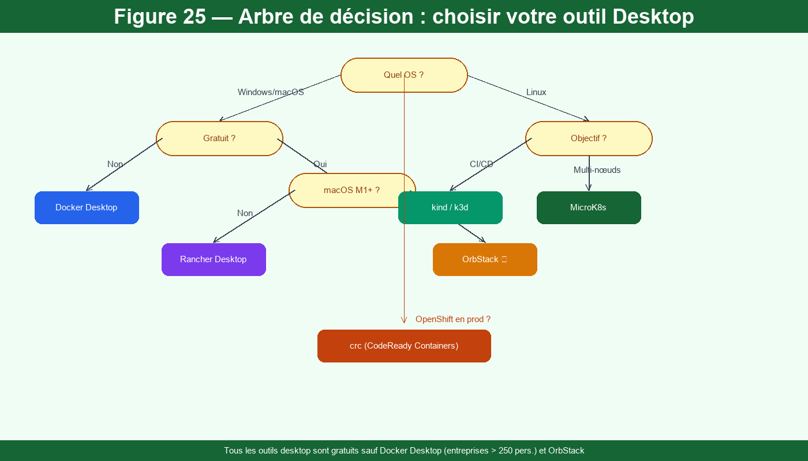

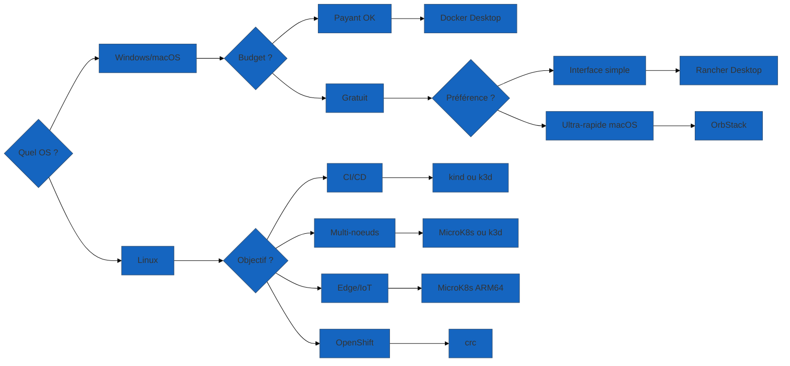

*Figure 25 — Arbre de décision pour choisir un outil desktop*

| Outil | OS | Multi-nœuds | CI/CD | Gratuit | Niveau |
|-------|-----|-------------|-------|---------|--------|
| kind | Tous | ✅ | ✅✅ | ✅ | Intermédiaire |
| MicroK8s | Linux | ✅ | ✅ | ✅ | Débutant |
| Docker Desktop | Win/Mac | ❌ | ✅ | ⚠️ | Débutant |
| Rancher Desktop | Tous | ❌ | ✅ | ✅ | Débutant |
| OrbStack | macOS | ❌ | ✅ | ⚠️ | Débutant |
| Minikube | Tous | ❌ | ✅ | ✅ | Intermédiaire |
| k3d | Tous | ✅ | ✅✅ | ✅ | Intermédiaire |
| crc | Tous | ❌ | ❌ | ✅* | Avancé |

*⚠️ Payant pour entreprises > 250 personnes — * compte Red Hat gratuit requis*

---

## CHAPITRE 2 — Offres Managées

> **Objectif :** Utiliser Kubernetes sans gérer le Control Plane. Le fournisseur cloud s'occupe des mises à jour, de la haute disponibilité et de la sécurité du plan de contrôle.

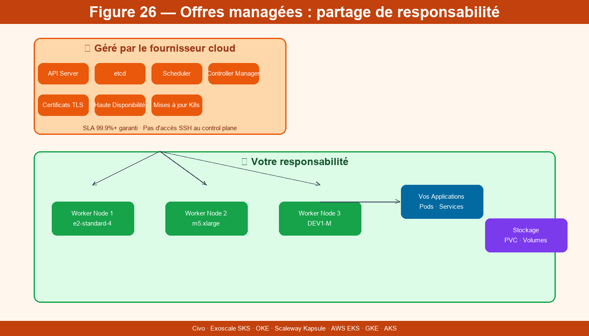

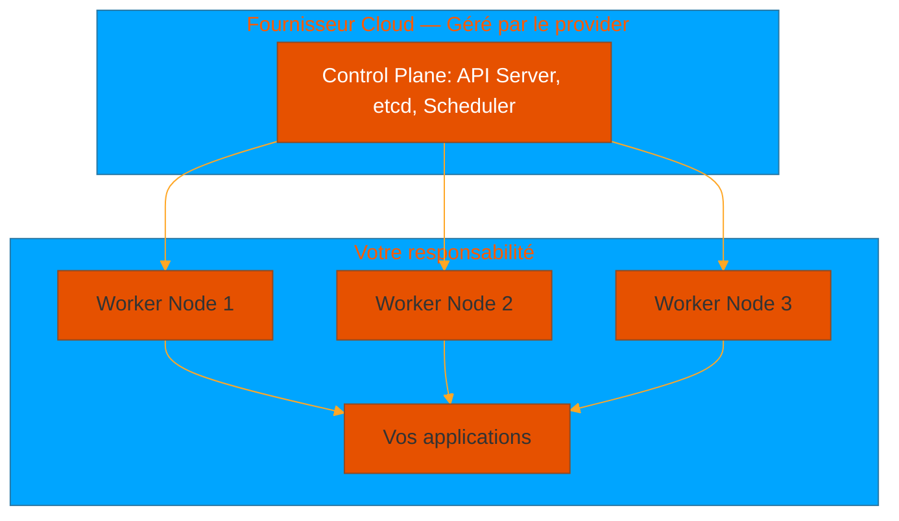

*Figure 26 — Partage de responsabilité dans une offre managée*

---

### 14 — Civo (exemple avec console web)

#### Introduction

**Civo** est un fournisseur cloud spécialisé Kubernetes, offrant des clusters K3s managés à des prix compétitifs. Cluster opérationnel en **90 secondes** — le plus rapide du marché.

**Points forts :**
- Déploiement en 90 secondes
- Tarification prévisible et pas de surprise
- Marketplace d'applications en 1 clic

#### Système requis

- Compte Civo (civo.com) — crédit gratuit de 250$ à l'inscription
- kubectl installé localement

#### Déploiement via console web

1. Se connecter sur **app.civo.com**
2. Cliquer **Kubernetes → Create a cluster**
3. Remplir le formulaire : Nom, Region FRA1 (Frankfurt), 3 nœuds Medium
4. Cliquer **Create cluster** → Cluster prêt en 90 secondes

```bash
# Télécharger kubeconfig depuis la console
export KUBECONFIG=~/Downloads/civo-cluster-kubeconfig
kubectl get nodes
# NAME                          STATUS   ROLES    VERSION
# k3s-cluster-worker-1          Ready    none     v1.29.4+k3s1
# k3s-cluster-worker-2          Ready    none     v1.29.4+k3s1
# k3s-cluster-worker-3          Ready    none     v1.29.4+k3s1
```

```bash
# Via CLI Civo
curl -sL https://civo.com/get | sh

civo kubernetes create cluster-education-dev \
  --size g4s.kube.medium \
  --nodes 3 \
  --region FRA1 \
  --version 1.29 \
  --wait

civo kubernetes config cluster-education-dev > ~/.kube/civo-config
kubectl get nodes
```

#### Aller plus loin

```bash
# Installer Helm et déployer Moodle
helm repo add bitnami https://charts.bitnami.com/bitnami
helm install moodle bitnami/moodle \
  --set moodleUsername=admin \
  --set moodlePassword=MonMotDePasse \
  --set ingress.enabled=true \
  --set ingress.hostname=cours.universite.fr
```

> **Cas d'usage Transport** — Backend de covoiturage déployé sur Civo en 5 minutes :

```bash
civo kubernetes create cluster-covoiturage --nodes 3 --region FRA1 --wait
civo kubernetes config cluster-covoiturage > ~/.kube/civo-config
export KUBECONFIG=~/.kube/civo-config
kubectl apply -f k8s/transport/covoiturage/
kubectl get pods -n transport
```

> **Cas d'usage Éducation** — Plateforme e-learning pour une université :

```yaml
apiVersion: apps/v1
kind: Deployment
metadata:
  name: plateforme-cours
  namespace: education
spec:
  replicas: 3
  selector:
    matchLabels:
      app: plateforme-cours
  template:
    metadata:
      labels:
        app: plateforme-cours
    spec:
      containers:
      - name: moodle
        image: bitnami/moodle:4.3
        env:
        - name: MOODLE_SITE_NAME
          value: "Universite Numerique"
        resources:
          requests:
            memory: "512Mi"
            cpu: "500m"
          limits:
            memory: "1Gi"
            cpu: "1000m"
```

#### Avantages et inconvénients

| Avantages | Inconvénients |
|-----------|--------------|
| Le plus rapide (90s) | k3s uniquement (pas K8s vanilla) |
| Prix très compétitifs | Moins de régions que AWS/GCP |
| Interface simple et claire | Support limité |
| Marketplace intégrée | |

---

### 15 — Exoscale SKS (exemple avec CLI)

#### Introduction

**Exoscale SKS** (Scalable Kubernetes Service) est une offre managée européenne, conforme RGPD, hébergée en Suisse, Allemagne, Autriche et Bulgarie. Idéal pour les secteurs réglementés.

#### Système requis

```bash
curl -fsSL https://raw.githubusercontent.com/exoscale/cli/master/install-latest.sh | sh
exo config add
```

#### Déploiement

```bash
exo compute sks create cluster-banque-prod \
  --zone ch-gva-2 \
  --version 1.29.4 \
  --nodepool-name workers \
  --nodepool-size 3 \
  --nodepool-instance-type "standard.large"

exo compute sks kubeconfig cluster-banque-prod admin \
  --zone ch-gva-2 > ~/.kube/exoscale-banque.yaml

export KUBECONFIG=~/.kube/exoscale-banque.yaml
kubectl get nodes
```

#### Aller plus loin

```bash
# Autoscaling du nodepool
exo compute sks nodepool update cluster-banque-prod workers \
  --zone ch-gva-2 \
  --size 5

# Installer le Cluster Autoscaler Exoscale
kubectl apply -f https://raw.githubusercontent.com/exoscale/exoscale-cloud-controller-manager/master/manifest/cloud-controller-manager.yaml
```

> **Cas d'usage Banque** — Scoring crédit sur infrastructure suisse (conformité réglementaire) :

```bash
exo compute sks create cluster-scoring \
  --zone ch-gva-2 \
  --nodepool-size 5

kubectl apply -f k8s/banque/scoring-credit/
kubectl apply -f k8s/banque/scoring-credit/hpa.yaml
```

> **Cas d'usage Assurance** — API de tarification avec isolation réseau :

```yaml
apiVersion: networking.k8s.io/v1
kind: NetworkPolicy
metadata:
  name: isolation-tarification
  namespace: assurance
spec:
  podSelector:
    matchLabels:
      app: tarification-api
  ingress:
  - from:
    - namespaceSelector:
        matchLabels:
          name: assurance
    ports:
    - port: 8080
  egress:
  - to:
    - podSelector:
        matchLabels:
          app: base-donnees
    ports:
    - port: 5432
```

#### Avantages et inconvénients

| Avantages | Inconvénients |
|-----------|--------------|
| Hébergement 100% européen | Moins connu que AWS/Azure |
| Conformité RGPD native | Moins de régions |
| Prix transparents | Interface web moins aboutie |
| Support enterprise disponible | |

---

### 16 — OKE (exemple avec instances ARM64)

#### Introduction

**OKE** (Oracle Kubernetes Engine) propose des instances **ARM64 Ampere A1** dans son tier Always Free : jusqu'à 4 vCPU et 24 Go RAM sans facturation. Rapport performance/coût imbattable.

#### Système requis

```bash
bash -c "$(curl -L https://raw.githubusercontent.com/oracle/oci-cli/master/scripts/install/install.sh)"
oci setup config
```

#### Déploiement

```bash
# Via console OCI : Container Engine for Kubernetes
# Shape : VM.Standard.A1.Flex (ARM64 - Gratuit)
# OCPU : 2, RAM : 12 Go, Noeuds : 3

oci ce cluster create-kubeconfig \
  --cluster-id ocid1.cluster.oc1..xxx \
  --file ~/.kube/oke-config \
  --region eu-frankfurt-1

export KUBECONFIG=~/.kube/oke-config
kubectl get nodes
# NAME       STATUS   ARCH
# 10.0.10.x  Ready    arm64
```

```yaml
# Cibler les noeuds ARM64 dans les déploiements
apiVersion: apps/v1
kind: Deployment
metadata:
  name: api-sante
spec:
  replicas: 3
  selector:
    matchLabels:
      app: api-sante
  template:
    spec:
      nodeSelector:
        kubernetes.io/arch: arm64
      containers:
      - name: api
        image: sante/api-dossier-patient:v2.1-arm64
        ports:
        - containerPort: 8080
```

#### Aller plus loin

```yaml
# CronJob traitement de données sur ARM64
apiVersion: batch/v1
kind: CronJob
metadata:
  name: traitement-compteurs
  namespace: energie
spec:
  schedule: "*/15 * * * *"
  jobTemplate:
    spec:
      template:
        spec:
          nodeSelector:
            kubernetes.io/arch: arm64
          containers:
          - name: traitement
            image: energie/traitement-compteurs:v1.0-arm64
            env:
            - name: REGION
              value: "IDF"
          restartPolicy: OnFailure
```

> **Cas d'usage Santé** — Dossier patient sur ARM64 : coût divisé par 3 :

```
OKE ARM64 : 0.01$/h par OCPU vs 0.031$/h pour x86
10 OCPU production = économie ~1500$/mois
```

> **Cas d'usage Énergie** — Traitement batch des données de compteurs intelligents à moindre coût :

```bash
kubectl apply -f k8s/energie/traitement-compteurs-arm64.yaml
kubectl get cronjobs -n energie
# NAME                    SCHEDULE      LAST SCHEDULE
# traitement-compteurs    */15 * * * *  2m ago
```

#### Avantages et inconvénients

| Avantages | Inconvénients |
|-----------|--------------|
| Always Free tier généreux | Oracle moins populaire |
| ARM64 excellent rapport qualité/prix | Interface OCI complexe |
| Performances ARM64 compétitives | Documentation parfois obscure |

---

### 17 — Kosmos et Kapsule (exemple avec curl/API)

#### Introduction

Deux offres Kubernetes du fournisseur cloud français **Scaleway** :
- **Kapsule** : cluster K8s classique, nœuds Scaleway uniquement
- **Kosmos** : cluster K8s multi-cloud, nœuds chez n'importe quel fournisseur ou on-premise

#### Préparation

```bash
# Installer CLI Scaleway
curl -s https://raw.githubusercontent.com/scaleway/scaleway-cli/master/scripts/get.sh | sh
scw init
```

#### Déploiement du control plane Kapsule via API REST

```bash
SCW_TOKEN="votre-token"
SCW_ORG="votre-org-id"
REGION="fr-par"

curl -X POST "https://api.scaleway.com/k8s/v1/regions/${REGION}/clusters" \
  -H "X-Auth-Token: ${SCW_TOKEN}" \
  -H "Content-Type: application/json" \
  -d "{
    \"organization_id\": \"${SCW_ORG}\",
    \"name\": \"cluster-assurance-prod\",
    \"version\": \"1.29.1\",
    \"cni\": \"cilium\",
    \"pools\": [{
      \"name\": \"pool-workers\",
      \"node_type\": \"DEV1-M\",
      \"size\": 3,
      \"autoscaling\": true,
      \"min_size\": 2,
      \"max_size\": 10
    }]
  }"
```

```bash
# Via CLI
scw k8s cluster create name=cluster-sinistres version=1.29.1 cni=cilium region=fr-par
scw k8s kubeconfig install cluster-id=CLUSTER_ID region=fr-par
kubectl get nodes
```

#### Ajout de nœuds depuis d'autres fournisseurs (Kosmos)

```bash
# Créer un cluster Kosmos (multi-cloud)
curl -X POST "https://api.scaleway.com/k8s/v1/regions/${REGION}/clusters" \
  -H "X-Auth-Token: ${SCW_TOKEN}" \
  -H "Content-Type: application/json" \
  -d "{\"name\": \"cluster-kosmos\", \"type\": \"multicloud\", \"version\": \"1.29.1\", \"cni\": \"kilo\"}"

# Les nœuds externes rejoignent via un script fourni par Scaleway
# Exécuter sur serveurs on-premise ou autres clouds
bash scaleway-node-install.sh
kubectl get nodes
# srv-local-01   Ready   on-premise
# scw-worker-01  Ready   scaleway-fr-par
```

> **Cas d'usage Assurance** — Kapsule Paris pour gestion sinistres (données en France) :

```bash
kubectl apply -f k8s/assurance/sinistres/
kubectl apply -f k8s/assurance/network-policies.yaml
```

> **Cas d'usage Éducation** — Kosmos hybride : serveurs universitaires + cloud Scaleway pour pics d'examens :

```yaml
# Pendant les examens, les pods débordent sur les noeuds Scaleway
apiVersion: apps/v1
kind: Deployment
metadata:
  name: plateforme-examens
  namespace: education
spec:
  replicas: 20
  template:
    spec:
      affinity:
        nodeAffinity:
          preferredDuringSchedulingIgnoredDuringExecution:
          - weight: 80
            preference:
              matchExpressions:
              - key: location
                operator: In
                values: ["on-premise"]
```

#### Avantages et inconvénients

| Avantages | Inconvénients |
|-----------|--------------|
| Hébergement français (RGPD) | Moins mature que AWS/GCP |
| Kosmos : multi-cloud natif | Interface parfois lente |
| API REST complète | Moins de services associés |
| Prix compétitifs Europe | |

---

### 18 — EKS et Karpenter

#### Introduction

**Amazon EKS** est l'offre Kubernetes managée d'AWS, la plus utilisée en production mondiale. **Karpenter** provisionne des nœuds EC2 en moins de 60 secondes, choisissant automatiquement Spot ou On-Demand pour réduire les coûts jusqu'à 60%.

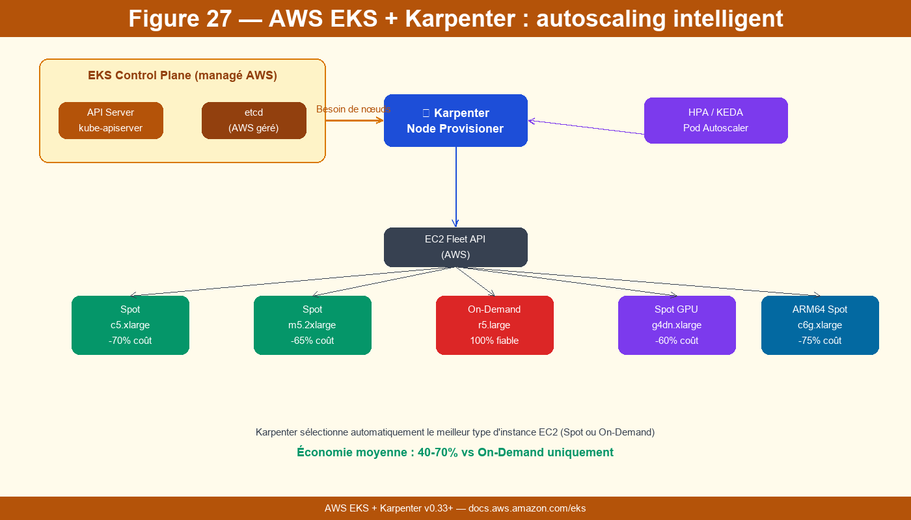

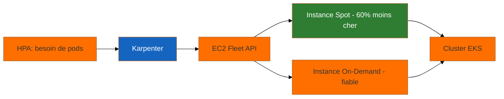

*Figure 27 — Karpenter sélectionne le type d'instance EC2 optimal*

#### Préparation du compte AWS

```bash
# Installer eksctl
curl --silent --location \
  "https://github.com/eksctl-io/eksctl/releases/latest/download/eksctl_$(uname -s)_amd64.tar.gz" \
  | tar xz -C /tmp && sudo mv /tmp/eksctl /usr/local/bin

aws configure
```

#### Déploiement d'EKS

```bash
eksctl create cluster \
  --name cluster-banque-prod \
  --version 1.29 \
  --region eu-west-1 \
  --nodegroup-name initial-nodes \
  --node-type t3.medium \
  --nodes 2 --nodes-min 2 --nodes-max 4

kubectl get nodes
```

#### Installation de Karpenter

```bash
CLUSTER_NAME="cluster-banque-prod"
KARPENTER_VERSION="v0.33.0"

helm upgrade --install karpenter oci://public.ecr.aws/karpenter/karpenter \
  --version "${KARPENTER_VERSION}" \
  --namespace karpenter --create-namespace \
  --set settings.clusterName=${CLUSTER_NAME} \
  --wait
```

```yaml
# nodepool-banque.yaml
apiVersion: karpenter.sh/v1beta1
kind: NodePool
metadata:
  name: pool-banque
spec:
  template:
    spec:
      nodeClassRef:
        name: ec2nodeclass-banque
      requirements:
      - key: karpenter.sh/capacity-type
        operator: In
        values: ["spot", "on-demand"]
      - key: karpenter.k8s.aws/instance-family
        operator: In
        values: ["c5", "m5", "r5"]
  limits:
    cpu: 1000
  disruption:
    consolidationPolicy: WhenUnderutilized
    consolidateAfter: 30s
```

#### Aller plus loin

```yaml
# HPA + Karpenter = double autoscaling (pods + noeuds)
apiVersion: autoscaling/v2
kind: HorizontalPodAutoscaler
metadata:
  name: api-paiement-hpa
  namespace: banque
spec:
  scaleTargetRef:
    apiVersion: apps/v1
    kind: Deployment
    name: api-paiement
  minReplicas: 5
  maxReplicas: 100
  metrics:
  - type: Resource
    resource:
      name: cpu
      target:
        type: Utilization
        averageUtilization: 60
```

> **Cas d'usage Banque** — API paiement : 5 pods lundi 8h → 100 pods en 5 minutes, Karpenter provisionne 10 nœuds Spot en 45 secondes, économie -65% vs On-Demand.

> **Cas d'usage Santé** — GPU spot pour imagerie médicale IA :

```yaml
apiVersion: karpenter.sh/v1beta1
kind: NodePool
metadata:
  name: pool-gpu-imagerie
spec:
  template:
    spec:
      requirements:
      - key: karpenter.k8s.aws/instance-family
        operator: In
        values: ["g4dn", "g5"]
      - key: karpenter.sh/capacity-type
        operator: In
        values: ["spot"]
  limits:
    nvidia.com/gpu: 20
```

#### Avantages et inconvénients

| Avantages | Inconvénients |
|-----------|--------------|
| Le plus utilisé en production | Complexité IAM AWS |
| Karpenter : provisionnement < 60s | Coûts peuvent surprendre |
| Intégration AWS native | Vendor lock-in AWS |
| Scalabilité massive | Expertise AWS requise |

---

### Conclusion Chapitre 2 — Offres Managées

| Offre | Région | RGPD | Prix | Idéal pour |
|-------|--------|------|------|------------|
| Civo | EU/US | Partiel | $ | Startups, éducation |
| Exoscale SKS | CH/EU | Natif | $$ | Banque, assurance suisse |
| OKE | Global | Oui | $ (Free) | IoT, énergie (ARM64) |
| Scaleway Kapsule/Kosmos | FR/EU | Natif | $$ | Santé, éducation France |
| AWS EKS | Global | Oui | $$$ | Grandes entreprises |

---

## CHAPITRE 3 — Solutions de déploiement automatisées

> **Objectif :** Déployer Kubernetes sur vos propres serveurs (on-premise ou cloud IaaS) avec des outils d'automatisation. Vous contrôlez tout, mais vous êtes responsable du Control Plane.

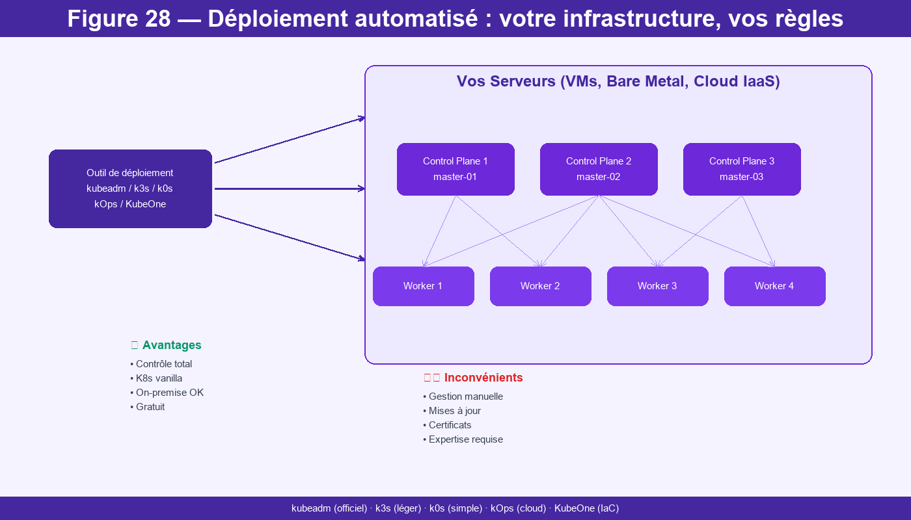

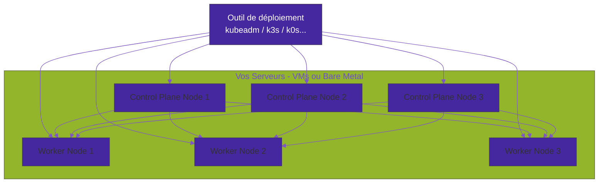

*Figure 28 — Déploiement automatisé : vous gérez tout, l'outil automatise*

---

### 19 — kubeadm (via CLI)

#### Introduction

**kubeadm** est l'outil officiel de la communauté Kubernetes pour initialiser des clusters. Il automatise les étapes les plus complexes (génération des certificats, configuration d'etcd, jonction des nœuds) tout en restant simple à utiliser.

**Cas d'usage type :** Infrastructure on-premise dans une banque ou un hôpital.

#### Système requis

| Composant | Requis |
|-----------|--------|
| OS | Ubuntu 22.04 / Debian 12 / CentOS 9 |
| RAM Control Plane | 2 Go minimum (4 Go recommandé) |
| RAM Workers | 1 Go minimum (2 Go recommandé) |
| CPU | 2 cœurs minimum |
| Réseau | Tous les nœuds peuvent communiquer entre eux |
| Swap | Désactivé (`swapoff -a`) |

#### Installation

**Sur TOUS les nœuds (control plane + workers)**

```bash
# Désactiver le swap
sudo swapoff -a
sudo sed -i '/ swap / s/^\(.*\)$/#\1/g' /etc/fstab

# Charger les modules noyau nécessaires
cat <<EOF | sudo tee /etc/modules-load.d/k8s.conf
overlay
br_netfilter
EOF
sudo modprobe overlay
sudo modprobe br_netfilter

# Paramètres réseau
cat <<EOF | sudo tee /etc/sysctl.d/k8s.conf
net.bridge.bridge-nf-call-iptables  = 1
net.bridge.bridge-nf-call-ip6tables = 1
net.ipv4.ip_forward                 = 1
EOF
sudo sysctl --system

# Installer containerd
sudo apt-get update
sudo apt-get install -y containerd
sudo containerd config default | sudo tee /etc/containerd/config.toml
sudo sed -i 's/SystemdCgroup = false/SystemdCgroup = true/' /etc/containerd/config.toml
sudo systemctl restart containerd

# Installer kubeadm, kubelet, kubectl
sudo apt-get update
sudo apt-get install -y apt-transport-https ca-certificates curl gpg

curl -fsSL https://pkgs.k8s.io/core:/stable:/v1.29/deb/Release.key \
  | sudo gpg --dearmor -o /etc/apt/keyrings/kubernetes-apt-keyring.gpg

echo 'deb [signed-by=/etc/apt/keyrings/kubernetes-apt-keyring.gpg] https://pkgs.k8s.io/core:/stable:/v1.29/deb/ /' \
  | sudo tee /etc/apt/sources.list.d/kubernetes.list

sudo apt-get update
sudo apt-get install -y kubelet kubeadm kubectl
sudo apt-mark hold kubelet kubeadm kubectl
```

#### Déploiement

**Sur le premier nœud Control Plane**

```bash
# Initialiser le cluster
sudo kubeadm init \
  --pod-network-cidr=10.244.0.0/16 \
  --apiserver-advertise-address=192.168.1.10

# Configurer kubectl pour l'utilisateur courant
mkdir -p $HOME/.kube
sudo cp -i /etc/kubernetes/admin.conf $HOME/.kube/config
sudo chown $(id -u):$(id -g) $HOME/.kube/config

# Installer le CNI (réseau inter-pods) - Flannel
kubectl apply -f https://github.com/flannel-io/flannel/releases/latest/download/kube-flannel.yml

# Vérifier que le control plane est prêt
kubectl get nodes
# NAME           STATUS   ROLES           AGE   VERSION
# master-01      Ready    control-plane   2m    v1.29.4
```

**Sur chaque Worker Node**

```bash
# Rejoindre le cluster avec le token affiché par kubeadm init
sudo kubeadm join 192.168.1.10:6443 \
  --token abcdef.0123456789abcdef \
  --discovery-token-ca-cert-hash sha256:HASH_AFFICHÉ

# Sur le control plane, vérifier
kubectl get nodes
# NAME           STATUS   ROLES           AGE   VERSION
# master-01      Ready    control-plane   5m    v1.29.4
# worker-01      Ready    <none>          1m    v1.29.4
# worker-02      Ready    <none>          1m    v1.29.4
```

#### Control plane HA (multi-masters)

```bash
# Pour un cluster HA, ajouter d'autres control planes
# Sur master-01, générer le token de jonction control plane
kubeadm token create --print-join-command

# Sur master-02 et master-03
sudo kubeadm join 192.168.1.10:6443 \
  --token TOKEN \
  --discovery-token-ca-cert-hash sha256:HASH \
  --control-plane \
  --certificate-key CERT_KEY
```

#### Aller plus loin

```bash
# Mettre à jour le cluster
sudo kubeadm upgrade plan
sudo kubeadm upgrade apply v1.30.0

# Drainer un nœud avant maintenance
kubectl drain worker-01 --ignore-daemonsets --delete-emptydir-data
# Effectuer la maintenance...
kubectl uncordon worker-01

# Réinitialiser un nœud
sudo kubeadm reset
```

> **Cas d'usage Banque** — Cluster kubeadm on-premise dans le datacenter de la banque :

```bash
# Infrastructure : 3 control planes + 6 workers sur serveurs dédiés
# Réseau : 10 Gbps, VLAN isolé (conformité PCI-DSS)

# Sur master-01
sudo kubeadm init \
  --control-plane-endpoint "api.banque-interne.fr:6443" \
  --upload-certs \
  --pod-network-cidr=10.244.0.0/16

# Installer Calico (CNI avec support des Network Policies - requis PCI-DSS)
kubectl apply -f https://raw.githubusercontent.com/projectcalico/calico/v3.27.0/manifests/calico.yaml

# Appliquer les NetworkPolicies de conformité PCI-DSS
kubectl apply -f k8s/banque/security/network-policies-pci-dss.yaml
```

> **Cas d'usage Santé** — Cluster certifié HDS (Hébergeur de Données de Santé) :

```bash
# Prérequis HDS : serveurs certifiés ISO 27001, chiffrement au repos
# Utiliser etcd avec chiffrement des données au repos

cat > encryption-config.yaml << 'EOF'
apiVersion: apiserver.config.k8s.io/v1
kind: EncryptionConfiguration
resources:
- resources:
  - secrets
  - configmaps
  providers:
  - aescbc:
      keys:
      - name: key1
        secret: BASE64_ENCODED_32_BYTE_KEY
  - identity: {}
EOF

sudo kubeadm init \
  --encryption-provider-config=/etc/kubernetes/encryption-config.yaml \
  --pod-network-cidr=10.244.0.0/16
```

#### Avantages et inconvénients

| Avantages | Inconvénients |
|-----------|--------------|
| Outil officiel Kubernetes | Installation manuelle |
| Kubernetes vanilla (100% compatible) | Gestion des certificats à renouveler |
| Contrôle total | Pas de gestion du cycle de vie |
| Idéal on-premise | Upgrade manuel |
| Gratuit | |

---

### 20 — kubeadm (via ClusterConfiguration)

#### Introduction

La **ClusterConfiguration** est un fichier YAML qui permet de configurer précisément kubeadm : réseau, version, options d'étcd, certificats personnalisés. Recommandé pour les déploiements en production reproductibles.

#### Système requis et installation

Identique au chapitre 19 — kubeadm doit être installé sur tous les nœuds.

#### Génération d'un fichier kubeadmcfg

```bash
# Générer un fichier de configuration par défaut
kubeadm config print init-defaults > kubeadmcfg.yaml
```

#### Personnalisation

```yaml
# kubeadmcfg.yaml complet et personnalisé
apiVersion: kubeadm.k8s.io/v1beta3
kind: InitConfiguration
localAPIEndpoint:
  advertiseAddress: 192.168.1.10
  bindPort: 6443
nodeRegistration:
  criSocket: unix:///var/run/containerd/containerd.sock
  name: master-01
  taints: []
---
apiVersion: kubeadm.k8s.io/v1beta3
kind: ClusterConfiguration
clusterName: cluster-energie-prod
kubernetesVersion: v1.29.4
controlPlaneEndpoint: "api.energie-prod.fr:6443"
networking:
  podSubnet: 10.244.0.0/16
  serviceSubnet: 10.96.0.0/12
  dnsDomain: cluster.local
etcd:
  local:
    dataDir: /var/lib/etcd
    extraArgs:
      auto-compaction-retention: "1"
      quota-backend-bytes: "8589934592"
apiServer:
  certSANs:
  - api.energie-prod.fr
  - 192.168.1.10
  extraArgs:
    audit-log-path: /var/log/kubernetes/audit.log
    audit-log-maxage: "30"
    audit-log-maxbackup: "10"
    audit-log-maxsize: "100"
    encryption-provider-config: /etc/kubernetes/encryption-config.yaml
controllerManager:
  extraArgs:
    bind-address: 0.0.0.0
scheduler:
  extraArgs:
    bind-address: 0.0.0.0
---
apiVersion: kubelet.config.k8s.io/v1beta1
kind: KubeletConfiguration
cgroupDriver: systemd
serverTLSBootstrap: true
```

#### Premier nœud du control plane

```bash
# Initialiser avec le fichier de configuration
sudo kubeadm init --config kubeadmcfg.yaml --upload-certs

# Récupérer le certificat key pour les autres control planes
# (affiché dans la sortie de kubeadm init)
CERT_KEY="xxxxxxxxxxxxxxxxxxxxxxxxxxxxxxxxxxxxxxxxxxxxxxxxxxxxxxxxxxxxxxxx"
```

#### Nœuds suivants

```bash
# Joindre d'autres control planes (HA)
sudo kubeadm join api.energie-prod.fr:6443 \
  --config kubeadmcfg-worker.yaml

# Fichier pour workers
# kubeadmcfg-worker.yaml :
# apiVersion: kubeadm.k8s.io/v1beta3
# kind: JoinConfiguration
# discovery:
#   bootstrapToken:
#     token: TOKEN
#     apiServerEndpoint: api.energie-prod.fr:6443
#     caCertHashes: ["sha256:HASH"]
```

> **Cas d'usage Énergie** — Cluster kubeadm configuré pour le SCADA modernisé d'un réseau électrique :

```yaml
# kubeadmcfg-energie.yaml avec audit logging pour traçabilité SCADA
apiVersion: kubeadm.k8s.io/v1beta3
kind: ClusterConfiguration
clusterName: cluster-scada-energie
apiServer:
  extraArgs:
    audit-log-path: /var/log/kubernetes/audit.log
    audit-policy-file: /etc/kubernetes/audit-policy.yaml
  extraVolumes:
  - name: audit-policy
    hostPath: /etc/kubernetes/audit-policy.yaml
    mountPath: /etc/kubernetes/audit-policy.yaml
    readOnly: true
  - name: audit-log
    hostPath: /var/log/kubernetes
    mountPath: /var/log/kubernetes
```

#### Avantages et inconvénients

| Avantages | Inconvénients |
|-----------|--------------|
| Configuration reproductible (GitOps) | Plus complexe que CLI |
| Audit logging intégré | Connaissance approfondie requise |
| Idéal pour infra as code | |

---

### 21 — k3s

#### Introduction

**k3s** est une distribution Kubernetes légère développée par Rancher (SUSE). Il est conçu pour fonctionner avec seulement **512 Mo de RAM**, sur des architectures ARM64, et dans des environnements edge ou IoT.

**Différence avec Kubernetes classique :**
- Binaire unique < 100 Mo (toutes dépendances incluses)
- etcd remplacé par SQLite (ou PostgreSQL pour HA)
- Traefik inclus comme Ingress Controller
- Local Path Provisioner inclus pour le stockage

#### Système requis

| Composant | Minimum |
|-----------|---------|
| OS | Linux (toutes distributions) |
| RAM | 512 Mo (control plane) / 256 Mo (worker) |
| CPU | 1 cœur |
| Arch | x86-64, ARM64, ARMv7 |

#### Control Plane

```bash
# Installation en une seule commande
curl -sfL https://get.k3s.io | sh -

# k3s démarre automatiquement comme service systemd
systemctl status k3s

# kubectl est inclus
sudo k3s kubectl get nodes
# NAME        STATUS   ROLES                  AGE   VERSION
# master-01   Ready    control-plane,master   30s   v1.29.4+k3s1

# Récupérer le token pour les workers
sudo cat /var/lib/rancher/k3s/server/node-token
# K107...TOKEN...

# Copier le kubeconfig
sudo cp /etc/rancher/k3s/k3s.yaml ~/.kube/config
sudo chown $USER ~/.kube/config
kubectl get nodes
```

**k3s avec HA (etcd externe)**

```bash
# Control plane HA avec etcd embarqué (3 masters minimum)
# Sur le premier master
curl -sfL https://get.k3s.io | sh -s - server \
  --cluster-init \
  --tls-san "api.transport.fr"

# Sur les masters suivants
curl -sfL https://get.k3s.io | sh -s - server \
  --server https://master-01:6443 \
  --token SECRET_TOKEN \
  --tls-san "api.transport.fr"
```

#### Worker

```bash
# Sur chaque worker node
K3S_URL="https://master-01:6443"
K3S_TOKEN="TOKEN_DEPUIS_SERVER"

curl -sfL https://get.k3s.io | K3S_URL=${K3S_URL} K3S_TOKEN=${K3S_TOKEN} sh -

# Sur le master, vérifier
kubectl get nodes
# NAME        STATUS   ROLES                  VERSION
# master-01   Ready    control-plane,master   v1.29.4+k3s1
# worker-01   Ready    <none>                 v1.29.4+k3s1
# worker-02   Ready    <none>                 v1.29.4+k3s1
```

#### Aller plus loin

```bash
# Désactiver Traefik et utiliser NGINX Ingress à la place
curl -sfL https://get.k3s.io | sh -s - --disable traefik

# Installer NGINX Ingress
kubectl apply -f https://raw.githubusercontent.com/kubernetes/ingress-nginx/main/deploy/static/provider/cloud/deploy.yaml

# k3s sur Raspberry Pi (ARM64) - edge computing
curl -sfL https://get.k3s.io | sh -
# Identique ! k3s détecte automatiquement l'architecture ARM64
```

> **Cas d'usage Transport** — Cluster k3s dans les bus pour le système de billettique embarqué :

```bash
# k3s sur un mini-PC dans chaque bus (ARM64, 2 Go RAM)
curl -sfL https://get.k3s.io | sh -s - \
  --disable traefik \
  --node-name "bus-ligne-12-vehicule-047"

kubectl apply -f k8s/transport/billettique-embarquee/
kubectl apply -f k8s/transport/affichage-arrets/
kubectl apply -f k8s/transport/wifi-passagers/
```

> **Cas d'usage Énergie** — k3s dans les sous-stations électriques pour le traitement edge des données SCADA :

```bash
# Raspberry Pi 4 dans chaque sous-station
curl -sfL https://get.k3s.io | sh -

kubectl apply -f k8s/energie/collecteur-scada.yaml
kubectl apply -f k8s/energie/alertes-temps-reel.yaml

# Les données sensibles restent en local (edge processing)
# Seuls les agrégats sont envoyés au cloud
```

> **Cas d'usage Santé** — k3s dans les cabinets médicaux pour les applications offline-first :

```bash
# Dossier patient local même sans internet (edge + synchronisation)
curl -sfL https://get.k3s.io | sh -

kubectl apply -f k8s/sante/dossier-local.yaml
kubectl apply -f k8s/sante/sync-cloud.yaml
```

#### Avantages et inconvénients

| Avantages | Inconvénients |
|-----------|--------------|
| Ultra-léger (512 Mo RAM) | Quelques différences avec K8s vanilla |
| ARM64 natif | etcd remplacé par SQLite |
| Installation en 30 secondes | Moins adapté aux très grands clusters |
| Idéal edge/IoT | |
| Batteries incluses (Traefik, stockage) | |

---

### 22 — k3sup

#### Introduction

**k3sup** (prononcer "ketchup") est un outil CLI qui automatise l'installation de k3s sur des serveurs distants via SSH. Une seule commande installe le control plane et joint les workers.

#### Système requis

```
Poste local : Linux / macOS / Windows
Serveurs distants : accès SSH, Linux
k3sup installé en local
```

#### Installation

```bash
# Installer k3sup en local
curl -sLS https://get.k3sup.dev | sh
sudo install k3sup /usr/local/bin/
```

#### Déploiement

```bash
# Variables
MASTER_IP="192.168.1.10"
WORKER1_IP="192.168.1.11"
WORKER2_IP="192.168.1.12"
SSH_KEY="~/.ssh/id_rsa"

# Installer k3s sur le master VIA SSH (depuis votre laptop !)
k3sup install \
  --ip ${MASTER_IP} \
  --user ubuntu \
  --ssh-key ${SSH_KEY} \
  --k3s-extra-args "--disable traefik"

# Le kubeconfig est automatiquement téléchargé localement
export KUBECONFIG=./kubeconfig
kubectl get nodes

# Joindre les workers
k3sup join \
  --ip ${WORKER1_IP} \
  --server-ip ${MASTER_IP} \
  --user ubuntu \
  --ssh-key ${SSH_KEY}

k3sup join \
  --ip ${WORKER2_IP} \
  --server-ip ${MASTER_IP} \
  --user ubuntu \
  --ssh-key ${SSH_KEY}

kubectl get nodes
# master     Ready    control-plane,master
# worker-01  Ready    <none>
# worker-02  Ready    <none>
```

#### Aller plus loin

```bash
# Installer des applications via k3sup (apps store k3s)
k3sup app install openfaas
k3sup app install cert-manager
k3sup app install inlets-operator

# Script de déploiement complet d'un cluster de 10 serveurs
for i in {1..8}; do
  k3sup join \
    --ip 192.168.1.$(($i + 10)) \
    --server-ip 192.168.1.10 \
    --user ubuntu \
    --ssh-key ~/.ssh/id_rsa
done
```

> **Cas d'usage Éducation** — Déployer un cluster k3s sur 10 Raspberry Pi dans une salle de TP :

```bash
# Depuis le PC du professeur, déployer sur tous les Pi en SSH
k3sup install --ip 192.168.1.100 --user pi --ssh-key ~/.ssh/id_rsa

for i in {1..9}; do
  k3sup join \
    --ip 192.168.1.$(($i + 100)) \
    --server-ip 192.168.1.100 \
    --user pi \
    --ssh-key ~/.ssh/id_rsa
done

# Les étudiants ont accès au cluster en 5 minutes
kubectl get nodes
```

> **Cas d'usage Assurance** — Déploiement rapide d'un cluster de dev pour les équipes d'actuaires :

```bash
# k3sup déploie sur des VMs cloud en quelques minutes
k3sup install --ip ${VM_MASTER} --user ubuntu --ssh-key ${KEY}
k3sup join --ip ${VM_WORKER1} --server-ip ${VM_MASTER} --user ubuntu --ssh-key ${KEY}

kubectl apply -f k8s/assurance/modeles-actuariels/
```

#### Avantages et inconvénients

| Avantages | Inconvénients |
|-----------|--------------|
| Déploiement via SSH ultra-simple | k3s uniquement |
| Installation depuis votre laptop | Pas de gestion du cycle de vie |
| Idéal clusters de dev rapides | Moins adapté à la production |
| Compatible k3s (ARM64, edge) | |

---

### 23 — k0s et k0sctl

#### Introduction

**k0s** est une distribution Kubernetes "zéro friction" conçue pour être simple à déployer et à maintenir. **k0sctl** est son outil de déploiement déclaratif. Comme k3s, c'est un binaire unique, mais il est plus proche de Kubernetes vanilla.

#### Système requis

```
OS : Linux (x86-64 ou ARM64)
RAM : 1 Go minimum
CPU : 1 cœur minimum
```

#### Installation et déploiement

**Installation manuelle de k0s**

```bash
# Installer k0s
curl -sSLf https://get.k0s.sh | sudo sh

# Démarrer en mode controller+worker (single node)
sudo k0s install controller --single
sudo k0s start

# Obtenir kubectl
sudo k0s kubectl get nodes
```

**Déploiement multi-nœuds avec k0sctl**

```bash
# Installer k0sctl
curl -sSLf https://github.com/k0sproject/k0sctl/releases/latest/download/k0sctl-linux-amd64 \
  -o k0sctl && chmod +x k0sctl && sudo mv k0sctl /usr/local/bin/
```

```yaml
# k0sctl.yaml
apiVersion: k0sctl.k0sproject.io/v1beta1
kind: Cluster
metadata:
  name: cluster-banque-k0s
spec:
  hosts:
  - ssh:
      address: 192.168.1.10
      user: ubuntu
      keyPath: ~/.ssh/id_rsa
    role: controller+worker
  - ssh:
      address: 192.168.1.11
      user: ubuntu
      keyPath: ~/.ssh/id_rsa
    role: worker
  - ssh:
      address: 192.168.1.12
      user: ubuntu
      keyPath: ~/.ssh/id_rsa
    role: worker
  k0s:
    version: v1.29.4+k0s.0
    config:
      apiVersion: k0s.k0sproject.io/v1beta1
      kind: ClusterConfig
      metadata:
        name: cluster-banque-k0s
      spec:
        network:
          provider: calico
          calico:
            mode: vxlan
```

```bash
# Déployer le cluster en une commande
k0sctl apply --config k0sctl.yaml

# Obtenir le kubeconfig
k0sctl kubeconfig --config k0sctl.yaml > ~/.kube/config
kubectl get nodes
```

#### Aller plus loin

```bash
# Backup etcd
k0s etcd snapshot
k0s etcd snapshot list

# Mise à jour du cluster
k0sctl apply --config k0sctl.yaml --upgrade

# Reset complet d'un nœud
sudo k0s reset
```

> **Cas d'usage Banque** — k0s pour le cluster de traitement des transactions (proche de K8s vanilla) :

```yaml
# k0sctl.yaml pour cluster bancaire
spec:
  hosts:
  - ssh:
      address: 10.0.1.10
      user: ubuntu
    role: controller
  - ssh:
      address: 10.0.1.11
      user: ubuntu
    role: controller
  - ssh:
      address: 10.0.1.12
      user: ubuntu
    role: controller
  - ssh:
      address: 10.0.2.10
      user: ubuntu
    role: worker
  k0s:
    config:
      spec:
        network:
          provider: calico   # Requis pour Network Policies PCI-DSS
```

> **Cas d'usage Transport** — k0s dans les gares pour les systèmes d'information voyageurs :

```bash
k0sctl apply --config k0sctl-gare-paris-nord.yaml
kubectl apply -f k8s/transport/affichage-voyageurs/
kubectl apply -f k8s/transport/annonces-sonores/
kubectl apply -f k8s/transport/wifi-gare/
```

#### Avantages et inconvénients

| Avantages | Inconvénients |
|-----------|--------------|
| Proche de K8s vanilla | Moins répandu que k3s |
| k0sctl déclaratif (GitOps friendly) | Communauté plus petite |
| Binaire unique | |
| Mise à jour en ligne commande | |
| ARM64 natif | |

---

### 24 — kOps (exemple avec Hetzner)

#### Introduction

**kOps** (Kubernetes Operations) est l'outil de référence pour déployer et gérer des clusters Kubernetes sur des infrastructures cloud IaaS. Il génère et gère toute l'infrastructure (VMs, réseau, stockage) et le cluster Kubernetes.

**Supports :** AWS, GCP, Azure, Hetzner, DigitalOcean, OpenStack, Scaleway.

#### Système requis

```bash
# Installer kOps
curl -Lo kops https://github.com/kubernetes/kops/releases/latest/download/kops-linux-amd64
chmod +x kops && sudo mv kops /usr/local/bin/

# Hetzner : Compte et token API
# console.hetzner.cloud → Security → API Tokens
export HCLOUD_TOKEN="votre-token-hetzner"
```

#### Installation et préparation de l'environnement

```bash
# Créer un bucket S3 pour l'état kOps (ou équivalent)
# Sur Hetzner Object Storage
export KOPS_STATE_STORE="s3://mon-kops-state"
export CLUSTER_NAME="cluster-energie.hetzner.k8s.local"

# Pour Hetzner, utiliser un provider de stockage compatible S3
export S3_ENDPOINT="https://fsn1.your-objectstorage.com"
```

#### Déploiement du cluster

```bash
# Créer la configuration du cluster
kops create cluster \
  --name ${CLUSTER_NAME} \
  --state ${KOPS_STATE_STORE} \
  --cloud hetzner \
  --zones hel1 \
  --node-count 3 \
  --node-size cpx21 \
  --control-plane-size cpx31 \
  --kubernetes-version 1.29.4 \
  --network-id NETWORK_ID

# Appliquer la configuration (crée les VMs)
kops update cluster ${CLUSTER_NAME} --yes --admin

# Attendre que le cluster soit prêt
kops validate cluster --wait 10m

kubectl get nodes
```

```bash
# Modifier le cluster (scale up)
kops get instancegroups
kops edit ig nodes-hel1 --name ${CLUSTER_NAME}
# Modifier maxSize et minSize dans l'éditeur
kops update cluster ${CLUSTER_NAME} --yes
kops rolling-update cluster ${CLUSTER_NAME} --yes
```

> **Cas d'usage Énergie** — Cluster kOps sur Hetzner pour la gestion des données d'une centrale solaire :

```bash
export CLUSTER_NAME="cluster-solaire.hetzner.k8s.local"

kops create cluster \
  --name ${CLUSTER_NAME} \
  --cloud hetzner \
  --zones hel1,fsn1 \
  --node-count 6 \
  --node-size cpx31 \
  --control-plane-count 3

kubectl apply -f k8s/energie/centrale-solaire/
kubectl apply -f k8s/energie/monitoring-production/
```

> **Cas d'usage Assurance** — kOps sur AWS pour le système de tarification automatique :

```bash
export CLUSTER_NAME="cluster-tarification.k8s.local"
export KOPS_STATE_STORE="s3://kops-assurance-state"

kops create cluster \
  --name ${CLUSTER_NAME} \
  --cloud aws \
  --zones eu-west-1a,eu-west-1b,eu-west-1c \
  --node-count 6 \
  --node-size m5.xlarge \
  --control-plane-count 3 \
  --yes
```

#### Avantages et inconvénients

| Avantages | Inconvénients |
|-----------|--------------|
| Gestion complète Infrastructure + K8s | Complexe pour les débutants |
| Multi-cloud (AWS, GCP, Hetzner...) | Nécessite bucket S3 pour l'état |
| HA natif | Temps de déploiement long (15-20 min) |
| GitOps friendly | |

---

### 25 — KubeOne (exemple avec Infomaniak)

#### Introduction

**KubeOne** de Kubermatic déploie et gère des clusters Kubernetes sur des IaaS cloud. Il s'intègre nativement avec Terraform pour provisioner l'infrastructure.

#### Système requis

```bash
# Installer KubeOne
curl -sfL https://get.kubeone.io | sh

# Terraform
wget https://releases.hashicorp.com/terraform/1.7.0/terraform_1.7.0_linux_amd64.zip
unzip terraform_1.7.0_linux_amd64.zip && sudo mv terraform /usr/local/bin/
```

#### Installation et déploiement

```bash
# Cloner les exemples Terraform pour Infomaniak (OpenStack)
git clone https://github.com/kubermatic/kubeone
cd kubeone/examples/terraform/openstack

# Configurer les credentials Infomaniak
export OS_AUTH_URL="https://api.pub1.infomaniak.cloud/identity"
export OS_USERNAME="votre-username"
export OS_PASSWORD="votre-password"
export OS_PROJECT_NAME="votre-projet"

# Provisionner l'infrastructure
cp terraform.tfvars.example terraform.tfvars
# Éditer terraform.tfvars avec vos paramètres

terraform init && terraform apply
```

```yaml
# kubeone.yaml
apiVersion: kubeone.k8c.io/v1beta2
kind: KubeOneCluster
metadata:
  name: cluster-sante-prod
versions:
  kubernetes: 1.29.4
cloudProvider:
  openstack: {}
  external: true
clusterNetwork:
  podSubnet: "192.168.0.0/16"
  serviceSubnet: "10.96.0.0/12"
features:
  coreDNS:
    replicaCount: 2
  nodeLocalDNS:
    deploy: true
```

```bash
# Déployer le cluster
kubeone apply -m kubeone.yaml -t ./

# Obtenir le kubeconfig
kubeone kubeconfig -m kubeone.yaml -t ./ > ~/.kube/config
kubectl get nodes
```

> **Cas d'usage Santé** — Cluster sur Infomaniak (hébergeur suisse) pour dossiers patients :

```bash
# Infomaniak = hébergeur suisse respectueux de la vie privée
# Idéal pour données médicales (conformité suisse + RGPD)

kubeone apply -m kubeone-sante.yaml -t ./infomaniak-tf/
kubectl apply -f k8s/sante/dossier-patient-chiffre/
```

#### Avantages et inconvénients

| Avantages | Inconvénients |
|-----------|--------------|
| Infrastructure + K8s intégrés | Nécessite Terraform |
| Multi-cloud (OpenStack, AWS, GCP...) | Courbe d'apprentissage |
| Support enterprise disponible | |
| Mise à jour in-place | |

---

### 26 — KubeKey

#### Introduction

**KubeKey** de KubeSphere est un outil qui installe simultanément Kubernetes ET KubeSphere (une plateforme de management avec interface web) en une commande. Idéal pour les équipes qui veulent une interface graphique complète.

#### Système requis

```
OS : Ubuntu 16.04+ / CentOS 7+ / Debian
RAM : 2 Go minimum par nœud
CPU : 2 cœurs par nœud
```

#### Installation et déploiement

```bash
# Installer KubeKey
curl -sfL https://get-kk.kubesphere.io | VERSION=v3.1.1 sh -
chmod +x kk

# Créer un fichier de configuration du cluster
./kk create config --with-kubernetes v1.29.4 \
  --with-kubesphere v3.4.1 \
  -f config-cluster-education.yaml
```

```yaml
# config-cluster-education.yaml (extrait)
apiVersion: kubekey.kubesphere.io/v1alpha2
kind: Cluster
metadata:
  name: cluster-education
spec:
  hosts:
  - {name: master, address: 192.168.1.10, internalAddress: 192.168.1.10, user: ubuntu, privateKeyPath: "~/.ssh/id_rsa"}
  - {name: worker1, address: 192.168.1.11, internalAddress: 192.168.1.11, user: ubuntu, privateKeyPath: "~/.ssh/id_rsa"}
  - {name: worker2, address: 192.168.1.12, internalAddress: 192.168.1.12, user: ubuntu, privateKeyPath: "~/.ssh/id_rsa"}
  roleGroups:
    etcd:
    - master
    control-plane:
    - master
    worker:
    - worker1
    - worker2
  controlPlaneEndpoint:
    domain: lb.kubesphere.local
    address: ""
    port: 6443
  kubernetes:
    version: v1.29.4
    containerManager: containerd
  network:
    plugin: calico
    kubePodsCIDR: 10.233.64.0/18
    kubeServiceCIDR: 10.233.0.0/18
```

```bash
# Déployer Kubernetes + KubeSphere
./kk create cluster -f config-cluster-education.yaml

# Accéder à KubeSphere (interface web)
# http://IP_MASTER:30880
# admin / P@88w0rd (changer immédiatement)
```

> **Cas d'usage Éducation** — Kubernetes + KubeSphere pour une université sans expertise DevOps :

```bash
./kk create cluster -f config-universite.yaml

# L'interface KubeSphere permet aux enseignants de déployer
# sans connaître kubectl :
# → Créer des namespaces par département
# → Déployer des applications via interface graphique
# → Monitorer les ressources avec tableaux de bord intégrés
```

#### Avantages et inconvénients

| Avantages | Inconvénients |
|-----------|--------------|
| K8s + interface web en 1 commande | Installation longue (30-45 min) |
| Idéal équipes sans expertise CLI | KubeSphere consomme des ressources |
| Monitoring inclus | Moins flexible que kubeadm pur |
| Multi-nœuds simple | |

---

### 27 — kURL

#### Introduction

**kURL** (de Replicated) est un installateur Kubernetes clé en main, spécialement conçu pour les applications SaaS qui souhaitent être déployées on-premise chez leurs clients. Il génère un script d'installation personnalisable.

#### Système requis

```
OS : Ubuntu 18.04+ / CentOS 7.4+ / RHEL 7.4+
RAM : 4 Go
CPU : 2 cœurs
Réseau : Internet ou air-gap
```

#### Installation

```bash
# Installation online (avec internet)
curl -sSL https://kurl.sh/latest | sudo bash

# Ou installation personnalisée (générer votre spec sur kurl.sh)
curl -sSL https://kurl.sh/VOTRE_SPEC_ID | sudo bash
```

#### Déploiement

**Générer une spec personnalisée sur kurl.sh**

```yaml
# spec kURL personnalisée
apiVersion: cluster.kurl.sh/v1beta1
kind: Installer
metadata:
  name: cluster-assurance
spec:
  kubernetes:
    version: 1.29.x
  containerd:
    version: 1.7.x
  flannel:
    version: 0.24.x
  rook:
    version: 1.13.x    # Stockage distribué inclus
  prometheus:
    version: 0.72.x    # Monitoring inclus
  registry:
    version: 2.8.x     # Registre d'images inclus
```

```bash
# Télécharger l'installateur air-gap (sans internet, pour environnements sécurisés)
curl -sSL https://kurl.sh/bundle/SPEC_ID.tar.gz -o kurl-bundle.tar.gz
tar xzf kurl-bundle.tar.gz

# Installer en mode air-gap
cat install.sh | sudo bash -s airgap
```

> **Cas d'usage Assurance** — Déployer une application SaaS d'assurance chez un client en mode air-gap :

```bash
# Le client n'a pas internet dans son datacenter (banque sécurisée)
# kURL génère un bundle complet à installer hors ligne

# Côté éditeur de l'application
curl -sSL https://kurl.sh/bundle/assurance-app-spec.tar.gz -o bundle.tar.gz

# Livrer le bundle au client sur clé USB
# Le client installe sans internet :
tar xzf bundle.tar.gz
cat install.sh | sudo bash -s airgap
```

#### Avantages et inconvénients

| Avantages | Inconvénients |
|-----------|--------------|
| Air-gap natif | Moins flexible |
| Tout inclus (stockage, monitoring, registry) | Orienté éditeurs SaaS |
| Support RHEL/CentOS | Communauté plus petite |
| Idéal clients sans internet | |

---

### 28 — KubeMarine

#### Introduction

**KubeMarine** (de Kubermatic) est un outil d'installation et de maintenance de clusters Kubernetes on-premise via des fichiers de configuration YAML. Il gère aussi les mises à jour et l'ajout de nœuds.

#### Système requis

```
OS : Ubuntu 20.04/22.04, CentOS 7/8, RHEL 7/8
RAM : 2 Go par nœud
Python 3.8+ (sur le poste d'administration)
```

#### Installation du client

```bash
# Via pip
pip install kubemarine

# Vérifier
kubemarine version
```

#### Déploiement

```yaml
# cluster.yaml
node_defaults:
  keyfile: ~/.ssh/id_rsa
  username: ubuntu

nodes:
- name: master-01
  address: 192.168.1.10
  roles:
  - master
  - balancer
- name: worker-01
  address: 192.168.1.11
  roles:
  - worker
- name: worker-02
  address: 192.168.1.12
  roles:
  - worker

cluster_name: cluster-energie-kubemarine

kubernetes:
  version: v1.29.4

plugins:
  calico:
    install: true
  nginx-ingress-controller:
    install: true
  cert-manager:
    install: true
```

```bash
# Déployer le cluster
kubemarine install --config cluster.yaml

# Vérifier
kubemarine check_paas --config cluster.yaml

# Ajouter un nœud
kubemarine add_node --config cluster.yaml
```

> **Cas d'usage Énergie** — Cluster KubeMarine pour la gestion des données de production d'énergie renouvelable :

```yaml
nodes:
- name: control-01
  address: 10.0.1.10
  roles: [master, balancer]
- name: worker-data-01
  address: 10.0.2.10
  roles: [worker]
  labels:
    workload: data-processing
- name: worker-api-01
  address: 10.0.2.11
  roles: [worker]
  labels:
    workload: api
```

#### Avantages et inconvénients

| Avantages | Inconvénients |
|-----------|--------------|
| Configuration YAML simple | Moins connu que kubeadm/k3s |
| Gestion lifecycle complet | Communauté restreinte |
| Ajout de nœuds sans interruption | |

---

### 29 — OneKE

#### Introduction

**OneKE** est la distribution Kubernetes intégrée à **OpenNebula**, la plateforme de cloud privé open source. Elle déploie K8s directement dans l'environnement OpenNebula via des appliances VM préconfigurées.

#### Système requis

```
OpenNebula 6.6+
Accès à la marketplace OpenNebula
```

#### Déploiement

```bash
# Depuis l'interface Sunstone d'OpenNebula
# Apps → Marketplace → OneKE 1.29

# Ou via CLI OpenNebula
onemarketapp export "Service OneKE 1.29" --datastore default
onetemplate instantiate TEMPLATE_ID

# Configuration via le template OpenNebula
# ONEKE_CONTROL_PLANE_COUNT = 3
# ONEKE_WORKER_COUNT = 5
# ONEKE_KUBERNETES_VERSION = 1.29.4
```

> **Cas d'usage Énergie** — OneKE dans un cloud privé OpenNebula pour un opérateur d'énergie :

```bash
# L'opérateur utilise OpenNebula pour son cloud privé
# OneKE s'intègre nativement dans cet environnement existant

# Déployer depuis Sunstone
# Apps → OneKE 1.29 → Configurer → Déployer

kubectl apply -f k8s/energie/gestion-reseau/
kubectl apply -f k8s/energie/trading-energie/
```

#### Avantages et inconvénients

| Avantages | Inconvénients |
|-----------|--------------|
| Intégration OpenNebula native | Nécessite OpenNebula existant |
| Appliances VM prêtes à l'emploi | Niche (OpenNebula peu répandu) |
| Gestion cloud privé intégrée | |

---

### 30 — OKD/OpenShift (exemple avec Infomaniak)

#### Introduction

**OKD** est la version community (upstream) d'**OpenShift**, la distribution Kubernetes enterprise de Red Hat. OpenShift ajoute une couche de sécurité renforcée (SecurityContextConstraints), une interface web avancée, des builds intégrés (S2I) et le support RHEL.

#### Système requis

```
OKD : 3 masters x 8 vCPU / 16 Go RAM / 120 Go disque minimum
OpenShift : identique + licences Red Hat
DNS configuré correctement
```

#### Déploiement de la solution sur Infomaniak

```bash
# Prérequis : CLI OKD/OpenShift
curl -LO https://github.com/okd-project/okd/releases/latest/download/openshift-install-linux.tar.gz
tar xzf openshift-install-linux.tar.gz

# Créer le fichier de configuration
./openshift-install create install-config --dir=cluster-assurance/
```

```yaml
# install-config.yaml (Infomaniak OpenStack)
apiVersion: v1
baseDomain: assurance-prod.fr
compute:
- architecture: amd64
  hyperthreading: Enabled
  name: worker
  platform:
    openstack:
      flavor: a1-ram4-disk50-perf1
  replicas: 3
controlPlane:
  architecture: amd64
  hyperthreading: Enabled
  name: master
  platform: {}
  replicas: 3
metadata:
  name: cluster-assurance
platform:
  openstack:
    apiFloatingIP: 185.59.x.x
    cloud: infomaniak
    defaultMachinePlatform:
      type: a1-ram8-disk100-perf1
    ingressFloatingIP: 185.59.x.x
pullSecret: '{"auths": ...}'
sshKey: 'ssh-rsa AAAA...'
```

```bash
# Déployer OpenShift/OKD
./openshift-install create cluster --dir=cluster-assurance/ --log-level=info

# Attendre 30-45 minutes...
# Accéder à la console web
./openshift-install wait-for console-url --dir=cluster-assurance/

# Utiliser oc (CLI OpenShift)
export KUBECONFIG=cluster-assurance/auth/kubeconfig
oc get nodes
oc whoami
```

> **Cas d'usage Banque** — OpenShift pour l'équipe DevOps d'une banque utilisant Red Hat :

```bash
# La banque utilise RHEL et Red Hat Satellite
# OpenShift s'intègre dans l'écosystème Red Hat

oc new-project api-bancaire
oc new-app python~https://github.com/banque/api-virement.git

# SecurityContextConstraints (SCC) - sécurité OpenShift renforcée
oc adm policy add-scc-to-serviceaccount restricted api-sa -n api-bancaire

# Routes OpenShift (Ingress OpenShift-natif)
oc expose svc/api-virement --hostname=api.banque-interne.fr
```

#### Avantages et inconvénients

| Avantages | Inconvénients |
|-----------|--------------|
| Sécurité renforcée (SCC) | Très lourd en ressources |
| Intégration Red Hat | Licences OpenShift coûteuses |
| S2I (build depuis source) | Courbe d'apprentissage importante |
| Interface web complète | OKD moins stable qu'OpenShift |

---

### 31 — OpenStack Magnum (exemple avec DevStack)

#### Introduction

**OpenStack Magnum** est le service d'orchestration de conteneurs intégré à OpenStack. Il permet de créer et gérer des clusters Kubernetes directement depuis l'API OpenStack.

#### Système requis

```
OpenStack avec Magnum activé
DevStack (pour les tests) : 16 Go RAM, 100 Go disque
```

#### Installation via DevStack

```bash
# Installer DevStack avec Magnum
git clone https://opendev.org/openstack/devstack
cd devstack

cat > local.conf << 'EOF'
[[local|localrc]]
ADMIN_PASSWORD=secret
DATABASE_PASSWORD=secret
RABBIT_PASSWORD=secret
SERVICE_PASSWORD=secret

enable_plugin heat https://opendev.org/openstack/heat
enable_plugin magnum https://opendev.org/openstack/magnum
enable_plugin magnum-ui https://opendev.org/openstack/magnum-ui

VOLUME_BACKING_FILE_SIZE=20G
EOF

./stack.sh
```

#### Déploiement du cluster

```bash
# Source les credentials OpenStack
source openrc admin admin

# Créer un template de cluster Kubernetes
openstack coe cluster template create k8s-template \
  --image fedora-coreos-latest \
  --external-network public \
  --dns-nameserver 8.8.8.8 \
  --master-flavor m1.medium \
  --flavor m1.medium \
  --coe kubernetes \
  --network-driver flannel

# Créer un cluster
openstack coe cluster create mon-cluster-k8s \
  --cluster-template k8s-template \
  --master-count 1 \
  --node-count 3

# Attendre la création
openstack coe cluster show mon-cluster-k8s

# Obtenir le kubeconfig
openstack coe cluster config mon-cluster-k8s
export KUBECONFIG=config
kubectl get nodes
```

> **Cas d'usage Énergie** — Magnum dans le cloud privé OpenStack d'un opérateur énergie :

```bash
# L'opérateur a un cloud OpenStack privé
# Magnum permet de créer des clusters K8s à la demande

openstack coe cluster create cluster-trading-energie \
  --cluster-template k8s-prod-template \
  --master-count 3 \
  --node-count 6

kubectl apply -f k8s/energie/trading-temps-reel/
```

#### Avantages et inconvénients

| Avantages | Inconvénients |
|-----------|--------------|
| Intégration OpenStack native | Nécessite OpenStack existant |
| API OpenStack unifiée | Installation complexe |
| Multi-COE (K8s, Swarm...) | Moins populaire |
| Self-service K8s dans un cloud privé | |

---

### Conclusion Chapitre 3 — Solutions de déploiement automatisées

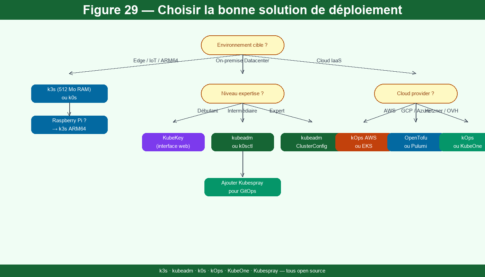

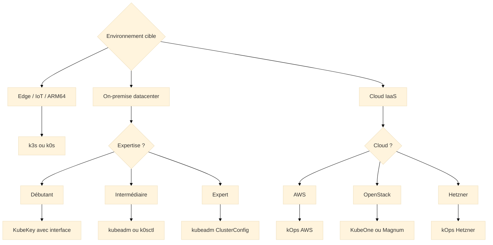

*Figure 29 — Choisir la bonne solution de déploiement*

| Outil | Edge | On-prem | Cloud | HA | Niveau |
|-------|------|---------|-------|----|--------|
| kubeadm | ❌ | ✅ | ✅ | ✅ | Intermédiaire |
| k3s | ✅ | ✅ | ✅ | ✅ | Débutant |
| k3sup | ✅ | ✅ | ✅ | ❌ | Débutant |
| k0s / k0sctl | ✅ | ✅ | ✅ | ✅ | Intermédiaire |
| kOps | ❌ | ❌ | ✅ | ✅ | Avancé |
| KubeOne | ❌ | ✅ | ✅ | ✅ | Avancé |
| KubeKey | ❌ | ✅ | ✅ | ✅ | Débutant |

---

## CHAPITRE 4 — Solutions « Infrastructure as Code » (IaC)

> **Objectif :** Décrire l'infrastructure Kubernetes dans du code versionnable (YAML, HCL, Python) pour des déploiements reproductibles et auditables.

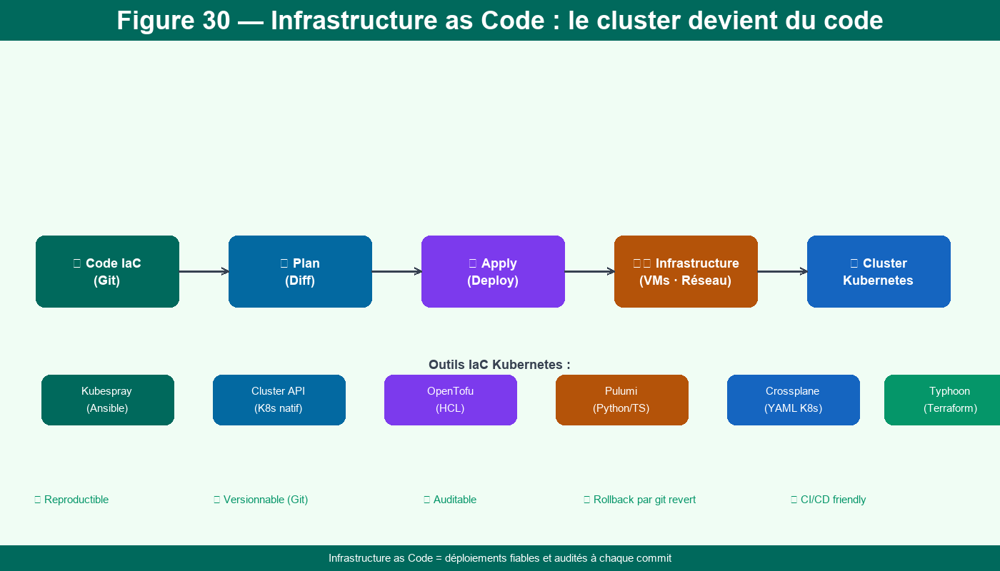


*Figure 30 — Infrastructure as Code : le code décrit l'infrastructure*

---

### 32 — Kubespray

#### Introduction

**Kubespray** est un projet Ansible qui déploie Kubernetes sur n'importe quelle infrastructure (bare metal, VMs, cloud). C'est l'outil préféré des équipes qui maîtrisent Ansible.

#### Système requis

```bash
pip install ansible
# Python 3.9+, Ansible 2.14+
# Accès SSH à tous les nœuds
```

#### Déploiement

```bash
git clone https://github.com/kubernetes-sigs/kubespray
cd kubespray
pip install -r requirements.txt

# Créer l'inventaire
cp -rfp inventory/sample inventory/cluster-banque
declare -a IPS=(192.168.1.10 192.168.1.11 192.168.1.12 192.168.1.13 192.168.1.14)
CONFIG_FILE=inventory/cluster-banque/hosts.yaml \
  python3 contrib/inventory_builder/inventory.py ${IPS[@]}
```

```ini
# inventory/cluster-banque/hosts.yaml
all:
  hosts:
    node1:
      ansible_host: 192.168.1.10
      ip: 192.168.1.10
    node2:
      ansible_host: 192.168.1.11
    node3:
      ansible_host: 192.168.1.12
    node4:
      ansible_host: 192.168.1.13
    node5:
      ansible_host: 192.168.1.14
  children:
    kube_control_plane:
      hosts:
        node1:
        node2:
        node3:
    kube_node:
      hosts:
        node4:
        node5:
    etcd:
      hosts:
        node1:
        node2:
        node3:
```

```bash
# Personnaliser les variables
cat >> inventory/cluster-banque/group_vars/k8s_cluster/k8s-cluster.yml << 'EOF'
kube_version: v1.29.4
container_manager: containerd
kube_network_plugin: calico
dns_mode: coredns
EOF

# Déployer
ansible-playbook -i inventory/cluster-banque/hosts.yaml \
  --become --become-user=root \
  cluster.yml

kubectl get nodes
```

```bash
# Ajouter des nœuds
ansible-playbook -i inventory/cluster-banque/hosts.yaml \
  --become scale.yml --limit=node6

# Mise à jour du cluster
ansible-playbook -i inventory/cluster-banque/hosts.yaml \
  --become upgrade-cluster.yml \
  -e kube_version=v1.30.0
```

> **Cas d'usage Banque** — Kubespray pour maintenir 50 clusters bancaires en conformité :

```bash
# Un seul playbook maintient tous les clusters en version identique
for cluster in banque-paris banque-lyon banque-bordeaux; do
  ansible-playbook -i inventory/${cluster}/hosts.yaml \
    --become upgrade-cluster.yml \
    -e kube_version=v1.30.0
done
```

> **Cas d'usage Santé** — Kubespray avec CIS Benchmark pour conformité HDS :

```bash
# Activer le hardening CIS
cat >> inventory/cluster-sante/group_vars/k8s_cluster/k8s-cluster.yml << 'EOF'
kube_apiserver_anonymous_auth: false
kube_apiserver_audit_log_path: /var/log/kubernetes/audit.log
podsecuritypolicy_enabled: false
kubernetes_audit: true
EOF

ansible-playbook -i inventory/cluster-sante/hosts.yaml --become cluster.yml
```

#### Avantages et inconvénients

| Avantages | Inconvénients |
|-----------|--------------|
| Ansible (très répandu) | Déploiement lent (Ansible) |
| Hautement configurable | Courbe apprentissage Ansible |
| Idéal multi-clusters | Debugging complexe |
| Kubernetes vanilla | |

---

### 33 — Cluster API (exemple avec ProxmoxVE)

#### Introduction

**Cluster API (CAPI)** est un projet Kubernetes qui utilise Kubernetes pour déployer et gérer d'autres clusters Kubernetes. Un cluster de "management" contrôle les clusters "workload".

**Concept clé :** Les clusters sont des ressources Kubernetes (CRDs) comme les Pods.

#### Système requis

```bash
# clusterctl (CLI Cluster API)
curl -L https://github.com/kubernetes-sigs/cluster-api/releases/latest/download/clusterctl-linux-amd64 \
  -o clusterctl
chmod +x clusterctl && sudo mv clusterctl /usr/local/bin/

# Un cluster Kubernetes existant (management cluster)
# kind ou k3s pour commencer
kind create cluster --name capi-management
```

#### Préparation pour Proxmox VE

```bash
# Variables d'environnement Proxmox
export PROXMOX_URL="https://proxmox.banque.fr:8006"
export PROXMOX_TOKEN="user@pam!token-name=SECRET"
export PROXMOX_NODE="pve-01"

# Initialiser CAPI avec le provider Proxmox
clusterctl init \
  --core cluster-api \
  --bootstrap kubeadm \
  --control-plane kubeadm \
  --infrastructure proxmox

kubectl get pods -n capi-system
```

#### Déploiement d'un cluster

```yaml
# cluster-proxmox-energie.yaml
apiVersion: cluster.x-k8s.io/v1beta1
kind: Cluster
metadata:
  name: cluster-energie-prod
  namespace: energie
spec:
  clusterNetwork:
    pods:
      cidrBlocks: ["192.168.0.0/16"]
  infrastructureRef:
    apiVersion: infrastructure.cluster.x-k8s.io/v1alpha1
    kind: ProxmoxCluster
    name: cluster-energie-proxmox
  controlPlaneRef:
    apiVersion: controlplane.cluster.x-k8s.io/v1beta1
    kind: KubeadmControlPlane
    name: cluster-energie-control-plane
---
apiVersion: infrastructure.cluster.x-k8s.io/v1alpha1
kind: ProxmoxCluster
metadata:
  name: cluster-energie-proxmox
  namespace: energie
spec:
  controlPlaneEndpoint:
    host: 10.0.1.100
    port: 6443
  serverType: local
  allowedNodes: ["pve-01", "pve-02", "pve-03"]
---
apiVersion: controlplane.cluster.x-k8s.io/v1beta1
kind: KubeadmControlPlane
metadata:
  name: cluster-energie-control-plane
  namespace: energie
spec:
  replicas: 3
  version: v1.29.4
  machineTemplate:
    infrastructureRef:
      apiVersion: infrastructure.cluster.x-k8s.io/v1alpha1
      kind: ProxmoxMachineTemplate
      name: control-plane-template
```

```bash
kubectl apply -f cluster-proxmox-energie.yaml

# Observer la création
kubectl get clusters -n energie
kubectl get machines -n energie

# Récupérer le kubeconfig du cluster workload
clusterctl get kubeconfig cluster-energie-prod -n energie > energie-kubeconfig.yaml
export KUBECONFIG=energie-kubeconfig.yaml
kubectl get nodes
```

> **Cas d'usage Énergie** — CAPI + Proxmox pour gérer 20 clusters K8s dans différentes sous-stations :

```bash
# Chaque sous-station a son cluster, tous gérés depuis un seul management cluster

for station in paris lyon bordeaux marseille; do
  cat > cluster-${station}.yaml << EOF
  # ... template de cluster avec le nom de la station
EOF
  kubectl apply -f cluster-${station}.yaml
done

# Voir tous les clusters
kubectl get clusters -A
# NAMESPACE   NAME              PHASE         AGE
# paris       cluster-paris     Provisioned   5m
# lyon        cluster-lyon      Provisioned   4m
# bordeaux    cluster-bordeaux  Provisioned   3m
```

#### Avantages et inconvénients

| Avantages | Inconvénients |
|-----------|--------------|
| Gestion déclarative des clusters | Courbe d'apprentissage élevée |
| Multi-cloud (AWS, GCP, Azure, Proxmox...) | Nécessite un cluster management |
| GitOps natif | Complexité opérationnelle |
| Day-2 operations intégrées | |

---

### 34 — OpenTofu (exemple avec GKE)

#### Introduction

**OpenTofu** est le fork open source de Terraform maintenu par la Linux Foundation. Il permet de provisionner des clusters Kubernetes en cloud avec du code HCL, versionnable dans Git.

#### Système requis

```bash
# Installer OpenTofu
curl --proto '=https' --tlsv1.2 -fsSL https://get.opentofu.org/install-opentofu.sh | sh

tofu version
```

#### Installation

```bash
mkdir cluster-gke-education && cd cluster-gke-education
```

#### Préparation du code

```hcl
# main.tf
terraform {
  required_providers {
    google = {
      source  = "hashicorp/google"
      version = "~> 5.0"
    }
  }
}

provider "google" {
  project = var.project_id
  region  = var.region
}

# Cluster GKE
resource "google_container_cluster" "education" {
  name     = "cluster-education-${var.environment}"
  location = var.region

  initial_node_count       = 1
  remove_default_node_pool = true

  network    = google_compute_network.vpc.name
  subnetwork = google_compute_subnetwork.subnet.name

  ip_allocation_policy {
    cluster_ipv4_cidr_block  = "/16"
    services_ipv4_cidr_block = "/22"
  }
}

# Node Pool
resource "google_container_node_pool" "workers" {
  name       = "workers-pool"
  location   = var.region
  cluster    = google_container_cluster.education.name
  node_count = var.node_count

  autoscaling {
    min_node_count = 2
    max_node_count = 10
  }

  node_config {
    preemptible  = var.use_spot_instances
    machine_type = var.machine_type

    labels = {
      env     = var.environment
      secteur = "education"
    }

    oauth_scopes = [
      "https://www.googleapis.com/auth/cloud-platform"
    ]
  }
}
```

```hcl
# variables.tf
variable "project_id" { type = string }
variable "region" { default = "europe-west1" }
variable "environment" { default = "production" }
variable "node_count" { default = 3 }
variable "machine_type" { default = "e2-medium" }
variable "use_spot_instances" { default = false }
```

```hcl
# outputs.tf
output "kubeconfig_command" {
  value = "gcloud container clusters get-credentials ${google_container_cluster.education.name} --region ${var.region}"
}
```

#### Déploiement du cluster

```bash
# Initialiser et déployer
tofu init
tofu plan -var="project_id=mon-projet-gcp"
tofu apply -var="project_id=mon-projet-gcp"

# Configurer kubectl
gcloud container clusters get-credentials cluster-education-production \
  --region europe-west1

kubectl get nodes
```

> **Cas d'usage Éducation** — GKE provisionné via OpenTofu pour une université avec env dev/staging/prod :

```bash
# Environnement de développement (moins de ressources)
tofu workspace new dev
tofu apply \
  -var="project_id=univ-numerique" \
  -var="environment=dev" \
  -var="node_count=2" \
  -var="machine_type=e2-small" \
  -var="use_spot_instances=true"

# Production (ressources adaptées aux examens)
tofu workspace new prod
tofu apply \
  -var="project_id=univ-numerique" \
  -var="environment=prod" \
  -var="node_count=10" \
  -var="machine_type=e2-standard-4"
```

> **Cas d'usage Banque** — Infrastructure GKE versionnée et auditée dans Git :

```bash
git clone https://github.com/banque/infra-kubernetes
cd infra-kubernetes/clusters/banque-prod/

# Chaque changement d'infra passe par une PR Git
# CI/CD vérifie le plan Tofu avant merge
tofu plan -out=plan.out
tofu show plan.out

# Deploy en production après approbation PR
tofu apply plan.out
```

#### Avantages et inconvénients

| Avantages | Inconvénients |
|-----------|--------------|
| Open source (fork Terraform) | Courbe d'apprentissage HCL |
| Multi-cloud (GCP, AWS, Azure...) | State file à gérer |
| GitOps naturel | |
| Rollback par git revert | |

---

### 35 — Typhoon (exemple avec DigitalOcean)

#### Introduction

**Typhoon** est un module Terraform/OpenTofu minimal et strict pour déployer des clusters Kubernetes en production. Il priorise la simplicité, la sécurité et l'immuabilité.

#### Système requis

```bash
# OpenTofu ou Terraform
# Accès API DigitalOcean (token)
export DIGITALOCEAN_TOKEN="votre-token-do"
```

#### Préparation du code IaC

```hcl
# typhoon-cluster.tf
module "cluster-transport" {
  source = "git::https://github.com/poseidon/typhoon//digital-ocean/fedora-coreos/kubernetes?ref=v1.29.4"

  # Paramètres du cluster
  cluster_name = "cluster-transport"
  region       = "fra1"    # Frankfurt - EU

  dns_zone = "transport-prod.fr"

  os_image    = "fedora-coreos"
  worker_count = 3

  ssh_fingerprints = ["SHA256:votre-fingerprint-ssh"]

  tags = ["transport", "production", "europe"]
}

output "kubeconfig" {
  value     = module.cluster-transport.kubeconfig-admin
  sensitive = true
}
```

#### Déploiement

```bash
tofu init
tofu plan
tofu apply

# Récupérer le kubeconfig
tofu output kubeconfig > ~/.kube/typhoon-transport.yaml
export KUBECONFIG=~/.kube/typhoon-transport.yaml
kubectl get nodes
```

> **Cas d'usage Transport** — Cluster Typhoon sur DigitalOcean pour l'API de gestion de flotte :

```hcl
module "cluster-flotte" {
  source = "git::https://github.com/poseidon/typhoon//digital-ocean/fedora-coreos/kubernetes?ref=v1.29.4"

  cluster_name = "cluster-flotte-transport"
  region       = "fra1"
  worker_count = 5
  dns_zone     = "flotte.transport-fr.com"
}
```

#### Avantages et inconvénients

| Avantages | Inconvénients |
|-----------|--------------|
| Minimal et sécurisé | Moins flexible que kOps |
| Fedora CoreOS (OS immuable) | Moins de cloud providers |
| Reproducible | |
| Idéal pour cluster immuable | |

---

### 36 — Pulumi (exemple avec OVHcloud)

#### Introduction

**Pulumi** est un outil IaC qui utilise des langages de programmation réels (Python, TypeScript, Go, Java) au lieu d'un DSL comme HCL. Idéal pour les équipes de développeurs.

#### Système requis

```bash
# Installer Pulumi
curl -fsSL https://get.pulumi.com | sh

# Se connecter à Pulumi Cloud (ou self-hosted)
pulumi login

# Python
pip install pulumi pulumi-ovh pulumi-kubernetes
```

#### Installation et déploiement

```python
# __main__.py - Cluster MKS (Managed Kubernetes Service) OVHcloud en Python
import pulumi
import pulumi_ovh as ovh

config = pulumi.Config()

# Créer un cluster Kubernetes OVHcloud (MKS)
cluster = ovh.cloudproject.Kube(
    "cluster-assurance",
    service_name=config.require("ovh_service_name"),
    region="GRA7",
    name="cluster-assurance-prod",
    version="1.29",
    private_network_id=config.get("private_network_id"),
)

# Node Pool
node_pool = ovh.cloudproject.KubeNodePool(
    "workers",
    service_name=config.require("ovh_service_name"),
    kube_id=cluster.id,
    name="workers-pool",
    flavor_name="b3-8",
    desired_nodes=3,
    min_nodes=2,
    max_nodes=10,
    autoscale=True,
)

# Exporter le kubeconfig
pulumi.export("cluster_id", cluster.id)
pulumi.export("kubeconfig", cluster.kubeconfig.content)
```

```bash
# Déployer
pulumi stack init cluster-assurance-prod
pulumi config set ovh_service_name VOTRE_SERVICE_NAME

pulumi up
# Pulumi affiche un diff et demande confirmation

# Obtenir le kubeconfig
pulumi stack output kubeconfig --show-secrets > ~/.kube/ovh-assurance.yaml
export KUBECONFIG=~/.kube/ovh-assurance.yaml
kubectl get nodes
```

> **Cas d'usage Assurance** — Cluster OVHcloud en Python pour les équipes de dev :

```python
# Les développeurs Python peuvent contribuer à l'infra
import pulumi
import pulumi_ovh as ovh
import pulumi_kubernetes as k8s

cluster = ovh.cloudproject.Kube("cluster-assurance", ...)

# Déployer l'application directement depuis Pulumi
provider = k8s.Provider("k8s-provider",
    kubeconfig=cluster.kubeconfig.content)

deployment = k8s.apps.v1.Deployment("api-sinistres",
    metadata=k8s.meta.v1.ObjectMetaArgs(namespace="assurance"),
    spec=k8s.apps.v1.DeploymentSpecArgs(
        replicas=3,
        selector=k8s.meta.v1.LabelSelectorArgs(
            match_labels={"app": "api-sinistres"}),
        template=k8s.core.v1.PodTemplateSpecArgs(
            metadata=k8s.meta.v1.ObjectMetaArgs(
                labels={"app": "api-sinistres"}),
            spec=k8s.core.v1.PodSpecArgs(
                containers=[k8s.core.v1.ContainerArgs(
                    name="api",
                    image="assurance/api-sinistres:v2.1")]))
    ),
    opts=pulumi.ResourceOptions(provider=provider)
)
```

#### Avantages et inconvénients

| Avantages | Inconvénients |
|-----------|--------------|
| Langages réels (Python, TypeScript...) | Moins de ressources que Terraform |
| Logique de programmation dans l'infra | Pulumi Cloud nécessaire (ou self-hosted) |
| Idéal pour développeurs | Nouveau dans l'écosystème |
| Multi-cloud | |

---

### 37 — Crossplane (exemple avec Azure AKS)

#### Introduction

**Crossplane** transforme votre cluster Kubernetes en plan de contrôle universel : vous gérez l'infrastructure cloud (AKS, RDS, S3...) avec des ressources Kubernetes (CRDs). L'infrastructure devient du YAML Kubernetes.

#### Système requis

```bash
# Cluster Kubernetes existant (kind, k3s, ou managé)
kubectl get nodes

# Helm installé
helm version
```

#### Installation de Crossplane

```bash
helm repo add crossplane-stable https://charts.crossplane.io/stable
helm repo update

helm install crossplane crossplane-stable/crossplane \
  --namespace crossplane-system \
  --create-namespace \
  --wait

kubectl get pods -n crossplane-system
```

#### Configuration d'Azure

```bash
# Installer le provider Azure
kubectl apply -f - <<'EOF'
apiVersion: pkg.crossplane.io/v1
kind: Provider
metadata:
  name: provider-azure-containerservice
spec:
  package: xpkg.upbound.io/upbound/provider-azure-containerservice:v0.42.0
EOF

# Créer les credentials Azure
az ad sp create-for-rbac --sdk-auth > azure-credentials.json

kubectl create secret generic azure-creds \
  --from-file=credentials=./azure-credentials.json \
  -n crossplane-system

kubectl apply -f - <<'EOF'
apiVersion: azure.upbound.io/v1beta1
kind: ProviderConfig
metadata:
  name: default
spec:
  credentials:
    source: Secret
    secretRef:
      namespace: crossplane-system
      name: azure-creds
      key: credentials
EOF
```

#### Création du cluster AKS

```yaml
# cluster-aks-banque.yaml
apiVersion: containerservice.azure.upbound.io/v1beta1
kind: KubernetesCluster
metadata:
  name: aks-banque-prod
  annotations:
    crossplane.io/external-name: aks-banque-prod
spec:
  forProvider:
    location: westeurope
    resourceGroupNameRef:
      name: rg-banque
    dnsPrefix: banque-prod
    defaultNodePool:
    - name: default
      nodeCount: 3
      vmSize: Standard_D4s_v3
      enableAutoScaling: true
      minCount: 2
      maxCount: 10
    identity:
    - type: SystemAssigned
    kubernetesVersion: "1.29"
    tags:
      environment: production
      secteur: banque
  writeConnectionSecretToRef:
    namespace: banque
    name: aks-banque-kubeconfig
---
apiVersion: containerservice.azure.upbound.io/v1beta1
kind: KubernetesClusterNodePool
metadata:
  name: gpu-pool
spec:
  forProvider:
    kubernetesClusterIdRef:
      name: aks-banque-prod
    vmSize: Standard_NC6s_v3
    nodeCount: 2
    mode: User
    nodeTaints:
    - "nvidia.com/gpu=present:NoSchedule"
```

```bash
kubectl apply -f cluster-aks-banque.yaml

# Observer la création
kubectl get KubernetesCluster
kubectl describe KubernetesCluster aks-banque-prod

# Récupérer le kubeconfig depuis le Secret
kubectl get secret aks-banque-kubeconfig -n banque \
  -o jsonpath='{.data.kubeconfig}' | base64 -d > ~/.kube/aks-banque.yaml
```

> **Cas d'usage Banque** — GitOps complet : infrastructure + applications dans le même dépôt Git :

```yaml
# Un seul dépôt Git gère tout (ArgoCD déploie les manifestes)
# /infra/cluster-aks.yaml       <- Crossplane crée AKS
# /infra/database-cosmos.yaml   <- Crossplane crée CosmosDB
# /apps/api-paiement.yaml       <- K8s Deployment standard
# /apps/api-banque.yaml         <- K8s Deployment standard
```

#### Avantages et inconvénients

| Avantages | Inconvénients |
|-----------|--------------|
| Infrastructure = YAML K8s | Complexité initiale élevée |
| GitOps natif avec ArgoCD/Flux | Courbe d'apprentissage CRDs |
| Multi-cloud depuis un cluster | Debugging plus difficile |
| Composition d'infrastructure | |

---

### Conclusion Chapitre 4 — Solutions IaC

| Outil | Langage | Multi-cloud | GitOps | Niveau |
|-------|---------|-------------|--------|--------|
| Kubespray | Ansible YAML | Via Ansible | ✅ | Intermédiaire |
| Cluster API | YAML K8s | ✅ (providers) | ✅✅ | Avancé |
| OpenTofu | HCL | ✅✅ | ✅ | Intermédiaire |
| Typhoon | HCL | Partiel | ✅ | Intermédiaire |
| Pulumi | Python/TS/Go | ✅✅ | ✅ | Développeur |
| Crossplane | YAML K8s | ✅✅ | ✅✅ | Avancé |

---

## CHAPITRE 5 — Le système d'exploitation Kubernetes

> **Objectif :** Utiliser des OS spécialement conçus pour faire tourner Kubernetes, offrant sécurité renforcée, immuabilité et mises à jour atomiques.

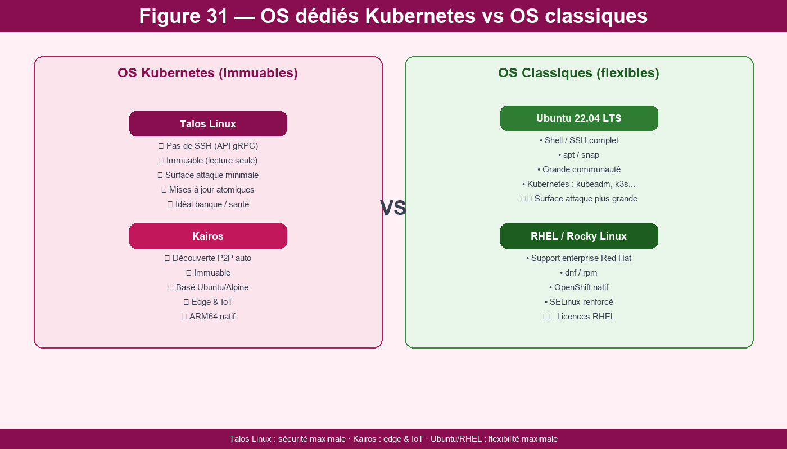

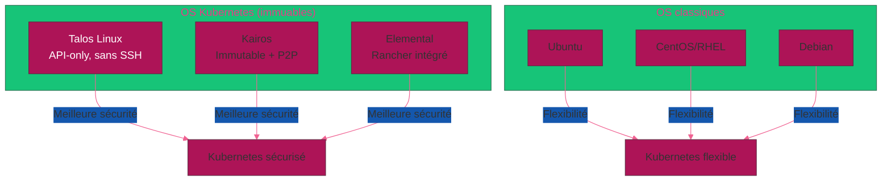

*Figure 31 — OS dédiés Kubernetes vs OS classiques*

---

### 38 — Talos Linux

#### Introduction

**Talos Linux** est un OS minimaliste conçu exclusivement pour Kubernetes. Il n'a **pas de SSH**, pas de shell, pas de gestionnaire de paquets. Tout est géré via une API gRPC sécurisée. C'est l'OS le plus sécurisé pour Kubernetes.

**Avantages clés :**
- Surface d'attaque minimale (aucun service inutile)
- Immuable (lecture seule sauf /tmp et /var)
- Mises à jour atomiques avec rollback automatique
- Idéal pour les secteurs réglementés (banque, santé)

#### Système requis

```bash
# Installer talosctl (CLI Talos)
curl -sL https://talos.dev/install | sh

# Installer talhelper (simplificateur de config)
# Ou directement talosctl

# Infrastructure : VMs bare metal, Proxmox, cloud, Raspberry Pi
```

#### Installation

**Générer les configurations**

```bash
# Générer les secrets et configs du cluster
talosctl gen config cluster-banque-talos https://10.0.1.10:6443 \
  --output-dir _out \
  --config-patch @patches/banque-patch.yaml

# Fichiers générés :
# _out/controlplane.yaml  <- Config control plane
# _out/worker.yaml        <- Config worker
# _out/talosconfig        <- Config talosctl
```

```yaml
# patches/banque-patch.yaml
machine:
  network:
    hostname: ""
  time:
    servers:
      - time.cloudflare.com
  kubelet:
    extraArgs:
      rotate-server-certificates: true
cluster:
  network:
    cni:
      name: none   # On installe Cilium manuellement
  proxy:
    disabled: true
  etcd:
    extraArgs:
      election-timeout: "5000"
```

#### Déploiement

```bash
# Appliquer la config sur le control plane (via ISO ou PXE)
# Talos boot depuis l'ISO, puis :
talosctl apply-config --insecure \
  --nodes 10.0.1.10 \
  --file _out/controlplane.yaml

# Bootstrapper etcd (une seule fois, sur le premier master)
talosctl bootstrap --nodes 10.0.1.10 --talosconfig _out/talosconfig

# Obtenir kubectl
talosctl kubeconfig --nodes 10.0.1.10 --talosconfig _out/talosconfig

# Appliquer la config workers
talosctl apply-config --insecure \
  --nodes 10.0.1.11 \
  --file _out/worker.yaml

talosctl apply-config --insecure \
  --nodes 10.0.1.12 \
  --file _out/worker.yaml

kubectl get nodes
# NAME    STATUS   ROLES           AGE   VERSION
# talos-master-01   Ready    control-plane   5m    v1.29.4
# talos-worker-01   Ready    <none>          2m    v1.29.4
```

#### Aller plus loin

```bash
# Gérer les nœuds sans SSH
talosctl dmesg --nodes 10.0.1.10
talosctl logs --nodes 10.0.1.10 kubelet
talosctl ps --nodes 10.0.1.10

# Mise à jour Talos
talosctl upgrade \
  --nodes 10.0.1.11 \
  --image ghcr.io/siderolabs/installer:v1.7.0

# Mise à jour Kubernetes
talosctl upgrade-k8s \
  --nodes 10.0.1.10 \
  --to 1.30.0
```

> **Cas d'usage Banque** — Talos Linux pour l'infrastructure de trading haute fréquence (sécurité maximale) :

```bash
# Aucun SSH = aucune backdoor possible
# Tout audit via API gRPC
# Surface d'attaque minimale pour PCI-DSS

talosctl gen config cluster-trading https://10.0.0.10:6443
# Déployer sur serveurs dédiés via IPMI/PXE
kubectl apply -f k8s/banque/trading-hf/
```

> **Cas d'usage Santé** — Talos pour les données RGPD/HDS avec immuabilité garantie :

```bash
# OS immuable = pas de modification non autorisée
# Conforme HDS : audit trail complet via API Talos
talosctl apply-config --nodes 10.0.1.10 --file controlplane.yaml
kubectl apply -f k8s/sante/dossier-patient/
```

#### Avantages et inconvénients

| Avantages | Inconvénients |
|-----------|--------------|
| Sécurité maximale (pas de SSH) | Courbe d'apprentissage importante |
| Immuable (lecture seule) | Pas de shell = debugging différent |
| Mises à jour atomiques | |
| Idéal réglementé (banque, santé) | |
| API gRPC : auditabilité complète | |

---

### 39 — Kairos

#### Introduction

**Kairos** est un framework pour créer des OS Kubernetes immuables à partir de n'importe quelle distribution Linux (Ubuntu, Alpine, openSUSE...). Il ajoute des fonctionnalités P2P (peer-to-peer) pour la découverte de nœuds automatique.

#### Système requis

```
N'importe quelle machine Linux (bare metal, VM, Raspberry Pi)
ISO Kairos téléchargeable depuis kairos.io
```

#### Installation

```bash
# Télécharger l'ISO Kairos (basé sur Ubuntu)
wget https://github.com/kairos-io/kairos/releases/latest/download/kairos-ubuntu-22.04-core-amd64.iso

# Booter depuis l'ISO
# Kairos s'installe automatiquement

# Configuration via cloud-init
cat > kairos-config.yaml << 'EOF'
#cloud-config
kairos:
  network_token: "VOTRE_TOKEN_P2P"   # Pour la découverte P2P

hostname: "k8s-node-01"

users:
- name: kairos
  ssh_authorized_keys:
  - "ssh-rsa VOTRE_CLE_SSH"

k3s:
  enabled: true
  args:
  - --disable traefik
EOF
```

#### Aller plus loin

```bash
# Formation d'un cluster P2P (sans configuration réseau manuelle)
# Les nœuds se découvrent automatiquement via le network_token

# Sur le premier nœud (le master sera auto-élu)
# Le token P2P est partagé entre tous les nœuds
# Kairos forme automatiquement le cluster

# Vérifier après démarrage
kubectl get nodes
```

> **Cas d'usage Éducation** — Kairos sur Raspberry Pi dans une salle de TP :

```yaml
# Les Pi se découvrent automatiquement (P2P)
# Pas de configuration réseau manuelle
#cloud-config
kairos:
  network_token: "tp-kubernetes-2024"

k3s:
  enabled: true

# Après boot des 10 Pi → cluster automatique
```

#### Avantages et inconvénients

| Avantages | Inconvénients |
|-----------|--------------|
| Découverte P2P automatique | Moins mature que Talos |
| Immuable | Communauté plus petite |
| Basé sur distributions connues | |
| Idéal edge et IoT | |

---

### 40 — Elemental (exemple avec RKE2)

#### Introduction

**Elemental** est une solution de gestion d'OS de Rancher pour provisionner et maintenir des nœuds Kubernetes à distance. Il se base sur SLE Micro (SUSE Linux Enterprise Micro) et s'intègre avec Rancher pour la gestion centralisée des OS des nœuds.

#### Système requis

```
Cluster Rancher existant
Serveurs cibles avec accès réseau
```

#### Installation et déploiement

```bash
# Installer l'opérateur Elemental sur Rancher
helm repo add elemental https://rancher.github.io/elemental-operator-helm-charts
helm install elemental-operator elemental/elemental-operator \
  --namespace cattle-elemental-system \
  --create-namespace
```

```yaml
# MachineRegistration : enregistrer de nouveaux nœuds
apiVersion: elemental.cattle.io/v1beta1
kind: MachineRegistration
metadata:
  name: machines-sante
  namespace: fleet-default
spec:
  machineName: "${System Information/Hostname}"
  machineInventoryLabels:
    secteur: sante
    location: "hopital-paris"
  config:
    cloud-config:
      users:
      - name: root
        ssh_authorized_keys:
        - "ssh-rsa VOTRE_CLE_SSH"
    elemental:
      install:
        reboot: true
        device: /dev/sda
```

```bash
# Créer l'ISO d'enregistrement
kubectl apply -f machine-registration-sante.yaml

# Générer l'ISO depuis Rancher UI
# Machines → Machine Registration → Build ISO

# Booter les serveurs depuis cet ISO
# Les machines s'enregistrent automatiquement dans Rancher
```

> **Cas d'usage Santé** — Elemental pour déployer K8s dans 50 hôpitaux depuis un Rancher central :

```yaml
# Depuis Rancher, créer un cluster RKE2 qui utilise les machines Elemental
apiVersion: provisioning.cattle.io/v1
kind: Cluster
metadata:
  name: cluster-hopitaux-paris
spec:
  rkeConfig:
    machinePools:
    - name: control-planes
      quantity: 3
      machineConfigRef:
        kind: ElementalMachineTemplate
        name: hopitaux-control-plane
    - name: workers
      quantity: 10
      machineConfigRef:
        kind: ElementalMachineTemplate
        name: hopitaux-workers
```

#### Avantages et inconvénients

| Avantages | Inconvénients |
|-----------|--------------|
| Gestion centralisée des OS | Nécessite Rancher |
| OS immuable SLE Micro | Complexité Rancher |
| Idéal grands déploiements (50+ sites) | Licence SUSE |
| Mise à jour OS à distance | |

---

### Conclusion Chapitre 5 — OS Kubernetes

| OS | Immuable | SSH | Mises à jour | Idéal pour |
|----|----------|-----|-------------|-----------|
| Talos Linux | ✅✅ | ❌ (API) | Atomiques | Banque, santé (sécurité max) |
| Kairos | ✅ | ✅ | Atomiques | Edge, IoT, éducation |
| Elemental + RKE2 | ✅ | ✅ | Via Rancher | Multi-sites, grandes orgas |

---

## CHAPITRE 6 — Plateformes de management de clusters Kubernetes

> **Objectif :** Gérer plusieurs clusters Kubernetes depuis une interface unifiée.

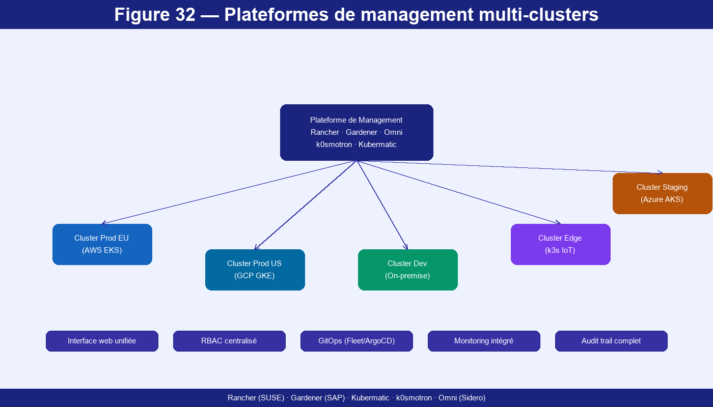

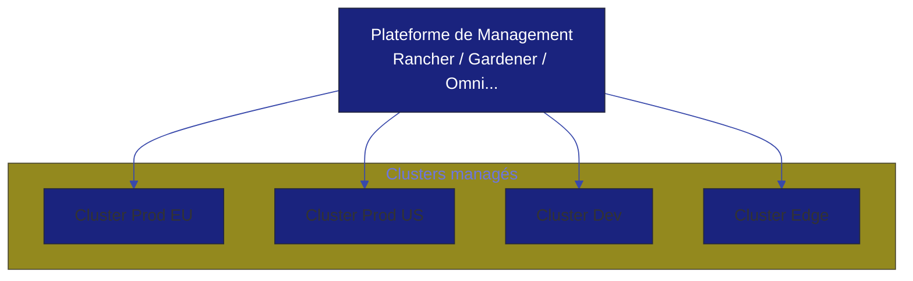

*Figure 32 — Une plateforme manage plusieurs clusters*

---

### 41 — k0smotron

#### Introduction

**k0smotron** permet de déployer des control planes Kubernetes en tant que pods dans un cluster Kubernetes hôte. Les workers peuvent être dans n'importe quel cloud ou on-premise.

#### Système requis

```bash
# Cluster Kubernetes hôte existant (k0s, k3s, ou autre)
kubectl get nodes

# Helm
helm version
```

#### Installation

```bash
helm repo add k0smotron https://docs.k0smotron.io/stable/charts
helm install k0smotron k0smotron/k0smotron \
  --namespace k0smotron --create-namespace
```

```yaml
# Créer un cluster k0s dans le cluster hôte
apiVersion: k0smotron.io/v1beta1
kind: Cluster
metadata:
  name: cluster-energie-child
  namespace: energie
spec:
  replicas: 3        # 3 pods control-plane
  k0sVersion: v1.29.4+k0s.0
  persistence:
    type: pvc
    persistentVolumeClaim:
      spec:
        accessModes: [ReadWriteOnce]
        resources:
          requests:
            storage: 10Gi
  service:
    type: LoadBalancer
```

```bash
kubectl apply -f cluster-energie-child.yaml

# Le control plane démarre comme des pods
kubectl get pods -n energie
# cluster-energie-child-0   Running   # etcd
# cluster-energie-child-1   Running   # api-server
# cluster-energie-child-2   Running   # controller-manager

# Récupérer le kubeconfig
kubectl get secret -n energie k0s-kubeconfig-cluster-energie-child \
  -o jsonpath='{.data.value}' | base64 -d > cluster-energie.kubeconfig
```

#### Création et déploiement d'un cluster chez un fournisseur cloud

```yaml
# Worker nodes sur AWS (Cluster API + k0smotron)
apiVersion: cluster.x-k8s.io/v1beta1
kind: MachineDeployment
metadata:
  name: workers-energie-aws
  namespace: energie
spec:
  clusterName: cluster-energie-child
  replicas: 3
  template:
    spec:
      clusterName: cluster-energie-child
      infrastructureRef:
        kind: AWSMachineTemplate
        name: workers-aws-template
      bootstrap:
        configRef:
          kind: K0sWorkerConfigTemplate
          name: worker-config
```

> **Cas d'usage Énergie** — k0smotron pour créer des clusters K8s par centrale électrique :

```bash
# 1 cluster par centrale, tous gérés depuis le cluster hôte central
for centrale in paris-nord lyon-sud bordeaux-ouest; do
  cat > cluster-${centrale}.yaml << EOF
apiVersion: k0smotron.io/v1beta1
kind: Cluster
metadata:
  name: cluster-${centrale}
  namespace: energie
spec:
  replicas: 1
  k0sVersion: v1.29.4+k0s.0
EOF
  kubectl apply -f cluster-${centrale}.yaml
done

kubectl get clusters -n energie
```

#### Avantages et inconvénients

| Avantages | Inconvénients |
|-----------|--------------|
| Control plane = pods (flexible) | Encore jeune |
| Workers multi-cloud | Complexité Cluster API |
| Isolation forte | |
| Idéal multi-tenant | |

---

### 42 — Omni

#### Introduction

**Omni** de Sidero Labs (créateurs de Talos Linux) est une plateforme SaaS de management de clusters Kubernetes basée sur Talos Linux. Elle permet de gérer des clusters dans n'importe quel environnement depuis une interface web simple.

#### Système requis

```
Compte Omni sur omni.siderolabs.com (SaaS) ou self-hosted
Serveurs bootables (bare metal, VMs, cloud)
```

#### Déploiement

**Étape 1 — Créer le média d'installation**

```bash
# Dans l'interface Omni
# Machines → Download Talos Image
# Choisir la version et l'architecture

# Ou via omnictl
omnictl download media \
  --type iso \
  --output talos-omni.iso
```

**Étape 2 — Booter les serveurs**

```
Booter les serveurs depuis l'ISO Omni
Ils apparaissent automatiquement dans Omni → Machines
```

**Création d'un cluster**

```bash
# Via l'interface web Omni :
# Clusters → Create Cluster
# Sélectionner les machines depuis l'inventaire
# Choisir la version Kubernetes

# Via omnictl
omnictl cluster template generate \
  --name cluster-sante \
  --kubernetes-version v1.29.4 \
  > cluster-sante.yaml

# Éditer pour assigner les machines
omnictl apply -f cluster-sante.yaml
```

```yaml
# cluster-sante.yaml
kind: Cluster
name: cluster-sante
kubernetes:
  version: v1.29.4
talos:
  version: v1.7.0
patches:
- file: patches/sante-security.yaml
---
kind: ControlPlane
machines:
- id: machine-01
- id: machine-02
- id: machine-03
patches:
- file: patches/control-plane-sante.yaml
---
kind: Workers
machines:
- id: machine-04
- id: machine-05
```

#### Utilisation de kubectl

```bash
omnictl kubeconfig --cluster cluster-sante > ~/.kube/omni-sante.yaml
export KUBECONFIG=~/.kube/omni-sante.yaml
kubectl get nodes
```

> **Cas d'usage Santé** — Omni pour gérer les clusters K8s de 20 hôpitaux depuis un tableau de bord central :

```bash
# Chaque hôpital a ses serveurs bootés avec l'ISO Omni
# Ils apparaissent dans l'inventaire central
# L'équipe IT centrale crée les clusters depuis l'interface web

omnictl cluster list
# NAME                  MACHINES   K8S VERSION   PHASE
# cluster-hopital-01    5          v1.29.4       Running
# cluster-hopital-02    5          v1.29.4       Running
# cluster-clinique-01   3          v1.29.4       Running
```

#### Avantages et inconvénients

| Avantages | Inconvénients |
|-----------|--------------|
| Interface web simple | Basé sur Talos (courbe apprentissage) |
| Basé sur Talos (sécurité max) | SaaS ou self-hosted complexe |
| Gestion multi-clusters unifiée | |
| Idéal multi-sites | |

---

### 43 — Rancher (exemple avec OVHcloud)

#### Introduction

**Rancher** de SUSE est la plateforme de management Kubernetes la plus populaire. Elle offre une interface web unifiée pour créer, gérer et monitorer des clusters K8s dans n'importe quel environnement.

#### Déploiement

```bash
# Installer Rancher sur un cluster K8s existant
helm repo add rancher-latest https://releases.rancher.com/server-charts/latest
helm repo update

# Installer cert-manager (requis)
kubectl apply -f https://github.com/cert-manager/cert-manager/releases/latest/download/cert-manager.yaml

# Installer Rancher
helm install rancher rancher-latest/rancher \
  --namespace cattle-system \
  --create-namespace \
  --set hostname=rancher.mondomaine.fr \
  --set bootstrapPassword=admin \
  --set ingress.tls.source=letsEncrypt \
  --set letsEncrypt.email=admin@mondomaine.fr

# Accéder à l'interface web
# https://rancher.mondomaine.fr
```

#### Création d'un cluster sur OVHcloud avec OpenStack

```bash
# Dans Rancher : Clusters → Create → Custom
# Ou via CLI
cat > cluster-ovhcloud.yaml << 'EOF'
apiVersion: provisioning.cattle.io/v1
kind: Cluster
metadata:
  name: cluster-transport-ovh
  namespace: fleet-default
spec:
  rkeConfig:
    machinePools:
    - name: control-plane
      quantity: 3
      machineConfigRef:
        kind: OpenStackConfig
        name: ovh-control-plane-config
    - name: workers
      quantity: 5
      machineConfigRef:
        kind: OpenStackConfig
        name: ovh-worker-config
EOF

kubectl apply -f cluster-ovhcloud.yaml
```

#### Enrôlement d'un cluster existant

```bash
# Rancher peut aussi gérer des clusters existants (import)
# Clusters → Import → Afficher la commande kubectl

kubectl apply -f https://rancher.mondomaine.fr/v3/import/TOKEN.yaml
# Le cluster apparaît dans Rancher
```

> **Cas d'usage Transport** — Rancher pour gérer les clusters K8s de 15 régions ferroviaires :

```bash
# Cluster Rancher central qui manage 15 clusters régionaux
rancher cluster list
# NAME              PROVIDER    VERSION   STATUS
# cluster-idf       OVHcloud    1.29.4    Active
# cluster-aura      OVHcloud    1.29.4    Active
# cluster-paca      OVHcloud    1.29.4    Active
# ...

# Déployer une app sur toutes les régions via Fleet (GitOps Rancher)
kubectl apply -f fleet-bundle-transport.yaml
```

#### Avantages et inconvénients

| Avantages | Inconvénients |
|-----------|--------------|
| Interface web très complète | Rancher consomme des ressources |
| Multi-cloud natif | Complexité de setup |
| Fleet (GitOps intégré) | |
| Monitoring intégré (Prometheus) | |
| Support enterprise SUSE | |

---

### 44 — Kubermatic Kubernetes Platform

#### Introduction

**Kubermatic** (KKP) est une plateforme enterprise de management de clusters Kubernetes multi-cloud, auto-service pour les développeurs. Elle permet aux équipes de créer elles-mêmes des clusters via un portail self-service.

#### Système requis

```
Cluster K8s master (seed cluster)
Helm 3.x
Licence Kubermatic (community ou enterprise)
```

#### Installation

```bash
# Télécharger KKP
wget https://github.com/kubermatic/kubermatic/releases/latest/download/kubermatic-ee-linux-amd64.tar.gz
tar xzf kubermatic-ee-linux-amd64.tar.gz

# Configurer les valeurs Helm
cat > values.yaml << 'EOF'
kubermatic:
  domain: kkp.mondomaine.fr
  auth:
    tokenIssuer: https://kkp.mondomaine.fr/dex
    clientID: kubermatic
EOF
```

#### Configuration

```yaml
# kubermatic.yaml
apiVersion: operator.kubermatic.io/v1alpha1
kind: KubermaticConfiguration
metadata:
  name: kubermatic
  namespace: kubermatic
spec:
  ingress:
    domain: kkp.mondomaine.fr
  featureGates:
    OIDCKubeCfgEndpoint:
      enabled: true
  userCluster:
    kubernetes:
      versions:
      - "1.28.x"
      - "1.29.x"
      default: "1.29"
```

#### Déploiement

```bash
kubermatic-installer deploy kubermatic-master \
  --helm-values values.yaml \
  --config kubermatic.yaml
```

> **Cas d'usage Éducation** — KKP en libre-service pour les chercheurs d'une université :

```
Chaque chercheur peut créer son propre cluster K8s via le portail web
Sans intervention de l'équipe IT
Quotas par département pour contrôler les coûts
```

#### Avantages et inconvénients

| Avantages | Inconvénients |
|-----------|--------------|
| Self-service pour les équipes | Complexité de déploiement |
| Multi-cloud natif | Licence enterprise coûteuse |
| Quotas et RBAC avancés | |
| Audit trail complet | |

---

### 45 — Gardener

#### Introduction

**Gardener** est la plateforme de management Kubernetes développée par SAP pour gérer des milliers de clusters à l'échelle mondiale. Il utilise Kubernetes pour gérer Kubernetes (comme Cluster API).

#### Système requis

```
Cluster K8s (garden cluster)
Accès cloud provider (AWS, GCP, Azure, OpenStack...)
```

#### Installation

```bash
helm repo add gardener https://charts.gardener.cloud/stable
helm repo update

helm install gardener-controlplane gardener/gardener-controlplane \
  --namespace garden --create-namespace
```

```yaml
# Shoot cluster : un cluster managé par Gardener
apiVersion: core.gardener.cloud/v1beta1
kind: Shoot
metadata:
  name: cluster-banque-shoot
  namespace: garden-banque
spec:
  cloudProfileName: aws
  region: eu-west-1
  provider:
    type: aws
    controlPlaneConfig:
      apiVersion: aws.provider.extensions.gardener.cloud/v1alpha1
      kind: ControlPlaneConfig
      loadBalancerProvider: aws
    infrastructureConfig:
      apiVersion: aws.provider.extensions.gardener.cloud/v1alpha1
      kind: InfrastructureConfig
      networks:
        vpc:
          cidr: 10.250.0.0/16
    workers:
    - name: workers
      machine:
        type: m5.xlarge
      autoScalerMin: 2
      autoScalerMax: 10
  kubernetes:
    version: "1.29"
  networking:
    type: calico
    pods: 100.128.0.0/11
    nodes: 10.250.0.0/16
    services: 100.112.0.0/13
```

```bash
kubectl apply -f cluster-banque-shoot.yaml
kubectl get shoot cluster-banque-shoot -n garden-banque
# Gardener provisionne le cluster sur AWS
```

> **Cas d'usage Banque** — Gardener pour gérer 200 clusters dans une multinationale bancaire :

```bash
# SAP gère des milliers de clusters avec Gardener
# Une banque internationale peut faire de même

kubectl get shoots -A
# NAMESPACE       NAME               CLOUDPROFILE   VERSION   STATUS
# garden-france   cluster-fr-prod    aws-eu-west    1.29.4    Ready
# garden-germany  cluster-de-prod    aws-eu-central 1.29.4    Ready
# garden-usa      cluster-us-prod    aws-us-east    1.29.4    Ready
```

#### Avantages et inconvénients

| Avantages | Inconvénients |
|-----------|--------------|
| Hyperscale (milliers de clusters) | Très complexe à installer |
| Multi-cloud | Courbe d'apprentissage importante |
| Kubernetes-native | Overkill pour < 50 clusters |
| Utilisé par SAP en production | |

---

### Conclusion Chapitre 6 — Plateformes de Management

| Plateforme | Interface | Multi-cloud | Self-service | Idéal pour |
|-----------|-----------|-------------|-------------|-----------|
| k0smotron | kubectl | ✅ | ❌ | Multi-tenant technique |
| Omni | Web simple | ✅ | ✅ | Multi-sites, hôpitaux |
| Rancher | Web complet | ✅✅ | ✅ | Entreprises moyennes |
| Kubermatic | Web self-service | ✅✅ | ✅✅ | R&D, universités |
| Gardener | kubectl/web | ✅✅ | ✅ | Très grandes enterprises |

---

## CHAPITRE 7 — Méthodes d'installation Kubernetes « inclassables »

> Ces outils ne rentrent dans aucune catégorie précédente mais méritent d'être connus.

---

### 46 — vCluster

#### Introduction

**vCluster** crée des clusters Kubernetes virtuels à l'intérieur d'un namespace d'un cluster physique. Chaque vCluster est isolé et a son propre API server, mais partage les ressources physiques du cluster hôte.

**Cas d'usage :** Multi-tenancy avancé (chaque client a son propre "cluster" apparent).

#### Système requis

```bash
# vcluster CLI
curl -L -o vcluster \
  "https://github.com/loft-sh/vcluster/releases/latest/download/vcluster-linux-amd64"
chmod +x vcluster && sudo mv vcluster /usr/local/bin/
```

#### Installation

```bash
# Créer un vCluster pour l'équipe banque
vcluster create vcluster-banque \
  --namespace vcluster-banque \
  --connect

kubectl get nodes
# NAME           STATUS   ROLES
# fake-node-01   Ready    <none>   # Nœud virtuel du vCluster

# Se déconnecter du vCluster
vcluster disconnect

# Lister tous les vClusters
vcluster list
# NAME              NAMESPACE        STATUS    AGE
# vcluster-banque   vcluster-banque  Running   2m
```

```yaml
# Configuration avancée d'un vCluster
vcluster create vcluster-sante \
  --namespace vcluster-sante \
  --values - << 'EOF'
syncer:
  extraArgs:
  - --sync-all-configmaps
vcluster:
  env:
  - name: KUBERNETES_SERVICE_HOST
    value: "kubernetes.default.svc.cluster.local"
isolation:
  enabled: true
  resourceQuota:
    enabled: true
    quota:
      requests.cpu: "10"
      requests.memory: 20Gi
      pods: "50"
EOF
```

> **Cas d'usage Banque** — vCluster pour isoler les équipes produit dans un seul cluster physique :

```bash
# Un cluster physique, 5 équipes avec leur vCluster isolé
vcluster create vcluster-equipe-credit    --namespace equipe-credit
vcluster create vcluster-equipe-epargne   --namespace equipe-epargne
vcluster create vcluster-equipe-trading   --namespace equipe-trading
vcluster create vcluster-equipe-mobile    --namespace equipe-mobile
vcluster create vcluster-equipe-api       --namespace equipe-api

# Chaque équipe a son propre kubectl/kubeconfig
# Isolation forte + économie de coût (1 cluster physique pour toutes)
```

> **Cas d'usage Éducation** — vCluster pour les étudiants en TP Kubernetes :

```bash
# 1 cluster physique, 30 vClusters pour 30 étudiants
for i in $(seq -w 1 30); do
  vcluster create "vcluster-etudiant-${i}" \
    --namespace "etudiant-${i}" \
    --values values-student.yaml
done

# Chaque étudiant a un vrai cluster K8s sans risque de casser la prod
```

#### Avantages et inconvénients

| Avantages | Inconvénients |
|-----------|--------------|
| Isolation forte sans cluster physique | Certaines ressources non synchronisées |
| Multi-tenant économique | vCluster = overhead CPU/mémoire |
| API server dédié par tenant | |
| Idéal TP, dev, staging | |

---

### 47 — k3k

#### Introduction

**k3k** est similaire à vCluster mais utilise **k3s** pour créer des clusters virtuels. Il crée des clusters k3s complets (avec worker nodes) dans un namespace Kubernetes.

#### Système requis

```bash
# Helm
helm version

# Cluster Kubernetes hôte
kubectl get nodes
```

#### Installation et déploiement

```bash
helm repo add k3k https://rancher.github.io/k3k
helm repo update

helm install k3k k3k/k3k \
  --namespace k3k --create-namespace

# Installer le CLI k3k
curl -sfL https://raw.githubusercontent.com/rancher/k3k/main/install.sh | sh -
```

```bash
# Créer un cluster k3k
k3k cluster create \
  --name cluster-assurance \
  --servers 1 \
  --agents 2 \
  --namespace k3k-assurance

# Récupérer le kubeconfig
k3k kubeconfig --cluster cluster-assurance \
  --namespace k3k-assurance > k3k-assurance.yaml

export KUBECONFIG=k3k-assurance.yaml
kubectl get nodes
```

> **Cas d'usage Assurance** — k3k pour créer des environnements de test isolés :

```bash
# Créer un environnement de test pour chaque sprint
k3k cluster create \
  --name "test-sprint-$(date +%Y%m%d)" \
  --servers 1 --agents 2

kubectl apply -f k8s/assurance/
./scripts/tests-integration.sh

# Supprimer après les tests
k3k cluster delete --name "test-sprint-$(date +%Y%m%d)"
```

#### Avantages et inconvénients

| Avantages | Inconvénients |
|-----------|--------------|
| Clusters k3s complets avec workers | Plus lourd que vCluster |
| Isolation réseau et ressources | Jeune projet |
| Idéal tests d'intégration | |

---

### 48 — Rancher Harvester

#### Introduction

**Rancher Harvester** est une plateforme HCI (Hyper-Converged Infrastructure) open source qui combine la virtualisation (VMs basées sur KubeVirt) et Kubernetes dans une seule plateforme. Vous pouvez faire tourner des VMs et des conteneurs côte à côte.

#### Système requis

```
Serveur bare metal : 8 cœurs, 32 Go RAM, 200 Go SSD
ISO Harvester téléchargeable
```

#### Installation du premier nœud

```bash
# Booter depuis l'ISO Harvester
# https://releases.rancher.com/harvester/

# Pendant l'installation :
# 1. Choisir "Create a new Harvester cluster"
# 2. Configurer l'IP de management
# 3. Choisir le disque
# 4. Configurer le mot de passe

# Accéder à l'interface web : https://IP_HARVESTER
```

#### Installation des nœuds suivants

```bash
# Sur les nœuds suivants :
# Booter depuis le même ISO Harvester
# Choisir "Join an existing Harvester cluster"
# Entrer l'IP du cluster existant et le token
```

#### Première connexion et création d'une machine virtuelle

```bash
# Interface web Harvester : https://IP_HARVESTER
# Virtual Machines → Create

# Ou via kubectl (Harvester = cluster Kubernetes)
kubectl get nodes
kubectl get vms -A
```

```yaml
# Créer une VM Ubuntu pour les tests
apiVersion: kubevirt.io/v1
kind: VirtualMachine
metadata:
  name: vm-test-transport
  namespace: transport
spec:
  running: true
  template:
    spec:
      domain:
        cpu:
          cores: 2
        memory:
          guest: 4Gi
        devices:
          disks:
          - name: boot-disk
            disk:
              bus: virtio
      volumes:
      - name: boot-disk
        containerDisk:
          image: kubevirt/fedora-cloud-container-disk-demo:latest
```

> **Cas d'usage Transport** — Harvester pour l'infrastructure d'une entreprise de transport (VMs + K8s) :

```bash
# L'entreprise a besoin de VMs (legacy) ET de K8s (nouvelles apps)
# Harvester unifie les deux sur la même infrastructure

# VMs pour les applications legacy
kubectl apply -f vm-systeme-legacy-transport.yaml

# K8s (Rancher + Harvester) pour les nouvelles apps
kubectl apply -f k8s/transport/suivi-flotte-moderne/
```

#### Avantages et inconvénients

| Avantages | Inconvénients |
|-----------|--------------|
| VMs + K8s dans la même plateforme | Bare metal requis |
| HCI open source | Ressources importantes |
| Intégration Rancher native | Complexité HCI |
| Idéal remplacement VMware | |

---

### 49 — KWOK

#### Introduction

**KWOK** (Kubernetes WithOut Kubelet) permet de simuler des milliers de nœuds et pods Kubernetes sans consommer de ressources réelles. Idéal pour les tests de performance et la formation.

#### Système requis et installation

```bash
# Installer KWOK
KWOK_REPO=kubernetes-sigs/kwok
KWOK_LATEST_RELEASE=$(curl "https://api.github.com/repos/${KWOK_REPO}/releases/latest" | jq -r '.tag_name')

wget -O kwokctl "https://github.com/${KWOK_REPO}/releases/download/${KWOK_LATEST_RELEASE}/kwokctl-linux-amd64"
chmod +x kwokctl && sudo mv kwokctl /usr/local/bin/
```

#### Déploiement d'un cluster avec KWOK

```bash
# Créer un cluster KWOK (pas de vrais nœuds !)
kwokctl create cluster --name cluster-test-perf

# Simuler 1000 nœuds virtuels
kubectl apply -f - << 'EOF'
apiVersion: v1
kind: Node
metadata:
  name: fake-node-001
  labels:
    beta.kubernetes.io/arch: amd64
    beta.kubernetes.io/os: linux
    kubernetes.io/arch: amd64
    kubernetes.io/hostname: fake-node-001
    kubernetes.io/os: linux
    kwok.x-k8s.io/node: fake
status:
  allocatable:
    cpu: "32"
    memory: 256Gi
    pods: "110"
  capacity:
    cpu: "32"
    memory: 256Gi
    pods: "110"
  phase: Running
EOF

# Script pour créer 1000 noeuds
for i in $(seq -w 1 1000); do
  kubectl apply -f - << EOF
apiVersion: v1
kind: Node
metadata:
  name: fake-node-${i}
  labels:
    kwok.x-k8s.io/node: fake
    kubernetes.io/hostname: fake-node-${i}
status:
  allocatable:
    cpu: "8"
    memory: 32Gi
    pods: "110"
  phase: Running
EOF
done

kubectl get nodes | wc -l
# 1001 (1000 noeuds + header)
```

```bash
# Tester le scheduler sur 1000 nœuds
kubectl create deployment test-scaling --image=nginx --replicas=50000
kubectl get pods | wc -l
# 50001 pods "running" sans consommer de ressources réelles !
```

> **Cas d'usage Éducation** — KWOK pour enseigner le scheduler et le HPA sans cluster réel :

```bash
# Un étudiant sur son laptop simule un cluster de 100 nœuds
kwokctl create cluster --name tp-scheduler

for i in $(seq 1 100); do
  kubectl apply -f fake-node.yaml
done

# Démontrer le scheduler
kubectl create deployment nginx-tp --image=nginx --replicas=200
kubectl get pods -o wide  # Répartition sur les 100 nœuds virtuels
```

> **Cas d'usage Banque** — KWOK pour tester la configuration HPA/KEDA avant mise en production :

```bash
# Simuler 500 nœuds d'un cluster bancaire pour tester l'autoscaler
kwokctl create cluster --name test-hpa-banque

kubectl apply -f k8s/banque/hpa-config.yaml
kubectl scale deployment api-paiement --replicas=10000
# Vérifier que le HPA se comporte comme attendu
```

#### Avantages et inconvénients

| Avantages | Inconvénients |
|-----------|--------------|
| Simule des milliers de nœuds | Pas de vrais workloads |
| Aucune ressource consommée | Tests limités (pas de réseau réel) |
| Idéal tests scheduler/HPA | Seulement pour simulation |
| Gratuit et léger | |

---

### 50 — Démystifions Kubernetes, binaire par binaire

#### Introduction

Cette section décompose Kubernetes en ses binaires fondamentaux pour comprendre l'architecture interne. C'est la meilleure façon de comprendre comment tout fonctionne, même si vous n'utiliserez jamais cette méthode en production.

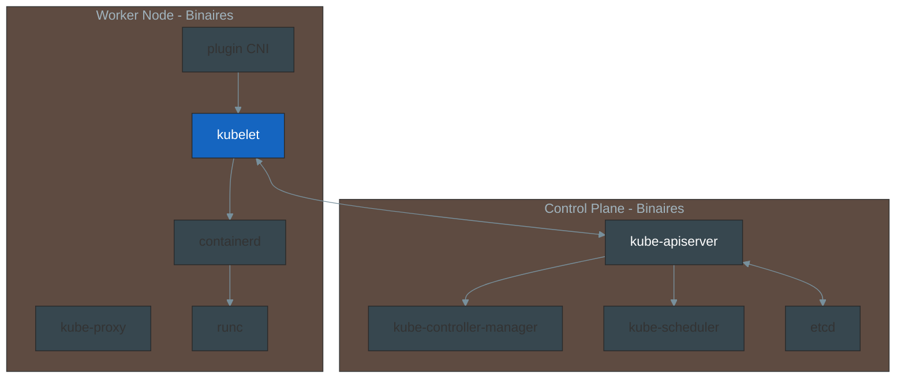

*Figure 33 — Les binaires Kubernetes et leurs interactions*

#### Système requis

```
Linux x86-64
8 Go RAM
50 Go disque
```

#### Récupération des binaires

```bash
K8S_VERSION="v1.29.4"
BASE_URL="https://dl.k8s.io/release/${K8S_VERSION}/bin/linux/amd64"

# Télécharger tous les binaires
for binary in kube-apiserver kube-controller-manager kube-scheduler kubectl kubelet kube-proxy; do
  curl -LO "${BASE_URL}/${binary}"
  chmod +x ${binary}
  sudo mv ${binary} /usr/local/bin/
done

# etcd
ETCD_VERSION="v3.5.10"
curl -LO "https://github.com/etcd-io/etcd/releases/download/${ETCD_VERSION}/etcd-${ETCD_VERSION}-linux-amd64.tar.gz"
tar xzf etcd-*.tar.gz
sudo mv etcd-*/etcd etcd-*/etcdctl /usr/local/bin/
```

#### Génération des certificats

```bash
# Créer l'autorité de certification (CA)
mkdir -p /etc/kubernetes/pki

# CA
openssl genrsa -out /etc/kubernetes/pki/ca.key 2048
openssl req -new -x509 -days 365 -key /etc/kubernetes/pki/ca.key \
  -out /etc/kubernetes/pki/ca.crt \
  -subj "/CN=kubernetes-ca"

# Certificat kube-apiserver
openssl genrsa -out /etc/kubernetes/pki/apiserver.key 2048
openssl req -new -key /etc/kubernetes/pki/apiserver.key \
  -out /etc/kubernetes/pki/apiserver.csr \
  -subj "/CN=kube-apiserver"

# Signer avec la CA
openssl x509 -req -in /etc/kubernetes/pki/apiserver.csr \
  -CA /etc/kubernetes/pki/ca.crt \
  -CAkey /etc/kubernetes/pki/ca.key \
  -CAcreateserial \
  -out /etc/kubernetes/pki/apiserver.crt \
  -days 365
```

#### Création du fichier .kube/config

```bash
# Générer le kubeconfig
kubectl config set-cluster kubernetes \
  --certificate-authority=/etc/kubernetes/pki/ca.crt \
  --server=https://127.0.0.1:6443 \
  --kubeconfig=/etc/kubernetes/admin.conf

kubectl config set-credentials admin \
  --client-certificate=/etc/kubernetes/pki/admin.crt \
  --client-key=/etc/kubernetes/pki/admin.key \
  --kubeconfig=/etc/kubernetes/admin.conf

kubectl config set-context kubernetes-admin@kubernetes \
  --cluster=kubernetes \
  --user=admin \
  --kubeconfig=/etc/kubernetes/admin.conf

kubectl config use-context kubernetes-admin@kubernetes \
  --kubeconfig=/etc/kubernetes/admin.conf

cp /etc/kubernetes/admin.conf ~/.kube/config
```

#### Création de la base de données etcd

```bash
# Démarrer etcd
etcd \
  --data-dir=/var/lib/etcd \
  --name=etcd-01 \
  --cert-file=/etc/kubernetes/pki/etcd/server.crt \
  --key-file=/etc/kubernetes/pki/etcd/server.key \
  --trusted-ca-file=/etc/kubernetes/pki/etcd/ca.crt \
  --listen-client-urls=https://127.0.0.1:2379 \
  --advertise-client-urls=https://127.0.0.1:2379 &

# Vérifier
etcdctl --endpoints=https://127.0.0.1:2379 member list
```

#### Le serveur d'API

```bash
kube-apiserver \
  --etcd-servers=https://127.0.0.1:2379 \
  --etcd-cafile=/etc/kubernetes/pki/etcd/ca.crt \
  --etcd-certfile=/etc/kubernetes/pki/apiserver-etcd-client.crt \
  --etcd-keyfile=/etc/kubernetes/pki/apiserver-etcd-client.key \
  --client-ca-file=/etc/kubernetes/pki/ca.crt \
  --tls-cert-file=/etc/kubernetes/pki/apiserver.crt \
  --tls-private-key-file=/etc/kubernetes/pki/apiserver.key \
  --service-cluster-ip-range=10.96.0.0/12 \
  --authorization-mode=Node,RBAC &

echo "API Server démarré"
kubectl get nodes  # Doit retourner (vide pour l'instant)
```

#### Le binaire controller-manager

```bash
kube-controller-manager \
  --master=https://127.0.0.1:6443 \
  --kubeconfig=/etc/kubernetes/controller-manager.conf \
  --root-ca-file=/etc/kubernetes/pki/ca.crt \
  --cluster-signing-cert-file=/etc/kubernetes/pki/ca.crt \
  --cluster-signing-key-file=/etc/kubernetes/pki/ca.key \
  --service-account-private-key-file=/etc/kubernetes/pki/sa.key &
```

#### Le scheduler

```bash
kube-scheduler \
  --kubeconfig=/etc/kubernetes/scheduler.conf \
  --leader-elect=false &
```

#### containerd et runc

```bash
# Installer containerd
apt-get install -y containerd
systemctl start containerd

# runc est inclus dans containerd
runc --version
```

#### kubelet

```bash
kubelet \
  --kubeconfig=/etc/kubernetes/kubelet.conf \
  --config=/var/lib/kubelet/config.yaml \
  --container-runtime-endpoint=unix:///var/run/containerd/containerd.sock \
  --node-ip=192.168.1.10 &

kubectl get nodes
# NAME    STATUS     ROLES    AGE
# node1   NotReady   <none>   10s   (NotReady car pas de CNI encore)
```

#### Plugin CNI

```bash
# Installer les plugins CNI de base
mkdir -p /opt/cni/bin
curl -LO https://github.com/containernetworking/plugins/releases/latest/download/cni-plugins-linux-amd64-v1.4.0.tgz
tar xzf cni-plugins-*.tgz -C /opt/cni/bin

# Configurer un réseau simple (bridge)
mkdir -p /etc/cni/net.d
cat > /etc/cni/net.d/10-bridge.conf << 'EOF'
{
  "cniVersion": "0.4.0",
  "name": "bridge",
  "type": "bridge",
  "bridge": "cni0",
  "isGateway": true,
  "ipMasq": true,
  "ipam": {
    "type": "host-local",
    "subnet": "10.244.0.0/24",
    "routes": [{"dst": "0.0.0.0/0"}]
  }
}
EOF

kubectl get nodes
# NAME    STATUS   ROLES    AGE
# node1   Ready    <none>   2m    (Ready maintenant !)
```

#### Aller plus loin

```bash
# Vérifier que tout fonctionne
kubectl run test-pod --image=nginx
kubectl get pods
# test-pod   Running

kubectl exec -it test-pod -- curl localhost
# HTML de nginx = succès !

# Vous venez de comprendre comment K8s fonctionne de l'intérieur
```

---

### Conclusion Chapitre 7 — Outils inclassables

| Outil | Cas d'usage | Niveau |
|-------|-------------|--------|
| vCluster | Multi-tenant, dev isolé | Intermédiaire |
| k3k | Tests d'intégration | Intermédiaire |
| Rancher Harvester | VMs + K8s (remplace VMware) | Avancé |
| KWOK | Simulation, formation, tests | Débutant |
| Binaires K8s | Comprendre K8s en profondeur | Expert |

---

## Conclusion

### Outils Desktop

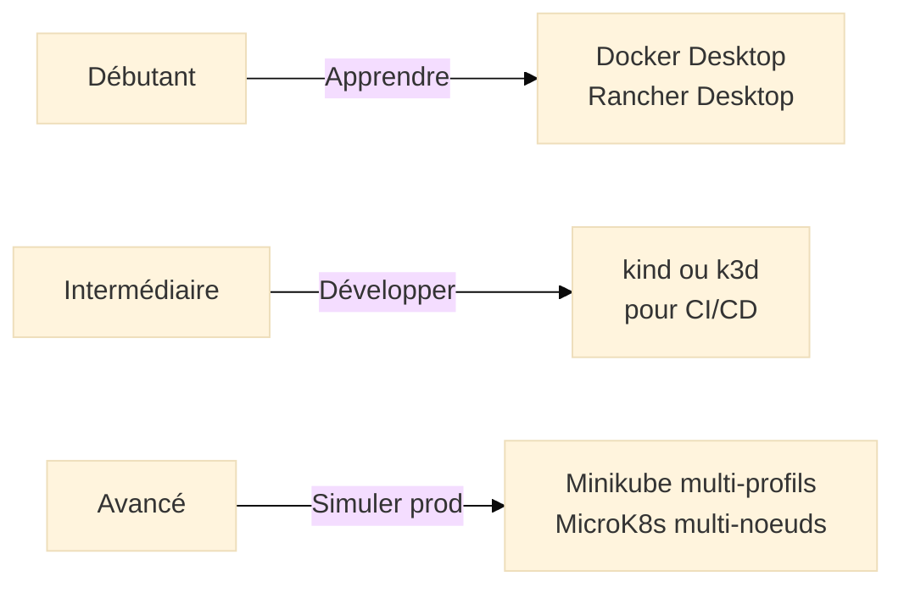

Pour démarrer, **Rancher Desktop** (gratuit, Windows/macOS/Linux) ou **Docker Desktop** (macOS/Windows) sont les choix évidents. Pour le CI/CD, **kind** et **k3d** sont incontournables.

### Services Managés

Les offres managées sont le choix naturel pour la production cloud. Le choix dépend principalement de :
- **La conformité réglementaire** : Exoscale (Suisse) ou Scaleway (France) pour les données européennes sensibles
- **L'écosystème existant** : AWS EKS si vous utilisez déjà AWS
- **Le budget** : Civo pour les petites structures, OKE pour profiter du tier gratuit ARM64

### Solutions de Déploiement Automatisées vs IaC

| Besoin | Solution recommandée |
|--------|---------------------|
| On-premise datacenter | kubeadm + Kubespray |
| Edge / IoT / ARM64 | k3s |
| Cloud IaaS | kOps ou KubeOne |
| GitOps complet | Cluster API ou Crossplane |
| Équipes développeurs | OpenTofu ou Pulumi |

### Systèmes d'exploitation spécialisés

Talos Linux représente l'avenir des OS pour Kubernetes en production : immuable, sans SSH, surface d'attaque minimale. Pour les secteurs réglementés (banque, santé), c'est le choix optimal.

### Dernier mot

Kubernetes n'est pas une technologie qu'on apprend en un jour. C'est un écosystème en constante évolution. La meilleure approche est :

1. **Commencer local** avec Rancher Desktop ou kind
2. **Déployer une vraie application** (pas juste nginx)
3. **Ajouter progressivement** : Ingress, stockage, monitoring
4. **Passer au cloud managé** : EKS, Civo, ou Scaleway
5. **Automatiser** avec kubeadm ou k3s pour vos propres clusters
6. **Adopter GitOps** avec ArgoCD ou Flux pour la production

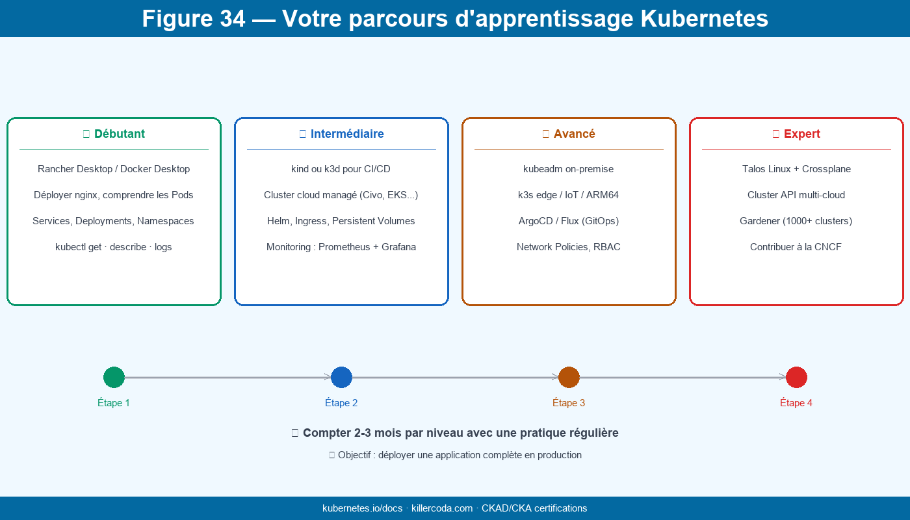

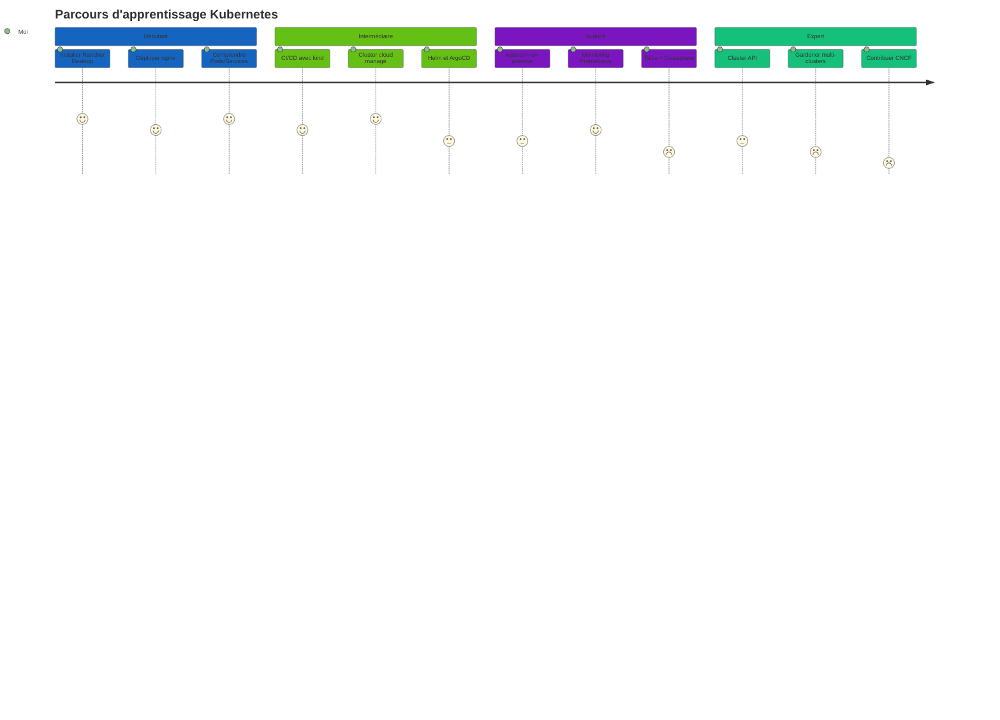

*Figure 34 — Votre parcours d'apprentissage Kubernetes*

---

## Remerciements

Ce document s'inspire de la communauté Kubernetes et de la CNCF. Merci à tous les contributeurs des projets open source présentés ici.

---

## Index

| Terme | Section |
|-------|---------|
| ARM64 | OKE (§16), k3s (§21), MicroK8s (§2) |
| CI/CD | kind (§1), k3d (§7), k3sup (§22) |
| Edge / IoT | k3s (§21), Kairos (§39), KWOK (§49) |
| GitOps | Kubespray (§32), Cluster API (§33), Crossplane (§37) |
| HA (Haute Disponibilité) | kubeadm (§19), k3s (§21), k0s (§23) |
| Multi-cloud | Cluster API (§33), Crossplane (§37), Gardener (§45) |
| On-premise | kubeadm (§19), KubeKey (§26), Kubespray (§32) |
| RGPD/Conformité | Exoscale (§15), Scaleway (§17), Talos (§38) |
| Sécurité | Talos (§38), NetworkPolicy, PodSecurityPolicy |
| Simulation | KWOK (§49) |
| Virtualisation + K8s | Rancher Harvester (§48) |

---

*Documentation générée pour les secteurs : Banque · Assurance · Énergie · Transport · Éducation · Santé*  
*Kubernetes 1.29+ · Mai 2026*
