> Guide de référence du troubleshooting Kubernetes : architecture, méthode, 80 fiches d'incidents, observabilité, cas métier, SRE, antisèche, travaux pratiques et préparation aux entretiens. Organisé selon la roadmap Kubernetes en 7 étapes.

## Sommaire

- [Comment utiliser ce guide](#comment-utiliser-ce-guide)
- [Partie I — Architecture : comprendre avant de dépanner](#partie-i--architecture--comprendre-avant-de-dépanner)
- [Partie II — Méthodologie universelle de troubleshooting](#partie-ii--méthodologie-universelle-de-troubleshooting)
- [Partie III — Étape 1 : Fondations](#partie-iii--étape-1--fondations)
- [Partie IV — Étape 2 : Workloads](#partie-iv--étape-2--workloads)
- [Partie V — Étape 3 : Networking et stockage](#partie-v--étape-3--networking-et-stockage)
- [Partie VI — Étape 4 : Architecture interne et control plane](#partie-vi--étape-4--architecture-interne-et-control-plane)
- [Partie VII — Étape 5 : Configuration, ressources et scaling](#partie-vii--étape-5--configuration-ressources-et-scaling)
- [Partie VIII — Étape 6 : Sécurité et politiques](#partie-viii--étape-6--sécurité-et-politiques)
- [Partie IX — Étape 7 : Extensibilité et opérations](#partie-ix--étape-7--extensibilité-et-opérations)
- [Partie X — Observabilité : diagnostiquer avec les métriques, les journaux et les traces](#partie-x--observabilité--diagnostiquer-avec-les-métriques-les-journaux-et-les-traces)
- [Partie XI — Cas pratiques multisectoriels](#partie-xi--cas-pratiques-multisectoriels)
- [Partie XII — Guide opérationnel SRE et gestion des incidents](#partie-xii--guide-opérationnel-sre-et-gestion-des-incidents)
- [Partie XIII — Aides à la décision et outils de révision](#partie-xiii--aides-à-la-décision-et-outils-de-révision)
- [Annexe — Index des incidents](#annexe--index-des-incidents)
- [Annexe — Matrice de couverture pédagogique](#annexe--matrice-de-couverture-pédagogique)
- [Annexe A — Antisèche des commandes](#annexe-a--antisèche-des-commandes)
- [Annexe B — Travaux pratiques](#annexe-b--travaux-pratiques)
- [Annexe C — Préparation aux entretiens et certifications](#annexe-c--préparation-aux-entretiens-et-certifications)
- [Annexe — Sources de référence](#annexe--sources-de-référence)
- [Annexe — Publication sur Astro Starlight](#annexe--publication-sur-astro-starlight)

## Comment utiliser ce guide

Ce guide est un ouvrage de référence de troubleshooting Kubernetes : il explique le fonctionnement interne du cluster, donne une méthode de diagnostic reproductible, puis détaille **80 fiches d'incidents** organisées selon les 7 étapes de la roadmap « Kubernetes Learning Roadmap — De zéro à la production ». Il s'adresse aux débutants comme aux SRE expérimentés : chaque fiche propose un premier niveau de lecture accessible, puis un « Niveau 2 » pour l'intervention en production.

### Versions et périmètre

| Élément | Référence utilisée |
|---|---|
| Kubernetes | Branches maintenues à la date de rédaction (octobre 2026) : 1.35, 1.36, 1.37 ; les fiches signalent les changements notables depuis 1.28 |
| etcd | 3.5 / 3.6 : depuis etcd 3.6, `etcdctl snapshot restore` et `snapshot status` sont retirés au profit de `etcdutl` |
| Environnements | kubeadm, Talos Linux, Azure AKS, k3d, kind, Minikube, Proxmox on-premise, hybrides |
| Écosystème | Helm, Kustomize, Argo CD, Cilium/Hubble, CoreDNS, Traefik, Gateway API, cert-manager, Longhorn, CloudNativePG, Prometheus, Grafana, Loki, Alloy, OpenTelemetry, Falco, Kyverno, Gatekeeper, Trivy, Velero |

Deux évolutions récentes changent des habitudes de diagnostic et sont prises en compte partout : l'API `Endpoints` est dépréciée depuis 1.33 au profit des **EndpointSlices**, et le projet **Ingress NGINX** a été retiré en mars 2026 (plus aucun correctif de sécurité) ; les exemples utilisent donc Traefik ou Gateway API.

### Conventions de sécurité des commandes

Chaque commande est marquée selon son effet sur le cluster :

| Marqueur | Signification | Règle |
|---|---|---|
| 🟢 LECTURE | Observation sans effet | Utilisable à tout moment, première étape de tout diagnostic |
| 🟡 DIAGNOSTIC AVANCÉ | Accès au Node, conteneur éphémère, capture réseau | Droits élevés, traçabilité, éviter les données sensibles |
| 🟠 MODIFICATION | Change l'état du cluster ou d'un objet | Contexte vérifié, retour arrière prévu, de préférence via Git |
| 🔴 DESTRUCTIF | Supprime, force ou affaiblit un contrôle | Dernier recours, justification écrite, sauvegarde préalable |

Avant **toute** commande 🟠 ou 🔴 : vérifier le contexte (`kubectl config current-context`), les droits (`kubectl auth can-i`), l'impact utilisateur, la sauvegarde si des données sont concernées, le plan de retour arrière, et prévenir les équipes. Dans un cluster géré par GitOps, la correction se fait dans Git ; une commande impérative n'est qu'un rétablissement temporaire, aussitôt reporté dans Git.

### Distinguer documenté, hypothèse et laboratoire

| Mention | Sens |
|---|---|
| **Sources** (en fin de fiche) | Procédures et comportements tirés de la documentation officielle ou de post-mortems publics |
| « Causes possibles », « Hypothèse » | Pistes à confirmer par les commandes du diagnostic ; jamais présentées comme certitude |
| « Sortie illustrative » | Exemple construit pour l'apprentissage, non issu d'un cluster réel |
| « Cas métier » / scénarios sectoriels | Scénarios pédagogiques fictifs, distincts des incidents réels publics cités en partie Cas métier |
| TP | Exercices reproductibles en cluster de laboratoire isolé, jamais en production |

Aucun secret, jeton ou donnée métier réelle n'apparaît dans les exemples ; les commandes qui touchent aux Secrets n'affichent que les **noms** de clés.

### Progression pédagogique

Chaque concept est introduit par une définition simple, une analogie, l'explication technique, un schéma et un exemple (sections « Concepts » de chaque étape) ; chaque fiche prolonge avec l'incident typique, la recherche de cause racine, la correction, la validation et la prévention. Toutes les fiches suivent le même fil : **Comprendre → Visualiser avec une analogie → Diagnostiquer → Confirmer la cause → Corriger pas à pas → Vérifier → Prévenir**. La matrice de couverture en annexe vérifie automatiquement la présence de chaque élément dans chaque fiche.

## Partie I — Architecture : comprendre avant de dépanner

### 1. Architecture générale

**Définition simple.** Kubernetes est un système qui maintient vos applications dans l'état que vous avez décrit, sur un ensemble de machines.

**Analogie.** Un centre logistique : les **Nodes** sont les entrepôts, les **Pods** les unités de travail, le **Scheduler** répartit les charges entre entrepôts, les **Services** donnent une adresse stable pour joindre une équipe même quand ses membres changent, et les **Controllers** vérifient sans arrêt que la réalité correspond au plan. **etcd** est le registre central où tout est consigné. Limite de l'analogie : un entrepôt garde son stock, alors qu'un Pod est jetable et peut être recréé ailleurs à tout moment.

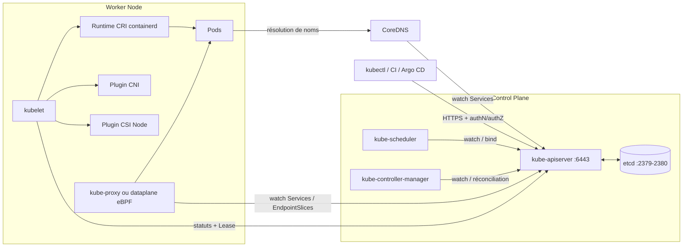

| Composant | Rôle | Analogie | Où regarder quand ça casse |
|---|---|---|---|
| kube-apiserver | Porte d'entrée unique : authentifie, autorise, valide, persiste | Standard téléphonique | `/readyz`, journaux du Pod statique, K8S-044/045 |
| etcd | Base clé-valeur répliquée (Raft) de tout l'état | Registre officiel | `etcdctl endpoint status`, K8S-046 à 048 |
| kube-scheduler | Choisit un Node pour chaque nouveau Pod | Service des réservations | Événements `FailedScheduling`, K8S-009/050 |
| kube-controller-manager | Boucles de réconciliation (Deployment, Node, Job…) | Thermostat | Leases, `observedGeneration`, K8S-051 |
| kubelet | Agent du Node : lance et surveille les Pods | Chef d'entrepôt | Conditions du Node, journaux kubelet, K8S-005/052 |
| Runtime (CRI) | Exécute réellement les conteneurs | Machines-outils | `crictl`, K8S-007 |
| CNI | Réseau des Pods (IP, routes, politiques) | Électricien de l'immeuble | Agents CNI, K8S-029/036 |
| kube-proxy / dataplane | Traduit Services en règles de routage (iptables, nftables, IPVS ou eBPF avec Cilium) | Aiguilleur | EndpointSlices, K8S-025/026 |
| CSI | Stockage persistant | Garde-meubles | VolumeAttachments, K8S-038 à 043 |
| CoreDNS | Noms des Services | Annuaire | K8S-027 |

### 2. Cycle de vie d'une application, du développeur à l'utilisateur

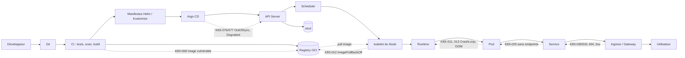

Chaque flèche est un point de rupture possible. Le schéma sert de carte : face à un symptôme utilisateur (droite du schéma), on remonte vers la gauche jusqu'au premier maillon défaillant.

### 3. Fonctionnement interne du cluster

**Déclaratif.** On ne dit pas « lance trois conteneurs », on déclare « je veux trois réplicas de cette version ». L'état **désiré** (spec) est stocké dans etcd ; l'état **observé** (status) est publié par les composants.

**Réconciliation.** Chaque contrôleur observe (watch) les objets de son type, compare désiré et observé, agit pour réduire l'écart, puis recommence. Analogie : un thermostat. Conséquence pour le diagnostic : quand « rien ne se passe », on cherche quel contrôleur devrait agir et pourquoi il ne le fait pas (absent, bloqué par un refus d'admission, quota…).

**Cycle de création d'un Pod.**

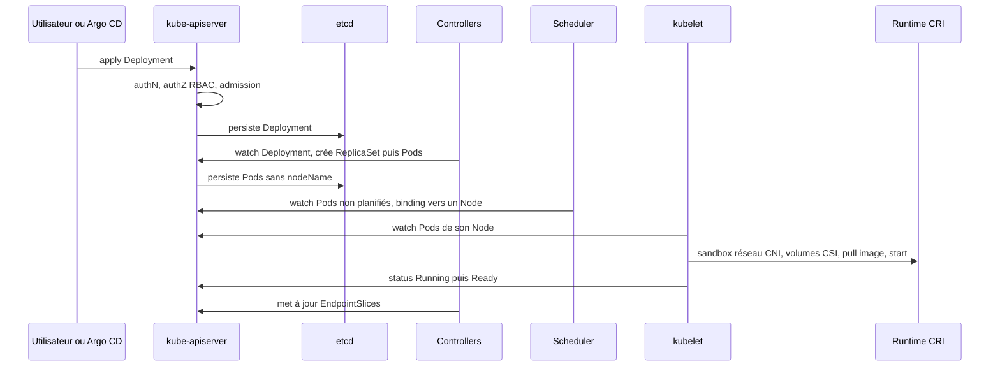

Chaque étape correspond à un état observable : refus à l'admission (`FailedCreate`), `Pending` (scheduler), `ContainerCreating` (volumes, réseau, image), `CrashLoopBackOff` (application), `Running` mais non prêt (readiness).

**Enregistrement des Nodes.** Le kubelet s'enregistre auprès de l'API, publie ses capacités et conditions, et renouvelle un `Lease` dans `kube-node-lease`. Sans renouvellement, le contrôleur de Nodes marque le Node `Unknown`, ajoute le taint `unreachable`, puis les Pods sont évincés après leur délai de tolérance (300 s par défaut).

**Autoguérison et ses limites.** Kubernetes recrée les Pods disparus, replanifie après la perte d'un Node et redémarre les conteneurs en échec. Il ne corrige pas : un bug applicatif (CrashLoop infini), une capacité insuffisante (Pending), une base de données corrompue, une configuration fausse versionnée dans Git, ni un control plane sans quorum. L'autoguérison peut même amplifier un incident (redémarrages en cascade sous charge, K8S-057).

### 4. Architectures de déploiement et conséquences pour le dépannage

| Environnement | Accès au control plane | Accès aux Nodes | Outils de diagnostic | Responsabilité |
|---|---|---|---|---|
| kubeadm | Complet (Pods statiques, `/etc/kubernetes`) | SSH | `kubectl`, `crictl`, `journalctl`, `etcdctl`/`etcdutl`, `kubeadm` | Tout est à votre charge |
| Talos Linux | Via API Talos, pas de SSH ni de shell | `talosctl` uniquement | `talosctl logs/service/dmesg/etcd/containers`, `kubectl debug node` | Tout, mais système immuable configuré par machine config |
| Azure AKS | Géré par Azure (pas d'accès direct) | `kubectl debug node`, VMSS | `az aks`, `kubectl`, Azure Monitor, journaux de diagnostic du control plane | Partagée : Azure pour le control plane, vous pour Nodes, workloads, réseau, identité |
| k3d / kind / Minikube | Local | Conteneurs ou VM locales | `kubectl`, `docker exec` | Laboratoire uniquement : comportements réseau/stockage différents de la production |
| Proxmox on-premise | Selon la distribution (souvent Talos ou kubeadm) | Selon l'OS | Outils de la distribution + hyperviseur | Tout, y compris hyperviseur, stockage et réseau physique |
| Hybride cloud / on-premise | Variable | Variable | Ajouter la couche réseau intersites (VPN, MTU) | Frontières de responsabilité à documenter |

**AKS — qui gère quoi.** Azure gère l'API Server, etcd, le scheduler et le controller-manager (haute disponibilité, correctifs, sauvegardes d'etcd). Le client gère les pools de Nodes (versions, images, dimensionnement), les workloads, le RBAC et l'intégration Entra ID, la configuration réseau (Azure CNI ou Overlay, NetworkPolicies, plages d'IP autorisées, cluster privé), les mises à niveau, l'observabilité et la sauvegarde des applications. Conséquence : les fiches etcd ne s'appliquent pas à AKS ; un symptôme côté control plane se diagnostique par `az aks show`, Azure Service Health et les journaux de diagnostic, puis le support Azure.

**Talos — particularités.** Pas de SSH, pas de gestionnaire de paquets, système de fichiers en lecture seule : on n'« installe » jamais un outil sur un Node pour dépanner. On observe via `talosctl` (journaux de services, `dmesg`, conteneurs, etcd) et `kubectl debug node` dans un namespace autorisé en `privileged` ; on corrige par la configuration machine (`talosctl apply-config`, `talosctl upgrade`, extensions système) versionnée dans Git. Voir le [guide Talos du portfolio](https://devsecops-portfolio.netlify.app/guides/linux/talos/) et la [comparaison des outils de déploiement](https://devsecops-portfolio.netlify.app/guides/kubernetes/k8s-outils/).

## Partie II — Méthodologie universelle de troubleshooting

**Analogie fil rouge.** Un médecin urgentiste : il constate les symptômes, évalue la gravité, localise l'organe en cause, demande des examens, formule des hypothèses, les teste par ordre de risque, traite, vérifie que le patient va mieux, puis prescrit de quoi éviter la rechute. Il ne commence jamais par opérer.

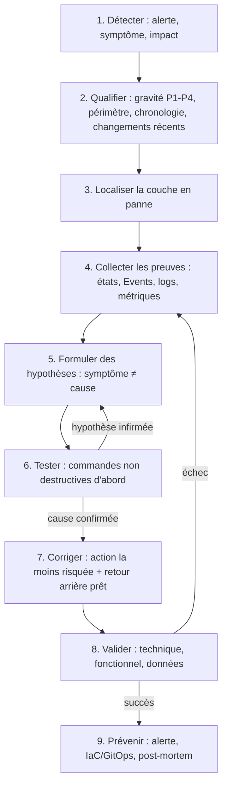

### Les 9 phases

1. **Détecter.** Source de l'alerte, symptôme exact (message, code HTTP), impact utilisateur mesuré. Une alerte sans impact n'est pas un P1.
2. **Qualifier.** Gravité (voir partie SRE), périmètre (un Pod, un Node, un namespace, tout le cluster), heure de début, **changements récents** (déploiement, mise à niveau, configuration, infrastructure). La majorité des incidents suit un changement.
3. **Localiser.** Descendre la pile : Application → Pod → Node → Service → DNS → Réseau → Stockage → Control Plane → Infrastructure. Le périmètre oriente : un seul Pod = application ou configuration ; un seul Node = Node ; tout un namespace = politique, quota, dépendance ; tout le cluster = control plane, DNS, CNI, infrastructure.
4. **Collecter les preuves.** `kubectl get` (états), `describe` (événements), `logs --previous`, métriques, objets et leurs `status.conditions`, certificats, historique Git. Conserver les preuves **avant** toute action (les événements expirent, les Pods redémarrés perdent leurs journaux).
5. **Formuler des hypothèses.** Écrire « je pense que X parce que Y ». Distinguer le symptôme (`CrashLoopBackOff`, 503) de la cause (variable manquante, readiness erronée).
6. **Tester.** Une hypothèse à la fois, avec des commandes en lecture ; comparer au fonctionnement attendu (un Pod sain, un autre namespace, un autre Node).
7. **Corriger.** Choisir l'action la moins risquée qui traite la cause ; distinguer **rétablissement immédiat** (revert, retour à la version précédente) et **correction durable** (dans Git) ; préparer le retour arrière.
8. **Valider.** État Kubernetes, métriques applicatives, test fonctionnel réel, intégrité des données, absence de récidive sur une période représentative.
9. **Prévenir.** Alerte qui aurait détecté plus tôt, garde-fou en CI, correction IaC/GitOps, post-mortem sans recherche de coupable.

### Tableau symptôme → composants à examiner

| Symptôme observé | Composants à examiner en premier | Fiches |
|---|---|---|
| `kubectl` ne répond pas | kubeconfig, réseau, API Server | K8S-001 à 004, 044 |
| Pod `Pending` | Scheduler, ressources, taints, PVC | K8S-009, 038, 050 |
| Pod `ContainerCreating` | Volumes, Secrets, CNI, image | K8S-010, 029, 039, 040 |
| `CrashLoopBackOff` | Journaux `--previous`, code de sortie, sondes, mémoire | K8S-011, 013, 057 |
| `ImagePullBackOff` | Registre, tag, identifiants, réseau | K8S-012 |
| Pod `Running` mais `0/1` | Readiness, dépendances | K8S-056 |
| 503 à l'Ingress | EndpointSlices, readiness | K8S-025, 031, 056 |
| Timeouts entre services | DNS, NetworkPolicy, CNI, MTU | K8S-027, 028, 029, 033, 036 |
| Node `NotReady` | kubelet, runtime, CNI, ressources, réseau | K8S-005, 007, 052, 054, 055 |
| Rien ne se passe après un apply | Contrôleurs, admission, quota | K8S-022, 051, 065 à 067 |
| Tout le cluster figé | etcd, API Server, certificats | K8S-044 à 049 |
| Déploiement GitOps bloqué | Rendu, admission, santé | K8S-071 à 077 |

### Arbre de diagnostic — un Pod ne démarre pas

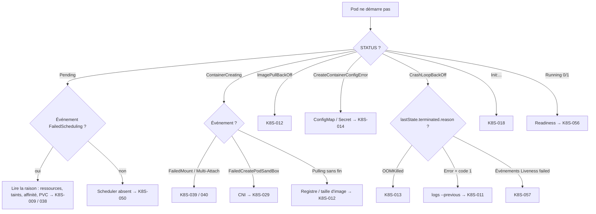

### Arbre de diagnostic — OOMKilled ou MemoryPressure

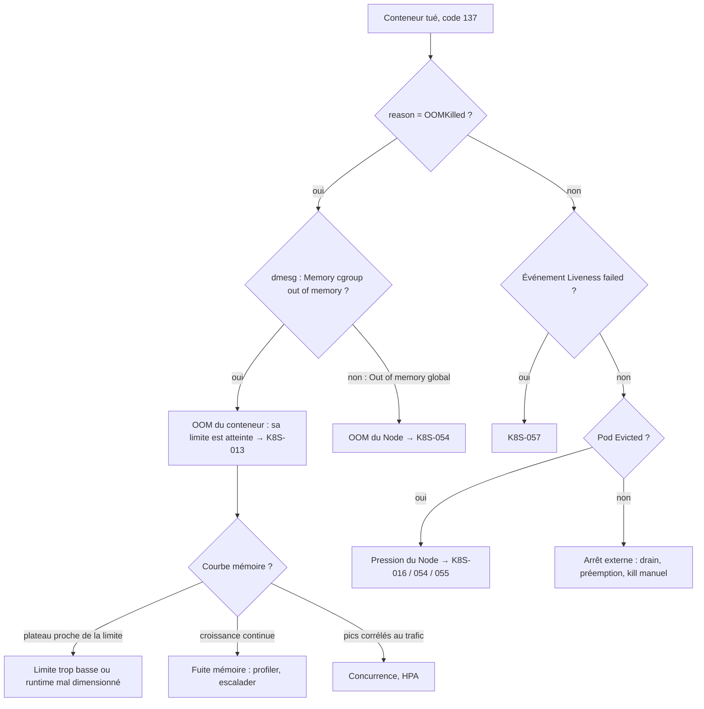

### Arbre de diagnostic — réseau, DNS et Ingress

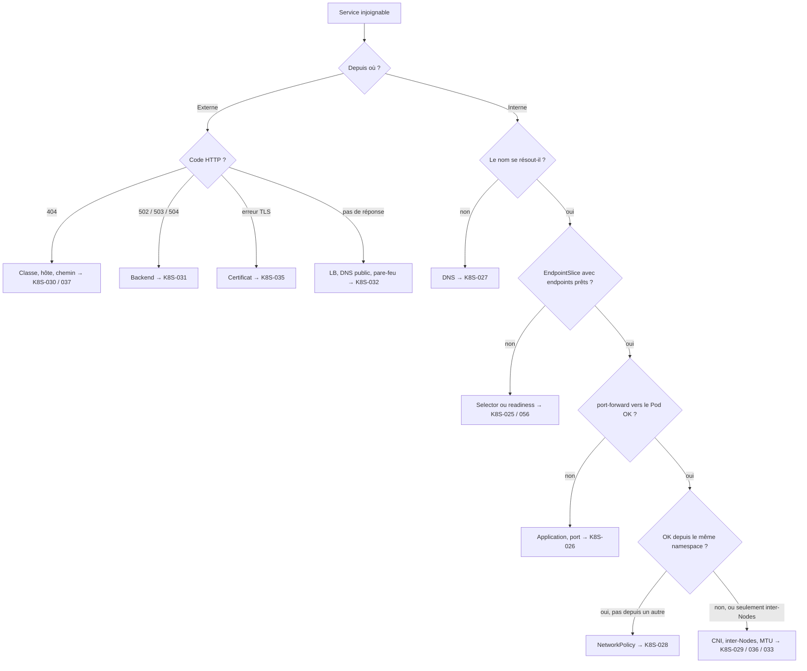

### Arbre de diagnostic — Node NotReady

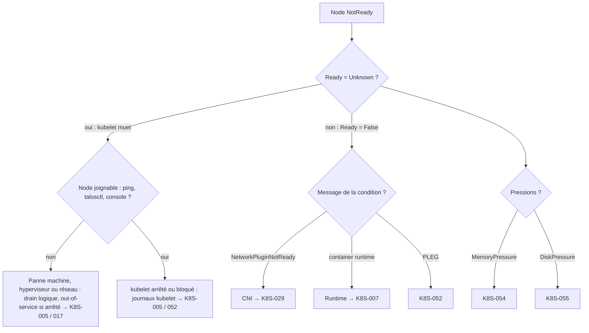

### Interactions entre incidents : penser en cascade

Un symptôme visible est souvent la dernière conséquence d'une chaîne. Exemple : une coupure réseau vers le registre provoque `ImagePullBackOff` sur les nouveaux Pods ; un Node tombe en même temps ; ses Pods ne peuvent pas être recréés ailleurs ; le Deployment ne redevient pas disponible ; l'Ingress renvoie 503.

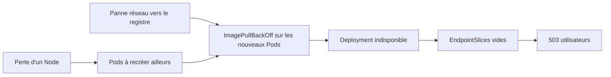

Règle pratique : traiter d'abord la cause la plus en amont (réseau vers le registre), sinon chaque correction en aval est annulée. Autres cascades classiques : surcharge de l'API Server → DNS en échec après expiration des caches (incident OpenAI 2024) ; disque plein → kubelet instable → Node `NotReady` → évictions → surcharge des autres Nodes ; webhook d'admission indisponible → plus aucun Pod créé, y compris ceux qui répareraient le webhook.

### Règles d'or avant d'agir en production

1. Vérifier le contexte et le namespace ; afficher le contexte dans le prompt.
2. Collecter les preuves avant de redémarrer quoi que ce soit.
3. Ne pas considérer « supprimer le Pod », « redémarrer le cluster », « augmenter les ressources » ou « désactiver la politique de sécurité » comme des corrections par défaut.
4. Un changement à la fois, avec observation de son effet.
5. Dans un cluster GitOps, corriger dans Git ; toute action impérative d'urgence est reportée dans Git immédiatement après.
6. Tracer chaque action (heure, commande, auteur) pour la chronologie du post-mortem.

## Partie III — Étape 1 : Fondations

*Point de départ.* Cette partie contient 8 fiches (K8S-001 à K8S-008).

### Concepts de l'étape 1 — Fondations

| Concept | Définition simple | Analogie | Ce qu'il faut vérifier quand ça casse |
|---|---|---|---|
| Conteneur et image OCI | Une application emballée avec ses dépendances ; l'image est le modèle, le conteneur l'instance en cours | Un plat sous vide (image) que l'on réchauffe (conteneur) | Nom, tag, digest, architecture, utilisateur de l'image |
| YAML et kubectl | Description déclarative des objets ; kubectl l'envoie à l'API | Un formulaire administratif et son guichet | Indentation, `apiVersion`, `--dry-run=server` |
| Cluster et Nodes | Ensemble de machines pilotées par un control plane | Un réseau d'entrepôts et son siège | `kubectl get nodes`, conditions des Nodes |
| Namespaces | Partitions logiques du cluster | Étages d'un immeuble | `-n`, quotas, politiques par namespace |
| Labels et selectors | Étiquettes clé/valeur et requêtes sur ces étiquettes | Étiquettes de couleur sur des dossiers | Selector du Service/Deployment vs labels des Pods |
| kubeconfig et contextes | Fichier décrivant clusters, identités et namespace par défaut | Annuaire + badge | `kubectl config current-context`, `auth whoami` |

**Exemple commenté.**

```bash
kubectl config get-contexts                       # 🟢 quels clusters puis-je joindre ? (* = actif)
kubectl get nodes -o wide                         # 🟢 Nodes, versions, IP, runtime
kubectl get pods -n boutique -l app=web -o wide   # 🟢 sélection par label dans un namespace
kubectl explain pod.spec.containers.resources     # 🟢 documentation de schéma intégrée
```

Résultat attendu : un contexte actif identifié, des Nodes `Ready`, des Pods listés avec leur Node. Les fiches suivantes traitent les cas où l'une de ces étapes échoue.

### K8S-001 — kubectl ne parvient pas à joindre l'API Server

> **Étape** 1 · **Couche** Accès au cluster · **Gravité typique** P2 (P1 si plus aucun opérateur n'accède au cluster) · **Difficulté** ★☆☆ · **Environnements** tous, spécificités AKS, Talos, k3d

**Le problème en langage simple.** Vous tapez une commande `kubectl` et elle reste bloquée puis échoue : `connection refused`, `i/o timeout` ou `no such host`. Kubectl n'arrive pas à parler au « standard téléphonique » du cluster.

**Le fonctionnement normal.** `kubectl` lit le fichier kubeconfig (adresse de l'API Server, certificat de l'autorité, identité), ouvre une connexion HTTPS vers l'API Server (port 6443 en général) puis envoie la requête.

**L'analogie.** Vous appelez le standard d'une entreprise. Selon le message entendu, le problème n'est pas le même : « numéro inconnu » (mauvaise adresse, DNS), « sonnerie dans le vide » (réseau ou pare-feu), « ligne occupée puis raccroché » (le standard est éteint).

**Symptômes et impact.** `The connection to the server x.x.x.x:6443 was refused`, `dial tcp ...: i/o timeout`, `no such host`. Impact : impossible d'observer ou de corriger quoi que ce soit ; les applications peuvent continuer de tourner normalement.

**Causes possibles (par probabilité).** 1. Mauvais kubeconfig ou mauvais contexte (adresse périmée, port de k3d changé après recréation). 2. Chemin réseau coupé : VPN, pare-feu, plages d'IP autorisées (AKS `authorized IP ranges`), cluster privé. 3. Résolution DNS du nom de l'API Server impossible. 4. API Server réellement arrêté (voir K8S-044).

**Diagnostic guidé.**

```bash
# 🟢 LECTURE — où kubectl essaie-t-il d'aller ?
kubectl config current-context                  # contexte actif
kubectl config view --minify -o jsonpath='{.clusters[0].cluster.server}'; echo
# 🟢 LECTURE — le nom se résout-il ? le port répond-il ?
getent hosts api.mon-cluster.exemple            # remplacer par l'hôte du champ server
nc -vz api.mon-cluster.exemple 6443             # ouverture TCP simple
# 🟢 LECTURE — l'API répond-elle à un contrôle de santé anonyme ?
curl -k https://api.mon-cluster.exemple:6443/livez   # -k uniquement pour ce test de joignabilité
```

Résultat attendu : le nom se résout, `nc` indique `succeeded`/`open`, `/livez` renvoie `ok` (ou un 401/403 si l'accès anonyme est désactivé — ce qui prouve quand même que l'API répond). Si le résultat est différent : `no such host` → DNS ou kubeconfig ; timeout → réseau/pare-feu ; `refused` → rien n'écoute sur ce port : passer à K8S-044.

**Lecture des résultats et cause racine.** On remonte la chaîne dans l'ordre : adresse → nom → réseau → service. La première étape qui échoue est la cause racine probable. Un timeout depuis votre poste mais un succès depuis un bastion du même réseau confirme un problème de chemin réseau, pas de cluster.

**Choix de la correction.**

| Preuve collectée | Correction | Inadaptée si |
|---|---|---|
| Adresse ou port périmé | Régénérer le kubeconfig avec l'outil de la plateforme | L'adresse est correcte mais le port ne répond pas |
| Timeout réseau, IP non autorisée | Ajouter votre IP de sortie aux plages autorisées, passer par le VPN ou le bastion | Le cluster est privé par conception (utiliser alors le chemin prévu) |
| `refused` sur toutes les adresses | Traiter l'indisponibilité de l'API Server (K8S-044) | — |

**Résolution pas à pas.** *Rétablissement immédiat* : utiliser le chemin d'accès de secours documenté (bastion, `az aks command invoke` pour un AKS privé, accès console). *Correction durable* : régénérer le kubeconfig depuis la source de vérité.

```bash
# 🟠 MODIFICATION (fichier local uniquement) — régénérer le kubeconfig
az aks get-credentials -g RG -n CLUSTER                 # AKS
talosctl -n 10.0.0.10 kubeconfig ./kubeconfig-talos     # Talos (IP d'un control plane)
k3d kubeconfig merge tshoot --kubeconfig-merge-default  # k3d (cluster "tshoot")
# 🟢 LECTURE — AKS : vérifier les plages d'IP autorisées
az aks show -g RG -n CLUSTER --query apiServerAccessProfile
```

Résultat attendu : `kubectl get --raw /readyz` renvoie `ok`. Si le résultat est différent : comparer `server` du nouveau kubeconfig avec l'adresse attendue et refaire le test `nc`.

**L'analogie de la réparation.** On met à jour l'annuaire (kubeconfig), on vérifie que la ligne passe par le bon central (VPN, plages autorisées) ; si le standard lui-même est éteint, changer d'annuaire ne sert à rien.

**Risques et retour arrière.** Modifier les plages autorisées d'AKS change la surface d'exposition de l'API : passer par une demande tracée. Conserver une copie de l'ancien kubeconfig (`cp ~/.kube/config ~/.kube/config.bak`) pour revenir en arrière.

**Validation.**

```bash
kubectl get --raw='/readyz?verbose' | tail -3   # 🟢 doit finir par "readyz check passed"
kubectl get nodes                               # 🟢 la commande répond
```

**Prévention.** Kubeconfig générés par outillage (jamais copiés à la main), contexte affiché dans le prompt du terminal, chemin d'accès de secours (« break-glass ») documenté et testé, sonde externe sur `/readyz`.

**Niveau 2 — mécanisme et production.** Les points `/livez`, `/readyz` et `/version` sont accessibles aux utilisateurs non authentifiés via le ClusterRole `system:public-info-viewer` lorsque l'authentification anonyme est active : c'est un test de joignabilité sans identifiants. Derrière un répartiteur de charge HA, tester chaque control plane individuellement pour isoler un membre défaillant.

**Cas métier.** Administration publique : après un changement de proxy d'entreprise, plus aucun agent ne joint l'API ; le test `nc` passe depuis le bastion mais pas depuis les postes → règle de proxy à corriger, le cluster est sain.

**Sources.** [Accès aux clusters](https://kubernetes.io/docs/tasks/access-application-cluster/access-cluster/) · [Health endpoints](https://kubernetes.io/docs/reference/using-api/health-checks/) · [AKS — plages d'IP autorisées](https://learn.microsoft.com/azure/aks/api-server-authorized-ip-ranges)

### K8S-002 — Erreur TLS x509 entre kubectl et l'API Server

> **Étape** 1 · **Couche** Accès au cluster / certificats · **Gravité typique** P2 · **Difficulté** ★★☆ · **Environnements** tous, kubeadm surtout

**Le problème en langage simple.** La connexion s'établit mais la vérification d'identité échoue : `x509: certificate signed by unknown authority`, `certificate has expired or is not yet valid` ou `certificate is valid for A, not B`.

**Le fonctionnement normal.** Le client vérifie que le certificat présenté par l'API Server est signé par l'autorité inscrite dans le kubeconfig, qu'il est valide à la date du jour et qu'il couvre le nom utilisé. Avec une authentification par certificat client, l'API Server fait la même vérification dans l'autre sens.

**L'analogie.** Un contrôle de pièce d'identité à l'entrée d'un bâtiment : la carte peut être fausse (autorité inconnue), périmée (expirée) ou au nom de quelqu'un d'autre (nom non couvert). Le gardien a raison de refuser.

**Symptômes et impact.** Toutes les commandes échouent avec un message `x509`. Impact identique à K8S-001 pour les opérateurs ; si le certificat serveur du control plane a expiré, voir aussi K8S-049.

**Causes possibles (par probabilité).** 1. Certificat client du kubeconfig expiré (sur kubeadm, `admin.conf` est valable un an). 2. Horloge du poste décalée. 3. Accès par un nom ou une IP absent des SAN du certificat serveur. 4. Proxy d'inspection TLS qui remplace le certificat. 5. Mauvaise autorité dans le kubeconfig (cluster recréé).

**Diagnostic guidé.**

```bash
# 🟢 LECTURE — dates de validité du certificat CLIENT (pas la clé privée)
kubectl config view --raw --minify -o jsonpath='{.users[0].user.client-certificate-data}' \
  | base64 -d | openssl x509 -noout -subject -enddate
# 🟢 LECTURE — certificat SERVEUR réellement présenté : émetteur, dates, noms couverts
openssl s_client -connect api.mon-cluster.exemple:6443 </dev/null 2>/dev/null \
  | openssl x509 -noout -issuer -enddate -ext subjectAltName
date -u                                          # 🟢 l'horloge locale est-elle juste ?
```

Résultat attendu : dates futures, émetteur = autorité du cluster, SAN contenant le nom utilisé. Si le résultat est différent : un émetteur inattendu (nom d'un proxy d'entreprise) signale une interception TLS ; une date passée désigne le certificat à renouveler.

**Lecture des résultats et cause racine.** `notAfter` dépassé → expiration. Émetteur inconnu → interception ou cluster recréé. SAN sans le nom utilisé → accès par un nom non prévu. Horloge décalée de plusieurs minutes → NTP.

**Choix de la correction.**

| Preuve | Correction | Inadaptée si |
|---|---|---|
| Certificat client expiré | Régénérer le kubeconfig | Le certificat serveur est aussi expiré (K8S-049) |
| Nom absent des SAN | Utiliser le nom prévu, ou ajouter le SAN et régénérer le certificat serveur | Accès ponctuel : utiliser le nom existant |
| Proxy d'inspection | Exclure l'API du déchiffrement TLS | — |

**Résolution pas à pas.** *Rétablissement immédiat* : régénérer le kubeconfig (voir K8S-001) ou, sur kubeadm, sur un control plane :

```bash
# 🟠 MODIFICATION — kubeadm : renouveler le kubeconfig administrateur
sudo kubeadm certs check-expiration              # 🟢 état de tous les certificats
sudo kubeadm certs renew admin.conf              # 🟠 renouvelle admin.conf
sudo cp /etc/kubernetes/admin.conf ~/.kube/config && sudo chown "$(id -u):$(id -g)" ~/.kube/config
```

*Correction durable* : ajout du SAN dans la configuration kubeadm (`apiServer.certSANs`) suivi de la régénération du certificat de l'API Server en fenêtre de maintenance. Ne jamais « corriger » avec `insecure-skip-tls-verify: true` : cela supprime la protection au lieu de réparer l'identité.

**L'analogie de la réparation.** On fait refaire une carte valide et au bon nom, on remet la pendule à l'heure ; on ne demande pas au gardien de fermer les yeux.

**Risques et retour arrière.** Régénérer le certificat de l'API Server nécessite un redémarrage du composant (bref arrêt de l'API sur ce nœud). Sauvegarder `/etc/kubernetes/pki` avant toute régénération.

**Validation.**

```bash
kubectl get --raw /readyz        # 🟢 "ok" sans erreur x509
```

**Prévention.** Alerte sur l'expiration des certificats (voir partie Observabilité), mise à niveau régulière (kubeadm renouvelle les certificats à chaque `kubeadm upgrade`), authentification OIDC plutôt que certificats clients longue durée.

**Niveau 2 — mécanisme et production.** Un certificat client ne peut pas être révoqué individuellement par Kubernetes : préférer des identités courtes (OIDC, Entra ID sur AKS). Sur Talos, les certificats sont gérés par la machine : régénérer le kubeconfig avec `talosctl kubeconfig`.

**Cas métier.** Assurance : un lundi, toute l'équipe d'exploitation reçoit `certificate has expired` ; le cluster kubeadm a exactement un an et n'a jamais été mis à niveau.

**Sources.** [Gestion des certificats kubeadm](https://kubernetes.io/docs/tasks/administer-cluster/kubeadm/kubeadm-certs/) · [PKI Kubernetes](https://kubernetes.io/docs/setup/best-practices/certificates/)

### K8S-003 — Unauthorized (401) : identité refusée

> **Étape** 1 · **Couche** Authentification · **Gravité typique** P3 · **Difficulté** ★☆☆ · **Environnements** tous, OIDC et AKS Entra ID en particulier

**Le problème en langage simple.** `error: You must be logged in to the server (Unauthorized)` : l'API Server ne sait pas qui vous êtes, ou ne reconnaît plus votre preuve d'identité.

**Le fonctionnement normal.** Chaque requête porte une preuve d'identité (certificat, jeton OIDC, jeton de ServiceAccount). L'API Server l'authentifie (401 si échec), puis vérifie les droits (403 si refus, voir K8S-063).

**L'analogie.** Votre badge d'accès n'est plus lu par le portique : il a expiré, il a été désactivé ou ce n'est pas le bon badge. Ce n'est pas encore une question d'autorisation d'entrer dans telle salle.

**Symptômes et impact.** Message `Unauthorized`, code HTTP 401. Seul l'utilisateur concerné est bloqué en général.

**Causes possibles (par probabilité).** 1. Jeton OIDC ou Entra ID expiré, plugin `kubelogin` absent. 2. Mauvais utilisateur dans le kubeconfig. 3. Jeton de ServiceAccount supprimé ou expiré. 4. Configuration OIDC de l'API Server modifiée (émetteur, audience).

**Diagnostic guidé.**

```bash
kubectl auth whoami                                   # 🟢 qui suis-je pour l'API ? (échoue si 401)
kubectl config view --minify -o jsonpath='{.users[0].user}' | grep -o '"exec"\|"token"\|"client-certificate-data"'  # 🟢 type d'identité
kubectl get pods -v=6 2>&1 | grep -E 'GET|401'        # 🟢 voir la requête et le code retour
```

Résultat attendu : `whoami` affiche votre identité et vos groupes. Si le résultat est différent : un 401 avec un kubeconfig de type `exec` oriente vers le plugin d'authentification (installé ? session expirée ?).

**Lecture des résultats et cause racine.** 401 = authentification ; 403 = autorisation. Ne pas chercher dans le RBAC tant que l'on est en 401.

**Choix de la correction.** Session expirée → se reconnecter. Plugin manquant → l'installer. Identité supprimée → demander une nouvelle identité au processus d'habilitation, pas un compte partagé.

**Résolution pas à pas.**

```bash
# 🟠 MODIFICATION (poste local) — AKS avec Entra ID
az login
az aks get-credentials -g RG -n CLUSTER --overwrite-existing
kubelogin convert-kubeconfig -l azurecli          # utiliser la session Azure CLI
```

Résultat attendu : `kubectl auth whoami` répond. Si le résultat est différent : vérifier l'heure locale et l'appartenance aux groupes Entra ID attendus.

**L'analogie de la réparation.** On réactive le badge auprès de l'accueil (fournisseur d'identité) au lieu d'emprunter celui d'un collègue.

**Risques et retour arrière.** Aucun risque cluster. Ne jamais utiliser un compte administrateur partagé « pour dépanner » : on perd la traçabilité.

**Validation.** `kubectl auth whoami` puis une commande de lecture habituelle.

**Prévention.** Identités nominatives via OIDC, durée de session raisonnable, documentation d'installation du plugin d'authentification.

**Niveau 2 — mécanisme et production.** Les jetons de ServiceAccount modernes sont projetés, signés et à durée limitée ; un jeton extrait d'un Pod et réutilisé ailleurs finira par expirer. Les journaux d'audit enregistrent les échecs d'authentification.

**Cas métier.** SaaS : un développeur obtient 401 chaque matin ; son jeton Entra ID expire et `kubelogin` n'est pas installé sur son nouveau poste.

**Sources.** [Authentification](https://kubernetes.io/docs/reference/access-authn-authz/authentication/) · [AKS et Entra ID](https://learn.microsoft.com/azure/aks/enable-authentication-microsoft-entra-id)

### K8S-004 — Mauvais contexte ou mauvais namespace

> **Étape** 1 · **Couche** Accès au cluster · **Gravité typique** P3 (P1 si action destructive sur le mauvais cluster) · **Difficulté** ★☆☆ · **Environnements** tous

**Le problème en langage simple.** `No resources found in default namespace` alors que l'application existe, ou pire : une commande passée sur la production en croyant être en recette.

**Le fonctionnement normal.** Le contexte courant combine un cluster, une identité et un namespace par défaut. Toute commande sans `-n` vise ce namespace.

**L'analogie.** Vous cherchez un dossier dans la mauvaise armoire du mauvais bâtiment : le dossier existe, mais pas là où vous regardez.

**Symptômes et impact.** Ressources « introuvables », modifications appliquées au mauvais endroit, incident déclenché par erreur.

**Causes possibles (par probabilité).** 1. Namespace par défaut différent de celui de l'application. 2. Variable `KUBECONFIG` pointant vers un autre fichier. 3. Contexte changé dans un autre terminal (fichier partagé).

**Diagnostic guidé.**

```bash
kubectl config current-context                                  # 🟢
kubectl config view --minify -o jsonpath='{..namespace}'; echo  # 🟢 namespace par défaut
echo "$KUBECONFIG"                                              # 🟢 fichier(s) utilisé(s)
kubectl get deploy -A | grep mon-app                            # 🟢 où est réellement l'application ?
```

Résultat attendu : le contexte et le namespace correspondent à la cible. Si le résultat est différent : corriger avant toute autre action.

**Lecture des résultats et cause racine.** Si l'application apparaît avec `-A` dans un autre namespace, la cause est le namespace par défaut.

**Choix de la correction.** Pour la lecture : préciser `-n`. Pour les actions : fixer explicitement contexte et namespace dans la commande.

**Résolution pas à pas.**

```bash
kubectl config use-context prod-paris                              # 🟠 local
kubectl config set-context --current --namespace=paiement           # 🟠 local
kubectl --context prod-paris -n paiement get deploy                 # 🟢 forme explicite recommandée en production
```

Résultat attendu : la ressource est visible. Si le résultat est différent : vérifier les droits de lecture dans ce namespace (K8S-063).

**L'analogie de la réparation.** On écrit l'adresse complète sur chaque demande (bâtiment + armoire) au lieu de compter sur sa mémoire.

**Risques et retour arrière.** Si une action a été faite sur le mauvais cluster : déclarer l'incident, restaurer depuis Git (GitOps) ou depuis la sauvegarde.

**Validation.** `kubectl config current-context` affiché dans le prompt et dans les journaux de session.

**Prévention.** Prompt affichant le contexte, kubeconfig séparés par environnement, accès production en lecture seule par défaut, modifications de production via GitOps.

**Niveau 2 — mécanisme et production.** Quand `KUBECONFIG` liste plusieurs fichiers, kubectl les fusionne et la première valeur trouvée l'emporte : une source fréquente de confusion.

**Cas métier.** E-commerce : un `kubectl delete` lancé sur la production au lieu de la recette ; la restauration via Argo CD prend dix minutes grâce à l'état décrit dans Git.

**Sources.** [Configurer l'accès multi-clusters](https://kubernetes.io/docs/tasks/access-application-cluster/configure-access-multiple-clusters/)

### K8S-005 — Node en état NotReady

> **Étape** 1 · **Couche** Node · **Gravité typique** P2 (P1 si plusieurs Nodes) · **Difficulté** ★★☆ · **Environnements** tous, spécificités Talos et AKS

**Le problème en langage simple.** `kubectl get nodes` affiche `NotReady` : le cluster ne considère plus ce serveur comme capable d'accueillir des Pods.

**Le fonctionnement normal.** Le kubelet de chaque Node renouvelle régulièrement un bail (`Lease` dans `kube-node-lease`) et publie des conditions (`Ready`, `MemoryPressure`, `DiskPressure`, `PIDPressure`). Sans nouvelle dans le délai de grâce, le contrôleur de Nodes passe `Ready` à `Unknown`.

**L'analogie.** Un entrepôt qui n'envoie plus son rapport quotidien au siège. Soit l'entrepôt est fermé (kubelet arrêté), soit le téléphone est coupé (réseau), soit le chef d'entrepôt est débordé (ressources épuisées).

**Symptômes et impact.** Node `NotReady`, taints `node.kubernetes.io/not-ready` ou `unreachable` ajoutés ; après la tolérance par défaut (300 s), les Pods sans tolérance spécifique sont évincés et recréés ailleurs si la capacité existe.

**Causes possibles (par probabilité).** 1. kubelet arrêté ou en échec (configuration, certificat). 2. Runtime de conteneurs arrêté (K8S-007). 3. CNI non initialisé (`NetworkPluginNotReady`). 4. Ressources épuisées (mémoire, disque, PID). 5. Coupure réseau vers le control plane. 6. Horloge décalée.

**Diagnostic guidé.**

```bash
kubectl get nodes -o wide                                        # 🟢
kubectl describe node worker-2 | sed -n '/Conditions:/,/Addresses:/p'   # 🟢 conditions et messages
kubectl -n kube-node-lease get lease worker-2 -o jsonpath='{.spec.renewTime}'; echo   # 🟢 dernier battement
# 🟡 DIAGNOSTIC AVANCÉ — sur le Node (kubeadm/Linux classique)
sudo systemctl status kubelet containerd --no-pager
sudo journalctl -u kubelet --since "20 min ago" --no-pager | tail -50
# 🟡 DIAGNOSTIC AVANCÉ — sur Talos (pas de shell : API talosctl)
talosctl -n 10.0.0.21 service kubelet
talosctl -n 10.0.0.21 logs kubelet | tail -50
```

Résultat attendu : la condition `Ready` indique un `reason` et un `message` exploitables. Si le résultat est différent : `Kubelet stopped posting node status` (statut `Unknown`) oriente vers kubelet arrêté ou réseau coupé ; `NetworkPluginNotReady` vers le CNI (K8S-029).

**Lecture des résultats et cause racine.** `Ready=False` avec message = le kubelet parle mais signale un problème local. `Ready=Unknown` = le kubelet ne parle plus : vérifier sa présence puis le réseau. Confirmer avec les journaux kubelet (erreur de certificat, de runtime, de CNI).

**Choix de la correction.**

| Preuve | Correction | Inadaptée si |
|---|---|---|
| kubelet arrêté sur erreur de config | Corriger la config (IaC) puis redémarrer kubelet | L'erreur vient du runtime |
| Disque plein | Libérer l'espace (K8S-055) | — |
| Réseau coupé | Rétablir le chemin vers le control plane | Le Node est volontairement isolé |
| Matériel ou VM défaillant | Drainer et remplacer le Node | — |

**Résolution pas à pas.** *Rétablissement immédiat* : si des Pods critiques n'ont pas été replanifiés, vérifier la capacité restante et les PDB. *Correction durable* :

```bash
# 🟠 MODIFICATION — redémarrer kubelet après correction de la cause (Linux classique)
sudo systemctl restart kubelet
# 🟠 MODIFICATION — Talos : redémarrer le service kubelet
talosctl -n 10.0.0.21 service kubelet restart
# 🟠 MODIFICATION — retirer un Node défaillant proprement avant remplacement
kubectl cordon worker-2
kubectl drain worker-2 --ignore-daemonsets --delete-emptydir-data --timeout=10m
```

Résultat attendu : `Ready=True` en moins d'une minute après le redémarrage. Si le résultat est différent : relire les journaux kubelet, ne pas boucler sur les redémarrages.

**L'analogie de la réparation.** On rouvre l'entrepôt, on rétablit la ligne téléphonique ou on transfère son stock vers un autre entrepôt avant de le reconstruire.

**Risques et retour arrière.** `drain` évince des Pods : vérifier la capacité et les PDB avant. `--delete-emptydir-data` efface les données `emptyDir` des Pods évincés. Le retour arrière d'un cordon est `kubectl uncordon`.

**Validation.**

```bash
kubectl get node worker-2                                   # 🟢 Ready
kubectl get pods -A -o wide --field-selector spec.nodeName=worker-2   # 🟢 Pods du Node en Running
```

**Prévention.** Alerte `kube_node_status_condition{condition="Ready",status="true"} == 0`, réserves système (`kube-reserved`, `system-reserved`), supervision disque, NTP, mises à jour du système maîtrisées (voir l'incident public Datadog en partie Cas métier).

**Niveau 2 — mécanisme et production.** Sur AKS, le Node est une VM gérée par Azure mais le diagnostic reste côté client (`kubectl debug node/...`, réparation automatique des Nodes). Lors d'un arrêt brutal d'un Node portant des volumes RWO, le taint `node.kubernetes.io/out-of-service` permet le basculement des Pods stateful (voir K8S-040).

**Cas métier.** Énergie : le Node portant l'agrégateur de télémesure passe `NotReady` ; `DiskPressure` puis arrêt du kubelet causé par des journaux non tournés.

**Sources.** [Nodes](https://kubernetes.io/docs/concepts/architecture/nodes/) · [Debug d'un Node Linux](https://kubernetes.io/docs/tasks/debug/debug-cluster/kubectl-node-debug/) · [Taints par défaut](https://kubernetes.io/docs/concepts/scheduling-eviction/taint-and-toleration/)

### K8S-006 — Labels et selectors incohérents dans un Deployment

> **Étape** 1 · **Couche** Objets Kubernetes · **Gravité typique** P3 · **Difficulté** ★☆☆ · **Environnements** tous

**Le problème en langage simple.** L'application d'un Deployment est refusée (`selector does not match template labels`, `field is immutable`) ou deux contrôleurs se « disputent » les mêmes Pods.

**Le fonctionnement normal.** Le `selector` d'un Deployment désigne les Pods qu'il possède ; les labels du modèle de Pod doivent le satisfaire. Le selector d'un Deployment est immuable après création.

**L'analogie.** Un professeur fait l'appel avec une liste : si la liste désigne « classe B » mais que les élèves portent l'étiquette « classe A », personne ne répond. Changer la liste en cours d'année est interdit par le règlement.

**Symptômes et impact.** Échec de `kubectl apply`, déploiement bloqué en CI/CD, Pods dupliqués si deux selectors se chevauchent.

**Causes possibles (par probabilité).** 1. Modification d'un label dans le selector d'un Deployment existant. 2. Faute de frappe entre selector et template. 3. Deux charts ou applications utilisant les mêmes labels génériques (`app: web`).

**Diagnostic guidé.**

```bash
kubectl get deploy web -n boutique -o jsonpath='{.spec.selector.matchLabels}'; echo   # 🟢
kubectl get deploy web -n boutique -o jsonpath='{.spec.template.metadata.labels}'; echo # 🟢
kubectl diff -f web-deployment.yaml                                                   # 🟢 ce que l'apply changerait
kubectl get pods -n boutique -l app=web -o custom-columns=NAME:.metadata.name,OWNER:.metadata.ownerReferences[0].name  # 🟢 propriétaires
```

Résultat attendu : selector inclus dans les labels du template, un seul propriétaire par Pod. Si le résultat est différent : le `diff` montre le champ du selector modifié.

**Lecture des résultats et cause racine.** `field is immutable` sur `spec.selector` = tentative de changer le selector. Plusieurs propriétaires différents pour des Pods de même label = chevauchement.

**Choix de la correction.** Faute de frappe dans le template → corriger le template. Changement voulu de selector → créer un nouveau Deployment (nouveau nom) puis basculer le Service, plutôt que supprimer/recréer en production.

**Résolution pas à pas.**

```yaml
# AVANT (refusé) : le selector a été modifié
spec:
  selector:
    matchLabels: {app: web-v2}          # ❌ le Deployment existant a app: web
# APRÈS : nouveau Deployment "web-v2" avec son propre selector, Service basculé ensuite
metadata:
  name: web-v2                          # ✅ nouvel objet, l'ancien reste en service
spec:
  selector:
    matchLabels: {app.kubernetes.io/name: web, app.kubernetes.io/instance: web-v2}
  template:
    metadata:
      labels: {app.kubernetes.io/name: web, app.kubernetes.io/instance: web-v2}   # ✅ identique au selector
```

Résultat attendu : le nouveau Deployment devient disponible, puis le Service est modifié pour cibler `app.kubernetes.io/instance: web-v2`. Si le résultat est différent : vérifier les Endpoints du Service (K8S-025).

**L'analogie de la réparation.** Plutôt que de réécrire la liste d'appel en plein cours, on ouvre une nouvelle classe avec sa propre liste, puis on oriente les élèves vers la nouvelle salle.

**Risques et retour arrière.** Supprimer/recréer le Deployment provoque une interruption ; la bascule par Service est réversible en remettant l'ancien selector du Service.

**Validation.** `kubectl rollout status deploy/web-v2 -n boutique` puis contrôle des EndpointSlices du Service.

**Prévention.** Labels recommandés `app.kubernetes.io/*` avec `instance` unique, validation en CI (`kubectl diff`, kubeconform), revue des changements de selector.

**Niveau 2 — mécanisme et production.** Le chevauchement de selectors n'est pas bloqué par l'API : c'est le contrôleur qui adopte ou ignore des Pods selon leurs `ownerReferences`. Un Service, lui, n'a pas de propriétaire : il route vers tout Pod correspondant, y compris ceux d'une autre application.

**Cas métier.** E-commerce : deux équipes utilisent `app: api` dans le même namespace ; le Service de l'une envoie une partie du trafic vers l'API de l'autre.

**Sources.** [Labels et selectors](https://kubernetes.io/docs/concepts/overview/working-with-objects/labels/) · [Deployments — selector](https://kubernetes.io/docs/concepts/workloads/controllers/deployment/) · [Labels recommandés](https://kubernetes.io/docs/concepts/overview/working-with-objects/common-labels/)

### K8S-007 — Runtime de conteneurs défaillant (containerd, CRI-O)

> **Étape** 1 · **Couche** Node / CRI · **Gravité typique** P2 · **Difficulté** ★★☆ · **Environnements** kubeadm, Talos, AKS (Node géré)

**Le problème en langage simple.** Le Node est là, mais plus aucun conteneur ne démarre ou ne s'arrête correctement : le moteur qui exécute réellement les conteneurs ne répond plus.

**Le fonctionnement normal.** Le kubelet demande au runtime, via l'interface CRI, de télécharger des images, créer le « bac à sable » réseau du Pod et lancer les conteneurs.

**L'analogie.** Le chef d'atelier (kubelet) donne des ordres, mais les machines-outils (runtime) sont en panne : les ordres s'empilent, rien n'est fabriqué.

**Symptômes et impact.** Pods bloqués en `ContainerCreating` ou `Terminating` sur un seul Node, Node qui bascule `NotReady`, messages kubelet mentionnant le runtime ou `PLEG is not healthy`.

**Causes possibles (par probabilité).** 1. Service containerd arrêté ou en boucle de redémarrage. 2. Disque plein sous `/var/lib/containerd`. 3. Incohérence de driver cgroup (systemd vs cgroupfs) entre kubelet et runtime. 4. Mise à jour du runtime incompatible.

**Diagnostic guidé.**

```bash
kubectl get pods -A -o wide --field-selector spec.nodeName=worker-3 | grep -v Running   # 🟢 effet limité à un Node ?
# 🟡 DIAGNOSTIC AVANCÉ — sur le Node (kubeadm)
sudo systemctl status containerd --no-pager
sudo crictl info | head -40            # état du runtime vu par l'interface CRI
sudo crictl ps -a | head               # conteneurs connus du runtime
df -h /var/lib/containerd
# 🟡 DIAGNOSTIC AVANCÉ — Talos
talosctl -n 10.0.0.23 service cri
talosctl -n 10.0.0.23 logs cri | tail -40
```

Résultat attendu : runtime `active (running)`, `crictl info` sans erreur. Si le résultat est différent : relever le message d'erreur exact dans les journaux du runtime.

**Lecture des résultats et cause racine.** Symptômes limités à un Node + runtime en erreur = cause locale confirmée. Si tous les Nodes sont touchés après une mise à jour, la cause est la mise à jour elle-même.

**Choix de la correction.** Disque plein → libérer (K8S-055). Driver cgroup → aligner la configuration (IaC) puis redémarrer runtime et kubelet. Panne persistante → drainer et reconstruire le Node.

**Résolution pas à pas.**

```bash
# 🟠 MODIFICATION — après correction de la cause, sur le Node concerné
sudo systemctl restart containerd
sudo systemctl restart kubelet
```

Résultat attendu : les Pods du Node se débloquent en quelques minutes. Si le résultat est différent : cordon + drain + remplacement du Node (approche « bétail »).

**L'analogie de la réparation.** On répare ou remplace la machine-outil, puis le chef d'atelier relance les ordres en attente.

**Risques et retour arrière.** Redémarrer containerd n'arrête normalement pas les conteneurs en cours (shims indépendants), mais à faire Node par Node. Ne jamais supprimer `/var/lib/containerd` sur un Node en service.

**Validation.** `kubectl get node worker-3` → `Ready` ; un Pod de test planifié sur ce Node démarre (`nodeName` dans un Pod jetable en environnement de test).

**Prévention.** Supervision du disque et des services du Node, configuration du runtime gérée par IaC, mises à jour progressives (un pool de Nodes à la fois).

**Niveau 2 — mécanisme et production.** Le PLEG (Pod Lifecycle Event Generator) du kubelet interroge le runtime ; s'il ne répond plus dans le délai, le Node est déclaré non sain. Sur Talos, le runtime est un service système immuable : on corrige par la configuration machine et la mise à niveau, pas par modification manuelle.

**Cas métier.** Télécoms : après une mise à jour de paquets non maîtrisée, containerd ne redémarre plus sur un pool ; le déploiement par vagues limite l'impact à un tiers des Nodes.

**Sources.** [Container runtimes](https://kubernetes.io/docs/setup/production-environment/container-runtimes/) · [Debug avec crictl](https://kubernetes.io/docs/tasks/debug/debug-cluster/crictl/)

### K8S-008 — Manifest YAML invalide (syntaxe, champ inconnu, apiVersion)

> **Étape** 1 · **Couche** Manifestes · **Gravité typique** P4 (bloque un déploiement) · **Difficulté** ★☆☆ · **Environnements** tous

**Le problème en langage simple.** `kubectl apply` refuse le fichier : erreur d'indentation, champ mal orthographié ou type d'objet inconnu.

**Le fonctionnement normal.** Le YAML est converti en JSON, puis l'API Server valide l'objet contre le schéma de la version d'API indiquée (`apiVersion` + `kind`).

**L'analogie.** Un formulaire administratif : une case remplie hors du cadre (indentation), une case qui n'existe pas (champ inconnu) ou un formulaire d'un modèle aboli (apiVersion retirée).

**Symptômes et impact.** `error converting YAML to JSON: yaml: line 12: ...`, `strict decoding error: unknown field "spec.template.spec.containers[0].imagePullPolice"`, `no matches for kind "X" in version "Y"`. Le déploiement échoue sans impact sur l'existant.

**Causes possibles (par probabilité).** 1. Indentation ou tabulation. 2. Faute de frappe sur un nom de champ. 3. `apiVersion` dépréciée et retirée (voir K8S-073). 4. CRD non installée.

**Diagnostic guidé.**

```bash
kubectl apply --dry-run=server -f deploy.yaml        # 🟢 validation complète côté serveur, sans rien créer
kubectl explain deployment.spec.template.spec.containers.imagePullPolicy   # 🟢 le champ existe-t-il ?
kubectl api-resources | grep -i ingress              # 🟢 quels types et groupes sont servis ?
kubeconform -strict -summary deploy.yaml             # 🟢 validation hors cluster (CI)
```

Résultat attendu : `created (server dry run)` ou `configured (server dry run)`. Si le résultat est différent : le message indique la ligne ou le champ fautif.

**Lecture des résultats et cause racine.** Le numéro de ligne d'une erreur YAML désigne souvent la ligne qui suit l'erreur réelle : regarder juste au-dessus.

**Choix de la correction.** Corriger le fichier source dans Git, jamais l'objet en direct.

**Résolution pas à pas.**

```yaml
# AVANT
      containers:
      - name: api
        image: registry.exemple/api:1.4.2
        imagePullPolice: IfNotPresent      # ❌ champ inconnu
# APRÈS
      containers:
      - name: api
        image: registry.exemple/api:1.4.2
        imagePullPolicy: IfNotPresent      # ✅ nom exact du champ
```

Résultat attendu : le dry-run serveur passe. Si le résultat est différent : vérifier la version d'API servie par le cluster (`kubectl api-versions`).

**L'analogie de la réparation.** On recopie le formulaire sur le modèle en vigueur, chaque information dans sa case.

**Risques et retour arrière.** Aucun : le dry-run ne modifie rien.

**Validation.** `kubectl apply --dry-run=server` en CI, puis `kubectl diff` avant l'apply réel.

**Prévention.** Éditeur avec schéma YAML, kubeconform et `--dry-run=server` dans la CI, revue de code.

**Niveau 2 — mécanisme et production.** La validation stricte des champs est faite par le serveur (field validation) : un client récent contre un serveur ancien, ou l'inverse, peut produire des avertissements différents. Respecter la politique de compatibilité de version de kubectl (±1 version mineure).

**Cas métier.** Éducation : la mise en production d'une plateforme d'examen échoue à cause d'une tabulation copiée depuis un traitement de texte ; le contrôle CI l'aurait détectée.

**Sources.** [kubectl apply / dry-run](https://kubernetes.io/docs/reference/kubectl/generated/kubectl_apply/) · [Field validation](https://kubernetes.io/docs/reference/using-api/api-concepts/#field-validation) · [kubeconform](https://github.com/yannh/kubeconform)

## Partie IV — Étape 2 : Workloads

*Faire tourner des applications.* Cette partie contient 16 fiches (K8S-009 à K8S-024).

### Concepts de l'étape 2 — Workloads

| Objet | Rôle | Analogie | Incident typique |
|---|---|---|---|
| Pod | Plus petite unité : un ou plusieurs conteneurs partageant réseau et volumes | Un appartement en colocation | Pending, CrashLoop, OOM |
| Deployment / ReplicaSet | Garantit N copies identiques et gère les mises à jour progressives | Un chef d'équipe et sa feuille d'effectif | Rollout bloqué, replicas manquants |
| StatefulSet | Pods à identité stable (nom, volume) créés dans l'ordre | Places numérotées et réservées | Ordinal bloqué, Multi-Attach |
| DaemonSet | Un Pod par Node | Un gardien par bâtiment | Absent sur des Nodes taintés |
| Job / CronJob | Tâche qui doit se terminer / tâche planifiée | Une livraison ponctuelle / un réveil | BackoffLimitExceeded, horaire manqué |
| Init container / sidecar | Préparation avant l'application / compagnon permanent | Check-list avant décollage / copilote | Init bloqué |
| Conteneur éphémère | Conteneur de debug ajouté à un Pod en cours (`kubectl debug`) | Un technicien qui entre temporairement | Image sans shell (distroless) |

**Phases et états à ne pas confondre.** La *phase* du Pod (`Pending`, `Running`, `Succeeded`, `Failed`, `Unknown`) est un résumé ; la colonne `STATUS` de `kubectl get pods` affiche souvent la *raison* d'attente d'un conteneur (`CrashLoopBackOff`, `ImagePullBackOff`, `ContainerCreating`). Le diagnostic se fait sur `status.containerStatuses[*].state` et `lastState`.

```bash
kubectl get pod <pod> -n <ns> -o jsonpath='{.status.phase}{"\n"}{range .status.containerStatuses[*]}{.name}{": "}{.state}{" last="}{.lastState}{"\n"}{end}'   # 🟢
kubectl debug -it <pod> -n <ns> --image=busybox:1.36 --target=app    # 🟡 conteneur éphémère partageant l'espace de processus de "app"
```

### K8S-009 — Pod bloqué en Pending

> **Étape** 2 · **Couche** Scheduling · **Gravité typique** P2 à P3 · **Difficulté** ★☆☆ · **Environnements** tous

**Le problème en langage simple.** Le Pod est accepté par le cluster mais n'est placé sur aucun Node : il attend une place qui ne vient pas.

**Le fonctionnement normal.** Le scheduler filtre les Nodes compatibles (ressources demandées, taints/tolerations, affinités, volumes, ports) puis choisit le meilleur ; le Pod reçoit alors un `nodeName`.

**L'analogie.** Une réservation d'hôtel : il faut une chambre assez grande (requests), dans un étage autorisé (taints, nodeSelector), avec les équipements demandés (volume, zone). Si aucune chambre ne coche toutes les cases, la réservation reste en attente.

**Symptômes et impact.** `STATUS Pending`, `NODE <none>`, événement `FailedScheduling`. Impact : capacité réduite, voire service indisponible si aucun réplica ne démarre.

**Causes possibles (par probabilité).** 1. Requests CPU/mémoire supérieures à la capacité libre (`Insufficient cpu`). 2. Taints sans toleration. 3. nodeSelector/affinité impossible. 4. PVC non lié (K8S-038). 5. Scheduler arrêté (aucun événement, K8S-050).

**Diagnostic guidé.**

```bash
kubectl get pod web-7d9 -n boutique -o wide                         # 🟢
kubectl describe pod web-7d9 -n boutique | sed -n '/Events:/,$p'   # 🟢 message FailedScheduling
kubectl describe nodes | grep -A6 'Allocated resources'             # 🟢 ressources déjà réservées par Node
kubectl get nodes -o custom-columns=NAME:.metadata.name,TAINTS:.spec.taints[*].key   # 🟢
```

Sortie illustrative de l'événement :

```text
Warning  FailedScheduling  0/3 nodes are available: 1 node(s) had untolerated taint {node-role.kubernetes.io/control-plane: },
2 Insufficient memory. preemption: 0/3 nodes are available: 3 No preemption victims found for incoming pod.
```

Résultat attendu : le message énumère la raison d'exclusion de chaque Node. Si le résultat est différent : aucun événement du tout → vérifier le scheduler (K8S-050).

**Lecture des résultats et cause racine.** Le message se lit comme un décompte : « 2 Insufficient memory » signifie que deux Nodes manquent de mémoire **réservable** (somme des requests), pas forcément de mémoire réellement utilisée.

**Choix de la correction.**

| Preuve | Correction | Inadaptée si |
|---|---|---|
| Requests surdimensionnées | Ajuster les requests sur mesures réelles | La consommation réelle les justifie |
| Capacité insuffisante | Ajouter des Nodes (autoscaler, pool) | Le blocage vient d'un taint |
| Taint non toléré | Ajouter la toleration **si** le Pod doit aller sur ces Nodes | Les Nodes sont réservés à d'autres usages |
| Affinité impossible | Corriger l'expression ou les labels de Nodes | — |

**Résolution pas à pas.** *Rétablissement immédiat* : si des Nodes sont simplement `cordoned` par erreur, `kubectl uncordon`. *Correction durable* : ajuster le manifeste dans Git.

```yaml
# AVANT : requête copiée d'un autre service
resources:
  requests: {cpu: "4", memory: 8Gi}
# APRÈS : basée sur l'observation (p95 de consommation + marge)
resources:
  requests: {cpu: 500m, memory: 768Mi}
  limits:   {memory: 768Mi}
```

Résultat attendu : le Pod passe `ContainerCreating` puis `Running`. Si le résultat est différent : relire le nouvel événement, une autre contrainte peut apparaître.

**L'analogie de la réparation.** On réserve une chambre à la bonne taille, ou on ouvre un nouvel étage, au lieu de supprimer la réservation.

**Risques et retour arrière.** Des requests trop basses dégradent la QoS et favorisent les évictions ; revenir aux valeurs précédentes via Git si les performances baissent.

**Validation.** `kubectl get pods -n boutique -l app=web` → tous `Running` ; `kubectl top pod` cohérent avec les requests.

**Prévention.** Requests basées sur des mesures, alerte sur Pods `Pending` > 10 min, capacité planifiée (marge N+1), ResourceQuotas cohérents.

**Niveau 2 — mécanisme et production.** Le scheduler raisonne sur les **requests**, jamais sur l'usage instantané. La préemption peut évincer des Pods de priorité inférieure si des `PriorityClass` sont définies. Le Cluster Autoscaler n'ajoute un Node que si un Pod Pending y deviendrait planifiable.

**Cas métier.** Éducation : la veille d'un examen, 20 replicas ajoutés restent Pending car chaque Pod demande 2 CPU alors qu'il en consomme 0,2.

**Sources.** [Scheduling](https://kubernetes.io/docs/concepts/scheduling-eviction/kube-scheduler/) · [Debug des Pods](https://kubernetes.io/docs/tasks/debug/debug-application/debug-pods/) · [Taints et tolerations](https://kubernetes.io/docs/concepts/scheduling-eviction/taint-and-toleration/)

### K8S-010 — Pod bloqué en ContainerCreating

> **Étape** 2 · **Couche** Node / volumes / CNI · **Gravité typique** P2 · **Difficulté** ★★☆ · **Environnements** tous

**Le problème en langage simple.** Le Pod a un Node mais ses conteneurs ne démarrent jamais : la préparation (réseau, volumes, image) n'aboutit pas.

**Le fonctionnement normal.** Le kubelet crée le bac à sable du Pod (réseau via le CNI), monte les volumes (Secrets, ConfigMaps, PVC), télécharge les images puis lance les conteneurs.

**L'analogie.** Un déménagement : le camion est arrivé à la bonne adresse, mais les clés (secrets), l'électricité (réseau) ou les meubles (volumes) manquent ; personne ne peut emménager.

**Symptômes et impact.** `ContainerCreating` qui dure, événements `FailedMount`, `FailedCreatePodSandBox`, `FailedAttachVolume`.

**Causes possibles (par probabilité).** 1. Volume impossible à monter (Secret/ConfigMap absent, PVC, CSI : K8S-039/040). 2. CNI en échec (`failed to setup network for sandbox`, K8S-029). 3. Téléchargement d'image très long (image volumineuse).

**Diagnostic guidé.**

```bash
kubectl describe pod api-5f6 -n facturation | sed -n '/Events:/,$p'   # 🟢 l'événement nomme la ressource bloquante
kubectl get events -n facturation --field-selector involvedObject.name=api-5f6 --sort-by=.lastTimestamp   # 🟢
```

Résultat attendu : un événement explicite. Si le résultat est différent : aucun événement → consulter les journaux kubelet du Node (K8S-005).

**Lecture des résultats et cause racine.** `MountVolume.SetUp failed ... secret "db-credentials" not found` = Secret absent. `FailedCreatePodSandBox` = CNI. `Pulling image` sans fin = registre lent ou image énorme.

**Choix de la correction.** Ressource absente → la créer par le canal normal (GitOps, opérateur de secrets). CNI → K8S-029. Volume → K8S-039/040.

**Résolution pas à pas.**

```bash
kubectl get secret db-credentials -n facturation      # 🟢 confirme l'absence (n'affiche pas le contenu)
# 🟠 MODIFICATION — via le canal prévu, par ex. synchroniser l'ExternalSecret ou l'application Argo CD
argocd app sync facturation-secrets
```

Résultat attendu : le Pod passe `Running` sans recréation manuelle. Si le résultat est différent : relire les événements, un second volume peut être en cause.

**L'analogie de la réparation.** On remet les clés au bon endroit ; le camion n'a pas besoin de refaire le voyage.

**Risques et retour arrière.** Ne pas créer un Secret « à la main » avec des valeurs de test en production : risque de mauvaise configuration et de fuite.

**Validation.** `kubectl get pod -n facturation -l app=api` → `Running` ; journaux applicatifs sans erreur de configuration.

**Prévention.** Dépendances (Secrets, ConfigMaps) livrées avant les workloads (ordre de synchronisation Argo CD), alerte sur Pods non prêts depuis 10 min.

**Niveau 2 — mécanisme et production.** Un Secret référencé en volume bloque `ContainerCreating` ; le même Secret référencé en variable d'environnement donne `CreateContainerConfigError` (K8S-014). L'option `optional: true` change ce comportement.

**Cas métier.** Santé : la rotation des identifiants de la base patients supprime puis recrée le Secret ; les Pods redémarrés pendant la fenêtre restent bloqués.

**Sources.** [Debug des Pods](https://kubernetes.io/docs/tasks/debug/debug-application/debug-pods/) · [Secrets](https://kubernetes.io/docs/concepts/configuration/secret/)

### K8S-011 — CrashLoopBackOff

> **Étape** 2 · **Couche** Application / conteneur · **Gravité typique** P1 à P3 · **Difficulté** ★★☆ · **Environnements** tous

**Le problème en langage simple.** Le conteneur démarre, s'arrête, redémarre, s'arrête encore ; Kubernetes espace de plus en plus les tentatives. `CrashLoopBackOff` est un **symptôme**, jamais une cause.

**Le fonctionnement normal.** Avec `restartPolicy: Always`, le kubelet relance un conteneur terminé, avec un délai croissant (10 s, 20 s, 40 s… plafonné à 5 min), remis à zéro après une exécution stable.

**L'analogie.** Une voiture qui cale dès qu'on la démarre. Insister sur la clé ne sert à rien : il faut savoir si c'est le carburant (configuration), une pièce manquante (dépendance), le moteur (bug) ou le contrôle technique qui coupe le moteur (liveness probe).

**Symptômes et impact.** `RESTARTS` qui augmente, statut `CrashLoopBackOff`, `Back-off restarting failed container`. Service dégradé ou indisponible.

**Causes possibles (par probabilité).** 1. Erreur applicative au démarrage (configuration manquante, base injoignable). 2. Commande ou arguments erronés. 3. `OOMKilled` (K8S-013). 4. Liveness probe trop agressive (K8S-057). 5. Permissions (système de fichiers en lecture seule, utilisateur non root).

**Diagnostic guidé.**

```bash
kubectl get pod paiement-6c4 -n banque -o jsonpath='{.status.containerStatuses[0].lastState.terminated}'; echo  # 🟢 exitCode, reason
kubectl logs paiement-6c4 -n banque --previous --tail=50     # 🟢 journaux de l'exécution qui a planté
kubectl describe pod paiement-6c4 -n banque | grep -E 'Liveness|Killing|OOM|Back-off'   # 🟢
```

Sortie illustrative :

```text
{"exitCode":1,"reason":"Error","startedAt":"...","finishedAt":"..."}
FATAL: variable DB_HOST non définie
```

Résultat attendu : un code de sortie et un message applicatif. Si le résultat est différent : journaux vides → le processus meurt avant d'écrire : tester la commande avec une copie du Pod.

**Lecture des résultats et cause racine.** Code 1 = erreur applicative ; 126 = commande non exécutable ; 127 = commande introuvable ; 137 = tué par SIGKILL (OOM, liveness ou arrêt forcé) ; 139 = erreur de segmentation ; 143 = SIGTERM. Le message des journaux `--previous` confirme la cause.

**Choix de la correction.**

| Preuve | Correction | Inadaptée si |
|---|---|---|
| Config manquante (journaux) | Fournir la variable/ConfigMap | La variable existe mais est mal nommée |
| Code 127 | Corriger `command`/`args` ou l'image | — |
| `reason: OOMKilled` | Voir K8S-013 | — |
| Événements « Liveness probe failed » | Voir K8S-057 | — |

**Résolution pas à pas.**

```bash
# 🟡 DIAGNOSTIC AVANCÉ — copie du Pod avec un shell à la place de la commande (Pod d'origine intact)
kubectl debug paiement-6c4 -n banque -it --copy-to=paiement-debug --container=app -- sh
#   dans la copie : env | grep DB_ ; ls -l /etc/app ; lancer la commande à la main
kubectl delete pod paiement-debug -n banque     # 🔴 DESTRUCTIF (copie de debug uniquement) — nettoyage
```

*Correction durable* : corriger le manifeste dans Git (variable, commande, image). *Rétablissement immédiat* si une version vient d'être déployée : revenir à la version précédente par Git (ou `kubectl rollout undo` hors GitOps).

**L'analogie de la réparation.** On ouvre le capot (journaux `--previous`, copie de debug), on remplace la pièce identifiée, puis on redémarre une seule fois.

**Risques et retour arrière.** La copie de debug peut se connecter aux vraies dépendances : éviter qu'elle consomme des messages ou écrive en base. Supprimer un Pod en CrashLoop ne corrige rien.

**Validation.**

```bash
kubectl get pod -n banque -l app=paiement -w        # 🟢 RESTARTS stable, READY 1/1
```

**Prévention.** Validation de configuration au démarrage avec message explicite, `startupProbe` pour les démarrages lents, alerte sur `increase(kube_pod_container_status_restarts_total[15m]) > 3`.

**Niveau 2 — mécanisme et production.** Le délai de back-off rend le diagnostic lent : les journaux `--previous` sont plus fiables que l'attente. Pour une image distroless sans shell, utiliser un conteneur éphémère `kubectl debug -it pod --image=busybox:1.36 --target=app`.

**Cas métier.** Banque : après une mise à jour, l'API de paiement boucle car la nouvelle version exige `DB_SSLMODE`, absente du ConfigMap.

**Sources.** [Debug des Pods en cours d'exécution](https://kubernetes.io/docs/tasks/debug/debug-application/debug-running-pod/) · [Cycle de vie du Pod](https://kubernetes.io/docs/concepts/workloads/pods/pod-lifecycle/)

### K8S-012 — ImagePullBackOff / ErrImagePull

> **Étape** 2 · **Couche** Registre / réseau / authentification · **Gravité typique** P2 · **Difficulté** ★☆☆ · **Environnements** tous

**Le problème en langage simple.** Kubernetes n'arrive pas à télécharger l'image du conteneur ; il réessaie avec un délai croissant.

**Le fonctionnement normal.** Le kubelet demande au runtime de télécharger l'image depuis le registre, avec les identifiants de `imagePullSecrets` si le registre est privé.

**L'analogie.** Une commande de colis : la référence n'existe pas (tag inexistant), l'entrepôt refuse de livrer sans bon de commande (authentification), la route est coupée (réseau) ou l'entrepôt limite les livraisons (quota).

**Symptômes et impact.** `ErrImagePull` puis `ImagePullBackOff`. Nouveaux Pods impossibles à démarrer : un rollout ou une montée en charge échoue.

**Causes possibles (par probabilité).** 1. Tag ou nom d'image erroné. 2. `imagePullSecrets` absent ou invalide. 3. Limite de débit du registre (`429 Too Many Requests`). 4. Registre ou proxy injoignable depuis les Nodes. 5. Architecture non disponible (`no match for platform`).

**Diagnostic guidé.**

```bash
kubectl describe pod front-79b -n boutique | grep -A3 -E 'Failed|Pulling'   # 🟢 message exact du registre
kubectl get pod front-79b -n boutique -o jsonpath='{.spec.containers[*].image}{"\n"}{.spec.imagePullSecrets}'; echo   # 🟢
# 🟡 DIAGNOSTIC AVANCÉ — depuis un Node kubeadm, tester le téléchargement avec le runtime
sudo crictl pull registry.exemple/boutique/front:2.3.1
```

Résultat attendu : le message distingue `not found`, `unauthorized`/`pull access denied`, `429`, `i/o timeout`. Si le résultat est différent : `x509` → certificat du registre non approuvé par les Nodes.

**Lecture des résultats et cause racine.** Le message du registre est la cause racine dans la grande majorité des cas ; si un seul Node échoue, chercher un problème réseau ou DNS local à ce Node.

**Choix de la correction.**

| Preuve | Correction | Inadaptée si |
|---|---|---|
| `not found` | Corriger le tag dans Git (idéalement par digest) | L'image existe : vérifier le nom complet |
| `unauthorized` | Fournir/rafraîchir le secret de registre | — |
| `429` | Miroir/cache de registre, authentification | — |
| Timeout réseau | Rétablir le chemin vers le registre | — |

**Résolution pas à pas.**

```yaml
# APRÈS : image référencée par digest et secret de registre déclaré
spec:
  imagePullSecrets:
  - name: regcred-boutique            # Secret de type kubernetes.io/dockerconfigjson, livré par l'outil de secrets
  containers:
  - name: front
    image: registry.exemple/boutique/front:2.3.1@sha256:<digest>   # tag lisible + digest immuable
```

Résultat attendu : `Pulled` dans les événements puis `Running`. Si le résultat est différent : tester le même pull depuis le Node concerné.

**L'analogie de la réparation.** On corrige la référence du colis, on joint le bon de commande ou on passe par l'entrepôt régional (miroir) ; insister sur la même commande ne change rien.

**Risques et retour arrière.** Ne jamais copier un mot de passe de registre dans un manifeste versionné. Le retour arrière est la version précédente du manifeste.

**Validation.** `kubectl rollout status deploy/front -n boutique`.

**Prévention.** Vérification de l'existence de l'image en CI avant le déploiement, références par digest, miroir de registre interne, alerte sur `ImagePullBackOff`.

**Niveau 2 — mécanisme et production.** Un registre injoignable n'affecte que les Pods qui doivent télécharger l'image : les Pods existants continuent, mais toute replanification (Node perdu, scale-up) échouera — d'où des cascades lors d'incidents réseau (voir partie Méthodologie).

**Cas métier.** E-commerce : le jour des soldes, le scale-up échoue avec `429` car les Nodes téléchargent depuis un registre public sans miroir.

**Sources.** [Images](https://kubernetes.io/docs/concepts/containers/images/) · [Pull depuis un registre privé](https://kubernetes.io/docs/tasks/configure-pod-container/pull-image-private-registry/)

### K8S-013 — OOMKilled : conteneur tué pour dépassement mémoire

> **Étape** 2 et 5 · **Couche** Conteneur / cgroups / Node · **Gravité typique** P1 à P2 · **Difficulté** ★★★ · **Environnements** tous

**Le problème en langage simple.** Le conteneur a voulu utiliser plus de mémoire que sa limite : le noyau Linux l'a tué net (code 137, raison `OOMKilled`). L'application redémarre et peut boucler (K8S-011).

**Le fonctionnement normal.** Chaque conteneur dispose d'une limite mémoire appliquée par les cgroups. Tant que sa consommation reste sous la limite, rien ne se passe ; au-delà, le noyau déclenche l'OOM killer **dans ce cgroup**.

**L'analogie.** Une personne travaille sur un bureau : la surface du bureau est la limite mémoire. Si trop de dossiers sont ouverts en même temps, il n'y a plus de place. Avant d'acheter un plus grand bureau, il faut savoir pourquoi il déborde : bureau trop petit pour le travail demandé, trop de dossiers traités en parallèle, ou dossiers terminés jamais rangés (fuite mémoire).

**Symptômes et impact.** `lastState.terminated.reason: OOMKilled`, code 137, redémarrages ; pour un service de paiement, transactions interrompues en cours de traitement.

**Causes possibles (par probabilité).** 1. Limite trop basse pour la charge réelle. 2. Pic de charge (concurrence trop élevée). 3. Fuite mémoire. 4. Runtime mal configuré pour le conteneur (heap JVM ou Node.js indépendante de la limite). 5. Mémoire du Node épuisée (OOM **système**, à distinguer : K8S-054).

**Diagnostic guidé.**

```bash
# 🟢 LECTURE — confirmer la raison et l'heure du kill
kubectl get pod paiement-6c4 -n banque \
  -o jsonpath='{range .status.containerStatuses[*]}{.name}{" "}{.lastState.terminated.reason}{" "}{.lastState.terminated.finishedAt}{"\n"}{end}'
kubectl get pod paiement-6c4 -n banque -o jsonpath='{.spec.containers[*].resources}'; echo   # 🟢 requests/limits
kubectl top pod paiement-6c4 -n banque --containers          # 🟢 consommation actuelle (metrics-server requis)
kubectl logs paiement-6c4 -n banque --previous --tail=30     # 🟢 activité juste avant le kill
# 🟡 DIAGNOSTIC AVANCÉ — conteneur ou Node ? (sur le Node, ou talosctl dmesg sur Talos)
sudo dmesg -T | grep -iE 'Memory cgroup out of memory|Out of memory: Killed process' | tail -5
```

PromQL (kube-state-metrics + cAdvisor requis) :

```promql
# Mémoire de travail rapportée à la limite, par conteneur (sur 1 h)
max_over_time(container_memory_working_set_bytes{namespace="banque",container="app"}[1h])
  / on(namespace,pod,container) group_left
  kube_pod_container_resource_limits{namespace="banque",container="app",resource="memory"}
```

Résultat attendu : `OOMKilled` avec une courbe de mémoire qui atteint la limite. Si le résultat est différent : `Out of memory: Killed process` (sans « Memory cgroup ») dans `dmesg` signale un OOM **du Node** → K8S-054.

**Lecture des résultats et cause racine.** Courbe en dents de scie qui monte lentement jusqu'à la limite à chaque cycle = fuite. Montée brutale corrélée au trafic = dimensionnement ou concurrence. Plateau proche de la limite dès le démarrage = runtime qui réserve trop (heap JVM fixe).

**Choix de la correction.**

| Preuve | Correction | Inadaptée si |
|---|---|---|
| Plateau normal mais limite trop juste | Relever la limite (et la request) sur mesure | La courbe monte sans fin (fuite) |
| Pics liés au trafic | Limiter la concurrence, ajouter des réplicas (HPA) | Chaque requête consomme anormalement |
| Fuite | Corriger le code ; redémarrage planifié en mesure temporaire | — |
| Heap JVM fixe > limite | `-XX:MaxRAMPercentage=75` au lieu de `-Xmx` en dur | Mémoire hors heap dominante |

**Résolution pas à pas.** *Rétablissement immédiat* (si la limite est la cause et la marge du Node suffisante) : augmenter la limite par Git ; sur Kubernetes ≥ 1.35, le redimensionnement en place d'un Pod est possible mais sera écrasé au prochain rollout, il ne remplace donc pas la correction dans Git. *Correction durable* :

```yaml
# AVANT
resources:
  requests: {cpu: 250m, memory: 256Mi}
  limits:   {cpu: "1", memory: 256Mi}       # ❌ pics mesurés à 410 Mi
env:
- {name: JAVA_TOOL_OPTIONS, value: "-Xmx512m"}   # ❌ heap supérieure à la limite
# APRÈS
resources:
  requests: {cpu: 250m, memory: 512Mi}      # request = limit : QoS mémoire prévisible
  limits:   {memory: 512Mi}
env:
- {name: JAVA_TOOL_OPTIONS, value: "-XX:MaxRAMPercentage=75"}   # heap proportionnelle à la limite
```

Résultat attendu : plus d'`OOMKilled`, mémoire stabilisée sous 80 % de la limite en charge représentative. Si le résultat est différent : si la mémoire continue de monter, c'est une fuite — capturer un profil mémoire (heap dump) et escalader vers l'équipe applicative.

**L'analogie de la réparation.** Selon le constat : agrandir le bureau (limite), réduire le nombre de dossiers ouverts en même temps (concurrence), ou ranger les dossiers terminés (corriger la fuite). Agrandir le bureau ne suffit pas si le désordre continue de s'accumuler.

**Risques et retour arrière.** Relever les limites sans relever les requests surcharge les Nodes (risque d'OOM système). Revenir à la version précédente du manifeste via Git si la nouvelle configuration dégrade autre chose.

**Validation.**

```bash
kubectl get pod -n banque -l app=paiement -o custom-columns=NAME:.metadata.name,RESTARTS:.status.containerStatuses[0].restartCount   # 🟢 stable
```

Puis test de charge représentatif et surveillance du ratio mémoire/limite pendant 24 h.

**Prévention.** Alerte à 90 % de la limite (voir partie Observabilité), tests de charge en recette, VPA en mode recommandation, profilage mémoire régulier.

**Niveau 2 — mécanisme et production.** La métrique pertinente est le *working set* (mémoire non récupérable), pas le cache de pages. Sur cgroup v2 et depuis Kubernetes 1.28, l'ensemble des processus du conteneur est tué en cas d'OOM (groupe OOM) plutôt qu'un seul processus. Un OOM du conteneur respecte la limite ; un OOM du Node frappe selon le score OOM, d'où l'intérêt de la QoS `Guaranteed` pour les services critiques. Voir la section approfondie OOMKilled de l'étape 5.

**Cas métier.** Banque : voir le scénario détaillé « paiement OOMKilled » dans la partie Cas métier.

**Sources.** [Gérer les ressources des conteneurs](https://kubernetes.io/docs/concepts/configuration/manage-resources-containers/) · [Assigner de la mémoire](https://kubernetes.io/docs/tasks/configure-pod-container/assign-memory-resource/) · [Redimensionnement en place](https://kubernetes.io/docs/tasks/configure-pod-container/resize-container-resources/)

### K8S-014 — CreateContainerConfigError

> **Étape** 2 · **Couche** Configuration · **Gravité typique** P3 · **Difficulté** ★☆☆ · **Environnements** tous

**Le problème en langage simple.** Le conteneur ne peut pas être créé car une information de configuration référencée est introuvable.

**Le fonctionnement normal.** Avant de créer le conteneur, le kubelet résout les variables d'environnement issues de ConfigMaps et Secrets (`valueFrom`, `envFrom`).

**L'analogie.** Une recette qui renvoie à « l'ingrédient de la page 12 » : si la page 12 a été arrachée, le cuisinier ne commence même pas.

**Symptômes et impact.** Statut `CreateContainerConfigError`, événement `Error: configmap "x" not found` ou `couldn't find key DB_PORT in Secret`.

**Causes possibles (par probabilité).** 1. ConfigMap ou Secret absent du namespace. 2. Clé absente. 3. Ressource livrée après le workload.

**Diagnostic guidé.**

```bash
kubectl describe pod crm-55d -n assurance | grep -A2 -i 'Error:'          # 🟢
kubectl get configmap crm-config -n assurance -o jsonpath='{.data}' | head -c 400; echo   # 🟢 clés présentes (ConfigMap)
kubectl get secret crm-secret -n assurance -o jsonpath='{.data}' | tr ',' '\n' | cut -d: -f1   # 🟢 NOMS des clés seulement
```

Résultat attendu : le message nomme la ressource et la clé. Si le résultat est différent : vérifier le namespace (les références ne traversent pas les namespaces).

**Lecture des résultats et cause racine.** Clé présente avec une casse différente = faute de nommage ; ressource absente = ordre de livraison ou oubli.

**Choix de la correction.** Corriger le nom de clé dans Git ou livrer la ressource manquante ; n'utiliser `optional: true` que si l'application sait fonctionner sans.

**Résolution pas à pas.**

```yaml
# AVANT
env:
- name: DB_PORT
  valueFrom: {secretKeyRef: {name: crm-secret, key: DB_PORT}}   # ❌ la clé s'appelle db-port
# APRÈS
env:
- name: DB_PORT
  valueFrom: {secretKeyRef: {name: crm-secret, key: db-port}}   # ✅
```

Résultat attendu : le Pod démarre au prochain essai du kubelet. Si le résultat est différent : relire l'événement suivant.

**L'analogie de la réparation.** On remet la page manquante ou on corrige le renvoi de page dans la recette.

**Risques et retour arrière.** Ne jamais afficher les valeurs d'un Secret pour « vérifier » : lister les noms de clés suffit.

**Validation.** `kubectl get pod -n assurance -l app=crm` → `Running`.

**Prévention.** Tests de rendu des manifestes (Helm/Kustomize) en CI, conventions de nommage des clés, vague de synchronisation des Secrets avant les Deployments.

**Niveau 2 — mécanisme et production.** Les variables d'environnement sont figées au démarrage : une modification ultérieure du ConfigMap n'est pas vue (K8S-059).

**Cas métier.** Assurance : un renommage de clé dans le chart Helm n'a été fait que dans le Secret de recette.

**Sources.** [ConfigMaps](https://kubernetes.io/docs/concepts/configuration/configmap/) · [Secrets](https://kubernetes.io/docs/concepts/configuration/secret/)

### K8S-015 — RunContainerError / StartError

> **Étape** 2 · **Couche** Runtime / image · **Gravité typique** P3 · **Difficulté** ★★☆ · **Environnements** tous

**Le problème en langage simple.** Le runtime a créé le conteneur mais n'a pas pu exécuter le programme demandé.

**Le fonctionnement normal.** Le runtime exécute l'`ENTRYPOINT`/`CMD` de l'image, ou la `command`/`args` du manifeste, avec l'utilisateur et le système de fichiers prévus.

**L'analogie.** On appuie sur l'interrupteur d'une machine qui n'est pas branchée, ou dont la prise n'a pas le bon format : la machine ne démarre même pas.

**Symptômes et impact.** `RunContainerError` ou `StartError`, messages `exec: "xyz": executable file not found in $PATH`, `exec format error`, `permission denied`.

**Causes possibles (par probabilité).** 1. Commande inexistante dans l'image (image distroless, chemin erroné). 2. Image construite pour une autre architecture (`exec format error`). 3. Fichier non exécutable ou monté sans droits. 4. Point de montage qui écrase un répertoire nécessaire.

**Diagnostic guidé.**

```bash
kubectl describe pod batch-1a2 -n energie | grep -iE 'exec|permission|format' | head      # 🟢
kubectl get node -o custom-columns=NAME:.metadata.name,ARCH:.status.nodeInfo.architecture   # 🟢 architecture des Nodes
docker manifest inspect registry.exemple/energie/batch:1.0 | grep -i architecture          # 🟢 (poste de build) architectures publiées
```

Résultat attendu : un message qui désigne la commande ou l'architecture. Si le résultat est différent : comparer la commande du manifeste avec `docker image inspect` de l'image.

**Lecture des résultats et cause racine.** `exec format error` + Node arm64 + image amd64 seulement = architecture. `not found in $PATH` = commande absente.

**Choix de la correction.** Image multi-architecture ou nodeSelector `kubernetes.io/arch` ; commande corrigée ; droits d'exécution ajoutés à la construction de l'image.

**Résolution pas à pas.**

```yaml
# Correction temporaire : cibler l'architecture disponible
spec:
  nodeSelector:
    kubernetes.io/arch: amd64
# Correction durable : publier une image multi-arch (buildx) puis retirer le nodeSelector
```

Résultat attendu : `Started` dans les événements. Si le résultat est différent : tester l'image localement avec la même commande.

**L'analogie de la réparation.** On branche la machine sur une prise compatible, ou on livre la version de la machine adaptée au réseau électrique.

**Risques et retour arrière.** Le nodeSelector réduit la capacité utilisable ; retirer dès que l'image multi-arch est disponible.

**Validation.** Pod `Running`, journaux applicatifs présents.

**Prévention.** Build multi-architecture en CI, test de démarrage de l'image (`docker run`) dans le pipeline.

**Niveau 2 — mécanisme et production.** Dans un cluster mixte (Nodes ARM64 et AMD64, fréquent pour réduire les coûts), le même Deployment peut fonctionner sur un Node et échouer sur un autre : c'est la signature d'un problème d'architecture.

**Cas métier.** Énergie : un traitement batch migré vers des Nodes ARM64 échoue à cause d'une image construite uniquement en AMD64.

**Sources.** [Images multi-architecture](https://kubernetes.io/docs/concepts/containers/images/#multi-architecture-images-with-image-indexes) · [Debug des Pods](https://kubernetes.io/docs/tasks/debug/debug-application/debug-pods/)

### K8S-016 — Pod Evicted

> **Étape** 2 et 5 · **Couche** Node / ressources · **Gravité typique** P2 · **Difficulté** ★★☆ · **Environnements** tous

**Le problème en langage simple.** Le kubelet a expulsé le Pod pour protéger le Node, à court de mémoire, de disque ou de PID.

**Le fonctionnement normal.** Le kubelet surveille des seuils d'éviction (par défaut sous Linux : `memory.available<100Mi`, `nodefs.available<10%`, `imagefs.available<15%`, `nodefs.inodesFree<5%`) et évince des Pods en commençant par ceux qui dépassent le plus leurs requests.

**L'analogie.** Un immeuble surchargé : le syndic fait sortir d'abord les occupants qui prennent plus de place que prévu dans leur bail, pour éviter que tout l'immeuble ne s'effondre.

**Symptômes et impact.** Pods `Evicted` (phase `Failed`), message `The node was low on resource: memory` ou `ephemeral-storage`. Si le contrôleur recrée les Pods sur un Node sain, l'impact est bref ; sinon dégradation.

**Causes possibles (par probabilité).** 1. Disque éphémère saturé (journaux écrits dans le conteneur, `emptyDir`). 2. Mémoire du Node insuffisante par rapport aux usages réels. 3. Dépassement de la limite `ephemeral-storage` d'un conteneur.

**Diagnostic guidé.**

```bash
kubectl get pods -A --field-selector=status.phase=Failed | grep -i evicted | head    # 🟢
kubectl get pod <pod-evince> -n <ns> -o jsonpath='{.status.message}'; echo         # 🟢 ressource en cause
kubectl describe node worker-1 | grep -E 'MemoryPressure|DiskPressure|PIDPressure'  # 🟢
```

Résultat attendu : le message nomme la ressource. Si le résultat est différent : comparer avec les conditions du Node au moment de l'éviction (métriques).

**Lecture des résultats et cause racine.** `ephemeral-storage` = disque local : chercher qui écrit. `memory` = Node sous-dimensionné ou requests sous-estimées.

**Choix de la correction.** Disque → voir K8S-055 et limites `ephemeral-storage`. Mémoire → voir K8S-054.

**Résolution pas à pas.** *Correction durable* : déclarer les besoins réels.

```yaml
resources:
  requests: {memory: 512Mi, ephemeral-storage: 1Gi}
  limits:   {memory: 512Mi, ephemeral-storage: 2Gi}   # éviction ciblée du Pod fautif plutôt que du voisinage
```

Nettoyage des objets Pod évincés (le contrôleur a déjà créé des remplaçants) :

```bash
kubectl delete pods -n boutique --field-selector=status.phase=Failed   # 🔴 DESTRUCTIF — supprime l'historique de ces Pods
```

Résultat attendu : plus de nouvelles évictions. Si le résultat est différent : identifier le Pod qui consomme (métriques par Pod).

**L'analogie de la réparation.** On rédige des baux qui reflètent la vraie place occupée et on surveille les occupants qui débordent, au lieu de faire sortir tout le monde au hasard.

**Risques et retour arrière.** Supprimer les Pods évincés efface les indices (messages) : relever les informations avant le nettoyage.

**Validation.** Absence de nouveaux Pods `Evicted` sur 24 h, conditions des Nodes à `False`.

**Prévention.** Journaux sur stdout plutôt qu'en fichiers, `emptyDir.sizeLimit`, requests réalistes, alertes sur pression des Nodes.

**Niveau 2 — mécanisme et production.** L'ordre d'éviction tient compte du dépassement des requests puis de la `PriorityClass`. Les Pods `Guaranteed` dont l'usage reste sous leurs requests sont évincés en dernier.

**Cas métier.** Transport : un service de calcul d'itinéraires écrit des fichiers temporaires volumineux ; les Pods sont évincés chaque après-midi.

**Sources.** [Éviction pour pression du Node](https://kubernetes.io/docs/concepts/scheduling-eviction/node-pressure-eviction/)

### K8S-017 — Pod bloqué en Terminating

> **Étape** 2 · **Couche** Cycle de vie / Node / finalizers · **Gravité typique** P3 (P2 pour un StatefulSet) · **Difficulté** ★★☆ · **Environnements** tous

**Le problème en langage simple.** Le Pod a reçu l'ordre de s'arrêter mais ne disparaît pas.

**Le fonctionnement normal.** À la suppression, le Pod reçoit un `deletionTimestamp` ; le kubelet exécute le `preStop`, envoie SIGTERM, attend `terminationGracePeriodSeconds` (30 s par défaut), envoie SIGKILL puis confirme la suppression. Les éventuels finalizers doivent être retirés par leur contrôleur.

**L'analogie.** Un locataire qui a donné son congé : il faut que l'état des lieux soit fait (finalizer) et que le propriétaire (kubelet) confirme le départ. Si le propriétaire est injoignable, le dossier reste ouvert.

**Symptômes et impact.** `Terminating` pendant de longues minutes ; pour un StatefulSet, le remplaçant ne peut pas être créé tant que l'ancien existe.

**Causes possibles (par probabilité).** 1. Node injoignable : le kubelet ne peut pas confirmer. 2. Finalizer non retiré (contrôleur absent). 3. `preStop` ou application qui ignore SIGTERM avec un grand délai de grâce. 4. Démontage de volume bloqué.

**Diagnostic guidé.**

```bash
kubectl get pod db-1 -n sante -o jsonpath='{.metadata.deletionTimestamp}{" "}{.metadata.finalizers}{" "}{.spec.nodeName}{"\n"}'   # 🟢
kubectl get node "$(kubectl get pod db-1 -n sante -o jsonpath='{.spec.nodeName}')"     # 🟢 Node joignable ?
kubectl get pod db-1 -n sante -o jsonpath='{.spec.terminationGracePeriodSeconds}'; echo  # 🟢
```

Résultat attendu : identifier lequel des trois verrous (Node, finalizer, délai) retient le Pod. Si le résultat est différent : consulter les journaux kubelet du Node (démontage de volume).

**Lecture des résultats et cause racine.** Node `NotReady`/`Unknown` = le kubelet ne peut pas confirmer. Finalizer listé = attendre ou réparer son contrôleur.

**Choix de la correction.** Node mort → traiter le Node (K8S-005), puis appliquer le taint `out-of-service` si le Node est réellement arrêté. Finalizer → réparer le contrôleur propriétaire. Forcer la suppression seulement si l'on a **prouvé** que les conteneurs ne tournent plus.

**Résolution pas à pas.**

```bash
# 🟠 MODIFICATION — Node confirmé éteint (arrêt non gracieux) : autoriser le basculement des workloads
kubectl taint nodes worker-2 node.kubernetes.io/out-of-service=nodeshutdown:NoExecute
# 🔴 DESTRUCTIF — dernier recours, après preuve que le conteneur n'est plus en exécution
kubectl delete pod db-1 -n sante --grace-period=0 --force
```

Résultat attendu : le Pod disparaît et le remplaçant démarre. Si le résultat est différent : un volume RWO peut rester attaché (K8S-040).

**L'analogie de la réparation.** On constate officiellement que l'ancien logement est vide avant d'y installer un nouveau locataire ; forcer la remise des clés sans vérifier crée deux occupants pour un seul logement.

**Risques et retour arrière.** Forcer la suppression d'un Pod de StatefulSet dont le Node tourne encore peut produire **deux** instances avec la même identité et corrompre les données. Action irréversible.

**Validation.** `kubectl get pods -n sante -l app=db -o wide` : chaque ordinal une seule fois, sur des Nodes sains.

**Prévention.** Délais de grâce adaptés, applications qui gèrent SIGTERM, supervision des contrôleurs qui posent des finalizers.

**Niveau 2 — mécanisme et production.** La documentation officielle insiste sur les risques de suppression forcée pour les StatefulSets. Le taint `out-of-service` (arrêt non gracieux, stable depuis 1.28) détache les volumes et supprime les Pods de façon contrôlée ; il doit être retiré quand le Node revient.

**Cas métier.** Santé : un Node portant `postgres-1` perd son alimentation ; le Pod reste `Terminating`, le basculement attend le taint `out-of-service`.

**Sources.** [Fin de vie des Pods](https://kubernetes.io/docs/concepts/workloads/pods/pod-lifecycle/#pod-termination) · [Suppression forcée de Pods de StatefulSet](https://kubernetes.io/docs/tasks/run-application/force-delete-stateful-set-pod/) · [Arrêt non gracieux d'un Node](https://kubernetes.io/docs/concepts/cluster-administration/node-shutdown/)

### K8S-018 — Init container bloqué (Init:0/1, Init:CrashLoopBackOff)

> **Étape** 2 · **Couche** Pod / dépendances · **Gravité typique** P3 · **Difficulté** ★☆☆ · **Environnements** tous

**Le problème en langage simple.** Les conteneurs d'initialisation, qui doivent réussir avant l'application, ne se terminent pas.

**Le fonctionnement normal.** Les init containers s'exécutent un par un, chacun devant terminer avec le code 0 ; l'application démarre ensuite. Les sidecars natifs (init container avec `restartPolicy: Always`, stables depuis 1.33) démarrent avant et restent actifs.

**L'analogie.** La check-list avant décollage : tant qu'une case n'est pas cochée, l'avion reste au sol, même si le moteur est parfait.

**Symptômes et impact.** `Init:0/2`, `Init:Error`, `Init:CrashLoopBackOff`. Le service ne démarre pas.

**Causes possibles (par probabilité).** 1. Attente d'une dépendance (base de données, DNS) qui n'arrive jamais. 2. Script de migration en échec. 3. Permissions sur un volume partagé.

**Diagnostic guidé.**

```bash
kubectl get pod erp-0 -n odoo -o jsonpath='{range .status.initContainerStatuses[*]}{.name}{" ready="}{.ready}{" "}{.state}{"\n"}{end}'   # 🟢
kubectl logs erp-0 -n odoo -c wait-db --tail=30          # 🟢 journaux de l'init container concerné
```

Résultat attendu : l'init container en cours et la raison de son attente. Si le résultat est différent : journaux vides → vérifier la commande (K8S-015).

**Lecture des résultats et cause racine.** Une boucle « waiting for db » qui ne finit pas déplace l'enquête vers la dépendance : Service, DNS (K8S-027), NetworkPolicy (K8S-028).

**Choix de la correction.** Réparer la dépendance, pas supprimer l'init container ; ajouter un délai maximal explicite à l'attente.

**Résolution pas à pas.**

```yaml
initContainers:
- name: wait-db
  image: busybox:1.36
  # attente bornée : échoue explicitement après ~5 min au lieu de bloquer indéfiniment
  command: ["sh","-c","for i in $(seq 1 60); do nc -z postgres-rw.odoo.svc 5432 && exit 0; sleep 5; done; echo 'DB injoignable'; exit 1"]
```

Résultat attendu : l'init container sort en 0 dès que la base répond. Si le résultat est différent : tester la dépendance depuis un Pod de debug.

**L'analogie de la réparation.** On règle la case de la check-list qui bloque (le carburant manque) au lieu de la rayer.

**Risques et retour arrière.** Retirer un init container de migration peut lancer l'application sur un schéma de base incompatible.

**Validation.** `kubectl get pod erp-0 -n odoo` → `Running`, journaux applicatifs sains.

**Prévention.** Attentes bornées avec messages explicites, migrations idempotentes, alertes sur Pods non prêts.

**Niveau 2 — mécanisme et production.** Les init containers comptent dans le calcul des requests effectives du Pod (maximum des init containers vs somme des conteneurs applicatifs), ce qui peut aussi provoquer un `Pending` inattendu.

**Cas métier.** Commerce : un ERP Odoo attend sa base CloudNativePG dont le Service a changé de nom lors d'une montée de version de l'opérateur.

**Sources.** [Init containers](https://kubernetes.io/docs/concepts/workloads/pods/init-containers/) · [Sidecar containers](https://kubernetes.io/docs/concepts/workloads/pods/sidecar-containers/)

### K8S-019 — Job en échec (BackoffLimitExceeded, DeadlineExceeded)

> **Étape** 2 · **Couche** Workload batch · **Gravité typique** P3 · **Difficulté** ★☆☆ · **Environnements** tous

**Le problème en langage simple.** Une tâche ponctuelle (migration, export, calcul) a échoué définitivement.

**Le fonctionnement normal.** Un Job relance des Pods jusqu'au nombre de succès attendu (`completions`), dans la limite de `backoffLimit` (6 par défaut) et de `activeDeadlineSeconds` s'il est défini.

**L'analogie.** Un livreur a droit à un nombre d'essais de livraison et à une date limite ; au-delà, le colis repart avec la mention « échec ».

**Symptômes et impact.** Condition `Failed` avec raison `BackoffLimitExceeded` ou `DeadlineExceeded` ; traitement métier non réalisé.

**Causes possibles (par probabilité).** 1. Erreur applicative répétée. 2. Délai trop court pour le volume. 3. Ressources insuffisantes (OOM). 4. Dépendance indisponible.

**Diagnostic guidé.**

```bash
kubectl get job export-fin-mois -n compta -o jsonpath='{range .status.conditions[*]}{.type}{" "}{.reason}{" "}{.message}{"\n"}{end}'   # 🟢
kubectl get pods -n compta -l job-name=export-fin-mois                 # 🟢 Pods du Job
kubectl logs -n compta -l job-name=export-fin-mois --tail=40 --prefix  # 🟢 journaux de chaque tentative
```

Résultat attendu : la raison d'échec et les journaux des tentatives. Si le résultat est différent : Pods déjà nettoyés → ajuster `ttlSecondsAfterFinished` pour garder les indices.

**Lecture des résultats et cause racine.** Même erreur à chaque tentative = défaut déterministe (inutile d'augmenter `backoffLimit`). Tentatives tuées à l'échéance = délai.

**Choix de la correction.** Corriger le défaut ou le délai, puis relancer **une** exécution contrôlée.

**Résolution pas à pas.**

```bash
# 🟠 MODIFICATION — relancer depuis le CronJob d'origine avec un nom unique (traçable)
kubectl create job export-fin-mois-relance-1 --from=cronjob/export-fin-mois -n compta
kubectl wait --for=condition=complete job/export-fin-mois-relance-1 -n compta --timeout=30m   # 🟢
```

Résultat attendu : `condition met`. Si le résultat est différent : ne pas relancer en boucle ; vérifier l'idempotence avant chaque nouvel essai.

**L'analogie de la réparation.** On corrige l'adresse sur le colis puis on programme une nouvelle tournée, au lieu de renvoyer indéfiniment le même livreur.

**Risques et retour arrière.** Un Job non idempotent relancé peut dupliquer des écritures (double facturation) : vérifier avant de relancer.

**Validation.** Condition `Complete`, contrôle métier du résultat (nombre de lignes exportées, fichier produit).

**Prévention.** Jobs idempotents, `podFailurePolicy` pour distinguer les erreurs non rejouables, alerte sur `kube_job_status_failed > 0`.

**Niveau 2 — mécanisme et production.** Avec `restartPolicy: OnFailure`, les redémarrages ont lieu dans le même Pod ; avec `Never`, chaque échec crée un nouveau Pod : les journaux de chaque tentative restent consultables.

**Cas métier.** Banque : l'export réglementaire de fin de mois dépasse `activeDeadlineSeconds` après un doublement du volume.

**Sources.** [Jobs](https://kubernetes.io/docs/concepts/workloads/controllers/job/)

### K8S-020 — CronJob qui ne s'exécute pas

> **Étape** 2 · **Couche** Workload planifié · **Gravité typique** P3 · **Difficulté** ★★☆ · **Environnements** tous

**Le problème en langage simple.** La tâche planifiée n'a pas été lancée à l'heure prévue.

**Le fonctionnement normal.** Le contrôleur CronJob crée un Job à chaque échéance de `schedule`, selon le fuseau de `spec.timeZone` (stable depuis 1.27) ou, à défaut, celui du kube-controller-manager.

**L'analogie.** Un réveil : mauvais fuseau horaire, réveil en mode silencieux (`suspend`), ou règle « ne pas sonner si le précédent sonne encore » (`concurrencyPolicy: Forbid`).

**Symptômes et impact.** `LAST SCHEDULE` ancien ou vide, aucun Job créé ; sauvegarde ou export non réalisé.

**Causes possibles (par probabilité).** 1. Fuseau horaire (UTC vs heure locale). 2. `suspend: true`. 3. Exécution précédente encore active avec `Forbid`. 4. Échéances manquées au-delà de `startingDeadlineSeconds`. 5. Expression cron erronée.

**Diagnostic guidé.**

```bash
kubectl get cronjob sauvegarde-nuit -n ops                                     # 🟢 SCHEDULE, SUSPEND, ACTIVE, LAST SCHEDULE
kubectl get cronjob sauvegarde-nuit -n ops -o jsonpath='{.spec.schedule} tz={.spec.timeZone} suspend={.spec.suspend} policy={.spec.concurrencyPolicy} deadline={.spec.startingDeadlineSeconds}{"\n"}'   # 🟢
kubectl get events -n ops --field-selector involvedObject.name=sauvegarde-nuit  # 🟢
```

Résultat attendu : paramètres cohérents avec l'intention. Si le résultat est différent : `ACTIVE=1` depuis longtemps → un Job précédent est bloqué (K8S-019).

**Lecture des résultats et cause racine.** `0 2 * * *` sans `timeZone` = 2 h UTC, soit 3 h ou 4 h à Paris. Un Job actif ancien avec `Forbid` bloque toutes les exécutions suivantes.

**Choix de la correction.** Déclarer le fuseau, débloquer le Job précédent, corriger l'expression.

**Résolution pas à pas.**

```yaml
spec:
  schedule: "0 2 * * *"
  timeZone: "Europe/Paris"        # ✅ intention explicite
  concurrencyPolicy: Forbid
  startingDeadlineSeconds: 600    # tolère 10 min de retard (redémarrage du contrôleur)
```

Résultat attendu : nouvelle colonne `LAST SCHEDULE` à la prochaine échéance. Si le résultat est différent : déclencher un essai manuel (`kubectl create job --from=cronjob/...`).

**L'analogie de la réparation.** On règle le réveil sur le bon fuseau et on vérifie qu'il n'est pas resté coincé sur une sonnerie précédente.

**Risques et retour arrière.** Un déclenchement manuel peut chevaucher une exécution planifiée : vérifier `ACTIVE` avant.

**Validation.** Présence d'un Job créé à l'heure attendue, condition `Complete`.

**Prévention.** Alerte si `time() - kube_cronjob_status_last_successful_time` dépasse la période attendue, fuseaux explicites.

**Niveau 2 — mécanisme et production.** Sans `startingDeadlineSeconds`, si plus de 100 échéances sont manquées (contrôleur arrêté longtemps), le CronJob cesse de planifier et l'indique par un événement.

**Cas métier.** Santé : la purge nocturne des fichiers temporaires d'imagerie se déclenche pendant les consultations du matin à cause du fuseau UTC.

**Sources.** [CronJobs](https://kubernetes.io/docs/concepts/workloads/controllers/cron-jobs/)

### K8S-021 — Rollout de Deployment bloqué

> **Étape** 2 · **Couche** Déploiement · **Gravité typique** P2 · **Difficulté** ★★☆ · **Environnements** tous

**Le problème en langage simple.** Une mise à jour ne se termine jamais : les nouveaux Pods ne deviennent pas prêts, les anciens restent en place.

**Le fonctionnement normal.** Le Deployment crée un nouveau ReplicaSet et remplace progressivement les Pods selon `maxSurge`/`maxUnavailable`. Si aucun progrès n'est constaté pendant `progressDeadlineSeconds` (600 s par défaut), la condition `Progressing` passe à `False` (`ProgressDeadlineExceeded`) ; le rollout n'est pas annulé automatiquement.

**L'analogie.** Une relève d'équipe : la nouvelle équipe n'arrive pas à prendre son poste, donc l'ancienne reste ; tant qu'on ne comprend pas pourquoi les nouveaux ne peuvent pas travailler, la relève est bloquée.

**Symptômes et impact.** `kubectl rollout status` qui attend, cohabitation de deux versions, capacité réduite.

**Causes possibles (par probabilité).** 1. Nouveaux Pods en CrashLoop, ImagePull ou Pending. 2. Readiness probe qui échoue (K8S-056). 3. Quota insuffisant pour le surge (K8S-022). 4. PVC RWO partagé avec stratégie RollingUpdate.

**Diagnostic guidé.**

```bash
kubectl rollout status deploy/contrats -n assurance --timeout=30s       # 🟢
kubectl get deploy contrats -n assurance -o jsonpath='{range .status.conditions[*]}{.type}={.status} {.reason}: {.message}{"\n"}{end}'   # 🟢
kubectl get rs -n assurance -l app=contrats                              # 🟢 ancien vs nouveau ReplicaSet
kubectl describe rs -n assurance <nouveau-rs> | sed -n '/Events:/,$p'    # 🟢 FailedCreate ?
```

Résultat attendu : identifier l'état des Pods du nouveau ReplicaSet. Si le résultat est différent : `FailedCreate` sur le ReplicaSet → admission ou quota.

**Lecture des résultats et cause racine.** Le rollout est bloqué **à cause** des nouveaux Pods : appliquer la fiche correspondant à leur état.

**Choix de la correction.** Production impactée → revenir à la version précédente d'abord, enquêter ensuite. Hors impact → corriger et avancer.

**Résolution pas à pas.**

```bash
# 🟠 MODIFICATION — GitOps : revert du commit fautif (méthode à privilégier)
git revert <sha-du-commit> && git push
# 🟠 MODIFICATION — hors GitOps uniquement
kubectl rollout undo deploy/contrats -n assurance
```

Résultat attendu : `successfully rolled out`. Si le résultat est différent : le problème n'était pas la nouvelle version (dépendance commune) — revenir à la méthodologie.

**L'analogie de la réparation.** On renvoie l'ancienne équipe au poste le temps de former correctement la nouvelle.

**Risques et retour arrière.** `rollout undo` sur une application gérée par Argo CD sera écrasé à la prochaine synchronisation : modifier Git. Une migration de base déjà jouée peut rendre la version précédente incompatible.

**Validation.** `kubectl rollout status` OK, taux d'erreurs HTTP revenu à la normale.

**Prévention.** Readiness probes fiables, `progressDeadlineSeconds` adapté, déploiement progressif (canary), alerte sur `kube_deployment_status_condition{condition="Progressing",status="false"}`.

**Niveau 2 — mécanisme et production.** Avec un PVC RWO, `RollingUpdate` peut bloquer (le nouveau Pod ne peut pas monter le volume tenu par l'ancien sur un autre Node) : utiliser `strategy: Recreate` ou un StatefulSet.

**Cas métier.** Assurance : voir le scénario « erreur 503 après mise à jour » dans la partie Cas métier.

**Sources.** [Deployments — échec de progression](https://kubernetes.io/docs/concepts/workloads/controllers/deployment/#failed-deployment)

### K8S-022 — Replicas manquants : le ReplicaSet ne crée pas les Pods (quota, admission, HPA)

> **Étape** 2 et 5 · **Couche** Contrôleurs / quotas · **Gravité typique** P2 · **Difficulté** ★★☆ · **Environnements** tous

**Le problème en langage simple.** Le Deployment demande 5 Pods, seuls 2 existent, et aucun n'est Pending : les Pods ne sont même pas créés.

**Le fonctionnement normal.** Le ReplicaSet crée des Pods via l'API ; la création peut être refusée par un `ResourceQuota`, un `LimitRange`, la Pod Security Admission ou un webhook. Le nombre voulu peut aussi être modifié par un HPA.

**L'analogie.** Un chef d'équipe veut embaucher 5 intérimaires, mais le service RH bloque les contrats : budget atteint (quota), contrat non conforme (admission). Aucun intérimaire n'arrive, donc personne n'attend à l'accueil.

**Symptômes et impact.** `READY 2/5`, aucun Pod `Pending`, événements `FailedCreate` sur le ReplicaSet ; ou valeur `replicas` qui change toute seule (HPA contre GitOps).

**Causes possibles (par probabilité).** 1. Quota du namespace atteint (`exceeded quota`). 2. Quota exigeant des limits absentes (`must specify limits.memory`). 3. Refus PSA/Kyverno/Gatekeeper (K8S-065/066). 4. Conflit entre HPA et `spec.replicas` versionné dans Git.

**Diagnostic guidé.**

```bash
kubectl describe rs -n facturation -l app=api | grep -A3 FailedCreate   # 🟢 refus et raison
kubectl describe resourcequota -n facturation                            # 🟢 Used vs Hard
kubectl get hpa -n facturation                                           # 🟢 un HPA pilote-t-il ce Deployment ?
```

Sortie illustrative :

```text
Warning  FailedCreate  Error creating: pods "api-6d8-x" is forbidden: exceeded quota: compute,
requested: limits.memory=1Gi, used: limits.memory=7Gi, limited: limits.memory=8Gi
```

Résultat attendu : un refus explicite. Si le résultat est différent : aucun événement et `replicas` qui oscille → conflit HPA/GitOps.

**Lecture des résultats et cause racine.** Le message de refus indique la règle et les chiffres. Un `replicas` qui revient à la valeur de Git après chaque scaling = Argo CD qui « corrige » le HPA.

**Choix de la correction.** Quota légitime atteint → arbitrer (augmenter le quota ou réduire les demandes). Conflit HPA → retirer `spec.replicas` du manifeste.

**Résolution pas à pas.**

```yaml
# Manifeste Deployment géré par GitOps avec HPA : ne pas fixer replicas
spec:
  # replicas: 3        # ❌ retiré : le HPA est seul maître du nombre de Pods
  selector: {matchLabels: {app: api}}
```

Résultat attendu : le nombre de Pods suit le HPA, plus de `FailedCreate`. Si le résultat est différent : relire le nouveau refus.

**L'analogie de la réparation.** On ajuste le budget RH ou on corrige le contrat type ; et on décide qui, du chef d'équipe ou des RH, fixe le nombre de postes.

**Risques et retour arrière.** Augmenter un quota retire une protection contre l'emballement : décision d'équipe, tracée dans Git.

**Validation.** `kubectl get deploy api -n facturation` → `READY` = désiré.

**Prévention.** Alerte quota > 85 %, `LimitRange` fournissant des valeurs par défaut, règle d'équipe « jamais de replicas avec un HPA ».

**Niveau 2 — mécanisme et production.** Le quota est évalué sur les limits/requests **déclarées**, pas sur l'usage réel. Un rolling update consomme temporairement plus (surge) : un namespace à 100 % de quota ne peut plus être mis à jour.

**Cas métier.** SaaS : chaque matin, Argo CD ramène l'API à 3 Pods alors que le HPA en voulait 8 ; les latences explosent à l'ouverture des bureaux.

**Sources.** [Resource quotas](https://kubernetes.io/docs/concepts/policy/resource-quotas/) · [Argo CD — diffing](https://argo-cd.readthedocs.io/en/stable/user-guide/diffing/)

### K8S-023 — StatefulSet bloqué sur un ordinal

> **Étape** 2 · **Couche** Workload stateful · **Gravité typique** P2 · **Difficulté** ★★★ · **Environnements** tous

**Le problème en langage simple.** Un StatefulSet (base de données, file de messages) n'avance plus : `pod-1` ne démarre pas, donc `pod-2` n'est jamais créé ou mis à jour.

**Le fonctionnement normal.** Avec `podManagementPolicy: OrderedReady` (défaut), les Pods sont créés dans l'ordre et chacun doit être prêt avant le suivant. Chaque ordinal a son propre PVC, issu de `volumeClaimTemplates`.

**L'analogie.** Une file d'attente à un guichet : tant que la personne n° 1 n'est pas servie, la n° 2 attend, même si elle est prête.

**Symptômes et impact.** `READY 1/3`, un ordinal `Pending`, `CrashLoopBackOff` ou ancienne version ; perte de redondance de la base.

**Causes possibles (par probabilité).** 1. PVC de l'ordinal non lié (K8S-038). 2. Mise à jour défectueuse : l'ordinal en cours plante. 3. Volume attaché ailleurs (K8S-040). 4. Ressources insuffisantes.

**Diagnostic guidé.**

```bash
kubectl get sts postgres -n sante                                   # 🟢 READY, version courante
kubectl get sts postgres -n sante -o jsonpath='{.status.currentRevision} -> {.status.updateRevision}{"\n"}'   # 🟢 mise à jour en cours ?
kubectl get pods,pvc -n sante -l app=postgres                       # 🟢 état par ordinal
kubectl describe pod postgres-1 -n sante | sed -n '/Events:/,$p'    # 🟢
```

Résultat attendu : identifier l'ordinal bloquant et sa raison. Si le résultat est différent : PVC `Pending` → K8S-038.

**Lecture des résultats et cause racine.** `currentRevision` différent de `updateRevision` avec l'ordinal le plus élevé en erreur = mise à jour défectueuse.

**Choix de la correction.** Mise à jour défectueuse → revenir au modèle précédent **puis** supprimer le Pod resté sur la mauvaise version (procédure documentée de rollback forcé). Volume → fiches stockage.

**Résolution pas à pas.**

```bash
# 1. 🟠 MODIFICATION — revenir au modèle précédent (Git revert, ou rollout undo hors GitOps)
kubectl rollout undo sts/postgres -n sante
# 2. 🔴 DESTRUCTIF (Pod seulement, le PVC est conservé) — le Pod bloqué ne se répare pas seul en OrderedReady
kubectl delete pod postgres-2 -n sante
```

Résultat attendu : l'ordinal recréé avec l'ancien modèle devient prêt, puis les suivants. Si le résultat est différent : examiner les journaux de la base (réplication).

**L'analogie de la réparation.** On aide la personne bloquée au guichet à repartir avec le bon formulaire, ce qui libère la file.

**Risques et retour arrière.** Avant toute action sur une base de données : vérifier la sauvegarde et l'état de la réplication. Ne jamais supprimer un PVC pour « débloquer ».

**Validation.** `kubectl get sts postgres -n sante` → `3/3`, réplication saine (outil de l'opérateur, par exemple `kubectl cnpg status`).

**Prévention.** Opérateurs spécialisés (CloudNativePG) pour les bases, `updateStrategy.rollingUpdate.partition` pour les mises à jour canary, sauvegardes testées.

**Niveau 2 — mécanisme et production.** `podManagementPolicy` n'est pas modifiable après création. La documentation des StatefulSets décrit le « forced rollback » : après correction du modèle, les Pods déjà créés avec la mauvaise configuration doivent être supprimés manuellement.

**Cas métier.** Santé : voir le scénario « PostgreSQL après incident de stockage » dans la partie Cas métier.

**Sources.** [StatefulSets](https://kubernetes.io/docs/concepts/workloads/controllers/statefulset/) · [CloudNativePG](https://cloudnative-pg.io/documentation/current/)

### K8S-024 — DaemonSet absent de certains Nodes

> **Étape** 2 · **Couche** Workload système · **Gravité typique** P3 (P2 si agent de sécurité ou CNI) · **Difficulté** ★☆☆ · **Environnements** tous

**Le problème en langage simple.** Un agent qui devrait tourner sur chaque Node (collecte de journaux, supervision, sécurité) manque sur une partie d'entre eux.

**Le fonctionnement normal.** Le contrôleur DaemonSet crée un Pod par Node correspondant à son `nodeSelector`/affinité et dont les taints sont tolérés.

**L'analogie.** Un gardien par bâtiment : certains bâtiments ont une porte « accès réservé » (taint) et le gardien n'a pas le badge (toleration).

**Symptômes et impact.** `DESIRED` inférieur au nombre de Nodes ou `CURRENT` < `DESIRED` ; angle mort de supervision ou de sécurité sur ces Nodes.

**Causes possibles (par probabilité).** 1. Taints non tolérés (control plane, pools dédiés). 2. nodeSelector trop restrictif. 3. Ressources insuffisantes sur le Node. 4. Refus d'admission (privilèges).

**Diagnostic guidé.**

```bash
kubectl get ds -n monitoring node-exporter                                  # 🟢 DESIRED/CURRENT/READY
kubectl get nodes -o custom-columns=NAME:.metadata.name,TAINTS:.spec.taints[*].key   # 🟢
kubectl get pods -n monitoring -l app=node-exporter -o wide                 # 🟢 Nodes couverts
```

Résultat attendu : liste des Nodes sans Pod et leur particularité. Si le résultat est différent : Pods présents mais non prêts → diagnostiquer comme un Pod normal.

**Lecture des résultats et cause racine.** Nodes manquants = tous ceux qui portent un même taint → toleration absente.

**Choix de la correction.** Ajouter la toleration si l'agent doit couvrir ces Nodes (sécurité, supervision) ; sinon documenter l'exclusion.

**Résolution pas à pas.**

```yaml
spec:
  template:
    spec:
      tolerations:
      - key: node-role.kubernetes.io/control-plane   # couvrir aussi les control planes
        operator: Exists
        effect: NoSchedule
```

Résultat attendu : `DESIRED` = nombre de Nodes visés. Si le résultat est différent : vérifier les ressources libres du Node.

**L'analogie de la réparation.** On remet au gardien le badge des bâtiments à accès réservé qu'il doit surveiller.

**Risques et retour arrière.** Tolérer `Exists` sans clé tolère tous les taints, y compris `NoExecute` de maintenance : rester précis.

**Validation.** `kubectl get ds` → `DESIRED = CURRENT = READY`.

**Prévention.** Alerte `kube_daemonset_status_number_misscheduled` ou écart desired/ready, revue des tolerations à l'ajout d'un pool.

**Niveau 2 — mécanisme et production.** Les Pods de DaemonSet tolèrent automatiquement certains taints de condition (`not-ready`, `unreachable`, pressions) ; les taints métier ne sont jamais tolérés implicitement.

**Cas métier.** DevSecOps : l'agent Falco n'a jamais tourné sur le pool GPU ; aucune alerte de sécurité n'en provenait.

**Sources.** [DaemonSet](https://kubernetes.io/docs/concepts/workloads/controllers/daemonset/)

## Partie V — Étape 3 : Networking et stockage

*Connecter et persister.* Cette partie contient 19 fiches (K8S-025 à K8S-043).

### Concepts de l'étape 3 — Networking et stockage

**Réseau : les règles de base.** Chaque Pod a sa propre IP ; tout Pod peut joindre tout autre Pod sans NAT (sauf NetworkPolicy) ; un Service fournit une IP virtuelle et un nom DNS stables devant un ensemble changeant de Pods. Types de Service : `ClusterIP` (interne), `NodePort` (port sur chaque Node), `LoadBalancer` (IP externe fournie par un contrôleur), `ExternalName` (alias DNS). L'entrée HTTP passe par un Ingress (contrôleur Traefik, etc.) ou par **Gateway API**, l'évolution recommandée.

**Chemin d'une requête utilisateur jusqu'au conteneur.**

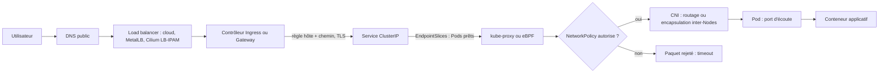

À chaque étape correspond un test : `dig` (DNS public), `curl -H Host:` vers le contrôleur (Ingress), EndpointSlices (Service), `port-forward` (Pod), Hubble (politiques et pertes), `ping -M do` (MTU).

**Stockage : les règles de base.** Un `PersistentVolumeClaim` (demande) est lié à un `PersistentVolume` (ressource), créé dynamiquement par un provisionneur CSI selon une `StorageClass`. Les modes d'accès (`ReadWriteOnce`, `ReadOnlyMany`, `ReadWriteMany`, `ReadWriteOncePod`) déterminent qui peut monter le volume.

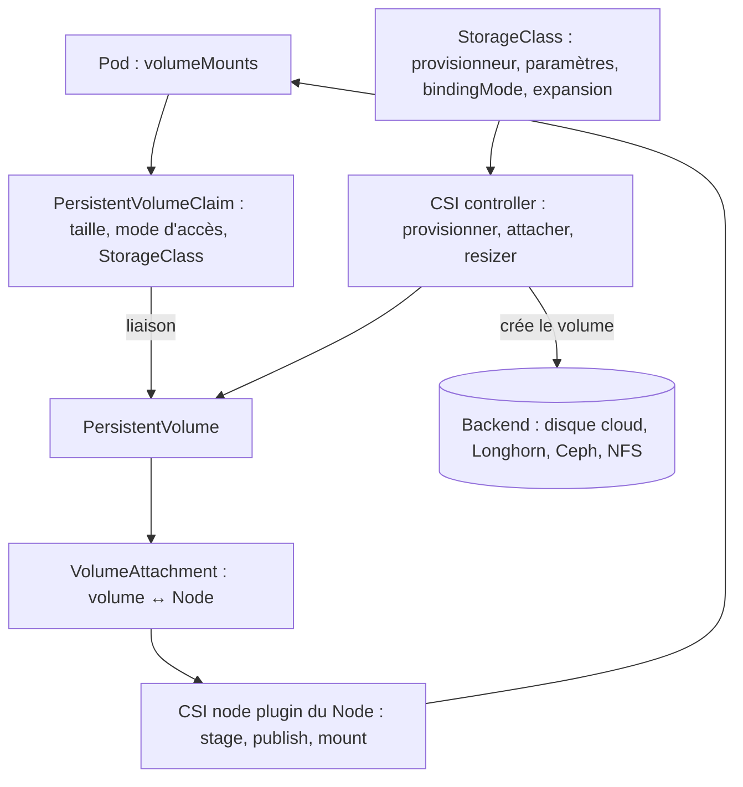

| Étape | Objet à inspecter | Fiche |
|---|---|---|
| Demande non satisfaite | PVC `Pending`, événements | K8S-038 |
| Attachement | `VolumeAttachment` | K8S-040 |
| Montage | Événements `FailedMount`, `csinode` | K8S-039 |
| Usage | `df -h`, `kubelet_volume_stats_*` | K8S-041 |
| Droits | `securityContext`, `ls -ln` | K8S-042 |
| Santé du backend | CRD Longhorn, outils du fournisseur | K8S-043 |

### K8S-025 — Service sans endpoints

> **Étape** 3 · **Couche** Service / EndpointSlices · **Gravité typique** P1 à P2 · **Difficulté** ★☆☆ · **Environnements** tous

**Le problème en langage simple.** Le Service existe mais ne pointe vers aucun Pod : toute requête échoue (connexion refusée, 503 à l'Ingress).

**Le fonctionnement normal.** Le contrôleur EndpointSlice associe au Service les adresses des Pods qui correspondent à son `selector` **et** sont prêts (readiness). kube-proxy ou le dataplane du CNI programme ensuite la répartition.

**L'analogie.** Un standard téléphonique dont la liste des postes est vide : le numéro existe, mais aucun téléphone ne sonne derrière.

**Symptômes et impact.** EndpointSlice vide ou endpoints `ready: false` ; 503 côté Ingress, `connection refused` en interne.

**Causes possibles (par probabilité).** 1. Selector du Service différent des labels des Pods. 2. Pods non prêts (readiness, K8S-056). 3. Aucun Pod (Deployment à 0, K8S-022). 4. Service dans un autre namespace que les Pods.

**Diagnostic guidé.**

```bash
kubectl get svc contrats -n assurance -o jsonpath='{.spec.selector}'; echo                 # 🟢 ce que cherche le Service
kubectl get pods -n assurance --show-labels | grep contrats                                # 🟢 ce que portent les Pods
kubectl get endpointslices -n assurance -l kubernetes.io/service-name=contrats -o wide     # 🟢 adresses retenues
kubectl get endpointslices -n assurance -l kubernetes.io/service-name=contrats \
  -o jsonpath='{range .items[*].endpoints[*]}{.addresses[0]} ready={.conditions.ready}{"\n"}{end}'   # 🟢 prêt ou non
```

Résultat attendu : au moins une adresse `ready=true`. Si le résultat est différent : aucune adresse → comparer selector et labels ; adresses `ready=false` → readiness.

**Lecture des résultats et cause racine.** `kubectl get endpoints` reste utilisable mais l'API Endpoints est dépréciée depuis 1.33 (avertissement affiché) : préférer les EndpointSlices, qui montrent aussi les endpoints non prêts avec leurs conditions.

**Choix de la correction.** Selector erroné → corriger le Service (ou les labels) dans Git. Pods non prêts → K8S-056.

**Résolution pas à pas.**

```yaml
# AVANT
spec:
  selector: {app: contrat}          # ❌ les Pods portent app: contrats
# APRÈS
spec:
  selector: {app: contrats}         # ✅
```

Résultat attendu : l'EndpointSlice se remplit en quelques secondes. Si le résultat est différent : vérifier le `targetPort` (K8S-026).

**L'analogie de la réparation.** On réinscrit les bons postes dans l'annuaire du standard ; les appels sonnent de nouveau.

**Risques et retour arrière.** Modifier le selector d'un Service en production peut envoyer du trafic vers des Pods non prévus (selector trop large) ; revenir à la valeur précédente via Git.

**Validation.**

```bash
kubectl run -n assurance tmp-curl --rm -it --restart=Never --image=curlimages/curl:8.5.0 -- \
  curl -s -o /dev/null -w '%{http_code}\n' http://contrats.assurance.svc:80/health   # 🟢 code 200 attendu
```

**Prévention.** Labels standardisés, test de fumée post-déploiement sur le Service, alerte « Service sans endpoint prêt » (kube-state-metrics : `kube_endpoint_address` ou métriques EndpointSlice selon version).

**Niveau 2 — mécanisme et production.** Un Service sans selector n'a pas d'EndpointSlices automatiques : c'est voulu pour pointer vers des cibles externes, mais déroutant si le selector a été oublié.

**Cas métier.** Assurance : un renommage de label dans le chart a laissé le Service orphelin ; le portail affiche 503.

**Sources.** [Debug des Services](https://kubernetes.io/docs/tasks/debug/debug-application/debug-service/) · [Dépréciation de l'API Endpoints](https://kubernetes.io/blog/2025/04/24/endpoints-deprecation/)

### K8S-026 — Connexion refusée vers un Pod ou un Service (ports, écoute)

> **Étape** 3 · **Couche** Service / application · **Gravité typique** P2 · **Difficulté** ★☆☆ · **Environnements** tous

**Le problème en langage simple.** Le Service a des endpoints, mais la connexion est refusée ou n'aboutit pas.

**Le fonctionnement normal.** Le client joint `port` du Service ; le trafic est redirigé vers `targetPort` sur le Pod, où l'application doit écouter sur toutes les interfaces (`0.0.0.0`), pas seulement `127.0.0.1`.

**L'analogie.** L'adresse de l'immeuble est bonne, mais vous sonnez à l'appartement 8080 alors que l'occupant habite au 3000, ou il n'ouvre qu'aux visiteurs déjà dans l'immeuble (écoute sur localhost).

**Symptômes et impact.** `connection refused`, `Connection reset`, 502 à l'Ingress.

**Causes possibles (par probabilité).** 1. `targetPort` différent du port d'écoute réel. 2. Application qui écoute sur `127.0.0.1`. 3. Nom de port (`targetPort: http`) absent du conteneur. 4. NetworkPolicy (K8S-028).

**Diagnostic guidé.**

```bash
kubectl get svc boutique-api -n boutique -o jsonpath='{.spec.ports}'; echo                 # 🟢 port -> targetPort
kubectl get pod -n boutique -l app=boutique-api -o jsonpath='{.items[0].spec.containers[0].ports}'; echo   # 🟢 ports déclarés
kubectl port-forward -n boutique deploy/boutique-api 18080:3000 &                          # 🟢 contourne le Service
curl -s -o /dev/null -w '%{http_code}\n' http://127.0.0.1:18080/health
# 🟡 DIAGNOSTIC AVANCÉ — sur quoi l'application écoute-t-elle ? (conteneur éphémère avec outils)
kubectl debug -n boutique -it <pod> --image=nicolaka/netshoot:v0.13 --target=app -- ss -lntp
```

Résultat attendu : `ss` montre l'écoute `0.0.0.0:3000` (ou `*:3000`) et le Service cible 3000. Si le résultat est différent : `127.0.0.1:3000` → configuration d'écoute de l'application.

**Lecture des résultats et cause racine.** Port-forward OK mais Service KO = problème de `targetPort` ou NetworkPolicy. Port-forward KO = application.

**Choix de la correction.** Aligner `targetPort` sur le port réel, ou configurer l'application pour écouter sur `0.0.0.0`.

**Résolution pas à pas.**

```yaml
ports:
- name: http
  port: 80
  targetPort: 3000   # ✅ port réellement écouté (APRÈS ; AVANT : 8080)
```

Résultat attendu : le test via le Service renvoie 200. Si le résultat est différent : tester depuis un Pod du même namespace puis d'un autre (NetworkPolicy).

**L'analogie de la réparation.** On corrige le numéro d'appartement sur l'interphone, ou on demande à l'occupant d'ouvrir à tous les visiteurs autorisés.

**Risques et retour arrière.** Faible ; retour par Git.

**Validation.** Test HTTP via le nom du Service, puis via l'Ingress.

**Prévention.** Ports nommés cohérents dans les charts, test de fumée en CI sur cluster éphémère (kind/k3d).

**Niveau 2 — mécanisme et production.** `kubectl port-forward` vers un Pod contourne Service, kube-proxy et la plupart des NetworkPolicies : c'est un excellent outil de bissection, pas une preuve que le chemin réel fonctionne.

**Cas métier.** Commerce : un passage de Node.js à Bun change le port par défaut de l'API sans mise à jour du Service.

**Sources.** [Debug des Services](https://kubernetes.io/docs/tasks/debug/debug-application/debug-service/) · [Service — ports](https://kubernetes.io/docs/concepts/services-networking/service/)

### K8S-027 — Résolution DNS défaillante ou lente dans le cluster

> **Étape** 3 · **Couche** CoreDNS / réseau · **Gravité typique** P1 à P2 · **Difficulté** ★★☆ · **Environnements** tous

**Le problème en langage simple.** Les applications n'arrivent plus à trouver les autres services par leur nom, ou mettent plusieurs secondes à le faire.

**Le fonctionnement normal.** Le `/etc/resolv.conf` des Pods pointe vers le Service `kube-dns` (CoreDNS). Les noms courts sont complétés par les domaines de recherche (`ns.svc.cluster.local`, `svc.cluster.local`, `cluster.local`) ; avec `ndots:5`, un nom externe comportant moins de 5 points est d'abord essayé avec chaque suffixe.

**L'analogie.** L'annuaire de l'entreprise : si le standardiste est absent (CoreDNS arrêté), personne ne trouve plus personne ; s'il essaie d'abord cinq annuaires internes avant l'annuaire public, chaque appel externe prend du temps.

**Symptômes et impact.** `could not resolve host`, `NXDOMAIN`, timeouts de 5 s, latence globale. Cascade possible : toutes les applications qui dépendent de noms internes tombent.

**Causes possibles (par probabilité).** 1. CoreDNS en échec ou saturé. 2. NetworkPolicy bloquant l'egress UDP/TCP 53 vers kube-dns. 3. Boucle de résolution (`loop` détecté, nœud avec `127.0.0.53`). 4. Résolveur amont en panne. 5. `ndots:5` générant beaucoup de requêtes inutiles.

**Diagnostic guidé.**

```bash
kubectl get pods -n kube-system -l k8s-app=kube-dns -o wide                    # 🟢 CoreDNS vivants ?
kubectl logs -n kube-system -l k8s-app=kube-dns --tail=30                      # 🟢 erreurs, "loop", upstream
kubectl get endpointslices -n kube-system -l kubernetes.io/service-name=kube-dns   # 🟢
# 🟢 Pod de test officiel (manifeste de la documentation Kubernetes)
kubectl apply -f https://k8s.io/examples/admin/dns/dnsutils.yaml
kubectl exec -it dnsutils -- cat /etc/resolv.conf
kubectl exec -it dnsutils -- nslookup kubernetes.default
kubectl exec -it dnsutils -- nslookup exemple.org
```

Résultat attendu : `kubernetes.default` résolu vers l'IP du Service API. Si le résultat est différent : interne KO → CoreDNS ou chemin vers kube-dns ; externe seul KO → résolveur amont.

**Lecture des résultats et cause racine.** Tester depuis le namespace de l'application **et** depuis `default` : si seul le namespace applicatif échoue, suspecter une NetworkPolicy (K8S-028).

**Choix de la correction.**

| Preuve | Correction | Inadaptée si |
|---|---|---|
| Pods CoreDNS en échec | Corriger leur cause (OOM, loop, config) | — |
| Egress 53 bloqué | Autoriser DNS dans la NetworkPolicy | — |
| `Loop ... detected` | Faire pointer `forward` vers un vrai résolveur amont | — |
| Lenteur `ndots` | FQDN avec point final ou `dnsConfig.options ndots` | Le service dépend de la recherche par suffixe |

**Résolution pas à pas.**

```yaml
# Réduire les requêtes inutiles pour une application qui appelle surtout des noms externes
spec:
  dnsConfig:
    options:
    - name: ndots
      value: "2"
```

Pour une NetworkPolicy, ajouter explicitement l'egress DNS (voir K8S-028). Résultat attendu : résolution en quelques millisecondes. Si le résultat est différent : mesurer avec `dig +stats` depuis le Pod de test.

**L'analogie de la réparation.** On rappelle le standardiste, on lui ouvre la porte (DNS autorisé) et on lui apprend à consulter directement l'annuaire public pour les numéros externes.

**Risques et retour arrière.** Modifier le ConfigMap `coredns` touche **tout** le cluster : changement revu, sauvegarde de la version précédente (`kubectl get cm coredns -n kube-system -o yaml > coredns.bak.yaml`).

**Validation.** `nslookup` interne et externe OK depuis le namespace applicatif ; taux d'erreurs CoreDNS stable.

**Prévention.** CoreDNS en au moins deux réplicas répartis, NodeLocal DNSCache sur les gros clusters, alertes sur `coredns_dns_responses_total{rcode="SERVFAIL"}`, NetworkPolicies modèles incluant DNS.

**Niveau 2 — mécanisme et production.** L'incident public d'OpenAI (décembre 2024) montre qu'une surcharge de l'API Server peut finir par casser la découverte DNS après expiration des caches : la panne DNS était un effet, pas la cause.

**Cas métier.** Télécoms : voir le scénario « latence DNS » dans la partie Cas métier.

**Sources.** [Debug de la résolution DNS](https://kubernetes.io/docs/tasks/administer-cluster/dns-debugging-resolution/) · [DNS des Services et Pods](https://kubernetes.io/docs/concepts/services-networking/dns-pod-service/) · [Plugin loop de CoreDNS](https://coredns.io/plugins/loop/)

### K8S-028 — NetworkPolicy trop restrictive

> **Étape** 3 et 6 · **Couche** Réseau / sécurité · **Gravité typique** P2 · **Difficulté** ★★☆ · **Environnements** CNI appliquant les NetworkPolicies (Cilium, Calico, k3s…)

**Le problème en langage simple.** Une règle de pare-feu interne bloque un flux légitime : timeouts entre deux services alors que tout « semble » sain.

**Le fonctionnement normal.** Dès qu'une NetworkPolicy sélectionne un Pod pour une direction (ingress/egress), tout ce qui n'est pas explicitement autorisé dans cette direction est refusé. Les règles s'additionnent (union), il n'existe pas de règle « deny » dans l'API standard.

**L'analogie.** Un badge d'accès par étage : dès qu'un étage est protégé, seules les personnes listées entrent ; oublier d'inscrire le coursier (DNS) bloque toutes les livraisons.

**Symptômes et impact.** Timeouts (paquets abandonnés silencieusement), pas de `connection refused`. Souvent après l'ajout d'une politique « default deny ».

**Causes possibles (par probabilité).** 1. Default deny sans autorisation DNS. 2. Mauvais `namespaceSelector` (labels du namespace). 3. Port ou protocole manquant. 4. Combinaison `namespaceSelector` + `podSelector` mal indentée (ET vs OU).

**Diagnostic guidé.**

```bash
kubectl get networkpolicy -n paiement                                   # 🟢 politiques en vigueur
kubectl describe networkpolicy -n paiement                              # 🟢 lecture humaine des règles
kubectl get ns --show-labels | grep -E 'paiement|frontal'               # 🟢 labels utilisés par namespaceSelector
# 🟡 Cilium/Hubble : voir les paquets rejetés et la politique en cause
hubble observe --namespace paiement --verdict DROPPED --last 20
```

Résultat attendu : identifier la politique qui sélectionne le Pod et l'absence de règle pour le flux. Si le résultat est différent : aucune politique → chercher ailleurs (CNI, Service).

**Lecture des résultats et cause racine.** Un flux bloqué uniquement après l'ajout d'une politique, et visible en `DROPPED` par Hubble, est confirmé.

**Choix de la correction.** Ajouter l'autorisation minimale nécessaire ; ne jamais supprimer la politique pour « tester en production ».

**Résolution pas à pas.**

```yaml
# Autoriser l'egress DNS vers CoreDNS pour tous les Pods du namespace (complément d'un default deny)
apiVersion: networking.k8s.io/v1
kind: NetworkPolicy
metadata: {name: allow-dns-egress, namespace: paiement}
spec:
  podSelector: {}
  policyTypes: [Egress]
  egress:
  - to:
    - namespaceSelector: {matchLabels: {kubernetes.io/metadata.name: kube-system}}
      podSelector: {matchLabels: {k8s-app: kube-dns}}     # même élément de liste = ET logique
    ports:
    - {protocol: UDP, port: 53}
    - {protocol: TCP, port: 53}
```

Résultat attendu : le flux passe, `hubble observe` montre `FORWARDED`. Si le résultat est différent : vérifier aussi la politique **ingress** côté destination.

**L'analogie de la réparation.** On inscrit précisément le coursier sur la liste de l'étage, sans ouvrir l'étage à tout le monde.

**Risques et retour arrière.** Une règle trop large annule l'isolation (exigence PCI-DSS, HDS). Retour arrière par Git.

**Validation.** Test de connectivité positif (flux autorisé) **et** négatif (flux interdit toujours bloqué).

**Prévention.** Politiques versionnées et testées (outils de visualisation, tests de connectivité en CI), modèle « default deny + DNS », éditeur de politiques Cilium.

**Niveau 2 — mécanisme et production.** Le label `kubernetes.io/metadata.name` est posé automatiquement sur chaque namespace : il évite de dépendre de labels ajoutés à la main. Les politiques Cilium étendues (L7, FQDN) suivent leurs propres règles.

**Cas métier.** Banque : l'activation d'un default deny pour PCI-DSS coupe la résolution DNS du namespace paiement pendant 20 minutes.

**Sources.** [Network Policies](https://kubernetes.io/docs/concepts/services-networking/network-policies/) · [Hubble](https://docs.cilium.io/en/stable/observability/hubble/)

### K8S-029 — CNI défaillant : Pods sans réseau

> **Étape** 3 · **Couche** CNI / Node · **Gravité typique** P1 · **Difficulté** ★★★ · **Environnements** tous

**Le problème en langage simple.** Le composant qui branche chaque Pod au réseau ne fonctionne plus : nouveaux Pods sans IP, ou Pods existants qui ne communiquent plus.

**Le fonctionnement normal.** À la création d'un Pod, le runtime appelle le plugin CNI qui crée l'interface, attribue l'IP (IPAM) et programme les routes ; un agent (cilium, calico-node…) maintient le dataplane sur chaque Node.

**L'analogie.** L'électricien de l'immeuble : sans lui, les nouveaux appartements n'ont pas de prise, et s'il débranche le tableau général, même les anciens perdent le courant.

**Symptômes et impact.** `FailedCreatePodSandBox ... failed to setup network for sandbox`, Node `NotReady` (`NetworkPluginNotReady`), agents CNI en CrashLoop.

**Causes possibles (par probabilité).** 1. Agent CNI en échec (mise à jour, configuration, ressources). 2. Fichiers de configuration CNI absents du Node. 3. Routes supprimées par un autre composant du système. 4. Plage d'IP épuisée (K8S-034).

**Diagnostic guidé.**

```bash
kubectl get pods -n kube-system -o wide | grep -Ei 'cilium|calico|flannel'   # 🟢 agents par Node
kubectl describe pod <pod-bloque> -n <ns> | grep -A3 FailedCreatePodSandBox # 🟢
# 🟡 Cilium
cilium status --wait=false
kubectl -n kube-system exec ds/cilium -- cilium-dbg status --brief
```

Résultat attendu : agents `Running` sur tous les Nodes, `cilium status` vert. Si le résultat est différent : relever les journaux de l'agent du Node concerné.

**Lecture des résultats et cause racine.** Panne sur un seul Node = local (agent, routes) ; sur tous = configuration ou version du CNI.

**Choix de la correction.** Revenir à la version/config précédente du CNI si le changement est récent ; sinon corriger la cause dans l'agent (journaux).

**Résolution pas à pas.**

```bash
# 🟠 MODIFICATION — redémarrer l'agent CNI d'UN Node après identification (Cilium)
kubectl -n kube-system delete pod -l k8s-app=cilium --field-selector spec.nodeName=worker-1
# 🟠 MODIFICATION — retour à la version précédente du chart CNI
helm history cilium -n kube-system && helm rollback cilium <revision> -n kube-system
```

Résultat attendu : agent prêt, nouveaux Pods avec IP. Si le résultat est différent : ne pas redémarrer tous les agents en même temps (coupure globale).

**L'analogie de la réparation.** On répare le tableau d'un appartement à la fois, ou on remet l'ancien tableau qui fonctionnait.

**Risques et retour arrière.** Toute intervention CNI peut couper le trafic de tout un Node : fenêtre de maintenance et procédure Node par Node.

**Validation.** `cilium connectivity test` **en environnement de test** (il crée ses propres Pods), tests de flux applicatifs en production.

**Prévention.** Mises à jour du CNI progressives, alertes sur agents non prêts, revue des interactions avec le système (voir l'incident public Datadog).

**Niveau 2 — mécanisme et production.** Sur Talos, le CNI est souvent installé hors configuration par défaut (`cni: none`) puis via Helm : sa version est donc pilotée par votre GitOps. L'incident Datadog de mars 2023 illustre une suppression des routes CNI par `systemd-networkd` lors d'une mise à jour système.

**Cas métier.** SaaS : une montée de version du CNI change un paramètre par défaut d'encapsulation ; les Pods de Nodes différents ne se voient plus.

**Sources.** [Plugins réseau](https://kubernetes.io/docs/concepts/extend-kubernetes/compute-storage-net/network-plugins/) · [Dépannage Cilium](https://docs.cilium.io/en/stable/operations/troubleshooting/) · [Incident Datadog 2023](https://www.datadoghq.com/blog/engineering/2023-03-08-multiregion-infrastructure-connectivity-issue/)

### K8S-030 — Ingress renvoie 404

> **Étape** 3 · **Couche** Ingress / contrôleur · **Gravité typique** P2 · **Difficulté** ★☆☆ · **Environnements** tous

**Le problème en langage simple.** Le contrôleur d'entrée répond, mais ne trouve aucune règle pour l'adresse demandée.

**Le fonctionnement normal.** Le contrôleur (Traefik, HAProxy, contrôleurs cloud…) lit les Ingress de sa classe et associe hôte + chemin à un Service.

**L'analogie.** L'accueil d'un hôtel : vous êtes au bon hôtel, mais votre réservation est au nom d'un autre établissement (classe) ou pour une autre chambre (chemin).

**Symptômes et impact.** 404 renvoyé par le contrôleur (page par défaut), pas par l'application.

**Causes possibles (par probabilité).** 1. `ingressClassName` absent ou différent du contrôleur. 2. En-tête `Host` différent de la règle. 3. `pathType`/chemin ne correspondant pas. 4. Ingress dans un namespace non surveillé.

**Diagnostic guidé.**

```bash
kubectl get ingressclass                                                    # 🟢 classes disponibles (et défaut)
kubectl get ingress -n assurance -o wide                                    # 🟢 CLASS, HOSTS, ADDRESS
kubectl describe ingress portail -n assurance                               # 🟢 règles et backends
curl -s -o /dev/null -w '%{http_code}\n' -H 'Host: portail.exemple.fr' http://<ip-du-controleur>/   # 🟢 test d'hôte explicite
```

Résultat attendu : `ADDRESS` renseignée, classe connue, test avec le bon `Host` = 200. Si le résultat est différent : `ADDRESS` vide → le contrôleur ne prend pas l'Ingress en charge.

**Lecture des résultats et cause racine.** 404 sans `Host` mais 200 avec = DNS/hôte. Pas d'`ADDRESS` = classe.

**Choix de la correction.** Déclarer la bonne classe, corriger hôte/chemin.

**Résolution pas à pas.**

```yaml
spec:
  ingressClassName: traefik      # ✅ classe effectivement servie par le contrôleur
  rules:
  - host: portail.exemple.fr
    http:
      paths:
      - {path: /, pathType: Prefix, backend: {service: {name: portail, port: {number: 80}}}}
```

Résultat attendu : `ADDRESS` apparaît, 200. Si le résultat est différent : journaux du contrôleur.

**L'analogie de la réparation.** On transfère la réservation vers le bon hôtel et la bonne chambre.

**Risques et retour arrière.** Faible ; retour par Git.

**Validation.** Test externe depuis Internet ou le réseau client, avec TLS (K8S-035).

**Prévention.** Classe par défaut explicite, tests de fumée par hôte après déploiement, sonde synthétique externe.

**Niveau 2 — mécanisme et production.** Le projet Ingress NGINX a été retiré en mars 2026 (plus aucun correctif) : un 404 après migration vers un autre contrôleur vient souvent d'annotations spécifiques non reprises. Pour les nouveaux besoins, la documentation Kubernetes oriente vers Gateway API (K8S-037).

**Cas métier.** Administration publique : après la migration d'Ingress NGINX vers Traefik, les règles de réécriture de chemin (annotations) n'existent plus et `/demarches` renvoie 404.

**Sources.** [Ingress](https://kubernetes.io/docs/concepts/services-networking/ingress/) · [Retrait d'Ingress NGINX](https://kubernetes.io/blog/2025/11/11/ingress-nginx-retirement/) · [Traefik](https://doc.traefik.io/traefik/)

### K8S-031 — Ingress renvoie 502, 503 ou 504

> **Étape** 3 · **Couche** Ingress → Service → Pod · **Gravité typique** P1 à P2 · **Difficulté** ★★☆ · **Environnements** tous

**Le problème en langage simple.** La règle est trouvée, mais la partie « arrière » (backend) ne répond pas correctement.

**Le fonctionnement normal.** Le contrôleur relaie la requête vers les endpoints prêts du Service, avec des délais d'attente configurés.

**L'analogie.** Un serveur de restaurant transmet la commande en cuisine : 502 = la cuisine renvoie n'importe quoi ou raccroche, 503 = il n'y a personne en cuisine, 504 = la cuisine ne répond pas à temps.

**Symptômes et impact.** Pages d'erreur 5xx, alertes d'erreurs HTTP, utilisateurs bloqués.

**Causes possibles (par probabilité).** 503 : aucun endpoint prêt (K8S-025/056). 502 : mauvais port ou protocole (HTTP vs HTTPS vers le backend), application qui coupe la connexion, Pods qui redémarrent. 504 : application lente, base de données lente, délai du contrôleur trop court.

**Diagnostic guidé.**

```bash
kubectl get endpointslices -n assurance -l kubernetes.io/service-name=portail -o wide   # 🟢 endpoints prêts ?
kubectl get pods -n assurance -l app=portail                                              # 🟢 redémarrages ?
kubectl logs -n traefik deploy/traefik --tail=50 | grep -E ' 50[234] '                    # 🟢 journaux du contrôleur (adapter)
kubectl run -n assurance tmp --rm -it --restart=Never --image=curlimages/curl:8.5.0 -- \
  curl -s -o /dev/null -w '%{http_code} %{time_total}s\n' http://portail.assurance.svc/   # 🟢 test interne
```

Résultat attendu : endpoints prêts et test interne rapide. Si le résultat est différent : le test interne reproduit l'erreur → le problème est derrière le Service ; sinon il est dans le contrôleur.

**Lecture des résultats et cause racine.** Code + temps de réponse classent la panne : 503 immédiat = pas de backend ; 504 après N secondes = lenteur ; 502 = échange invalide.

**Choix de la correction.** Rétablir les endpoints, corriger port/protocole, traiter la lenteur à sa source. Augmenter le délai du contrôleur seulement si le traitement long est normal et documenté.

**Résolution pas à pas.** *Rétablissement immédiat* : revenir à la version précédente si l'erreur suit un déploiement (K8S-021). *Correction durable* : selon la cause, K8S-025, K8S-026, K8S-053 ou analyse applicative.

Résultat attendu : taux de 5xx revenu à la ligne de base. Si le résultat est différent : tracer une requête de bout en bout (OpenTelemetry) pour localiser l'étape lente.

**L'analogie de la réparation.** On rappelle l'équipe de cuisine (endpoints), on corrige le passe-plat (port/protocole) ou on accélère la préparation ; rallonger l'attente du client n'est qu'un dernier recours.

**Risques et retour arrière.** Rallonger les délais masque des lenteurs et accumule des connexions ouvertes.

**Validation.** Taux d'erreurs et latence p95 du contrôleur revenus à la normale (métriques du contrôleur).

**Prévention.** Readiness fiables, PDB, déploiements progressifs, alertes SLO sur 5xx et latence.

**Niveau 2 — mécanisme et production.** Pendant un rolling update, des 502 brefs apparaissent si l'application ne termine pas proprement ses connexions : `preStop` court (quelques secondes) et gestion de SIGTERM.

**Cas métier.** Assurance : voir le scénario « 503 après mise à jour » dans la partie Cas métier.

**Sources.** [Debug des Services](https://kubernetes.io/docs/tasks/debug/debug-application/debug-service/) · [Ingress](https://kubernetes.io/docs/concepts/services-networking/ingress/)

### K8S-032 — Service LoadBalancer bloqué en pending

> **Étape** 3 · **Couche** Cloud provider / répartiteur · **Gravité typique** P2 · **Difficulté** ★★☆ · **Environnements** AKS, on-premise, laboratoire

**Le problème en langage simple.** `EXTERNAL-IP <pending>` : personne ne fournit d'adresse externe au Service.

**Le fonctionnement normal.** Un contrôleur (cloud-controller-manager sur AKS, MetalLB, Cilium LB IPAM, kube-vip, servicelb de k3s) attribue une IP et configure le répartiteur.

**L'analogie.** Vous demandez une ligne téléphonique extérieure, mais l'immeuble n'a pas d'opérateur raccordé (on-premise sans contrôleur) ou le stock de numéros est épuisé.

**Symptômes et impact.** `<pending>` indéfiniment, service non exposé.

**Causes possibles (par probabilité).** 1. Aucun contrôleur LoadBalancer (on-premise, kind). 2. Pool d'IP épuisé ou non configuré. 3. Erreur cloud (quota d'IP publiques, droits de l'identité AKS sur le sous-réseau).

**Diagnostic guidé.**

```bash
kubectl describe svc api-public -n transport | sed -n '/Events:/,$p'   # 🟢 EnsuringLoadBalancer / SyncLoadBalancerFailed
kubectl get pods -A | grep -Ei 'metallb|kube-vip|svclb|cloud-controller'   # 🟢 quel contrôleur existe ?
```

Résultat attendu : un événement du contrôleur. Si le résultat est différent : aucun événement → aucun contrôleur ne traite ce type de Service.

**Lecture des résultats et cause racine.** Absence d'événement = absence de contrôleur. `SyncLoadBalancerFailed` = erreur côté fournisseur, lisible dans le message.

**Choix de la correction.** On-premise : installer/configurer un contrôleur LB et son pool. AKS : corriger quota ou droits de l'identité.

**Résolution pas à pas.**

```yaml
# Exemple Cilium LB IPAM (vérifier l'apiVersion servie par votre version de Cilium)
apiVersion: cilium.io/v2alpha1
kind: CiliumLoadBalancerIPPool
metadata: {name: pool-lan}
spec:
  blocks:
  - cidr: 192.168.10.240/28     # plage réservée sur le LAN, hors DHCP
```

Résultat attendu : une IP attribuée. Si le résultat est différent : vérifier l'annonce (L2/BGP) de cette IP sur le réseau.

**L'analogie de la réparation.** On raccorde l'immeuble à un opérateur et on lui attribue un stock de numéros.

**Risques et retour arrière.** Une plage d'IP en conflit avec le DHCP crée des pannes difficiles à diagnostiquer.

**Validation.** `curl http://<ip-externe>` depuis le réseau client.

**Prévention.** Pool d'IP documenté, alerte sur Services LoadBalancer sans IP, préférer un Ingress/Gateway unique à de multiples LoadBalancers.

**Niveau 2 — mécanisme et production.** Sur k3d, servicelb (klipper) expose via les ports de l'hôte ; sur kind, `cloud-provider-kind` simule un fournisseur. Ces comportements ne reflètent pas la production.

**Cas métier.** Transport : sur un cluster Talos/Proxmox, le service d'horaires reste `<pending>` faute de contrôleur LB.

**Sources.** [Service type LoadBalancer](https://kubernetes.io/docs/concepts/services-networking/service/#loadbalancer) · [Cilium LB IPAM](https://docs.cilium.io/en/stable/network/lb-ipam/)

### K8S-033 — Problèmes MTU/MSS : petites requêtes OK, grosses bloquées

> **Étape** 3 · **Couche** Réseau sous-jacent / encapsulation · **Gravité typique** P2 · **Difficulté** ★★★ · **Environnements** overlays (VXLAN, Geneve), VPN, hybrides

**Le problème en langage simple.** Les petites requêtes fonctionnent, mais les grosses réponses, les téléchargements ou certaines poignées de main TLS restent bloqués.

**Le fonctionnement normal.** Chaque lien a une taille maximale de paquet (MTU, souvent 1500 octets). L'encapsulation overlay ajoute un en-tête (environ 50 octets en VXLAN) : la MTU des Pods doit être réduite d'autant, sinon les paquets trop gros sont rejetés.

**L'analogie.** Un camion trop haut pour un tunnel : les petites voitures passent, le camion reste bloqué à l'entrée, et si le panneau « hauteur maximale » est caché (ICMP filtré), le chauffeur ne comprend pas pourquoi.

**Symptômes et impact.** Connexions qui s'établissent puis se figent, `curl` bloqué après l'en-tête, TLS qui expire, problèmes uniquement entre certains sites.

**Causes possibles (par probabilité).** 1. MTU CNI non adaptée au réseau sous-jacent (VPN, cloud). 2. ICMP « fragmentation needed » filtré par un pare-feu. 3. Liaison hybride avec MTU réduite.

**Diagnostic guidé.**

```bash
# 🟡 DIAGNOSTIC AVANCÉ — depuis un Pod outillé, vers un Pod d'un autre Node
kubectl run -it --rm mtu --restart=Never --image=nicolaka/netshoot:v0.13 -- sh
#   ip link show eth0                       # MTU vue par le Pod
#   ping -M do -s 1372 10.244.2.15          # interdit la fragmentation ; augmenter -s jusqu'à l'échec
#   ping -M do -s 1472 10.244.2.15          # 1472 + 28 = 1500 : échoue si encapsulation
```

Résultat attendu : la plus grande taille qui passe + 28 octets = MTU effective du chemin. Si le résultat est différent : tout échoue → ce n'est pas un problème de MTU.

**Lecture des résultats et cause racine.** MTU effective inférieure à la MTU configurée dans les Pods = cause confirmée.

**Choix de la correction.** Aligner la MTU du CNI sur le chemin réel ; autoriser ICMP nécessaire ; MSS clamping sur la passerelle VPN.

**Résolution pas à pas.** Modifier la MTU dans la configuration du CNI (Helm values) par Git, puis redémarrer les agents Node par Node. Résultat attendu : les gros transferts aboutissent. Si le résultat est différent : mesurer chaque segment (Pod→Node, Node→Node, site→site).

**L'analogie de la réparation.** On charge des camions moins hauts (MTU réduite) et on rend le panneau de hauteur visible (ICMP autorisé).

**Risques et retour arrière.** Changer la MTU du CNI perturbe les connexions existantes ; fenêtre de maintenance.

**Validation.** Téléchargement d'un gros fichier et appels TLS entre tous les couples de Nodes.

**Prévention.** Documenter la MTU de chaque lien, tests de connectivité après chaque changement d'infrastructure réseau.

**Niveau 2 — mécanisme et production.** Les CNI modernes détectent souvent la MTU automatiquement mais se trompent derrière un VPN ou un tunnel ajouté après l'installation.

**Cas métier.** Hybride Djibouti/Europe : les appels entre le cluster on-premise et un service cloud via VPN échouent seulement sur les gros documents PDF.

**Sources.** [Cilium — MTU](https://docs.cilium.io/en/stable/network/concepts/routing/) · [Plugins réseau](https://kubernetes.io/docs/concepts/extend-kubernetes/compute-storage-net/network-plugins/)

### K8S-034 — Épuisement des adresses IP (Pods ou Nodes)

> **Étape** 3 · **Couche** IPAM / sous-réseaux · **Gravité typique** P2 · **Difficulté** ★★☆ · **Environnements** AKS (Azure CNI), on-premise

**Le problème en langage simple.** Plus d'adresse disponible : nouveaux Pods sans IP ou nouveaux Nodes impossibles à ajouter.

**Le fonctionnement normal.** Chaque Node reçoit une plage pour ses Pods (`podCIDR`) ou, en Azure CNI classique, les Pods prennent directement des IP du sous-réseau virtuel.

**L'analogie.** Un parking dont toutes les places sont numérotées et occupées : même avec des voitures prêtes, aucune ne peut se garer.

**Symptômes et impact.** `FailedCreatePodSandBox` mentionnant l'IPAM, scale-up bloqué, échec d'ajout de Node sur AKS.

**Causes possibles (par probabilité).** 1. Sous-réseau trop petit (Azure CNI non overlay). 2. `maxPods` élevé qui réserve beaucoup d'IP par Node. 3. CIDR des Pods trop étroit à la création.

**Diagnostic guidé.**

```bash
kubectl get nodes -o custom-columns=NAME:.metadata.name,PODCIDR:.spec.podCIDR,PODS:.status.capacity.pods   # 🟢
kubectl describe pod <pod> -n <ns> | grep -i -A2 sandbox                                                    # 🟢
az network vnet subnet show -g RG --vnet-name VNET -n SUBNET --query "{prefix:addressPrefix}"               # 🟢 AKS
```

Résultat attendu : marge d'adresses. Si le résultat est différent : comparer le nombre d'IP consommables au nombre de Pods/Nodes prévus.

**Lecture des résultats et cause racine.** Le message IPAM et le calcul de capacité confirment.

**Choix de la correction.** Court terme : réduire la consommation (Pods inutiles, `maxPods`). Durable : modèle overlay (Azure CNI Overlay) ou CIDR plus large — souvent une migration planifiée.

**Résolution pas à pas.** Planifier la migration réseau selon la documentation du fournisseur ; aucune commande « rapide » sûre n'existe pour agrandir un CIDR de Pods en production. Résultat attendu : capacité d'adresses documentée. Si le résultat est différent : escalader à l'architecture réseau.

**L'analogie de la réparation.** On ne peut pas peindre de nouvelles places dans un parking plein : on construit un niveau supplémentaire (nouveau sous-réseau) ou on passe à un système de voiturier (overlay).

**Risques et retour arrière.** Les migrations de CNI/IPAM sont des opérations lourdes, à répéter en préproduction.

**Validation.** Scale-up de test réussi, marge d'IP suivie.

**Prévention.** Dimensionnement des plages dès la conception, suivi du taux d'utilisation des sous-réseaux.

**Niveau 2 — mécanisme et production.** En Azure CNI classique, chaque Node pré-réserve des IP pour ses Pods potentiels : un sous-réseau peut être « plein » alors que peu de Pods tournent.

**Cas métier.** SaaS : l'ajout d'un pool de Nodes pour un nouveau client échoue faute d'IP dans le sous-réseau AKS.

**Sources.** [Azure CNI Overlay](https://learn.microsoft.com/azure/aks/azure-cni-overlay) · [Plugins réseau](https://kubernetes.io/docs/concepts/extend-kubernetes/compute-storage-net/network-plugins/)

### K8S-035 — Certificat TLS d'Ingress invalide ou expiré (cert-manager)

> **Étape** 3 et 6 · **Couche** TLS / cert-manager · **Gravité typique** P1 (site public) · **Difficulté** ★★☆ · **Environnements** tous

**Le problème en langage simple.** Le navigateur affiche « connexion non sécurisée » : certificat expiré, auto-signé par défaut ou ne couvrant pas le nom.

**Le fonctionnement normal.** cert-manager crée une `Certificate`, puis une `CertificateRequest`, puis (ACME) un `Order` et des `Challenge`. Le certificat obtenu est stocké dans un Secret TLS référencé par l'Ingress/Gateway, et renouvelé avant expiration.

**L'analogie.** Le renouvellement d'un passeport : formulaire (Certificate), dépôt en mairie (CertificateRequest), vérification d'identité (Challenge). Si la vérification échoue, l'ancien passeport finit par expirer.

**Symptômes et impact.** Erreurs TLS côté clients, applications partenaires qui refusent la connexion.

**Causes possibles (par probabilité).** 1. Challenge ACME HTTP-01 inaccessible (Ingress, pare-feu, DNS). 2. Secret référencé incorrect. 3. Émetteur (`Issuer`) en erreur. 4. Limites de débit de l'autorité.

**Diagnostic guidé.**

```bash
kubectl get certificate,certificaterequest,order,challenge -n portail       # 🟢 chaîne complète
kubectl describe certificate portail-tls -n portail | sed -n '/Status:/,$p' # 🟢 Ready, raison
openssl s_client -connect portail.exemple.fr:443 -servername portail.exemple.fr </dev/null 2>/dev/null \
  | openssl x509 -noout -subject -issuer -enddate                          # 🟢 ce que voit le client
```

Résultat attendu : `READY True` et date de fin cohérente. Si le résultat est différent : remonter la chaîne jusqu'au premier objet en erreur (souvent le `Challenge`).

**Lecture des résultats et cause racine.** Émetteur « TRAEFIK DEFAULT CERT » ou équivalent = le contrôleur n'a pas trouvé le Secret ; `Challenge` en `pending` avec erreur HTTP = validation ACME impossible.

**Choix de la correction.** Corriger l'objet bloquant (route de challenge, DNS, Secret, Issuer).

**Résolution pas à pas.** Corriger la cause, puis laisser cert-manager réessayer ; avec le CLI `cmctl`, on peut déclencher un renouvellement : `cmctl renew portail-tls -n portail` (🟠). Résultat attendu : nouveau Secret, `READY True`. Si le résultat est différent : journaux du pod cert-manager.

**L'analogie de la réparation.** On rend le guichet de vérification accessible, puis on redépose le dossier ; on ne fabrique pas un faux passeport (certificat auto-signé) pour passer la frontière.

**Risques et retour arrière.** Les autorités publiques limitent les émissions : éviter les essais en boucle, utiliser l'environnement de test (staging) de l'autorité pour déboguer.

**Validation.** `openssl s_client` montre la nouvelle date ; contrôle depuis un client externe.

**Prévention.** Alerte `certmanager_certificate_expiration_timestamp_seconds - time() < 14*24*3600`, sonde externe d'expiration, revue des changements d'Ingress.

**Niveau 2 — mécanisme et production.** cert-manager renouvelle par défaut aux deux tiers de la durée de vie : une panne de renouvellement laisse plusieurs semaines pour réagir si l'alerte existe.

**Cas métier.** Administration publique : voir le scénario « certificat expiré du téléservice » dans la partie Cas métier.

**Sources.** [cert-manager — troubleshooting](https://cert-manager.io/docs/troubleshooting/) · [ACME](https://cert-manager.io/docs/troubleshooting/acme/)

### K8S-036 — Communication inter-Nodes défaillante

> **Étape** 3 · **Couche** Réseau sous-jacent / overlay · **Gravité typique** P1 · **Difficulté** ★★★ · **Environnements** on-premise, hybrides

**Le problème en langage simple.** Deux Pods sur le même Node se parlent, mais pas deux Pods sur des Nodes différents.

**Le fonctionnement normal.** Le trafic inter-Nodes passe soit en routage direct (BGP, routes natives), soit encapsulé (VXLAN, Geneve) : les ports correspondants doivent être ouverts entre Nodes.

**L'analogie.** Les collègues d'un même bureau se parlent, mais le courrier interne entre deux bâtiments n'arrive plus : la navette entre bâtiments est bloquée au portail.

**Symptômes et impact.** Timeouts aléatoires selon le placement des Pods, services partiellement disponibles.

**Causes possibles (par probabilité).** 1. Pare-feu ou groupe de sécurité bloquant l'encapsulation (VXLAN UDP 8472 pour Flannel et Cilium par défaut ; UDP 4789 pour Calico VXLAN ; Geneve UDP 6081 ; BGP TCP 179). 2. Routes supprimées sur un Node. 3. Configuration BGP dépendant de labels modifiés (cas Reddit).

**Diagnostic guidé.**

```bash
kubectl get pods -A -o wide | grep -E 'client|serveur'          # 🟢 placement des Pods testés
# 🟡 test croisé : même Node vs Node différent (netshoot)
kubectl run -it --rm t1 --restart=Never --image=nicolaka/netshoot:v0.13 \
  --overrides='{"spec":{"nodeName":"worker-1"}}' -- curl -m 3 -s http://10.244.2.15:8080/
hubble observe --verdict DROPPED --last 20          # 🟡 Cilium
```

Résultat attendu : succès quel que soit le Node. Si le résultat est différent : échec uniquement inter-Nodes → chemin d'encapsulation ou routes.

**Lecture des résultats et cause racine.** Valider avec l'équipe réseau les flux entre adresses de Nodes sur le port d'encapsulation ; un changement récent de pare-feu est le suspect principal.

**Choix de la correction.** Rouvrir le flux d'encapsulation ou restaurer les routes ; corriger la configuration BGP.

**Résolution pas à pas.** Ouvrir le port documenté par votre CNI entre toutes les IP de Nodes (règle versionnée côté pare-feu/IaC). Résultat attendu : tests croisés OK. Si le résultat est différent : capture `tcpdump` côté Node (🟡) pour voir si les paquets encapsulés partent et arrivent.

**L'analogie de la réparation.** On rouvre le portail à la navette du courrier interne.

**Risques et retour arrière.** Ouvrir des ports réseau : limiter aux adresses des Nodes.

**Validation.** Matrice de tests de connectivité entre tous les Nodes.

**Prévention.** Règles réseau gérées en IaC, tests de connectivité automatiques après changement, vérification des labels utilisés par les configurations réseau avant une mise à niveau.

**Niveau 2 — mécanisme et production.** L'incident Reddit (mars 2023) : la mise à niveau 1.23→1.24 a retiré le label `node-role.kubernetes.io/master` ; les route reflectors Calico sélectionnés par ce label ont disparu et le routage des Pods s'est effondré, alors que les Nodes restaient `Ready`.

**Cas métier.** Énergie : après un changement de pare-feu entre deux salles, seuls les Pods de la salle B deviennent injoignables.

**Sources.** [Ports et protocoles](https://kubernetes.io/docs/reference/networking/ports-and-protocols/) · [Cilium — prérequis firewall](https://docs.cilium.io/en/stable/operations/system_requirements/) · [Reddit Pi-Day outage](https://www.reddit.com/r/RedditEng/comments/11xx5o0/you_broke_reddit_the_piday_outage/)

### K8S-037 — Gateway API : HTTPRoute non attachée

> **Étape** 3 · **Couche** Gateway API · **Gravité typique** P2 · **Difficulté** ★★☆ · **Environnements** contrôleurs Gateway API (Cilium, Traefik, Envoy Gateway…)

**Le problème en langage simple.** La route HTTP a été créée, mais le trafic n'arrive pas : la passerelle ne l'a pas acceptée ou ne trouve pas sa cible.

**Le fonctionnement normal.** Une `HTTPRoute` référence une `Gateway` (`parentRefs`) ; la Gateway doit autoriser les routes de ce namespace et de ce nom d'hôte. Le statut de la route indique `Accepted` et `ResolvedRefs` pour chaque parent.

**L'analogie.** Un quai de gare (Gateway) qui n'accepte que certains trains : votre train (route) doit être autorisé sur ce quai et sa destination (Service) doit exister.

**Symptômes et impact.** 404 ou absence de réponse ; statut de route avec `Accepted=False` ou `ResolvedRefs=False`.

**Causes possibles (par probabilité).** 1. `parentRefs` vers une Gateway ou un listener inexistant. 2. Namespace non autorisé par `allowedRoutes`. 3. Hôte non couvert par le listener. 4. Backend dans un autre namespace sans `ReferenceGrant`.

**Diagnostic guidé.**

```bash
kubectl get gateway,httproute -A                                                    # 🟢
kubectl get httproute horaires -n transport \
  -o jsonpath='{range .status.parents[*].conditions[*]}{.type}={.status} ({.reason}) {.message}{"\n"}{end}'   # 🟢
```

Résultat attendu : `Accepted=True` et `ResolvedRefs=True`. Si le résultat est différent : la raison (`NotAllowedByListeners`, `NoMatchingListenerHostname`, `BackendNotFound`, `RefNotPermitted`…) désigne la correction.

**Lecture des résultats et cause racine.** Le statut est la source de vérité : pas besoin de deviner.

**Choix de la correction.** Selon la raison : corriger `parentRefs`/hôte, autoriser le namespace, créer le `ReferenceGrant` côté namespace cible.

**Résolution pas à pas.**

```yaml
# Autoriser un backend inter-namespaces : objet créé DANS le namespace du Service cible
apiVersion: gateway.networking.k8s.io/v1beta1
kind: ReferenceGrant
metadata: {name: autoriser-transport, namespace: horaires-backend}
spec:
  from: [{group: gateway.networking.k8s.io, kind: HTTPRoute, namespace: transport}]
  to:   [{group: "", kind: Service}]
```

Résultat attendu : `ResolvedRefs=True`. Si le résultat est différent : vérifier la version des CRD Gateway API installées.

**L'analogie de la réparation.** On inscrit le train sur la liste des trains autorisés du quai et on confirme que sa destination accepte les voyageurs venant de cette ligne.

**Risques et retour arrière.** Un `ReferenceGrant` trop large ouvre l'accès à tous les Services du namespace : rester précis.

**Validation.** Requête HTTP vers l'hôte de la route, statut des conditions.

**Prévention.** Lecture systématique du statut en CI/CD (`kubectl wait --for=jsonpath=...`), modèles de routes validés.

**Niveau 2 — mécanisme et production.** Gateway API sépare les rôles : l'équipe plateforme gère `GatewayClass`/`Gateway`, les équipes applicatives gèrent leurs routes. Les erreurs d'attachement reflètent souvent ce contrat entre équipes.

**Cas métier.** Transport : la migration du service d'horaires vers Gateway API échoue car le Service backend vit dans un namespace séparé sans `ReferenceGrant`.

**Sources.** [Gateway API](https://gateway-api.sigs.k8s.io/) · [Gateway API dans Kubernetes](https://kubernetes.io/docs/concepts/services-networking/gateway/)

### K8S-038 — PVC en état Pending

> **Étape** 3 · **Couche** Stockage / provisionnement · **Gravité typique** P2 · **Difficulté** ★★☆ · **Environnements** tous

**Le problème en langage simple.** La demande de stockage (PVC) n'est associée à aucun volume ; le Pod qui l'utilise reste `Pending`.

**Le fonctionnement normal.** Une PVC précise taille, mode d'accès et `StorageClass`. Le provisionneur CSI de cette classe crée un PV, qui est lié à la PVC. Avec `volumeBindingMode: WaitForFirstConsumer`, la création attend volontairement qu'un Pod soit planifié, pour choisir la bonne zone ou le bon Node.

**L'analogie.** Une demande de location de garde-meuble : le gestionnaire (provisionneur) doit exister, proposer la taille et le type demandés, et parfois attendre de savoir dans quelle ville vous emménagez (WaitForFirstConsumer).

**Symptômes et impact.** `STATUS Pending` sur la PVC, Pod `Pending` avec `unbound immediate PersistentVolumeClaims` ou `waiting for first consumer`.

**Causes possibles (par probabilité).** 1. `WaitForFirstConsumer` sans Pod encore planifié (comportement normal). 2. StorageClass inexistante ou pas de classe par défaut. 3. Provisionneur CSI arrêté. 4. Mode d'accès non supporté (RWX sur stockage bloc). 5. Quota ou capacité du backend épuisés.

**Diagnostic guidé.**

```bash
kubectl get pvc data-postgres-0 -n sante                                 # 🟢
kubectl describe pvc data-postgres-0 -n sante | sed -n '/Events:/,$p'    # 🟢 ProvisioningFailed / WaitForFirstConsumer
kubectl get storageclass                                                  # 🟢 classe par défaut marquée "(default)"
kubectl get pods -A | grep -Ei 'csi|provisioner|longhorn'                 # 🟢 le provisionneur tourne-t-il ?
```

Résultat attendu : un événement qui explique l'attente. Si le résultat est différent : aucun événement du provisionneur → il n'est pas déployé ou ne surveille pas cette classe.

**Lecture des résultats et cause racine.** `waiting for first consumer to be created before binding` n'est pas une panne. `storageclass.storage.k8s.io "x" not found` = nom de classe erroné. Erreur du backend dans `ProvisioningFailed` = cause côté stockage.

**Choix de la correction.**

| Preuve | Correction | Inadaptée si |
|---|---|---|
| Classe inexistante | Corriger `storageClassName` (nouvelle PVC) | — |
| Provisionneur arrêté | Rétablir le CSI | — |
| RWX non supporté | Choisir une classe RWX (NFS, CephFS, Longhorn RWX) | L'application peut fonctionner en RWO |

**Résolution pas à pas.** Le `storageClassName` d'une PVC n'est pas modifiable : créer une nouvelle PVC correcte (et adapter le workload) puis supprimer l'ancienne PVC vide.

```yaml
apiVersion: v1
kind: PersistentVolumeClaim
metadata: {name: data-app, namespace: sante}
spec:
  accessModes: [ReadWriteOnce]
  storageClassName: longhorn      # ✅ classe existante (vérifiée avec kubectl get sc)
  resources: {requests: {storage: 20Gi}}
```

Résultat attendu : `Bound`. Si le résultat est différent : journaux du contrôleur CSI (`csi-provisioner`).

**L'analogie de la réparation.** On adresse la demande au bon gestionnaire de garde-meubles, avec un type de box qu'il propose réellement.

**Risques et retour arrière.** Supprimer une PVC `Bound` détruit les données si la `reclaimPolicy` est `Delete` : ne supprimer que des PVC jamais liées.

**Validation.** `kubectl get pvc` → `Bound`, Pod `Running`, écriture de test dans le volume.

**Prévention.** Classe par défaut explicite, validation des `storageClassName` en CI, alerte sur PVC `Pending` > 15 min.

**Niveau 2 — mécanisme et production.** Dans un StatefulSet, la PVC est créée depuis `volumeClaimTemplates` (nom `<template>-<sts>-<ordinal>`) : corriger le template ne modifie pas les PVC existantes.

**Cas métier.** Santé : un nouvel environnement de recette sans classe par défaut laisse la base CloudNativePG en attente.

**Sources.** [Persistent Volumes](https://kubernetes.io/docs/concepts/storage/persistent-volumes/) · [Storage Classes](https://kubernetes.io/docs/concepts/storage/storage-classes/)

### K8S-039 — Échec de montage d'un volume (FailedMount)

> **Étape** 3 · **Couche** CSI / Node · **Gravité typique** P2 · **Difficulté** ★★☆ · **Environnements** tous, Talos avec Longhorn en particulier

**Le problème en langage simple.** Le volume existe mais le kubelet n'arrive pas à le monter dans le Pod.

**Le fonctionnement normal.** Le volume est attaché au Node (étape *attach*), puis le plugin CSI du Node le prépare et le monte (*stage*/*publish*).

**L'analogie.** Le garde-meuble est livré devant la maison, mais la porte du garage refuse de s'ouvrir : clé absente (outil système), serrure différente (système de fichiers), porte bloquée (serveur NFS injoignable).

**Symptômes et impact.** `MountVolume.SetUp failed`, `MountVolume.MountDevice failed`, `Unable to attach or mount volumes ... timed out waiting for the condition` ; Pod en `ContainerCreating`.

**Causes possibles (par probabilité).** 1. Plugin CSI absent ou en échec sur ce Node. 2. Prérequis système manquants (iSCSI pour Longhorn ; sur Talos, extensions système requises). 3. Serveur NFS injoignable ou export refusé. 4. Secret/ConfigMap de volume absent (K8S-010).

**Diagnostic guidé.**

```bash
kubectl describe pod pg-0 -n sante | sed -n '/Events:/,$p'                       # 🟢 message de montage
kubectl get csinode "$(kubectl get pod pg-0 -n sante -o jsonpath='{.spec.nodeName}')" -o jsonpath='{.spec.drivers[*].name}'; echo   # 🟢 drivers CSI enregistrés sur le Node
kubectl get pods -n longhorn-system -o wide | grep -E 'csi|manager' | grep "$(kubectl get pod pg-0 -n sante -o jsonpath='{.spec.nodeName}')"   # 🟢
```

Résultat attendu : le driver figure sur le Node et ses Pods tournent. Si le résultat est différent : driver absent du Node → installer/réparer le plugin sur ce Node.

**Lecture des résultats et cause racine.** Le message de montage contient en général l'erreur système (`mount: permission denied`, `iscsiadm: not found`, `no route to host`).

**Choix de la correction.** Prérequis manquants → corriger l'image/configuration du Node (sur Talos : extensions et `extraMounts` du kubelet selon la doc Longhorn). NFS → réseau/export.

**Résolution pas à pas.** Corriger le prérequis via la configuration du Node (IaC/machine config), puis laisser le kubelet réessayer. Résultat attendu : `SuccessfulMountVolume`/Pod `Running`. Si le résultat est différent : journaux du plugin CSI Node.

**L'analogie de la réparation.** On installe la bonne serrure sur la porte du garage (prérequis du Node) ; le camion n'a pas besoin de repartir.

**Risques et retour arrière.** Modifier la configuration d'un Node Talos implique un redémarrage : drainer d'abord.

**Validation.** Pod `Running`, `kubectl exec ... -- df -h /data` montre le volume.

**Prévention.** Images/configurations de Nodes testées avec le CSI, DaemonSet CSI supervisé, procédure documentée pour les nouveaux Nodes.

**Niveau 2 — mécanisme et production.** Sur Talos, le système est immuable : les outils (iSCSI, util-linux) arrivent par extensions système dans l'image, et les répertoires de données doivent être exposés au kubelet. C'est le point de vigilance n° 1 de Longhorn sur Talos.

**Cas métier.** Infrastructure Proxmox + Talos : un Node ajouté sans l'extension iSCSI ne peut monter aucun volume Longhorn.

**Sources.** [Volumes CSI](https://kubernetes.io/docs/concepts/storage/volumes/#csi) · [Longhorn — prérequis](https://longhorn.io/docs/latest/deploy/install/) · [Talos](https://www.talos.dev/latest/)

### K8S-040 — Multi-Attach error / FailedAttachVolume

> **Étape** 3 · **Couche** CSI / attachement · **Gravité typique** P2 · **Difficulté** ★★★ · **Environnements** tous (stockage RWO)

**Le problème en langage simple.** Le volume est encore attaché à un autre Node : un disque en mode `ReadWriteOnce` ne peut pas être branché à deux machines en même temps.

**Le fonctionnement normal.** Le contrôleur d'attachement crée un `VolumeAttachment` pour relier le volume au Node du Pod ; il détache le volume de l'ancien Node quand celui-ci n'en a plus besoin.

**L'analogie.** Une clé USB qui ne peut être branchée que sur un seul ordinateur : tant qu'elle n'est pas éjectée du premier, le second ne peut pas l'utiliser.

**Symptômes et impact.** `Multi-Attach error for volume "pvc-..." Volume is already exclusively attached to one node and can't be attached to another` ; Pod bloqué en `ContainerCreating`.

**Causes possibles (par probabilité).** 1. Ancien Node arrêté brutalement : détachement impossible. 2. Deployment en `RollingUpdate` avec un PVC RWO (nouveau Pod sur un autre Node). 3. Ancien Pod bloqué en `Terminating` (K8S-017).

**Diagnostic guidé.**

```bash
kubectl get volumeattachment | grep "$(kubectl get pvc data -n app -o jsonpath='{.spec.volumeName}')"   # 🟢 attaché où ?
kubectl get pods -n app -o wide | grep -E 'Terminating|ContainerCreating'                             # 🟢
kubectl get deploy app -n app -o jsonpath='{.spec.strategy.type}'; echo                               # 🟢
```

Résultat attendu : identifier le Node qui détient le volume et son état. Si le résultat est différent : Node sain avec un ancien Pod actif → c'est la stratégie de déploiement.

**Lecture des résultats et cause racine.** Node détenteur `NotReady` = arrêt brutal. Ancien Pod encore actif = `RollingUpdate` incompatible.

**Choix de la correction.** Node mort confirmé → taint `out-of-service` (pas de suppression manuelle de VolumeAttachment). Stratégie → `Recreate` ou StatefulSet.

**Résolution pas à pas.**

```bash
# 🟠 MODIFICATION — Node confirmé arrêté : arrêt non gracieux, détachement contrôlé
kubectl taint nodes worker-2 node.kubernetes.io/out-of-service=nodeshutdown:NoExecute
# 🟠 MODIFICATION — après retour du Node
kubectl taint nodes worker-2 node.kubernetes.io/out-of-service=nodeshutdown:NoExecute-
```

```yaml
# Deployment mono-instance avec PVC RWO
spec:
  strategy: {type: Recreate}     # l'ancien Pod s'arrête avant que le nouveau ne démarre
```

Résultat attendu : le volume s'attache au nouveau Node. Si le résultat est différent : journaux du contrôleur d'attachement CSI.

**L'analogie de la réparation.** On éjecte proprement la clé du premier ordinateur (ou on constate officiellement qu'il est éteint) avant de la brancher ailleurs.

**Risques et retour arrière.** Forcer l'attachement alors que l'ancien Node écrit encore = corruption de données. Ne jamais appliquer `out-of-service` à un Node allumé.

**Validation.** `VolumeAttachment` sur le nouveau Node, application opérationnelle, intégrité des données vérifiée.

**Prévention.** `Recreate` pour les workloads RWO, StatefulSets/opérateurs pour les bases, procédure d'arrêt de Node documentée.

**Niveau 2 — mécanisme et production.** Le mode `ReadWriteOncePod` garantit qu'un seul Pod du cluster utilise le volume, plus strict que `ReadWriteOnce` (un seul Node).

**Cas métier.** Énergie : après la perte d'un hyperviseur Proxmox, le service d'archivage attend 6 minutes puis reste bloqué en Multi-Attach.

**Sources.** [Arrêt non gracieux](https://kubernetes.io/docs/concepts/cluster-administration/node-shutdown/#non-graceful-node-shutdown) · [Modes d'accès](https://kubernetes.io/docs/concepts/storage/persistent-volumes/#access-modes)

### K8S-041 — Volume saturé (No space left on device)

> **Étape** 3 · **Couche** Stockage · **Gravité typique** P1 (base de données) · **Difficulté** ★★☆ · **Environnements** tous

**Le problème en langage simple.** Le volume persistant est plein : l'application ne peut plus écrire.

**Le fonctionnement normal.** Le volume a une taille fixe ; si la StorageClass a `allowVolumeExpansion: true` et que le CSI le supporte, on peut agrandir la PVC (jamais la réduire).

**L'analogie.** Une armoire d'archives pleine : on peut ajouter une étagère (agrandir) ou détruire les dossiers périmés (purge), mais pas continuer à empiler.

**Symptômes et impact.** `No space left on device`, base de données en lecture seule ou arrêtée, journaux d'erreurs d'écriture.

**Causes possibles (par probabilité).** 1. Croissance normale non anticipée. 2. Journaux/WAL non purgés (archivage PostgreSQL bloqué). 3. Fichiers temporaires.

**Diagnostic guidé.**

```bash
kubectl exec -n sante pg-0 -c postgres -- df -h /var/lib/postgresql/data          # 🟢 occupation
kubectl get sc "$(kubectl get pvc pgdata-pg-0 -n sante -o jsonpath='{.spec.storageClassName}')" -o jsonpath='{.allowVolumeExpansion}'; echo   # 🟢 extensible ?
```

PromQL (métriques kubelet) : `kubelet_volume_stats_available_bytes / kubelet_volume_stats_capacity_bytes < 0.10`.

Résultat attendu : identifier ce qui occupe l'espace. Si le résultat est différent : volume non saturé → l'erreur peut concerner le disque du Node (K8S-055).

**Lecture des résultats et cause racine.** Croissance régulière = capacité ; croissance brutale = un processus (archivage bloqué, export temporaire).

**Choix de la correction.** Débloquer la cause de croissance anormale ; agrandir si la croissance est normale.

**Résolution pas à pas.**

```bash
# 🟠 MODIFICATION — agrandir la PVC (irréversible : on ne peut pas réduire)
kubectl patch pvc pgdata-pg-0 -n sante -p '{"spec":{"resources":{"requests":{"storage":"80Gi"}}}}'
kubectl get pvc pgdata-pg-0 -n sante -o jsonpath='{.status.conditions}'; echo   # 🟢 suivi du redimensionnement
```

Avec un opérateur (CloudNativePG), modifier la taille dans la ressource `Cluster` plutôt que la PVC. Résultat attendu : nouvelle capacité visible dans `df -h`. Si le résultat est différent : certaines extensions nécessitent un redémarrage du Pod (selon le CSI).

**L'analogie de la réparation.** On ajoute une étagère et on remet en route le service d'archivage qui devait vider l'armoire.

**Risques et retour arrière.** Agrandissement irréversible ; supprimer des fichiers de base de données « à la main » peut détruire la base.

**Validation.** Écritures applicatives réussies, espace libre > 20 %.

**Prévention.** Alerte à 80 et 90 %, prévision de croissance (`predict_linear` en PromQL), purges automatiques supervisées.

**Niveau 2 — mécanisme et production.** Pour PostgreSQL, un WAL qui grossit sans fin signale souvent un archivage ou un slot de réplication bloqué : agrandir sans corriger repousse simplement la panne.

**Cas métier.** Santé : la base de rendez-vous passe en lecture seule un vendredi soir ; l'archivage WAL vers S3 échouait depuis trois jours.

**Sources.** [Agrandir une PVC](https://kubernetes.io/docs/concepts/storage/persistent-volumes/#expanding-persistent-volumes-claims) · [CloudNativePG — stockage](https://cloudnative-pg.io/documentation/current/storage/)

### K8S-042 — Permission refusée sur un volume

> **Étape** 3 et 6 · **Couche** Stockage / securityContext · **Gravité typique** P3 · **Difficulté** ★★☆ · **Environnements** tous

**Le problème en langage simple.** Le volume est monté, mais l'application (non root) n'a pas le droit d'y écrire.

**Le fonctionnement normal.** Les fichiers ont un propriétaire et un groupe ; `securityContext.fsGroup` demande au kubelet de rendre le volume accessible au groupe indiqué (si le type de volume le permet).

**L'analogie.** Vous avez la clé de la pièce, mais l'armoire à l'intérieur est fermée au nom d'un autre service.

**Symptômes et impact.** `Permission denied`, `EACCES`, CrashLoop au démarrage.

**Causes possibles (par probabilité).** 1. Volume créé par root, application non root sans `fsGroup`. 2. NFS avec `root_squash` et UID non autorisés. 3. Changement d'UID de l'image.

**Diagnostic guidé.**

```bash
kubectl exec -n app <pod> -- id                         # 🟢 UID/GID du processus
kubectl exec -n app <pod> -- ls -ldn /data              # 🟢 propriétaire numérique du point de montage
kubectl get pod <pod> -n app -o jsonpath='{.spec.securityContext}'; echo   # 🟢
```

Résultat attendu : UID/GID compatibles avec les droits. Si le résultat est différent : le Pod ne démarre pas → copie de debug (K8S-011).

**Lecture des résultats et cause racine.** `ls -ldn` montre `0 0` (root) et `id` montre `uid=1000` = cause confirmée.

**Choix de la correction.** `fsGroup` (et `fsGroupChangePolicy: OnRootMismatch` pour les gros volumes) ; NFS → droits côté serveur. Éviter un init container root qui fait `chown` : incompatible avec le profil `restricted`.

**Résolution pas à pas.**

```yaml
spec:
  securityContext:
    runAsNonRoot: true
    runAsUser: 1000
    fsGroup: 1000
    fsGroupChangePolicy: OnRootMismatch   # évite de reparcourir tout le volume à chaque démarrage
```

Résultat attendu : écriture possible. Si le résultat est différent : le type de volume ne supporte pas `fsGroup` (certains NFS) → droits côté serveur.

**L'analogie de la réparation.** On ajoute votre service à la liste des ayants droit de l'armoire, sans donner le passe-partout du bâtiment.

**Risques et retour arrière.** Ne pas passer le conteneur en root « pour que ça marche » : cela affaiblit la sécurité et contredit les Pod Security Standards.

**Validation.** Test d'écriture `kubectl exec ... -- touch /data/.test` puis suppression du fichier de test.

**Prévention.** Images non root avec UID documenté, `fsGroup` dans les modèles de charts.

**Niveau 2 — mécanisme et production.** `fsGroup` déclenche un changement récursif des droits au montage : sur des millions de fichiers, le démarrage peut prendre des minutes ; `OnRootMismatch` limite ce coût.

**Cas métier.** Éducation : une mise à jour de l'image de la plateforme passe en non-root ; les dépôts de devoirs échouent.

**Sources.** [Security context](https://kubernetes.io/docs/tasks/configure-pod-container/security-context/)

### K8S-043 — Volume Longhorn dégradé ou en panne

> **Étape** 3 · **Couche** Stockage distribué · **Gravité typique** P2 (dégradé), P1 (faulted) · **Difficulté** ★★★ · **Environnements** on-premise, Talos/Proxmox

**Le problème en langage simple.** Le stockage répliqué a perdu une ou plusieurs copies : il fonctionne en mode dégradé, ou plus du tout.

**Le fonctionnement normal.** Longhorn maintient pour chaque volume un nombre de répliques (souvent 3) sur des Nodes différents ; la robustesse est `healthy` quand toutes sont à jour.

**L'analogie.** Un document important photocopié en trois exemplaires dans trois bureaux : si un bureau brûle, on travaille avec deux copies (dégradé) et on refait une copie ; si les trois brûlent, il faut la sauvegarde externe.

**Symptômes et impact.** Robustesse `degraded` ou `faulted`, lenteurs, Pods qui ne peuvent plus monter le volume.

**Causes possibles (par probabilité).** 1. Node indisponible ou disque plein. 2. Ordonnancement des répliques impossible (pas assez de Nodes/disques). 3. Réseau entre Nodes dégradé. 4. Défaillance disque.

**Diagnostic guidé.**

```bash
kubectl -n longhorn-system get volumes.longhorn.io -o wide        # 🟢 STATE, ROBUSTNESS par volume
kubectl -n longhorn-system get replicas.longhorn.io | grep <volume>   # 🟢 répliques et Nodes
kubectl -n longhorn-system get nodes.longhorn.io                  # 🟢 Nodes/disques prêts et planifiables
```

Résultat attendu : identifier les répliques manquantes et leur Node. Si le résultat est différent : `faulted` → stopper les écritures et préparer la restauration.

**Lecture des résultats et cause racine.** Répliques manquantes toutes sur le même Node = panne de ce Node ; reconstruction impossible faute de place = capacité.

**Choix de la correction.** Rétablir le Node ou libérer de la place pour que Longhorn reconstruise ; `faulted` → procédure de récupération documentée par Longhorn ou restauration depuis la sauvegarde.

**Résolution pas à pas.** Rétablir la capacité (Node, disque), surveiller la reconstruction (interface Longhorn ou CRD). Résultat attendu : robustesse `healthy`. Si le résultat est différent : escalader, ne pas supprimer de répliques manuellement sans procédure.

**L'analogie de la réparation.** On rouvre un bureau sain et on refait la photocopie manquante à partir d'un exemplaire intact.

**Risques et retour arrière.** Les actions de récupération (salvage) peuvent entraîner une perte des dernières écritures : décision documentée, sauvegarde vérifiée avant.

**Validation.** Robustesse `healthy`, test d'intégrité applicatif (contrôles de la base).

**Prévention.** Sauvegardes Longhorn vers un stockage objet externe (S3/Ceph RGW), alertes Longhorn, marge de capacité ≥ 1 Node, `replicaAutoBalance`.

**Niveau 2 — mécanisme et production.** La réplication n'est pas une sauvegarde : une suppression ou une corruption logique est répliquée. Seule une sauvegarde externe testée protège contre ces cas.

**Cas métier.** Santé : voir le scénario « PostgreSQL après incident de stockage » dans la partie Cas métier.

**Sources.** [Documentation Longhorn](https://longhorn.io/docs/latest/) · [Portfolio — Talos & Longhorn](https://devsecops-portfolio.netlify.app/guides/kubernetes/talos-longhorn/)

## Partie VI — Étape 4 : Architecture interne et control plane

*Comprendre le moteur.* Cette partie contient 9 fiches (K8S-044 à K8S-052).

### Concepts de l'étape 4 — Architecture interne et control plane

| Composant | Ce qu'il fait réellement | Signal de bonne santé |
|---|---|---|
| kube-apiserver | Authentification, autorisation (RBAC), admission (mutation puis validation), validation de schéma, persistance dans etcd, diffusion des changements (watch) | `/readyz` = ok, latence p99 stable, pas de 429 |
| etcd | Base clé-valeur cohérente ; chaque écriture est validée par une majorité (Raft) | Un leader, membres sains, fsync WAL rapide, taille sous le quota |
| kube-scheduler | Filtrage puis notation des Nodes ; un seul actif (Lease) | Lease renouvelé, événements de scheduling |
| kube-controller-manager | Boucles de réconciliation natives ; un seul actif (Lease) | Lease renouvelé, `observedGeneration` à jour |
| kubelet | Agent du Node, Pods statiques, sondes, évictions | Lease du Node renouvelé, conditions saines |
| kube-proxy / dataplane | Programme les Services (iptables, nftables, IPVS ou eBPF) | Règles synchronisées, EndpointSlices suivies |
| Runtime CRI | containerd ou CRI-O | `crictl info` sans erreur |

**Quorum etcd.** Quorum = ⌊N/2⌋ + 1. 3 membres tolèrent 1 panne, 5 membres en tolèrent 2 ; un nombre pair n'apporte rien. Les membres doivent être sur des hôtes physiques distincts.

### Sauvegarde, restauration et reprise d'etcd

> ⚠️ **Intervention à haut risque.** Une restauration d'etcd remplace l'état complet du cluster par celui du snapshot : tout ce qui a été créé ou modifié après est perdu, et la restauration crée un **nouveau** cluster etcd logique. À réserver à la perte définitive du quorum ou à une corruption, après échec des tentatives de rétablissement du quorum. Répéter la procédure en laboratoire. Sans objet sur AKS (etcd géré par Azure).

**1. Sauvegarder (kubeadm).**

```bash
# 🟠 Snapshot cohérent depuis un membre sain (chemins kubeadm)
sudo ETCDCTL_API=3 etcdctl --endpoints=https://127.0.0.1:2379 \
  --cacert=/etc/kubernetes/pki/etcd/ca.crt \
  --cert=/etc/kubernetes/pki/etcd/server.crt \
  --key=/etc/kubernetes/pki/etcd/server.key \
  snapshot save /var/backups/etcd/etcd-$(date +%Y%m%d-%H%M).db
# 🟢 Vérifier le fichier (etcd ≥ 3.6 : etcdutl obligatoire pour status/restore)
sudo etcdutl snapshot status /var/backups/etcd/etcd-20261014-0200.db -w table
```

Copier ensuite le snapshot **hors du cluster** (stockage objet chiffré, accès restreint : il contient tous les Secrets du cluster, chiffrés seulement si le chiffrement au repos est activé).

**2. Sauvegarder (Talos).**

```bash
talosctl -n 10.0.0.10 etcd snapshot ./etcd-$(date +%Y%m%d-%H%M).snapshot    # 🟠 snapshot cohérent
# si le quorum est déjà perdu, la doc Talos prévoit la copie brute de la base (à restaurer avec --recover-skip-hash-check) :
talosctl -n 10.0.0.10 cp /var/lib/etcd/member/snap/db ./db-brute
```

**3. Avant de restaurer : tenter de rétablir le quorum.** Redémarrer les membres arrêtés (hyperviseur, réseau), vérifier `endpoint status`. Si la majorité revient, aucune restauration n'est nécessaire.

**4. Restaurer (kubeadm, principe).** Sur **chaque** control plane, avec **le même** snapshot :

```bash
# 🔴 Arrêter API Server et etcd (Pods statiques) en déplaçant les manifestes
sudo mkdir -p /root/manifests-stop && sudo mv /etc/kubernetes/manifests/{kube-apiserver,etcd}.yaml /root/manifests-stop/
# 🔴 Restaurer dans un NOUVEAU répertoire (ne pas écraser l'ancien, utile pour l'enquête)
sudo etcdutl snapshot restore /var/backups/etcd/etcd-20261014-0200.db \
  --name cp1 \
  --initial-cluster cp1=https://10.0.0.10:2380,cp2=https://10.0.0.11:2380,cp3=https://10.0.0.12:2380 \
  --initial-advertise-peer-urls https://10.0.0.10:2380 \
  --data-dir /var/lib/etcd-restored \
  --bump-revision 1000000000 --mark-compacted
# Adapter --name et --initial-advertise-peer-urls sur cp2 et cp3.
# Modifier le hostPath du volume de données dans etcd.yaml vers /var/lib/etcd-restored, puis remettre les manifestes.
```

Les options `--bump-revision` et `--mark-compacted` (documentation etcd) évitent que les contrôleurs et caches clients ne mélangent anciennes et nouvelles révisions après la restauration. Après redémarrage : vérifier etcd (`endpoint status`), l'API, puis redémarrer les composants qui maintiennent des caches (controller-manager, scheduler, kubelets si nécessaire) selon la documentation Kubernetes.

**5. Restaurer (Talos).** La documentation Talos prévoit : vérifier que le quorum ne peut pas être rétabli, réinitialiser les données etcd des control planes (partition `EPHEMERAL`), attendre que le service etcd de chaque control plane soit en attente de bootstrap, puis lancer `talosctl -n <IP> bootstrap --recover-from=./etcd.snapshot` sur **un seul** nœud (ajouter `--recover-skip-hash-check` pour une copie brute). Suivre la page officielle de la version Talos déployée.

**6. Après la restauration.** Comparer l'état restauré avec Git (Argo CD le resynchronise), vérifier les objets créés après le snapshot (perdus), les PV dont le backend a évolué, les Secrets renouvelés entre-temps (certificats, jetons), puis documenter le RPO réel obtenu.

| Bonnes pratiques | Détail |
|---|---|
| Fréquence | Selon le RPO visé (souvent horaire) et avant chaque mise à niveau |
| Externalisation | Hors du cluster et hors de l'hyperviseur, chiffré |
| Test | Restauration complète en laboratoire au moins trimestrielle |
| Alerte | Échec ou absence de snapshot récent |
| Complément | GitOps pour reconstruire les objets + sauvegardes applicatives pour les données |

Sources : [etcd — disaster recovery](https://etcd.io/docs/latest/op-guide/recovery/) · [Opérer etcd pour Kubernetes](https://kubernetes.io/docs/tasks/administer-cluster/configure-upgrade-etcd/) · [Talos — disaster recovery](https://www.talos.dev/latest/advanced/disaster-recovery/) · [Portfolio — Kubernetes et etcd](https://devsecops-portfolio.netlify.app/guides/kubernetes/kube-etcd/)

### K8S-044 — API Server indisponible

> **Étape** 4 · **Couche** Control plane · **Gravité typique** P1 · **Difficulté** ★★★ · **Environnements** kubeadm, Talos (AKS : géré par Azure)

**Le problème en langage simple.** Le point d'entrée unique du cluster ne répond plus. Les applications déjà lancées continuent souvent de tourner, mais plus rien ne peut être créé, modifié ou réparé automatiquement.

**Le fonctionnement normal.** kube-apiserver (Pod statique sur kubeadm/Talos) authentifie, valide et persiste chaque requête dans etcd ; tous les autres composants passent par lui.

**L'analogie.** Le standard d'une entreprise est en panne : les employés continuent leur travail en cours, mais plus aucune nouvelle consigne ne circule et personne ne peut signaler un problème.

**Symptômes et impact.** `connection refused` sur 6443 depuis tous les clients, contrôleurs et kubelets en erreur, aucune autoguérison, déploiements bloqués.

**Causes possibles (par probabilité).** 1. etcd indisponible ou lent (K8S-046/047). 2. Certificats expirés (K8S-049). 3. Erreur dans le manifeste statique ou un fichier de configuration (chiffrement, audit, admission). 4. Ressources du control plane épuisées. 5. Répartiteur de charge devant les API Servers en panne.

**Diagnostic guidé.**

```bash
# 🟡 kubeadm — sur un control plane (kubectl ne répond plus)
sudo crictl ps -a --name kube-apiserver                    # conteneur présent ? redémarre-t-il ?
sudo crictl logs --tail=50 <id-conteneur-apiserver>        # dernière erreur
sudo journalctl -u kubelet --since "15 min ago" | grep -i apiserver | tail
curl -k https://127.0.0.1:6443/livez                       # contourne le répartiteur de charge
# 🟡 Talos
talosctl -n 10.0.0.10 containers -k | grep apiserver
talosctl -n 10.0.0.10 logs -k <id-conteneur-apiserver> | tail -50
talosctl -n 10.0.0.10 etcd status
```

Résultat attendu : identifier si le conteneur tourne et pourquoi il échoue. Si le résultat est différent : conteneur absent → le kubelet ne peut pas lancer le Pod statique (manifeste invalide, journaux kubelet).

**Lecture des résultats et cause racine.** `connection refused` vers `127.0.0.1:2379` dans les journaux = etcd. `x509: certificate has expired` = certificats. `unable to load ... config` = fichier de configuration. Un seul control plane en échec avec les autres sains = problème local.

**Choix de la correction.** Corriger la dépendance (etcd, certificats) avant l'API Server ; restaurer le dernier manifeste valide si un changement récent est en cause.

**Résolution pas à pas.**

```bash
# 🟠 MODIFICATION — kubeadm : restaurer le manifeste statique précédent (sauvegardé avant tout changement)
sudo cp /root/backup/kube-apiserver.yaml.bak /etc/kubernetes/manifests/kube-apiserver.yaml
# le kubelet détecte le changement et relance le Pod statique
```

Résultat attendu : `/readyz` renvoie `ok` sur chaque control plane. Si le résultat est différent : traiter etcd ou certificats.

**L'analogie de la réparation.** On rebranche le standard sur une ligne qui fonctionne (etcd) et avec un badge valide (certificats) ; inutile de le redémarrer en boucle tant que sa ligne est coupée.

**Risques et retour arrière.** Toute modification du control plane se fait un nœud à la fois, avec sauvegarde des manifestes et d'etcd. Ne jamais modifier les trois control planes simultanément.

**Validation.**

```bash
kubectl get --raw='/readyz?verbose' | tail -5        # 🟢
kubectl get pods -n kube-system -l tier=control-plane   # 🟢 (kubeadm)
```

**Prévention.** Control plane à 3 nœuds, sonde externe sur `/readyz`, sauvegardes etcd, revue de tout changement de configuration du control plane, accès de secours (OpenAI : accès « break-glass » ajouté après son incident).

**Niveau 2 — mécanisme et production.** Sur AKS, le control plane est géré par Azure : vérifier l'état du service (`az aks show`, Azure Service Health), la configuration réseau (cluster privé, plages autorisées) et la version ; les journaux du control plane sont disponibles via les paramètres de diagnostic vers Log Analytics s'ils ont été activés.

**Cas métier.** Banque : après l'ajout d'un fichier de politique d'audit mal formé, le kube-apiserver ne démarre plus sur le premier control plane ; le changement est annulé avant d'être propagé aux deux autres.

**Sources.** [Debug d'un cluster](https://kubernetes.io/docs/tasks/debug/debug-cluster/) · [kube-apiserver](https://kubernetes.io/docs/reference/command-line-tools-reference/kube-apiserver/) · [Incident OpenAI 2024](https://status.openai.com/incidents/ctrsv3lwd797)

### K8S-045 — API Server lent ou qui renvoie 429

> **Étape** 4 · **Couche** Control plane / API Priority and Fairness · **Gravité typique** P2 · **Difficulté** ★★★ · **Environnements** tous

**Le problème en langage simple.** L'API répond, mais lentement, ou refuse des requêtes avec `429 Too Many Requests`.

**Le fonctionnement normal.** API Priority and Fairness (APF) classe les requêtes (FlowSchemas) en niveaux de priorité avec des files d'attente, pour qu'un client trop bavard ne prive pas les autres.

**L'analogie.** Un guichet municipal avec plusieurs files (urgences, rendez-vous, public) : si un seul visiteur dépose mille dossiers, sa file sature mais les autres doivent continuer d'avancer.

**Symptômes et impact.** Commandes lentes, `429`, contrôleurs en retard, rollouts lents, kubelets qui peinent à mettre à jour leur état.

**Causes possibles (par probabilité).** 1. Client trop bavard (opérateur, outil de télémétrie, script en boucle de `LIST` complets). 2. etcd lent (K8S-047). 3. Webhook d'admission lent (K8S-067). 4. Ressources du control plane insuffisantes.

**Diagnostic guidé.**

```bash
kubectl get --raw /metrics | grep -E '^apiserver_flowcontrol_rejected_requests_total' | head   # 🟢 rejets par niveau
kubectl get flowschemas                                                                        # 🟢
kubectl get --raw /debug/api_priority_and_fairness/dump_priority_levels                        # 🟡 occupation des files
```

PromQL : `topk(10, sum by (user_agent, verb, resource) (rate(apiserver_request_total[5m])))` pour identifier les plus gros clients (le label `user_agent` n'est pas toujours exposé selon la configuration ; à défaut, utiliser les journaux d'audit).

Résultat attendu : identifier un client dominant ou une latence etcd. Si le résultat est différent : regarder la latence des webhooks (`apiserver_admission_webhook_admission_duration_seconds`).

**Lecture des résultats et cause racine.** Un composant récemment déployé qui apparaît en tête des requêtes `LIST` est le suspect principal (scénario de l'incident OpenAI de décembre 2024).

**Choix de la correction.** Arrêter ou corriger le client fautif ; ne pas désactiver APF.

**Résolution pas à pas.** *Rétablissement immédiat* : réduire à zéro ou retirer le composant fautif (via Git si possible ; en urgence par `kubectl scale`, puis aligner Git). *Correction durable* : le client doit utiliser des informers/caches, la pagination et des `watch` plutôt que des `LIST` répétés.

Résultat attendu : rejets 429 à zéro, latence revenue. Si le résultat est différent : augmenter les ressources du control plane (on-premise) en dernier recours.

**L'analogie de la réparation.** On demande au visiteur qui bloque le guichet de déposer ses dossiers par lots, au lieu de supprimer les files d'attente.

**Risques et retour arrière.** Modifier les FlowSchemas sans expertise peut affamer des composants système.

**Validation.** Latence p99 de l'API revenue sous le seuil, plus de 429.

**Prévention.** Revue de charge API de tout nouvel opérateur/agent, déploiement progressif sur un petit cluster d'abord, alertes de latence API.

**Niveau 2 — mécanisme et production.** Un agent déployé en DaemonSet multiplie sa charge par le nombre de Nodes : 2 requêtes `LIST` par minute sur 2 000 Nodes deviennent 4 000 requêtes coûteuses par minute.

**Cas métier.** SaaS : un nouvel agent de collecte de métriques, déployé sur tous les Nodes, fait passer la latence de l'API de 50 ms à plusieurs secondes.

**Sources.** [API Priority and Fairness](https://kubernetes.io/docs/concepts/cluster-administration/flow-control/) · [Incident OpenAI](https://status.openai.com/incidents/ctrsv3lwd797)

### K8S-046 — etcd : perte de quorum

> **Étape** 4 · **Couche** etcd / Raft · **Gravité typique** P1 · **Difficulté** ★★★ · **Environnements** kubeadm, Talos (AKS : géré)

**Le problème en langage simple.** Le cluster etcd n'a plus la majorité de ses membres : il refuse toute écriture. Kubernetes est figé.

**Le fonctionnement normal.** etcd réplique chaque écriture avec Raft ; une écriture n'est validée que si la majorité (quorum = ⌊N/2⌋+1) l'a enregistrée. Avec 3 membres, on tolère 1 panne ; avec 5, 2 pannes.

**L'analogie.** Un conseil de 3 personnes qui ne peut voter qu'à la majorité : si 2 sont absents, aucune décision ne peut être prise, même si la personne présente a raison.

**Symptômes et impact.** API Server en erreur (`etcdserver: request timed out`, `no leader`), cluster entièrement figé.

**Causes possibles (par probabilité).** 1. Plusieurs control planes arrêtés (maintenance simultanée, panne d'hyperviseur hébergeant plusieurs CP). 2. Partition réseau. 3. Disques saturés ou défaillants.

**Diagnostic guidé.**

```bash
# 🟡 kubeadm — depuis un control plane
sudo ETCDCTL_API=3 etcdctl --endpoints=https://127.0.0.1:2379 \
  --cacert=/etc/kubernetes/pki/etcd/ca.crt --cert=/etc/kubernetes/pki/etcd/server.crt \
  --key=/etc/kubernetes/pki/etcd/server.key endpoint status --cluster -w table
sudo ETCDCTL_API=3 etcdctl ... member list -w table          # mêmes options TLS
# 🟡 Talos
talosctl -n 10.0.0.10,10.0.0.11,10.0.0.12 service etcd
talosctl -n 10.0.0.10 etcd members
```

Résultat attendu : nombre de membres sains et leader. Si le résultat est différent : un seul membre répond → quorum perdu.

**Lecture des résultats et cause racine.** Compter les membres sains par rapport au total. Si les membres absents peuvent redémarrer (VM arrêtée, réseau), **restaurer le quorum** est toujours préférable à une restauration depuis sauvegarde.

**Choix de la correction.**

| Situation | Correction | Inadaptée si |
|---|---|---|
| Membres arrêtés mais intacts | Les redémarrer : le quorum revient | Leurs disques sont détruits |
| Membres définitivement perdus | Procédure de reprise après sinistre depuis snapshot | Le quorum peut encore être rétabli |

**Résolution pas à pas.** *Rétablissement immédiat* : redémarrer les membres absents (hyperviseur, réseau). *Reprise après sinistre* : suivre la section « Sauvegarde et restauration d'etcd » de l'étape 4 (kubeadm : `etcdutl snapshot restore` ; Talos : `talosctl bootstrap --recover-from`). Résultat attendu : leader élu, membres sains. Si le résultat est différent : escalader, ne pas improviser.

**L'analogie de la réparation.** On rappelle les membres absents du conseil ; ce n'est que si le conseil a disparu qu'on en reconstitue un nouveau à partir du dernier procès-verbal (snapshot), en acceptant de perdre ce qui a été décidé après.

**Risques et retour arrière.** Une restauration depuis snapshot fait perdre les écritures postérieures (RPO) et constitue un **nouveau** cluster etcd logique : procédure à haut risque, à répéter en laboratoire.

**Validation.** `endpoint status` : tous sains, un leader ; `kubectl get nodes` fonctionne ; contrôleurs reconcilient.

**Prévention.** 3 ou 5 membres répartis sur des hôtes physiques différents (anti-affinité au niveau Proxmox), maintenance un nœud à la fois, snapshots réguliers externalisés et testés.

**Niveau 2 — mécanisme et production.** Un cluster à 2 membres est moins tolérant qu'un cluster à 1 (la perte de l'un ou l'autre bloque tout). Sur Proxmox, trois VMs control plane sur le même hyperviseur n'apportent aucune haute disponibilité réelle.

**Cas métier.** Laboratoire Proxmox : un redémarrage de l'hyperviseur unique arrête les trois control planes Talos ; au retour, le quorum se reforme seul car les disques sont intacts.

**Sources.** [Opérer etcd pour Kubernetes](https://kubernetes.io/docs/tasks/administer-cluster/configure-upgrade-etcd/) · [etcd — FAQ (quorum)](https://etcd.io/docs/latest/faq/) · [Talos — disaster recovery](https://www.talos.dev/latest/advanced/disaster-recovery/)

### K8S-047 — etcd : latence disque et changements de leader fréquents

> **Étape** 4 · **Couche** etcd / stockage du control plane · **Gravité typique** P2 · **Difficulté** ★★★ · **Environnements** kubeadm, Talos

**Le problème en langage simple.** etcd est trop lent à écrire sur disque : le leader change souvent, l'API ralentit, des requêtes expirent.

**Le fonctionnement normal.** Chaque écriture etcd est synchronisée sur disque (fsync du WAL). La documentation etcd recommande des disques rapides (SSD) : un p99 de synchronisation WAL de l'ordre de 10 ms au plus.

**L'analogie.** Le secrétaire du conseil doit écrire chaque décision à l'encre indélébile avant de la confirmer ; s'il écrit très lentement, les autres membres croient qu'il est absent et élisent un autre secrétaire.

**Symptômes et impact.** Messages `apply request took too long`, `leader changed`, latence API, timeouts.

**Causes possibles (par probabilité).** 1. Disque lent ou partagé (stockage réseau, voisin bruyant sur l'hyperviseur). 2. Base etcd volumineuse non défragmentée. 3. Réseau lent entre membres.

**Diagnostic guidé.**

```promql
# Synchronisation du WAL, p99 (cible : de l'ordre de 10 ms au plus)
histogram_quantile(0.99, sum by (le, instance) (rate(etcd_disk_wal_fsync_duration_seconds_bucket[5m])))
# Commit du backend, p99 (cible : de l'ordre de 25 ms au plus)
histogram_quantile(0.99, sum by (le, instance) (rate(etcd_disk_backend_commit_duration_seconds_bucket[5m])))
# Changements de leader sur une heure
increase(etcd_server_leader_changes_seen_total[1h])
```

```bash
# 🟡 journaux etcd (kubeadm via crictl ; Talos :)
talosctl -n 10.0.0.10 logs etcd | grep -E 'took too long|leader' | tail
```

Résultat attendu : latences sous les cibles. Si le résultat est différent : une seule instance lente → son disque ou son hôte.

**Lecture des résultats et cause racine.** Latence élevée corrélée à l'activité d'autres VMs sur le même stockage = voisinage ; latence élevée permanente = type de disque inadapté.

**Choix de la correction.** Disque dédié et rapide pour etcd ; défragmentation planifiée si la base est fragmentée.

**Résolution pas à pas.** Déplacer les disques des control planes sur un stockage local SSD/NVMe (migration planifiée, un membre à la fois). Défragmentation : voir K8S-048. Résultat attendu : p99 sous les cibles, plus de changements de leader. Si le résultat est différent : examiner le réseau entre membres.

**L'analogie de la réparation.** On donne au secrétaire un stylo qui écrit vite et un bureau à lui, plutôt que de lui demander d'aller plus vite.

**Risques et retour arrière.** Migrer un membre etcd = intervention sur le quorum : un seul membre à la fois, quorum vérifié entre chaque étape.

**Validation.** Métriques stables sur 24 h, plus d'élections intempestives.

**Prévention.** Alertes etcd (voir partie Observabilité), stockage dédié dès la conception, pas de stockage réseau partagé pour etcd.

**Niveau 2 — mécanisme et production.** Les seuils de heartbeat et d'élection d'etcd peuvent être ajustés pour des liaisons à forte latence, mais cela traite le symptôme : la cause est presque toujours le disque.

**Cas métier.** Laboratoire Proxmox : les control planes Talos partagent un disque avec des sauvegardes nocturnes ; chaque nuit, le leader etcd change plusieurs fois.

**Sources.** [etcd — recommandations matérielles](https://etcd.io/docs/latest/op-guide/hardware/) · [etcd — métriques](https://etcd.io/docs/latest/metrics/)

### K8S-048 — etcd : quota dépassé (alarme NOSPACE)

> **Étape** 4 · **Couche** etcd · **Gravité typique** P1 · **Difficulté** ★★★ · **Environnements** kubeadm, Talos

**Le problème en langage simple.** La base etcd a atteint son quota : elle passe en mode maintenance et refuse les écritures (`mvcc: database space exceeded`).

**Le fonctionnement normal.** etcd garde l'historique des révisions ; la compaction supprime l'historique ancien et la défragmentation rend l'espace au disque. Un quota protège le système (2 Gio par défaut, souvent relevé).

**L'analogie.** Un registre papier dont on n'arrache jamais les pages périmées : quand il est plein, plus aucune écriture n'est possible ; il faut archiver (compacter), relier à nouveau (défragmenter), puis lever l'interdiction d'écrire.

**Symptômes et impact.** Écritures refusées dans tout le cluster, déploiements impossibles.

**Causes possibles (par probabilité).** 1. Objets nombreux ou volumineux (Events, Secrets de releases Helm, CRD bavardes). 2. Compaction absente ou insuffisante. 3. Quota trop bas pour la taille du cluster.

**Diagnostic guidé.**

```bash
# 🟡 kubeadm (options TLS comme en K8S-046, abrégées ici par "...")
sudo etcdctl ... alarm list
sudo etcdctl ... endpoint status --cluster -w table        # DB SIZE par membre
# 🟡 Talos
talosctl -n 10.0.0.10 etcd alarm list
talosctl -n 10.0.0.10 etcd status
```

Résultat attendu : alarme `NOSPACE` et taille proche du quota. Si le résultat est différent : pas d'alarme → chercher ailleurs.

**Lecture des résultats et cause racine.** Identifier ce qui remplit la base (types d'objets les plus nombreux) avant de nettoyer, sinon l'alarme reviendra.

**Choix de la correction.** Compaction + défragmentation + levée de l'alarme, puis traitement de la cause (nombre de révisions Helm conservées, objets créés en boucle).

**Résolution pas à pas.**

```bash
# ⚠️ Sauvegarde d'abord (snapshot), puis :
rev=$(sudo etcdctl ... endpoint status --write-out=json | python3 -c 'import sys,json;print(json.load(sys.stdin)[0]["Status"]["header"]["revision"])')
sudo etcdctl ... compact "$rev"                       # 🟠 supprime l'historique antérieur
sudo etcdctl ... defrag --endpoints=https://10.0.0.10:2379   # 🟠 UN membre à la fois (bloquant pendant l'opération)
sudo etcdctl ... alarm disarm                         # 🟠 lève l'alarme une fois l'espace libéré
# Talos : talosctl -n <IP> etcd defrag   puis   talosctl -n <IP> etcd alarm disarm
```

Résultat attendu : `alarm list` vide, écritures possibles. Si le résultat est différent : la taille reste élevée → les objets eux-mêmes occupent l'espace, il faut les réduire.

**L'analogie de la réparation.** On archive les vieilles pages, on relie le registre plus mince, puis on autorise à nouveau l'écriture ; et on cesse d'y recopier inutilement les mêmes informations.

**Risques et retour arrière.** La défragmentation bloque le membre pendant l'opération : un membre à la fois, jamais le leader en premier en période de charge. Pas de retour arrière d'une compaction : d'où le snapshot préalable.

**Validation.** `alarm list` vide, taille stable, création d'un objet test réussie.

**Prévention.** Alerte `etcd_mvcc_db_total_size_in_bytes / etcd_server_quota_backend_bytes > 0.8`, compaction automatique (par défaut côté API Server), limitation de l'historique Helm (`--history-max`), défragmentation planifiée.

**Niveau 2 — mécanisme et production.** L'API Server demande des compactions régulières ; la défragmentation, elle, n'est jamais automatique dans etcd. La taille « en usage » et la taille sur disque peuvent fortement différer avant défragmentation.

**Cas métier.** SaaS : un opérateur mal configuré met à jour le statut de milliers d'objets toutes les secondes ; la base etcd atteint le quota un dimanche.

**Sources.** [etcd — maintenance](https://etcd.io/docs/latest/op-guide/maintenance/) · [Portfolio — Kubernetes et etcd](https://devsecops-portfolio.netlify.app/guides/kubernetes/kube-etcd/)

### K8S-049 — Certificats du control plane expirés

> **Étape** 4 · **Couche** PKI du cluster · **Gravité typique** P1 · **Difficulté** ★★★ · **Environnements** kubeadm surtout (Talos et AKS gèrent la rotation)

**Le problème en langage simple.** Les certificats qui permettent aux composants du cluster de se faire confiance ont expiré : les composants refusent de se parler.

**Le fonctionnement normal.** kubeadm émet des certificats valables un an (l'autorité racine dix ans) ; ils sont renouvelés à chaque `kubeadm upgrade` ou manuellement. Le kubelet renouvelle son certificat client automatiquement si la rotation est active.

**L'analogie.** Tous les badges de l'entreprise ont été émis le même jour pour un an : le jour anniversaire, plus personne ne passe les portiques internes, même le directeur.

**Symptômes et impact.** `x509: certificate has expired` dans les journaux de l'API Server, du scheduler, du controller-manager, des kubelets ; cluster inutilisable.

**Causes possibles (par probabilité).** 1. Cluster kubeadm jamais mis à niveau depuis un an. 2. Rotation du certificat kubelet désactivée. 3. Horloge décalée.

**Diagnostic guidé.**

```bash
sudo kubeadm certs check-expiration                                                    # 🟢 kubeadm
sudo openssl x509 -noout -enddate -in /etc/kubernetes/pki/apiserver.crt                # 🟢
sudo openssl x509 -noout -enddate -in /var/lib/kubelet/pki/kubelet-client-current.pem  # 🟢 sur un Node
```

Résultat attendu : `RESIDUAL TIME` positif. Si le résultat est différent : planifier immédiatement le renouvellement.

**Lecture des résultats et cause racine.** Dates d'expiration dépassées et identiques pour plusieurs certificats = cycle annuel non renouvelé.

**Choix de la correction.** Renouvellement kubeadm, puis redémarrage des composants du control plane, puis mise à jour des kubeconfig administrateurs.

**Résolution pas à pas.**

```bash
sudo cp -a /etc/kubernetes /root/backup-kubernetes-$(date +%F)    # 🟠 sauvegarde complète d'abord
sudo kubeadm certs renew all                                       # 🟠 renouvelle les certificats du nœud
# 🟠 redémarrer les Pods statiques : retirer puis remettre les manifestes (le kubelet les arrête/relance)
sudo mkdir -p /root/manifests-tmp && sudo mv /etc/kubernetes/manifests/*.yaml /root/manifests-tmp/
sleep 20 && sudo mv /root/manifests-tmp/*.yaml /etc/kubernetes/manifests/
sudo cp /etc/kubernetes/admin.conf ~/.kube/config                  # 🟠 nouveau kubeconfig administrateur
```

Répéter sur chaque control plane, un à la fois. Résultat attendu : `check-expiration` montre une nouvelle échéance, `kubectl get nodes` fonctionne. Si le résultat est différent : vérifier les certificats kubelet des Nodes (CSR en attente : `kubectl get csr`).

**L'analogie de la réparation.** On réimprime tous les badges, on les distribue à chaque service (redémarrage des composants), puis on met à jour son propre badge d'administrateur.

**Risques et retour arrière.** Interruption de l'API sur le nœud pendant le redémarrage ; la sauvegarde de `/etc/kubernetes` permet le retour arrière.

**Validation.** Tous les composants `Running`, aucune erreur x509 dans les journaux, kubelets `Ready`.

**Prévention.** Mises à niveau régulières (au moins une par an), alerte sur l'expiration (`kubeadm certs check-expiration` en tâche planifiée, métriques d'expiration), rotation kubelet activée.

**Niveau 2 — mécanisme et production.** Sur Talos, les certificats du control plane sont gérés et renouvelés par le système ; sur AKS, Azure gère la rotation (une rotation manuelle existe et redémarre les Nodes). Les kubeconfig administrateurs distribués à la main expirent aussi.

**Cas métier.** Administration publique : un cluster kubeadm installé pour un projet pilote devient indisponible un an jour pour jour après son installation.

**Sources.** [Certificats avec kubeadm](https://kubernetes.io/docs/tasks/administer-cluster/kubeadm/kubeadm-certs/) · [Rotation des certificats kubelet](https://kubernetes.io/docs/tasks/tls/certificate-rotation/)

### K8S-050 — Le scheduler ne planifie plus les Pods

> **Étape** 4 · **Couche** kube-scheduler · **Gravité typique** P1 · **Difficulté** ★★☆ · **Environnements** kubeadm, Talos

**Le problème en langage simple.** Tous les nouveaux Pods restent `Pending` sans aucun événement `FailedScheduling` : personne ne cherche de place pour eux.

**Le fonctionnement normal.** Un seul kube-scheduler actif (élection de leader via un `Lease`) surveille les Pods sans `nodeName` et leur attribue un Node.

**L'analogie.** Le service des réservations est fermé : les demandes s'empilent dans la boîte aux lettres, et aucune réponse — même négative — n'est envoyée.

**Symptômes et impact.** Pending généralisé, aucun événement de scheduling, scale-up et remplacement de Pods impossibles.

**Causes possibles (par probabilité).** 1. Pods kube-scheduler arrêtés ou en CrashLoop. 2. Perte de la connexion à l'API (certificat, kubeconfig du scheduler). 3. Configuration du scheduler invalide.

**Diagnostic guidé.**

```bash
kubectl get pods -n kube-system -l component=kube-scheduler -o wide            # 🟢 (kubeadm)
kubectl get lease kube-scheduler -n kube-system -o jsonpath='{.spec.holderIdentity} {.spec.renewTime}{"\n"}'   # 🟢 leader et dernier renouvellement
kubectl logs -n kube-system -l component=kube-scheduler --tail=30              # 🟢
```

Résultat attendu : un leader dont `renewTime` est récent. Si le résultat est différent : `renewTime` ancien → aucun scheduler actif.

**Lecture des résultats et cause racine.** Leader non renouvelé + erreurs d'authentification dans les journaux = kubeconfig/certificat du scheduler (K8S-049).

**Choix de la correction.** Rétablir le composant (certificat, configuration) ; ne pas assigner `nodeName` à la main en masse.

**Résolution pas à pas.** Corriger la cause, puis vérifier que le Pod statique redémarre (kubeadm : manifeste `/etc/kubernetes/manifests/kube-scheduler.yaml` ; Talos : `talosctl -n <IP> containers -k`). Résultat attendu : les Pods Pending sont planifiés en quelques secondes. Si le résultat est différent : relire les journaux du nouveau leader.

**L'analogie de la réparation.** On rouvre le service des réservations, qui traite d'abord les demandes en attente.

**Risques et retour arrière.** Faible si l'on restaure la configuration précédente.

**Validation.** `kubectl get pods -A --field-selector=status.phase=Pending` diminue jusqu'à zéro (hors causes légitimes).

**Prévention.** Alerte « scheduler absent » (`absent(up{job="kube-scheduler"})` si les métriques sont collectées), supervision des Pods du control plane.

**Niveau 2 — mécanisme et production.** Sur AKS, le scheduler est géré : un Pending généralisé sans événements doit être signalé au support Azure après vérification côté client.

**Cas métier.** Énergie : après une mise à jour manuelle du manifeste du scheduler, aucun Pod ne peut être replanifié lors d'une panne de Node.

**Sources.** [kube-scheduler](https://kubernetes.io/docs/concepts/scheduling-eviction/kube-scheduler/) · [Leases](https://kubernetes.io/docs/concepts/architecture/leases/)

### K8S-051 — kube-controller-manager non fonctionnel

> **Étape** 4 · **Couche** Contrôleurs · **Gravité typique** P1 · **Difficulté** ★★☆ · **Environnements** kubeadm, Talos

**Le problème en langage simple.** Les boucles de réconciliation sont arrêtées : un Deployment modifié ne crée plus de ReplicaSet, un Pod supprimé n'est pas remplacé, les Nodes morts ne sont pas détectés.

**Le fonctionnement normal.** kube-controller-manager regroupe les contrôleurs (Deployment, ReplicaSet, Node, Job, EndpointSlice, namespace…) qui comparent en permanence l'état désiré et l'état observé.

**L'analogie.** Le thermostat de la maison est débranché : on peut régler la consigne autant qu'on veut, le chauffage ne réagit plus.

**Symptômes et impact.** `kubectl apply` réussit mais rien ne change ; `READY` ne bouge pas ; EndpointSlices non mises à jour.

**Causes possibles (par probabilité).** 1. Pods du controller-manager arrêtés. 2. Certificats/kubeconfig du composant. 3. Élection de leader impossible.

**Diagnostic guidé.**

```bash
kubectl get pods -n kube-system -l component=kube-controller-manager      # 🟢 (kubeadm)
kubectl get lease kube-controller-manager -n kube-system -o jsonpath='{.spec.holderIdentity} {.spec.renewTime}{"\n"}'   # 🟢
kubectl logs -n kube-system -l component=kube-controller-manager --tail=30  # 🟢
```

Résultat attendu : leader récent, journaux sans erreur. Si le résultat est différent : même logique que K8S-050.

**Lecture des résultats et cause racine.** Objets dont `metadata.generation` augmente mais dont `status.observedGeneration` reste figé = contrôleur absent.

**Choix de la correction.** Rétablir le composant ; ne pas créer à la main des ReplicaSets ou des Pods pour compenser.

**Résolution pas à pas.** Identique à K8S-050 pour le Pod statique concerné. Résultat attendu : `observedGeneration` rattrape `generation`. Si le résultat est différent : vérifier la connexion à l'API.

**L'analogie de la réparation.** On rebranche le thermostat : il constate l'écart et relance le chauffage tout seul.

**Risques et retour arrière.** Au redémarrage, les contrôleurs rattrapent leur retard d'un coup (création de nombreux Pods) : surveiller la charge.

**Validation.** Un Deployment de test passe de 1 à 2 réplicas ; un Pod supprimé est remplacé.

**Prévention.** Supervision des composants et des leases, alerte sur `observedGeneration` en retard.

**Niveau 2 — mécanisme et production.** Le controller-manager est aussi responsable de l'éviction des Pods des Nodes injoignables : s'il est arrêté pendant une panne de Node, l'autoguérison ne se produit pas.

**Cas métier.** Banque : un control plane sous-dimensionné voit son controller-manager tué par OOM pendant un pic ; les Deployments ne réagissent plus.

**Sources.** [kube-controller-manager](https://kubernetes.io/docs/reference/command-line-tools-reference/kube-controller-manager/) · [Contrôleurs](https://kubernetes.io/docs/concepts/architecture/controller/)

### K8S-052 — kubelet ne remonte plus l'état des Pods

> **Étape** 4 · **Couche** kubelet / Node · **Gravité typique** P2 · **Difficulté** ★★★ · **Environnements** tous

**Le problème en langage simple.** Le Node répond par moments, mais les statuts des Pods ne sont plus mis à jour : un conteneur arrêté apparaît encore `Running`, ou l'inverse.

**Le fonctionnement normal.** Le kubelet interroge le runtime (PLEG), met à jour le statut des Pods via l'API et renouvelle le bail du Node.

**L'analogie.** Le chef d'entrepôt n'envoie plus ses rapports à jour : le siège croit que des commandes sont prêtes alors qu'elles sont bloquées.

**Symptômes et impact.** Statuts incohérents, `PLEG is not healthy` dans les journaux, Node qui alterne entre `Ready` et `NotReady`.

**Causes possibles (par probabilité).** 1. Runtime lent ou saturé (trop de conteneurs, disque lent). 2. Ressources du Node épuisées (CPU, PID). 3. Problème de connexion à l'API (429, certificat).

**Diagnostic guidé.**

```bash
kubectl get node worker-4 -o jsonpath='{range .status.conditions[*]}{.type}={.status} {.reason}{"\n"}{end}'   # 🟢
# 🟡 sur le Node
sudo journalctl -u kubelet --since "30 min ago" | grep -Ei 'PLEG|context deadline|429' | tail
talosctl -n 10.0.0.24 logs kubelet | grep -Ei 'PLEG|deadline' | tail      # Talos
```

Résultat attendu : messages PLEG ou erreurs d'API. Si le résultat est différent : comparer avec l'état du runtime (K8S-007).

**Lecture des résultats et cause racine.** `PLEG is not healthy: pleg was last seen active ... ago` = le kubelet n'obtient pas l'état du runtime à temps.

**Choix de la correction.** Soulager le Node (drain), traiter le runtime ou les ressources, puis réintégrer.

**Résolution pas à pas.** `kubectl cordon` + `drain` (voir K8S-005), correction de la cause, redémarrage du kubelet, `uncordon`. Résultat attendu : statuts cohérents. Si le résultat est différent : remplacer le Node.

**L'analogie de la réparation.** On allège la charge de l'entrepôt, on répare son système d'inventaire, puis on le remet en service.

**Risques et retour arrière.** Drain = évictions : capacité et PDB à vérifier.

**Validation.** Conditions stables pendant une heure, statuts cohérents.

**Prévention.** Limite raisonnable de Pods par Node, réserves système, disques rapides pour le runtime.

**Niveau 2 — mécanisme et production.** Un `maxPods` élevé sur un Node modeste augmente la charge du runtime et du PLEG ; le dimensionnement des Nodes inclut ce paramètre.

**Cas métier.** Télécoms : un Node hébergeant 200 petits Pods de fonctions réseau devient instable lors des redéploiements massifs.

**Sources.** [kubelet](https://kubernetes.io/docs/reference/command-line-tools-reference/kubelet/) · [Debug d'un cluster](https://kubernetes.io/docs/tasks/debug/debug-cluster/)

## Partie VII — Étape 5 : Configuration, ressources et scaling

*Optimiser et scaler.* Cette partie contient 10 fiches (K8S-053 à K8S-062).

### Concepts de l'étape 5 — Configuration, ressources et scaling

| Concept | Définition simple | Analogie | Piège fréquent |
|---|---|---|---|
| ConfigMap / Secret | Configuration et données sensibles injectées dans les Pods | Règlement affiché / coffre | Variables d'environnement figées au démarrage (K8S-059) |
| Requests | Ressources réservées, utilisées par le scheduler | Places réservées au restaurant | Sous-estimées → surengagement, évictions |
| Limits | Plafond appliqué par le noyau (cgroups) | Taille maximale de l'assiette | Mémoire : OOMKilled ; CPU : throttling |
| QoS | `Guaranteed` (requests = limits partout), `Burstable`, `BestEffort` | Billet garanti, standard, liste d'attente | `BestEffort` évincé en premier |
| Probes | Startup (démarrage), readiness (trafic), liveness (redémarrage) | Contrôle à l'embauche, pause, malaise | Liveness trop agressive (K8S-057) |
| HPA / VPA | Nombre de Pods / taille des Pods selon la charge | Renforts / bureau plus grand | HPA sans requests, VPA + HPA sur la même métrique |
| Affinité, taints, tolerations, nodeSelector | Règles d'attraction et de répulsion entre Pods et Nodes | Préférences de placement et étages réservés | Contraintes impossibles → Pending |
| PodDisruptionBudget | Indisponibilité volontaire maximale | Effectif minimal du service | Drain bloqué (K8S-061) |

### Approfondissement : OOMKilled, mémoire et cgroups

**Quatre notions à ne pas confondre.**

| Notion | Ce que c'est | Où la lire |
|---|---|---|
| Request mémoire | Réservation pour le placement ; n'empêche rien à l'exécution | `spec.containers[].resources.requests.memory` |
| Limit mémoire | Plafond dur du cgroup du conteneur | `resources.limits.memory`, `memory.max` (cgroup v2) |
| Consommation réelle | *Working set* : mémoire non récupérable (anonyme + cache actif) | `container_memory_working_set_bytes`, `kubectl top` |
| Mémoire du Node | Capacité physique moins réserves système = allocatable | `kubectl describe node` (Capacity, Allocatable) |

**Deux mécanismes d'OOM différents.**

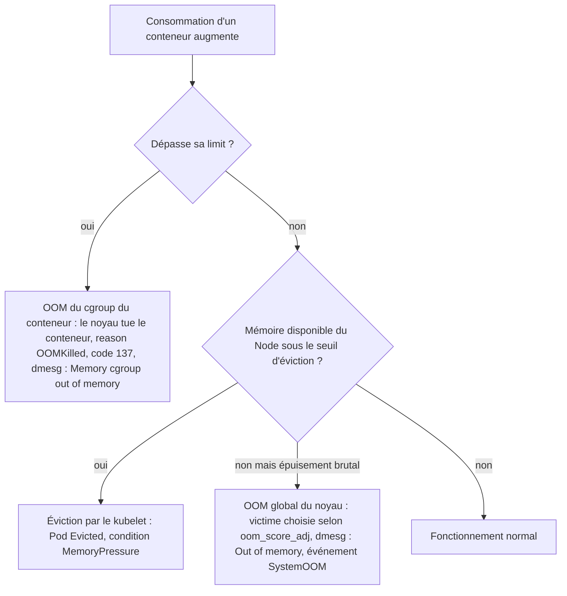

- **OOM au niveau conteneur.** Le conteneur dépasse sa propre limite ; seul son cgroup est touché. Sur cgroup v2 et depuis Kubernetes 1.28, tous les processus du conteneur sont tués ensemble (groupe OOM) ; le kubelet 1.32 a introduit une option pour revenir à l'ancien comportement (un seul processus).
- **Éviction par le kubelet.** Le Node approche de l'épuisement ; le kubelet choisit des Pods selon le dépassement de leurs requests et leur priorité. Le Pod apparaît `Evicted` (phase `Failed`), pas `OOMKilled`.
- **OOM global du Node.** La mémoire s'épuise plus vite que le kubelet ne réagit ; le noyau tue un processus selon `oom_score_adj` (fixé par le kubelet selon la QoS : `BestEffort` très exposé, `Guaranteed` protégé). Un conteneur **sous sa limite** peut alors être tué.

**Les preuves qui les distinguent.**

| Preuve | OOM conteneur | Éviction | OOM global |
|---|---|---|---|
| `lastState.terminated.reason` | `OOMKilled` | — (Pod `Evicted`) | souvent `OOMKilled` aussi |
| Message du Pod | — | `The node was low on resource: memory` | — |
| `dmesg` du Node | `Memory cgroup out of memory: Killed process` | — | `Out of memory: Killed process` |
| Événement Node | — | `EvictionThresholdMet` possible | `SystemOOM` |
| Métrique conteneur vs limite | Atteint 100 % de la limite | Peut être sous la limite | Peut être sous la limite |
| Métrique Node | Normale | `memory.available` bas | Mémoire épuisée |

**Métriques utiles** (kube-state-metrics et cAdvisor/kubelet requis) :

```promql
# OOMKill récent d'un conteneur (dernier état de terminaison)
kube_pod_container_status_last_terminated_reason{reason="OOMKilled"} == 1
# Redémarrages sur 1 h
increase(kube_pod_container_status_restarts_total[1h]) > 0
# Pression mémoire sur les Nodes
kube_node_status_condition{condition="MemoryPressure",status="true"} == 1
# Mémoire disponible du Node (node-exporter)
node_memory_MemAvailable_bytes / node_memory_MemTotal_bytes
```

**Spécificités des runtimes.** JVM : préférer `-XX:MaxRAMPercentage` à un `-Xmx` fixe, et compter la mémoire hors heap (threads, métaspace, buffers directs). Node.js : `--max-old-space-size` aligné sur la limite. Go : `GOMEMLIMIT` sous la limite. Ces réglages évitent qu'un runtime ignore la limite du conteneur.

Voir aussi le [guide du portfolio sur le diagnostic Java OutOfMemory](https://devsecops-portfolio.netlify.app/guides/incident/java-cg/) et les fiches K8S-013, 016 et 054.

### K8S-053 — CPU throttling : application ralentie par sa limite CPU

> **Étape** 5 · **Couche** Conteneur / cgroups CPU · **Gravité typique** P2 à P3 · **Difficulté** ★★★ · **Environnements** tous

**Le problème en langage simple.** L'application est lente alors que le Node n'est pas surchargé : le noyau la met en pause plusieurs fois par seconde car elle dépasse sa limite CPU.

**Le fonctionnement normal.** La `request` CPU sert au placement et au partage en cas de contention ; la `limit` CPU est appliquée par le quota CFS : par période (100 ms par défaut), le conteneur ne peut consommer que `limit × période`. S'il épuise son quota, il attend la période suivante.

**L'analogie.** Une salle d'examen où chaque candidat dispose de 10 minutes de photocopieuse par heure : même si la photocopieuse est libre, un candidat qui a épuisé son temps doit attendre l'heure suivante.

**Symptômes et impact.** Latence p99 élevée, timeouts, sondes qui échouent par lenteur, alors que `kubectl top` montre une consommation « raisonnable » (moyenne).

**Causes possibles (par probabilité).** 1. Limite CPU trop basse pour les pics (démarrage JVM, rafales). 2. Application multi-thread qui consomme son quota en quelques millisecondes. 3. Requests sous-évaluées et Node réellement saturé (contention, cas différent).

**Diagnostic guidé.**

```promql
# Part des périodes où le conteneur a été bridé (cAdvisor)
sum by (namespace, pod, container) (rate(container_cpu_cfs_throttled_periods_total{namespace="education",container!=""}[5m]))
  / sum by (namespace, pod, container) (rate(container_cpu_cfs_periods_total{namespace="education",container!=""}[5m]))
```

```bash
kubectl top pod -n education --containers | sort -k3 -h | tail      # 🟢 consommation moyenne
kubectl exec -n education <pod> -c app -- cat /sys/fs/cgroup/cpu.stat   # 🟢 cgroup v2 : nr_throttled, throttled_usec
```

Résultat attendu : ratio de throttling faible (moins de quelques %). Si le résultat est différent : ratio élevé + latence élevée = cause probable.

**Lecture des résultats et cause racine.** Un throttling élevé avec une consommation moyenne modérée confirme que les **pics** dépassent la limite. Si le Node est lui-même à 100 % CPU, c'est de la contention : regarder les requests et la capacité.

**Choix de la correction.**

| Preuve | Correction | Inadaptée si |
|---|---|---|
| Throttling élevé, Node peu chargé | Relever ou retirer la limite CPU, garder une request réaliste | Politique de l'organisation imposant des limites (multi-tenant strict) |
| Node saturé | Ajouter de la capacité, ajuster les requests, HPA | — |
| Pool de threads surdimensionné | Ajuster le nombre de threads au CPU alloué | — |

**Résolution pas à pas.**

```yaml
# AVANT
resources:
  requests: {cpu: 200m, memory: 512Mi}
  limits:   {cpu: 500m, memory: 512Mi}    # ❌ throttling > 40 % aux heures d'examen
# APRÈS (option A : limite relevée)
resources:
  requests: {cpu: 500m, memory: 512Mi}    # request alignée sur l'usage observé en charge
  limits:   {cpu: "2", memory: 512Mi}     # marge pour les rafales
```

Résultat attendu : throttling < 5 %, latence p99 revenue. Si le résultat est différent : la lenteur vient d'ailleurs (base de données, réseau) — tracer les requêtes.

**L'analogie de la réparation.** On accorde plus de temps de photocopieuse aux candidats qui en ont besoin, plutôt que d'acheter une photocopieuse plus rapide qu'ils n'ont pas le droit d'utiliser.

**Risques et retour arrière.** Sans limite CPU, un conteneur peut consommer le CPU inutilisé du Node ; la request garantit sa part en cas de contention. Retour arrière par Git.

**Validation.** Test de charge représentatif (examen simulé), suivi du ratio de throttling et de la latence.

**Prévention.** Alerte sur le ratio de throttling > 25 % en continu, dimensionnement guidé par des tests de charge, VPA en mode recommandation.

**Niveau 2 — mécanisme et production.** Le débat « limites CPU ou non » est réel : sans limite, meilleure performance et risque de voisins bruyants atténué par les requests ; avec limite, prévisibilité au prix du throttling. Décider par politique explicite, pas par défaut de modèle.

**Cas métier.** Éducation : voir le scénario « plateforme e-learning lente pendant un examen » dans la partie Cas métier.

**Sources.** [Ressources des conteneurs](https://kubernetes.io/docs/concepts/configuration/manage-resources-containers/) · [Assigner du CPU](https://kubernetes.io/docs/tasks/configure-pod-container/assign-cpu-resource/)

### K8S-054 — Node en MemoryPressure / OOM au niveau du Node

> **Étape** 5 · **Couche** Node / noyau · **Gravité typique** P1 à P2 · **Difficulté** ★★★ · **Environnements** tous

**Le problème en langage simple.** Le serveur entier manque de mémoire : le kubelet évince des Pods et, si cela ne suffit pas, le noyau tue des processus — parfois des conteneurs qui respectaient leur propre limite.

**Le fonctionnement normal.** La somme des **limits** peut dépasser la mémoire du Node (surengagement). Le kubelet évince quand `memory.available` passe sous le seuil ; le noyau intervient (OOM global) si la mémoire est épuisée plus vite que le kubelet ne réagit.

**L'analogie.** Un immeuble où chaque appartement a droit à « jusqu'à » 3 places de parking, mais où il n'existe que 100 places pour 50 appartements : tant que tout le monde ne vient pas en même temps, ça marche ; un jour de fête, des voitures sont enlevées par la fourrière.

**Symptômes et impact.** Condition `MemoryPressure=True`, taint `node.kubernetes.io/memory-pressure`, Pods `Evicted`, événement `SystemOOM` sur le Node, conteneurs tués sans dépasser leur limite.

**Causes possibles (par probabilité).** 1. Requests mémoire sous-évaluées (Pods `Burstable` qui consomment bien plus). 2. Processus hors Kubernetes (agents, journaux) sans réserve `system-reserved`. 3. Fuite mémoire d'un Pod sans limite.

**Diagnostic guidé.**

```bash
kubectl describe node worker-1 | grep -E 'MemoryPressure|Allocated' -A6          # 🟢
kubectl get events -A --field-selector involvedObject.kind=Node,reason=SystemOOM  # 🟢 OOM système récents
kubectl top pods -A --sort-by=memory | head -15                                   # 🟢 plus gros consommateurs
# 🟡 sur le Node : distinguer OOM global et OOM de cgroup
sudo dmesg -T | grep -iE 'Out of memory: Killed process|Memory cgroup out of memory' | tail
talosctl -n 10.0.0.21 dmesg | grep -i 'out of memory' | tail                       # Talos
```

Résultat attendu : identifier les Pods dont l'usage dépasse largement la request. Si le résultat est différent : mémoire consommée hors Pods → services système.

**Lecture des résultats et cause racine.** `Out of memory: Killed process` (sans « cgroup ») = OOM global du Node. Somme des usages réels > allocatable = surengagement. Le Pod tué n'est pas forcément le coupable : chercher qui a grossi.

**Choix de la correction.** Requests mémoire alignées sur l'usage (idéalement request = limit pour la mémoire des services critiques), réserves système, capacité suffisante.

**Résolution pas à pas.** *Rétablissement immédiat* : cordon du Node, réduction ou déplacement du Pod coupable. *Correction durable* : requests corrigées dans Git ; réserves du kubelet (`systemReserved`, `kubeReserved`) dans la configuration du Node (kubeadm : KubeletConfiguration ; Talos : `machine.kubelet.extraConfig`).

Résultat attendu : `MemoryPressure=False`, plus d'OOM système. Si le résultat est différent : un processus système fuit — journal du Node.

**L'analogie de la réparation.** On attribue les places de parking selon l'usage réel et on réserve des places pour le personnel de l'immeuble (services système).

**Risques et retour arrière.** Augmenter les requests réduit le nombre de Pods par Node : vérifier la capacité (Pending).

**Validation.** Mémoire disponible du Node stable sous charge, aucun événement `SystemOOM` pendant 48 h.

**Prévention.** Alerte `kube_node_status_condition{condition="MemoryPressure",status="true"} == 1`, ratio usage/request suivi par équipe, QoS `Guaranteed` pour les services critiques.

**Niveau 2 — mécanisme et production.** Lors d'un OOM global, le noyau choisit sa victime selon `oom_score_adj`, que le kubelet règle selon la classe de QoS : `BestEffort` d'abord, `Guaranteed` en dernier. Voir la section approfondie OOMKilled de l'étape 5.

**Cas métier.** Banque : un batch de rapprochement sans limite consomme 20 Gio la nuit ; l'API de paiement, pourtant sous sa limite, est tuée par l'OOM global.

**Sources.** [Éviction pour pression du Node](https://kubernetes.io/docs/concepts/scheduling-eviction/node-pressure-eviction/) · [Réserver des ressources système](https://kubernetes.io/docs/tasks/administer-cluster/reserve-compute-resources/) · [QoS](https://kubernetes.io/docs/concepts/workloads/pods/pod-qos/)

### K8S-055 — Node en DiskPressure

> **Étape** 5 · **Couche** Node / disque · **Gravité typique** P2 · **Difficulté** ★★☆ · **Environnements** tous

**Le problème en langage simple.** Le disque du Node est presque plein : le kubelet supprime des images inutilisées puis évince des Pods.

**Le fonctionnement normal.** Le kubelet surveille `nodefs` (données kubelet, journaux, `emptyDir`) et `imagefs` (images, couches) et déclenche le nettoyage des images puis l'éviction sous les seuils.

**L'analogie.** Un entrepôt dont les allées se remplissent de cartons vides : on jette d'abord les emballages (images inutilisées), puis on renvoie des marchandises (évictions) si l'espace manque encore.

**Symptômes et impact.** `DiskPressure=True`, taint `disk-pressure`, Pods évincés, nouveaux Pods refusés sur ce Node.

**Causes possibles (par probabilité).** 1. Journaux de conteneurs volumineux. 2. Images nombreuses ou énormes. 3. `emptyDir` sans limite. 4. Fichiers hors Kubernetes (journaux système, sauvegardes locales).

**Diagnostic guidé.**

```bash
kubectl describe node worker-2 | grep -E 'DiskPressure|ephemeral-storage'   # 🟢
kubectl get --raw "/api/v1/nodes/worker-2/proxy/stats/summary" | python3 -c 'import sys,json;d=json.load(sys.stdin);print(d["node"]["fs"]["availableBytes"]//2**30,"Gio libres")'   # 🟢
# 🟡 sur le Node
sudo du -xh --max-depth=2 /var/lib | sort -h | tail
sudo crictl images | wc -l
```

Résultat attendu : identifier ce qui occupe l'espace. Si le résultat est différent : disque saturé par des fichiers hors Kubernetes → administration système.

**Lecture des résultats et cause racine.** Grossissement de `/var/log/pods` = journaux applicatifs trop verbeux ; `/var/lib/containerd` = images.

**Choix de la correction.** Réduire la verbosité et tourner les journaux, limiter `emptyDir`, nettoyer les images inutilisées, agrandir le disque du Node si la charge le justifie.

**Résolution pas à pas.**

```bash
sudo crictl rmi --prune        # 🟠 supprime les images non utilisées par un conteneur du Node
```

Puis correction durable : `emptyDir.sizeLimit`, limites `ephemeral-storage`, rotation des journaux du kubelet (`containerLogMaxSize`, `containerLogMaxFiles`). Résultat attendu : `DiskPressure=False`. Si le résultat est différent : identifier le Pod qui écrit (statistiques par Pod du résumé ci-dessus).

**L'analogie de la réparation.** On évacue les emballages vides et on impose à chaque équipe un volume maximal de cartons dans les allées.

**Risques et retour arrière.** Supprimer des images force leur re-téléchargement au prochain démarrage (dépendance au registre). Ne jamais supprimer à la main des répertoires de `/var/lib/kubelet`.

**Validation.** Espace libre > 20 %, condition stable.

**Prévention.** Alerte disque Node à 80 %, journaux applicatifs sur stdout avec niveau adapté, images allégées.

**Niveau 2 — mécanisme et production.** Le garbage collector d'images du kubelet agit selon `imageGCHighThresholdPercent`/`imageGCLowThresholdPercent` ; sur Talos, l'espace `EPHEMERAL` porte ces données.

**Cas métier.** Énergie : un service de télémesure journalise chaque trame en niveau DEBUG ; le Node passe en DiskPressure chaque semaine.

**Sources.** [Éviction pour pression du Node](https://kubernetes.io/docs/concepts/scheduling-eviction/node-pressure-eviction/) · [Garbage collection](https://kubernetes.io/docs/concepts/architecture/garbage-collection/)

### K8S-056 — Readiness probe mal configurée : service retiré du trafic

> **Étape** 5 · **Couche** Sondes / Service · **Gravité typique** P1 à P2 · **Difficulté** ★★☆ · **Environnements** tous

**Le problème en langage simple.** L'application fonctionne, mais Kubernetes la considère « pas prête » et ne lui envoie plus de trafic : 503 côté utilisateurs.

**Le fonctionnement normal.** La readiness probe est exécutée en continu ; tant qu'elle échoue, l'endpoint du Pod est marqué non prêt et retiré de la répartition. Elle ne redémarre jamais le conteneur.

**L'analogie.** Un serveur de restaurant déclaré « en pause » par erreur : il est là, disponible, mais le maître d'hôtel ne lui attribue plus aucune table.

**Symptômes et impact.** `READY 0/1` avec `STATUS Running`, événements `Readiness probe failed`, EndpointSlices sans endpoint prêt, 503.

**Causes possibles (par probabilité).** 1. Chemin ou port de sonde modifié par la nouvelle version. 2. Délai (`timeoutSeconds`) trop court. 3. Sonde qui dépend d'une dépendance externe (base) : panne en cascade. 4. Démarrage lent sans `startupProbe`.

**Diagnostic guidé.**

```bash
kubectl describe pod contrats-7f9 -n assurance | grep -E 'Readiness|Unhealthy'   # 🟢 code ou erreur renvoyés
kubectl get pod contrats-7f9 -n assurance -o jsonpath='{.spec.containers[0].readinessProbe}'; echo   # 🟢 définition
kubectl port-forward -n assurance pod/contrats-7f9 18080:8080 &                   # 🟢 tester la même URL
curl -s -o /dev/null -w '%{http_code} %{time_total}s\n' http://127.0.0.1:18080/ready
```

Résultat attendu : le chemin de sonde renvoie 200 rapidement. Si le résultat est différent : 404 → chemin ; temps > `timeoutSeconds` → délai ; 500 → dépendance.

**Lecture des résultats et cause racine.** Comparer la sonde (chemin, port, délai) avec ce que l'application expose réellement dans sa version actuelle.

**Choix de la correction.** Aligner la sonde sur l'endpoint réel ; ne pas faire dépendre la readiness de dépendances partagées sans réflexion (sinon tous les Pods sortent du trafic en même temps).

**Résolution pas à pas.**

```yaml
# AVANT
readinessProbe:
  httpGet: {path: /health/ready, port: 8080}   # ❌ chemin renommé en /ready par la v2
  timeoutSeconds: 1
# APRÈS
readinessProbe:
  httpGet: {path: /ready, port: 8080}
  periodSeconds: 5
  timeoutSeconds: 2
  failureThreshold: 3
startupProbe:                                   # protège le démarrage lent
  httpGet: {path: /ready, port: 8080}
  periodSeconds: 5
  failureThreshold: 24                          # jusqu'à 2 min pour démarrer
```

Résultat attendu : `READY 1/1`, endpoints prêts, 503 disparus. Si le résultat est différent : journaux applicatifs de l'endpoint de santé.

**L'analogie de la réparation.** On corrige le tableau des pauses : le serveur réapparaît comme disponible et reçoit à nouveau des tables.

**Risques et retour arrière.** Une sonde trop permissive envoie du trafic à des Pods réellement incapables de servir. Retour arrière par Git.

**Validation.** EndpointSlices avec tous les endpoints prêts, taux de 5xx nominal.

**Prévention.** Contrat de santé versionné avec l'application, tests de sonde en CI, alerte sur Pods `Running` mais non prêts.

**Niveau 2 — mécanisme et production.** Une readiness qui interroge la base de données retire **tous** les Pods du trafic quand la base ralentit : l'utilisateur obtient un 503 immédiat au lieu d'une réponse dégradée. C'est parfois voulu (délestage), souvent un piège.

**Cas métier.** Assurance : voir le scénario « 503 après mise à jour » dans la partie Cas métier.

**Sources.** [Configurer les sondes](https://kubernetes.io/docs/tasks/configure-pod-container/configure-liveness-readiness-startup-probes/)

### K8S-057 — Liveness probe qui tue l'application

> **Étape** 5 · **Couche** Sondes · **Gravité typique** P2 · **Difficulté** ★★☆ · **Environnements** tous

**Le problème en langage simple.** Le kubelet redémarre un conteneur qui n'était pas mort, seulement lent ou occupé ; sous charge, cela aggrave la panne.

**Le fonctionnement normal.** Quand la liveness probe échoue `failureThreshold` fois, le kubelet tue et redémarre le conteneur. Elle doit détecter un blocage irréversible, pas une lenteur passagère.

**L'analogie.** Un surveillant qui réveille brutalement un employé à chaque fois qu'il ne répond pas au téléphone en une seconde : l'employé, qui était simplement en réunion, perd tout son travail en cours.

**Symptômes et impact.** Redémarrages fréquents, code 137, événements `Liveness probe failed ... will be restarted`, souvent pendant les pics de charge ou au démarrage.

**Causes possibles (par probabilité).** 1. Délai trop court sous charge (GC, CPU throttling). 2. Démarrage plus long que `initialDelaySeconds` sans `startupProbe`. 3. Liveness dépendant d'une ressource externe.

**Diagnostic guidé.**

```bash
kubectl get events -n education --field-selector reason=Unhealthy | grep -i liveness | tail   # 🟢
kubectl get pod <pod> -n education -o jsonpath='{.spec.containers[0].livenessProbe}'; echo     # 🟢
kubectl logs <pod> -n education --previous --tail=20                                           # 🟢 le processus était-il actif ?
```

Résultat attendu : corréler les échecs de sonde à la charge ou au démarrage. Si le résultat est différent : pas d'échec de sonde → cause de redémarrage ailleurs (OOM, K8S-013).

**Lecture des résultats et cause racine.** Échecs uniquement en pic + throttling CPU (K8S-053) = sonde trop exigeante.

**Choix de la correction.** `startupProbe` pour le démarrage, liveness légère et indépendante, délais réalistes.

**Résolution pas à pas.**

```yaml
livenessProbe:
  httpGet: {path: /live, port: 8080}   # endpoint trivial : le processus répond-il ?
  periodSeconds: 10
  timeoutSeconds: 3
  failureThreshold: 6                  # ~1 min de blocage réel avant redémarrage
```

Résultat attendu : plus de redémarrages en charge. Si le résultat est différent : chercher un réel blocage (thread dump).

**L'analogie de la réparation.** Le surveillant patiente raisonnablement et ne vérifie que si l'employé est conscient, pas s'il a fini tous ses dossiers.

**Risques et retour arrière.** Une liveness trop permissive laisse un processus réellement bloqué hors service plus longtemps.

**Validation.** Redémarrages stables à zéro pendant un test de charge.

**Prévention.** Règles d'équipe : liveness ≠ readiness, jamais de dépendance externe dans la liveness.

**Niveau 2 — mécanisme et production.** Les redémarrages provoqués par la liveness pendant un pic retirent des Pods au moment où l'on en a le plus besoin : effet boule de neige.

**Cas métier.** Éducation : les redémarrages en cascade pendant l'examen viennent d'une liveness avec `timeoutSeconds: 1`.

**Sources.** [Configurer les sondes](https://kubernetes.io/docs/tasks/configure-pod-container/configure-liveness-readiness-startup-probes/)

### K8S-058 — Le HPA ne déclenche pas de scaling

> **Étape** 5 · **Couche** Autoscaling / métriques · **Gravité typique** P2 · **Difficulté** ★★☆ · **Environnements** tous

**Le problème en langage simple.** La charge monte, mais le nombre de Pods ne bouge pas.

**Le fonctionnement normal.** Le HPA lit les métriques (metrics-server pour CPU/mémoire, ou adaptateurs de métriques personnalisées), compare l'utilisation à la cible (en pourcentage de la **request**) et ajuste `replicas` entre `minReplicas` et `maxReplicas`.

**L'analogie.** Un responsable de magasin qui appelle des renforts quand la file d'attente s'allonge : s'il ne voit pas la file (pas de métriques) ou s'il ignore la taille normale d'une file (pas de requests), il n'appelle personne.

**Symptômes et impact.** `TARGETS <unknown>/70%`, `REPLICAS` figé, latence en hausse.

**Causes possibles (par probabilité).** 1. metrics-server absent ou en erreur. 2. Requests CPU non définies (pourcentage incalculable). 3. `maxReplicas` atteint. 4. Pods Pending faute de capacité (le HPA a bien augmenté). 5. GitOps qui réimpose `replicas` (K8S-022).

**Diagnostic guidé.**

```bash
kubectl get hpa -n education                                   # 🟢 TARGETS, MINPODS, MAXPODS, REPLICAS
kubectl describe hpa examens -n education | sed -n '/Conditions:/,$p'   # 🟢 AbleToScale, ScalingActive, ScalingLimited
kubectl get apiservice v1beta1.metrics.k8s.io                  # 🟢 metrics-server disponible ?
kubectl top pods -n education                                  # 🟢
```

Résultat attendu : `ScalingActive=True`. Si le résultat est différent : `FailedGetResourceMetric` → métriques ; `ScalingLimited` → max atteint.

**Lecture des résultats et cause racine.** Les conditions du HPA donnent la raison explicite.

**Choix de la correction.** Installer/réparer metrics-server, définir les requests, ajuster `maxReplicas` selon la capacité.

**Résolution pas à pas.**

```yaml
apiVersion: autoscaling/v2
kind: HorizontalPodAutoscaler
metadata: {name: examens, namespace: education}
spec:
  scaleTargetRef: {apiVersion: apps/v1, kind: Deployment, name: examens}
  minReplicas: 4
  maxReplicas: 30
  metrics:
  - type: Resource
    resource: {name: cpu, target: {type: Utilization, averageUtilization: 65}}   # % de la request CPU
```

Résultat attendu : `TARGETS` chiffré, replicas qui suivent la charge. Si le résultat est différent : les nouveaux Pods restent Pending → capacité (K8S-009).

**L'analogie de la réparation.** On donne au responsable une vue sur la file d'attente et une référence de file normale, et on vérifie qu'il a des renforts disponibles.

**Risques et retour arrière.** Un `maxReplicas` élevé sans capacité ni quota déplace le problème vers le Pending.

**Validation.** Test de charge : montée des replicas puis redescente après stabilisation.

**Prévention.** Requests systématiques, préchauffage (`minReplicas`) avant les événements prévus (examens, soldes), alerte `ScalingLimited`.

**Niveau 2 — mécanisme et production.** Le HPA a une fenêtre de stabilisation (notamment à la baisse) : il réagit en dizaines de secondes, pas instantanément. Pour un pic prévisible, augmenter `minReplicas` à l'avance reste plus fiable.

**Cas métier.** Éducation : voir le scénario e-learning de la partie Cas métier.

**Sources.** [Horizontal Pod Autoscaling](https://kubernetes.io/docs/tasks/run-application/horizontal-pod-autoscale/) · [metrics-server](https://github.com/kubernetes-sigs/metrics-server)

### K8S-059 — Configuration modifiée mais non prise en compte

> **Étape** 5 · **Couche** ConfigMaps / Secrets / déploiement · **Gravité typique** P3 · **Difficulté** ★☆☆ · **Environnements** tous

**Le problème en langage simple.** Vous avez mis à jour un ConfigMap ou un Secret, mais l'application continue d'utiliser l'ancienne valeur.

**Le fonctionnement normal.** Les variables d'environnement sont lues **une fois** au démarrage du conteneur. Les volumes ConfigMap/Secret sont mis à jour par le kubelet avec un délai (synchronisation et cache), sauf montage en `subPath`, jamais mis à jour. L'application doit en plus relire le fichier.

**L'analogie.** On change le règlement affiché dans le hall, mais les employés ont déjà photocopié l'ancien en arrivant ce matin (variables d'environnement) : ils ne le reliront qu'à leur prochaine arrivée.

**Symptômes et impact.** Comportement inchangé après modification, différences entre Pods anciens et nouveaux.

**Causes possibles (par probabilité).** 1. Configuration injectée en variables d'environnement. 2. Montage `subPath`. 3. Application qui ne relit pas sa configuration. 4. ConfigMap `immutable: true`.

**Diagnostic guidé.**

```bash
kubectl get pod <pod> -n crm -o jsonpath='{.spec.containers[0].env}{.spec.containers[0].envFrom}'; echo   # 🟢 injection par env ?
kubectl get pod <pod> -n crm -o jsonpath='{.spec.containers[0].volumeMounts}'; echo                         # 🟢 subPath ?
kubectl exec -n crm <pod> -- printenv LOG_LEVEL                                                              # 🟢 valeur réellement vue
```

Résultat attendu : identifier le mode d'injection. Si le résultat est différent : valeur à jour dans le fichier mais pas dans l'application → elle ne relit pas.

**Lecture des résultats et cause racine.** Variables d'environnement ou `subPath` = un redémarrage est nécessaire par conception.

**Choix de la correction.** Déclencher un nouveau rollout lié au contenu de la configuration (méthode reproductible) plutôt que des redémarrages manuels.

**Résolution pas à pas.**

```yaml
# Kustomize : générateur avec suffixe de hachage → tout changement crée un nouveau nom et donc un rollout
configMapGenerator:
- name: crm-config
  literals: [LOG_LEVEL=info]
```

En dépannage ponctuel hors GitOps : `kubectl rollout restart deploy/crm -n crm` (🟠). Résultat attendu : nouveaux Pods avec la nouvelle valeur. Si le résultat est différent : vérifier que le Deployment référence bien le ConfigMap généré.

**L'analogie de la réparation.** On distribue une nouvelle version numérotée du règlement à chaque relève, au lieu de compter sur la relecture spontanée du hall.

**Risques et retour arrière.** Un rollout redémarre tous les Pods progressivement : capacité et PDB à vérifier.

**Validation.** `printenv` ou lecture du fichier dans un nouveau Pod, comportement applicatif attendu.

**Prévention.** Hachage de configuration dans le modèle de Pod (Kustomize, annotation checksum Helm), outils de rechargement si l'application le supporte.

**Niveau 2 — mécanisme et production.** Le délai de propagation d'un volume ConfigMap peut atteindre la période de synchronisation du kubelet plus la durée de cache : ne pas en dépendre pour des changements urgents.

**Cas métier.** Assurance : le passage du niveau de journalisation en DEBUG pour une enquête n'a aucun effet, la valeur étant injectée par variable d'environnement.

**Sources.** [ConfigMaps — mise à jour](https://kubernetes.io/docs/concepts/configuration/configmap/#mounted-configmaps-are-updated-automatically) · [Kustomize configMapGenerator](https://kubectl.docs.kubernetes.io/references/kustomize/kustomization/configmapgenerator/)

### K8S-060 — Répartition déséquilibrée des Pods

> **Étape** 5 · **Couche** Scheduling / topologie · **Gravité typique** P3 (P1 en cas de panne de zone) · **Difficulté** ★★☆ · **Environnements** tous

**Le problème en langage simple.** Tous les réplicas d'un service se retrouvent sur le même Node ou la même zone : la haute disponibilité n'est qu'apparente.

**Le fonctionnement normal.** Le scheduler place chaque Pod au moment de sa création ; sans contrainte de répartition, il optimise selon ses scores, pas selon la résilience. Il ne rééquilibre jamais les Pods existants.

**L'analogie.** Une entreprise qui place ses trois serveurs de secours dans la même salle : un seul incendie et tout est perdu.

**Symptômes et impact.** `kubectl get pods -o wide` montre une concentration ; perte d'un Node = perte totale du service.

**Causes possibles (par probabilité).** 1. Absence de `topologySpreadConstraints` ou d'anti-affinité. 2. Nodes ajoutés après le déploiement (pas de rééquilibrage). 3. Capacité libre concentrée sur un Node.

**Diagnostic guidé.**

```bash
kubectl get pods -n paiement -l app=paiement -o wide | awk '{print $7}' | sort | uniq -c   # 🟢 Pods par Node
kubectl get nodes -L topology.kubernetes.io/zone                                            # 🟢 zones
```

Résultat attendu : répartition sur plusieurs Nodes/zones. Si le résultat est différent : concentration confirmée.

**Lecture des résultats et cause racine.** Absence de contrainte dans le manifeste = cause.

**Choix de la correction.** Ajouter des contraintes de répartition ; pour rééquilibrer l'existant, un rollout contrôlé ou le Descheduler.

**Résolution pas à pas.**

```yaml
spec:
  template:
    spec:
      topologySpreadConstraints:
      - maxSkew: 1
        topologyKey: kubernetes.io/hostname
        whenUnsatisfiable: ScheduleAnyway   # préférence (DoNotSchedule = obligation, risque de Pending)
        labelSelector: {matchLabels: {app: paiement}}
```

Puis `kubectl rollout restart deploy/paiement -n paiement` (🟠) pour replacer les Pods. Résultat attendu : écart maximal de 1 Pod entre Nodes. Si le résultat est différent : capacité insuffisante sur les autres Nodes.

**L'analogie de la réparation.** On répartit les serveurs de secours dans des salles différentes et on organise le déménagement progressif des existants.

**Risques et retour arrière.** `DoNotSchedule` peut laisser des Pods Pending si les domaines manquent de capacité.

**Validation.** Répartition vérifiée, test de perte d'un Node en recette.

**Prévention.** Contraintes de répartition dans les modèles, PDB, tests de résilience.

**Niveau 2 — mécanisme et production.** Le Descheduler (projet SIG) évince des Pods pour corriger les déséquilibres ; à utiliser avec des PDB.

**Cas métier.** Banque : les 3 réplicas de l'API de paiement tournaient sur le même Node lorsqu'il est tombé.

**Sources.** [Topology spread constraints](https://kubernetes.io/docs/concepts/scheduling-eviction/topology-spread-constraints/) · [Descheduler](https://github.com/kubernetes-sigs/descheduler)

### K8S-061 — Drain bloqué par un PodDisruptionBudget

> **Étape** 5 · **Couche** Disponibilité / maintenance · **Gravité typique** P3 · **Difficulté** ★★☆ · **Environnements** tous

**Le problème en langage simple.** La maintenance d'un Node est bloquée : le drain refuse d'évincer un Pod car cela violerait sa règle de disponibilité minimale.

**Le fonctionnement normal.** Un PDB indique combien de Pods d'une application peuvent être indisponibles volontairement (`minAvailable`/`maxUnavailable`). L'API d'éviction le respecte ; `kubectl drain` réessaie jusqu'à ce que ce soit possible.

**L'analogie.** Une règle « au moins deux infirmiers présents dans le service » : on ne peut pas envoyer le dernier en formation tant qu'un remplaçant n'est pas arrivé.

**Symptômes et impact.** `Cannot evict pod as it would violate the pod's disruption budget`, drain qui boucle, maintenance retardée.

**Causes possibles (par probabilité).** 1. Application à 1 réplica avec `minAvailable: 1`. 2. Pods déjà non sains : budget consommé. 3. Remplaçants impossibles à planifier.

**Diagnostic guidé.**

```bash
kubectl get pdb -A                                                    # 🟢 colonne ALLOWED DISRUPTIONS
kubectl describe pdb paiement-pdb -n paiement                          # 🟢 expected/current healthy
kubectl get pods -n paiement -l app=paiement -o wide                   # 🟢 tous prêts ? remplaçants Pending ?
```

Résultat attendu : `ALLOWED DISRUPTIONS ≥ 1`. Si le résultat est différent : 0 → identifier pourquoi (réplicas, Pods non sains).

**Lecture des résultats et cause racine.** `replicas: 1` + `minAvailable: 1` = drain impossible par construction.

**Choix de la correction.** Augmenter temporairement les réplicas ou corriger les Pods non sains ; ne pas supprimer le PDB pour forcer.

**Résolution pas à pas.** Passer à 2 réplicas (via Git), attendre qu'ils soient prêts sur un autre Node, relancer le drain. Résultat attendu : drain terminé. Si le résultat est différent : remplaçant Pending → capacité.

**L'analogie de la réparation.** On fait venir un remplaçant avant d'envoyer l'infirmier en formation.

**Risques et retour arrière.** Contourner le PDB (suppression directe de Pod) provoque l'indisponibilité qu'il devait empêcher.

**Validation.** Drain réussi, service resté disponible pendant l'opération.

**Prévention.** PDB cohérents avec le nombre de réplicas, `unhealthyPodEvictionPolicy: AlwaysAllow` pour ne pas bloquer sur des Pods déjà en échec, maintenance planifiée avec capacité N+1.

**Niveau 2 — mécanisme et production.** Les mises à niveau de pools gérés (AKS) respectent les PDB : un PDB impossible bloque une mise à niveau de cluster entière.

**Cas métier.** Énergie : la mise à niveau d'un pool AKS reste bloquée pendant des heures à cause d'un PDB `minAvailable: 1` sur un service à un seul réplica.

**Sources.** [Configurer un PDB](https://kubernetes.io/docs/tasks/run-application/configure-pdb/) · [Drain sûr d'un Node](https://kubernetes.io/docs/tasks/administer-cluster/safely-drain-node/)

### K8S-062 — VPA : recommandations absentes ou redémarrages inattendus

> **Étape** 5 · **Couche** Autoscaling vertical (add-on) · **Gravité typique** P3 · **Difficulté** ★★☆ · **Environnements** clusters avec VPA installé

**Le problème en langage simple.** Le Vertical Pod Autoscaler ne propose aucune valeur, ou au contraire redémarre des Pods au mauvais moment pour ajuster leurs ressources.

**Le fonctionnement normal.** Le VPA (add-on, non inclus par défaut) observe la consommation et calcule des recommandations de requests ; selon `updateMode` (`Off`, `Initial`, `Recreate`, `InPlaceOrRecreate` selon les versions), il se contente de recommander, applique à la création, ou modifie les Pods existants.

**L'analogie.** Un conseiller qui ajuste la taille des bureaux : en mode « conseil », il rédige un rapport ; en mode « automatique », il déménage les gens en pleine journée si on ne l'encadre pas.

**Symptômes et impact.** Recommandations vides, Pods recréés fréquemment, conflit avec le HPA.

**Causes possibles (par probabilité).** 1. Composants VPA ou metrics-server absents. 2. Historique trop court. 3. `updateMode` automatique sans PDB. 4. HPA et VPA pilotant la même ressource CPU/mémoire.

**Diagnostic guidé.**

```bash
kubectl get vpa -A                                                        # 🟢
kubectl describe vpa examens-vpa -n education | sed -n '/Recommendation:/,$p'   # 🟢 cible, bornes
kubectl get pods -n kube-system | grep -i vpa                             # 🟢 recommender, updater, admission-controller
```

Résultat attendu : recommandations chiffrées. Si le résultat est différent : composants manquants ou historique insuffisant.

**Lecture des résultats et cause racine.** Redémarrages corrélés aux actions de l'updater = mode automatique non maîtrisé.

**Choix de la correction.** Commencer en `Off` (recommandation), appliquer les valeurs par Git, et ne jamais combiner HPA et VPA sur la même métrique.

**Résolution pas à pas.**

```yaml
apiVersion: autoscaling.k8s.io/v1
kind: VerticalPodAutoscaler
metadata: {name: examens-vpa, namespace: education}
spec:
  targetRef: {apiVersion: apps/v1, kind: Deployment, name: examens}
  updatePolicy: {updateMode: "Off"}     # recommandation seule : décision humaine, tracée dans Git
```

Résultat attendu : recommandations disponibles sans redémarrage. Si le résultat est différent : vérifier les journaux du recommender.

**L'analogie de la réparation.** On garde le conseiller en mode rapport et on décide soi-même des déménagements, hors des heures d'affluence.

**Risques et retour arrière.** Appliquer directement une recommandation basse avant un pic saisonnier peut provoquer des OOM.

**Validation.** Requests ajustées, stabilité des Pods, absence d'OOM.

**Prévention.** VPA en `Off` pour le dimensionnement, revue périodique, PDB si un mode automatique est retenu.

**Niveau 2 — mécanisme et production.** Le redimensionnement en place étant stable depuis Kubernetes 1.35, les versions récentes du VPA peuvent l'utiliser (`InPlaceOrRecreate`) pour limiter les redémarrages ; vérifier la version installée.

**Cas métier.** Éducation : en mode `Recreate`, le VPA redémarre les Pods de la plateforme d'examen pendant une épreuve.

**Sources.** [Vertical Pod Autoscaler](https://github.com/kubernetes/autoscaler/tree/master/vertical-pod-autoscaler) · [Redimensionnement en place](https://kubernetes.io/docs/tasks/configure-pod-container/resize-container-resources/)

## Partie VIII — Étape 6 : Sécurité et politiques

*Sécuriser le cluster.* Cette partie contient 8 fiches (K8S-063 à K8S-070).

### Concepts de l'étape 6 — Sécurité et politiques

| Mécanisme | Rôle | Analogie | Diagnostic d'un refus |
|---|---|---|---|
| Authentification | Qui êtes-vous ? (certificat, OIDC, jeton) | Badge à l'entrée | 401 → K8S-003 |
| RBAC | Que pouvez-vous faire ? | Liste d'accès par salle | 403 → `kubectl auth can-i`, K8S-063/064 |
| ServiceAccounts | Identité des workloads | Badge d'un robot | `--as=system:serviceaccount:ns:nom` |
| SecurityContext | Utilisateur, capacités, système de fichiers du conteneur | Équipement de protection individuelle | K8S-042, 065 |
| Pod Security Standards / Admission | Profils `privileged`, `baseline`, `restricted` par namespace | Règles de sécurité du chantier | Message `violates PodSecurity` → K8S-065 |
| Admission (webhooks, ValidatingAdmissionPolicy) | Contrôles et mutations à la création | Service conformité | `denied the request` → K8S-066/067 |
| NetworkPolicies | Pare-feu entre Pods | Badges par étage | Timeouts → K8S-028 |
| Chiffrement au repos | Chiffre les Secrets dans etcd | Coffre-fort dans les archives | `EncryptionConfiguration` |
| Audit | Journal de qui a fait quoi via l'API | Vidéosurveillance | Politique d'audit, enquêtes K8S-069/070 |
| Supply chain | Scan, SBOM, signature, registres autorisés | Traçabilité alimentaire | K8S-068 |
| Runtime security | Détection de comportements anormaux (Falco) | Alarme intrusion | K8S-070 |

**Principe de dépannage sécurisé.** Un refus de sécurité est un message, pas un obstacle : on lit la règle violée, on rend le workload conforme ou on fait évoluer la règle par son processus ; on ne désactive jamais un contrôle pour « faire passer » un déploiement. Les tests se font avec des outils non intrusifs : `kubectl auth can-i --as`, `--dry-run=server`, `kubectl label --dry-run=server` pour simuler un profil PSA, rapports d'audit des moteurs de politiques.

### K8S-063 — Forbidden : erreur RBAC pour un utilisateur

> **Étape** 6 · **Couche** Autorisation (RBAC) · **Gravité typique** P3 · **Difficulté** ★☆☆ · **Environnements** tous

**Le problème en langage simple.** L'API sait qui vous êtes, mais refuse l'action : `Error from server (Forbidden): pods is forbidden: User "alice" cannot list resource "pods" in API group "" in the namespace "paiement"`.

**Le fonctionnement normal.** RBAC autorise uniquement ce qui est explicitement accordé : un `Role`/`ClusterRole` liste verbes et ressources, un `RoleBinding`/`ClusterRoleBinding` les attribue à un utilisateur, groupe ou ServiceAccount.

**L'analogie.** Votre badge fonctionne à l'entrée (authentifié), mais n'ouvre pas la salle des archives : il faut que le responsable de la salle vous inscrive sur sa liste.

**Symptômes et impact.** Code 403, message qui précise utilisateur, verbe, ressource, groupe d'API et namespace.

**Causes possibles (par probabilité).** 1. Rôle absent pour ce namespace. 2. Binding vers le mauvais groupe (nom de groupe OIDC différent). 3. Sous-ressource non accordée (`pods/log`, `pods/exec`). 4. Mauvais groupe d'API dans la règle (`apps` vs `""`).

**Diagnostic guidé.**

```bash
kubectl auth whoami                                                   # 🟢 identité et groupes vus par l'API
kubectl auth can-i list pods -n paiement                              # 🟢 oui/non
kubectl auth can-i --list -n paiement | head -20                      # 🟢 tout ce qui est permis
kubectl auth can-i get pods --subresource=log -n paiement --as=alice --as-group=equipe-paiement   # 🟢 (admin) simuler
kubectl get rolebinding -n paiement -o wide                           # 🟢 qui a quoi
```

Résultat attendu : identifier l'autorisation manquante exacte. Si le résultat est différent : `whoami` ne montre pas le groupe attendu → problème d'identité (IdP), pas de RBAC.

**Lecture des résultats et cause racine.** Le message 403 contient tout : verbe + ressource + groupe d'API + namespace = la règle à ajouter.

**Choix de la correction.** Accorder le minimum nécessaire, via Git et un processus de revue ; ne jamais attribuer `cluster-admin` pour débloquer.

**Résolution pas à pas.**

```yaml
apiVersion: rbac.authorization.k8s.io/v1
kind: Role
metadata: {name: lecture-diagnostic, namespace: paiement}
rules:
- apiGroups: [""]
  resources: ["pods", "pods/log", "events", "services"]
  verbs: ["get", "list", "watch"]
- apiGroups: ["apps"]
  resources: ["deployments", "replicasets"]
  verbs: ["get", "list", "watch"]
---
apiVersion: rbac.authorization.k8s.io/v1
kind: RoleBinding
metadata: {name: equipe-paiement-lecture, namespace: paiement}
subjects:
- {kind: Group, name: equipe-paiement, apiGroup: rbac.authorization.k8s.io}
roleRef: {kind: Role, name: lecture-diagnostic, apiGroup: rbac.authorization.k8s.io}
```

Résultat attendu : `kubectl auth can-i list pods -n paiement` → `yes`. Si le résultat est différent : vérifier le nom exact du groupe.

**L'analogie de la réparation.** Le responsable inscrit votre service sur la liste de la salle, pour les seules actions nécessaires (consulter, pas détruire).

**Risques et retour arrière.** Un droit trop large (`*`) est une faille. Retour arrière : supprimer le binding via Git.

**Validation.** `auth can-i` positif pour les actions voulues, **négatif** pour les actions interdites (`delete`, `secrets`).

**Prévention.** Rôles types par profil, revue périodique des bindings, journaux d'audit des 403 récurrents.

**Niveau 2 — mécanisme et production.** RBAC est purement additif : il n'existe pas de règle de refus. Un 403 persistant malgré un rôle correct peut venir d'un autre mode d'autorisation (webhook, Node authorizer) selon la configuration du cluster.

**Cas métier.** Banque : les développeurs ne peuvent pas lire les journaux en production car `pods/log` n'était pas accordé, seulement `pods`.

**Sources.** [RBAC](https://kubernetes.io/docs/reference/access-authn-authz/rbac/) · [Vérifier l'accès à l'API](https://kubernetes.io/docs/reference/access-authn-authz/authorization/#checking-api-access)

### K8S-064 — ServiceAccount insuffisamment autorisé

> **Étape** 6 · **Couche** Identité des workloads · **Gravité typique** P2 · **Difficulté** ★★☆ · **Environnements** tous

**Le problème en langage simple.** Une application ou un opérateur qui parle à l'API Kubernetes reçoit des 403 : son identité technique n'a pas les droits nécessaires.

**Le fonctionnement normal.** Chaque Pod s'exécute avec un ServiceAccount (par défaut `default`) dont le jeton projeté est monté dans le Pod ; ses droits viennent des bindings RBAC.

**L'analogie.** Un robot de manutention qui reçoit un badge « visiteur » au lieu du badge « magasinier » : il circule mais n'ouvre aucune réserve.

**Symptômes et impact.** Journaux applicatifs : `forbidden: User "system:serviceaccount:ops:collecteur" cannot list resource "nodes"` ; fonctionnalités d'opérateur inactives.

**Causes possibles (par probabilité).** 1. `serviceAccountName` absent (usage de `default`). 2. Binding dans le mauvais namespace. 3. Ressource de portée cluster (nodes, namespaces) nécessitant un ClusterRole. 4. `automountServiceAccountToken: false` alors que l'application a besoin du jeton.

**Diagnostic guidé.**

```bash
kubectl get pod <pod> -n ops -o jsonpath='{.spec.serviceAccountName}'; echo                     # 🟢
kubectl auth can-i list nodes --as=system:serviceaccount:ops:collecteur                         # 🟢 simulation exacte
kubectl get rolebinding,clusterrolebinding -A -o wide | grep collecteur                          # 🟢
```

Résultat attendu : `yes` pour les actions nécessaires. Si le résultat est différent : `no` → ajouter le binding manquant.

**Lecture des résultats et cause racine.** Le message de l'application donne l'identité exacte (`system:serviceaccount:<ns>:<nom>`) : la simulation `--as` confirme sans toucher au Pod.

**Choix de la correction.** ServiceAccount dédié, rôle minimal, ClusterRole seulement pour les ressources de portée cluster.

**Résolution pas à pas.**

```yaml
apiVersion: rbac.authorization.k8s.io/v1
kind: ClusterRole
metadata: {name: collecteur-lecture-nodes}
rules:
- {apiGroups: [""], resources: ["nodes"], verbs: ["get", "list", "watch"]}
---
apiVersion: rbac.authorization.k8s.io/v1
kind: ClusterRoleBinding
metadata: {name: collecteur-lecture-nodes}
subjects: [{kind: ServiceAccount, name: collecteur, namespace: ops}]
roleRef: {kind: ClusterRole, name: collecteur-lecture-nodes, apiGroup: rbac.authorization.k8s.io}
```

Résultat attendu : la simulation passe à `yes`, l'application fonctionne sans redémarrage (les droits sont évalués à chaque requête). Si le résultat est différent : vérifier que le Pod utilise bien ce ServiceAccount.

**L'analogie de la réparation.** On remet au robot le badge de son métier, limité aux réserves qu'il doit desservir.

**Risques et retour arrière.** Ne jamais lier `cluster-admin` à un ServiceAccount applicatif : la compromission du Pod devient celle du cluster.

**Validation.** Simulations positives et négatives, journaux applicatifs sans 403.

**Prévention.** Un ServiceAccount par application, `automountServiceAccountToken: false` par défaut quand l'API n'est pas utilisée, revue des ClusterRoleBindings.

**Niveau 2 — mécanisme et production.** Les jetons projetés sont liés au Pod et expirent ; les anciens Secrets de jeton de longue durée ne sont plus créés automatiquement : un outil qui les attend doit être adapté.

**Cas métier.** Télécoms : un exporter de métriques réseau déployé avec le ServiceAccount `default` ne remonte aucune donnée de Node.

**Sources.** [ServiceAccounts](https://kubernetes.io/docs/concepts/security/service-accounts/) · [RBAC](https://kubernetes.io/docs/reference/access-authn-authz/rbac/)

### K8S-065 — Pod refusé par la Pod Security Admission

> **Étape** 6 · **Couche** Admission / Pod Security Standards · **Gravité typique** P3 · **Difficulté** ★★☆ · **Environnements** tous (Talos applique un profil par défaut)

**Le problème en langage simple.** Le Pod est refusé car il ne respecte pas le niveau de sécurité exigé par le namespace (`baseline` ou `restricted`).

**Le fonctionnement normal.** Les labels `pod-security.kubernetes.io/enforce|audit|warn` d'un namespace fixent le profil ; un Pod non conforme est rejeté en mode `enforce`, signalé en `warn`/`audit`.

**L'analogie.** Un chantier qui exige casque, gants et chaussures de sécurité : un ouvrier sans équipement est refoulé à l'entrée, même s'il est compétent.

**Symptômes et impact.** `pods "x" is forbidden: violates PodSecurity "restricted:latest": allowPrivilegeEscalation != false ...`. Pour un Deployment, le refus apparaît en `FailedCreate` sur le ReplicaSet (K8S-022).

**Causes possibles (par probabilité).** 1. `securityContext` incomplet (non root, capabilities, seccomp). 2. Volumes `hostPath` ou réseau hôte. 3. Namespace durci récemment.

**Diagnostic guidé.**

```bash
kubectl get ns paiement --show-labels | tr ',' '\n' | grep pod-security           # 🟢 profil appliqué
kubectl describe rs -n paiement -l app=api | grep -A4 FailedCreate                 # 🟢 liste précise des violations
kubectl label --dry-run=server --overwrite ns paiement pod-security.kubernetes.io/enforce=restricted   # 🟢 simuler un durcissement (avertissements)
```

Résultat attendu : la liste exacte des champs non conformes. Si le résultat est différent : refus d'une autre politique (Kyverno, Gatekeeper : K8S-066).

**Lecture des résultats et cause racine.** Chaque élément de la liste correspond à un champ à corriger dans le manifeste.

**Choix de la correction.** Rendre le workload conforme ; n'abaisser le profil du namespace que pour des composants système qui l'exigent (agents de supervision, CSI), et de manière documentée.

**Résolution pas à pas.**

```yaml
# APRÈS : conteneur conforme au profil restricted
spec:
  securityContext:
    runAsNonRoot: true
    seccompProfile: {type: RuntimeDefault}
  containers:
  - name: api
    securityContext:
      allowPrivilegeEscalation: false
      capabilities: {drop: ["ALL"]}
      readOnlyRootFilesystem: true      # recommandé (non exigé par le profil)
```

Résultat attendu : le ReplicaSet crée les Pods. Si le résultat est différent : l'image exige root → reconstruire l'image avec un utilisateur non root.

**L'analogie de la réparation.** On équipe l'ouvrier correctement au lieu de supprimer le contrôle à l'entrée du chantier.

**Risques et retour arrière.** Passer le namespace en `privileged` ouvre la porte à des évasions de conteneur : décision de sécurité, pas de dépannage.

**Validation.** Pods créés, `kubectl label --dry-run=server` sans avertissement.

**Prévention.** Profils en `warn` et `audit` avant `enforce`, modèles de manifestes conformes, contrôle en CI.

**Niveau 2 — mécanisme et production.** Sur Talos, la Pod Security Admission est configurée par défaut au niveau du cluster : les outils de debug de Node (`kubectl debug node/...`) nécessitent un namespace explicitement autorisé `privileged` et réservé à cet usage.

**Cas métier.** Banque : le durcissement PCI-DSS du namespace paiement bloque une version qui ajoutait `NET_ADMIN` inutilement.

**Sources.** [Pod Security Admission](https://kubernetes.io/docs/concepts/security/pod-security-admission/) · [Pod Security Standards](https://kubernetes.io/docs/concepts/security/pod-security-standards/)

### K8S-066 — Workload refusé par Kyverno ou OPA Gatekeeper

> **Étape** 6 · **Couche** Politiques d'admission · **Gravité typique** P3 · **Difficulté** ★★☆ · **Environnements** clusters avec moteur de politiques

**Le problème en langage simple.** Le déploiement est refusé par une règle d'entreprise (registre autorisé, labels obligatoires, limites requises…).

**Le fonctionnement normal.** Kyverno ou Gatekeeper reçoivent les requêtes d'admission via des webhooks et valident (ou modifient) les objets selon des politiques ; un mode audit permet de mesurer sans bloquer.

**L'analogie.** Le service conformité qui relit chaque contrat avant signature : il refuse un contrat sans clause obligatoire, en indiquant laquelle.

**Symptômes et impact.** `admission webhook "validate.kyverno.svc-fail" denied the request: ...` ou `[nom-de-contrainte] ...` pour Gatekeeper ; déploiement bloqué.

**Causes possibles (par probabilité).** 1. Manifeste non conforme (image d'un registre non autorisé, absence de limits). 2. Nouvelle politique passée en mode bloquant. 3. Politique erronée (faux positif).

**Diagnostic guidé.**

```bash
kubectl apply --dry-run=server -f deploy.yaml               # 🟢 reproduit le refus sans rien créer
kubectl get clusterpolicy                                    # 🟢 Kyverno : politiques et mode
kubectl get policyreport -A                                  # 🟢 Kyverno : résultats d'audit
kubectl get constraints                                      # 🟢 Gatekeeper : contraintes et violations
```

Résultat attendu : nom de la politique et règle violée. Si le résultat est différent : erreur de connexion au webhook → K8S-067.

**Lecture des résultats et cause racine.** Le message contient la politique, la règle et souvent le champ ; comparer avec l'intention de la politique pour distinguer non-conformité réelle et faux positif.

**Choix de la correction.** Non-conformité → corriger le manifeste. Faux positif → corriger la politique par son processus. Exception justifiée → objet d'exception ciblé (Kyverno `PolicyException`, exclusions Gatekeeper), limité et tracé.

**Résolution pas à pas.**

```yaml
# Exemple : politique "images uniquement depuis registry.exemple"
containers:
- name: api
  image: registry.exemple/paiement/api:3.2.0   # ✅ APRÈS (AVANT : docker.io/library/api:latest)
```

Résultat attendu : dry-run serveur sans refus. Si le résultat est différent : relire le message, une autre règle s'applique.

**L'analogie de la réparation.** On ajoute la clause manquante au contrat, ou on fait corriger la règle de conformité si elle est erronée ; on ne supprime pas le service conformité.

**Risques et retour arrière.** Désactiver une politique ou passer le moteur en mode non bloquant pour déployer annule un contrôle de sécurité : interdit sans décision formelle.

**Validation.** Déploiement accepté, `policyreport` sans échec pour ce workload.

**Prévention.** Politiques testées en CI (`kyverno test`, `gator`), déploiement en mode audit avant enforce, contrôles dès la CI (shift-left).

**Niveau 2 — mécanisme et production.** Les politiques de mutation peuvent modifier un objet après son écriture dans Git : source de dérive GitOps (K8S-076) à gérer avec des exclusions de diff.

**Cas métier.** SaaS : la règle « limits obligatoires » bloque une hotfix ; l'équipe ajoute les limits plutôt que de demander une exception.

**Sources.** [Kyverno](https://kyverno.io/docs/) · [Gatekeeper](https://open-policy-agent.github.io/gatekeeper/website/docs/)

### K8S-067 — Admission webhook indisponible

> **Étape** 6 et 7 · **Couche** Admission / extensions · **Gravité typique** P1 à P2 · **Difficulté** ★★★ · **Environnements** tous

**Le problème en langage simple.** Un service de contrôle externe (webhook) ne répond plus ; selon sa configuration, toutes les créations d'objets qu'il surveille échouent.

**Le fonctionnement normal.** L'API Server appelle les webhooks déclarés dans `ValidatingWebhookConfiguration`/`MutatingWebhookConfiguration`. Avec `failurePolicy: Fail`, une absence de réponse rejette la requête ; avec `Ignore`, la requête passe sans contrôle.

**L'analogie.** Un portique de sécurité relié à un serveur de vérification : si le serveur tombe et que la consigne est « fermer en cas de doute », plus personne n'entre, y compris les techniciens venus le réparer.

**Symptômes et impact.** `failed calling webhook "x": ... connect: connection refused` ou `context deadline exceeded` ; impossibilité de créer des Pods, parfois y compris ceux du webhook lui-même (blocage circulaire).

**Causes possibles (par probabilité).** 1. Pods du webhook arrêtés (Node perdu, OOM). 2. Certificat du webhook expiré (`caBundle`). 3. NetworkPolicy bloquant l'API Server vers le webhook. 4. Webhook trop lent (timeout).

**Diagnostic guidé.**

```bash
kubectl get validatingwebhookconfigurations,mutatingwebhookconfigurations           # 🟢 liste
kubectl get validatingwebhookconfiguration kyverno-resource-validating-webhook-cfg \
  -o jsonpath='{range .webhooks[*]}{.name} failurePolicy={.failurePolicy} timeout={.timeoutSeconds} svc={.clientConfig.service.namespace}/{.clientConfig.service.name}{"\n"}{end}'   # 🟢
kubectl get pods,endpointslices -n kyverno                                           # 🟢 backend du webhook disponible ?
```

Résultat attendu : backend prêt. Si le résultat est différent : Pods du webhook non prêts → les rétablir ; si eux-mêmes sont bloqués par le webhook, vérifier que leur namespace est exclu (`namespaceSelector`).

**Lecture des résultats et cause racine.** `connection refused` = backend absent ; `x509` = certificat ; `deadline exceeded` = lenteur ou réseau.

**Choix de la correction.** Rétablir le backend (cas le plus fréquent). Si un blocage circulaire empêche tout redémarrage : procédure d'urgence (« break-glass ») documentée et approuvée, puis retour immédiat à la normale.

**Résolution pas à pas.** *Rétablissement* : redémarrer/replanifier le backend du webhook (vérifier capacité et exclusions de namespace). *Procédure d'urgence, uniquement si prévue par la politique de sécurité* :

```bash
# 🔴 DESTRUCTIF / AFFAIBLIT LA SÉCURITÉ — sauvegarder puis retirer temporairement la configuration du webhook
kubectl get validatingwebhookconfiguration <nom> -o yaml > /root/break-glass/<nom>.yaml
kubectl delete validatingwebhookconfiguration <nom>
# ... rétablir le backend ...
kubectl apply -f /root/break-glass/<nom>.yaml      # 🟠 restauration immédiate (ou resynchronisation GitOps)
```

Résultat attendu : créations d'objets à nouveau possibles. Si le résultat est différent : chercher un second webhook en échec.

**L'analogie de la réparation.** On répare le serveur de vérification ; en dernier recours et sur ordre écrit, on ouvre une porte de secours surveillée, refermée dès la réparation.

**Risques et retour arrière.** Pendant la suppression, aucune politique ne s'applique : tracer, limiter la durée, journaliser les objets créés entre-temps.

**Validation.** Création d'un Pod de test, politiques à nouveau appliquées (refus d'un Pod non conforme de test).

**Prévention.** Webhooks en plusieurs réplicas avec PDB, exclusion des namespaces système (`kube-system`, namespace du webhook), timeouts courts, alertes sur `apiserver_admission_webhook_rejection_count` et sur la disponibilité du backend.

**Niveau 2 — mécanisme et production.** Depuis Kubernetes 1.30, les `ValidatingAdmissionPolicy` (CEL, exécutées dans l'API Server) offrent une alternative sans webhook externe pour les règles simples, ce qui supprime ce point de défaillance.

**Cas métier.** SaaS : voir le scénario « plus aucun déploiement possible » dans la partie Cas métier.

**Sources.** [Admission webhooks](https://kubernetes.io/docs/reference/access-authn-authz/extensible-admission-controllers/) · [Bonnes pratiques webhooks](https://kubernetes.io/docs/concepts/cluster-administration/admission-webhooks-good-practices/) · [ValidatingAdmissionPolicy](https://kubernetes.io/docs/reference/access-authn-authz/validating-admission-policy/)

### K8S-068 — Image contenant une vulnérabilité critique

> **Étape** 6 · **Couche** Chaîne d'approvisionnement · **Gravité typique** P2 (P1 si exploitée) · **Difficulté** ★★☆ · **Environnements** tous

**Le problème en langage simple.** Un scanner signale qu'une image en production contient une vulnérabilité critique. Ce n'est pas une panne, mais un risque à traiter avec méthode.

**Le fonctionnement normal.** Les images sont scannées à la construction (CI) et en continu (Trivy Operator, registre) ; un correctif passe par une nouvelle image, testée et déployée via le pipeline.

**L'analogie.** Un rappel constructeur sur un modèle de voiture : on identifie les véhicules concernés, on évalue le danger réel, on planifie le passage au garage, sans immobiliser toute la flotte au hasard.

**Symptômes et impact.** Alerte du scanner (CVE, sévérité), rapport de vulnérabilité ; exposition à une exploitation.

**Causes possibles (par probabilité).** 1. Image de base ancienne. 2. Dépendance applicative vulnérable. 3. Image non reconstruite depuis longtemps.

**Diagnostic guidé.**

```bash
kubectl get vulnerabilityreports -A | head                                        # 🟢 Trivy Operator
kubectl get pods -A -o jsonpath='{range .items[*]}{.metadata.namespace}{"/"}{.metadata.name}{" "}{.spec.containers[*].image}{"\n"}{end}' | grep 'api:3.1'   # 🟢 où tourne l'image ?
trivy image --severity HIGH,CRITICAL registry.exemple/paiement/api:3.1.0          # 🟢 (poste/CI) détail
```

Résultat attendu : liste des workloads concernés, paquet vulnérable, version corrigée disponible. Si le résultat est différent : pas de correctif publié → mesures compensatoires.

**Lecture des résultats et cause racine.** Prioriser selon l'exposition réelle (service public ? paquet effectivement utilisé ? exploit connu ?), pas uniquement selon la note CVSS.

**Choix de la correction.** Reconstruire l'image avec la version corrigée et la déployer via le pipeline ; à défaut, mesures compensatoires (NetworkPolicy, WAF, désactivation de la fonctionnalité).

**Résolution pas à pas.** Mise à jour de l'image de base ou de la dépendance → build → scan → tests → déploiement GitOps par digest. Résultat attendu : rapport sans la CVE. Si le résultat est différent : la CVE vient d'une autre couche de l'image.

**L'analogie de la réparation.** On remplace la pièce défectueuse au garage, puis on vérifie que le véhicule ne figure plus sur la liste du rappel.

**Risques et retour arrière.** Une mise à jour d'image peut introduire une régression : tests et déploiement progressif ; retour à l'image précédente seulement si le risque de la CVE est accepté explicitement.

**Validation.** Nouveau scan propre, workloads sur le nouveau digest.

**Prévention.** Scan bloquant en CI pour les sévérités critiques corrigeables, reconstruction régulière des images, SBOM, signature des images.

**Niveau 2 — mécanisme et production.** Un scan ne voit que ce que contient l'image : il ne remplace ni la sécurité d'exécution (Falco) ni la politique d'admission (registres autorisés, images signées).

**Cas métier.** Santé : une bibliothèque de traitement d'images DICOM vulnérable est corrigée en 48 h grâce à la cartographie image → workloads.

**Sources.** [Trivy](https://trivy.dev/) · [Portfolio — Supply Chain](https://devsecops-portfolio.netlify.app/guides/security/supply-chain/) · [Portfolio — SBOM](https://devsecops-portfolio.netlify.app/guides/security/sbom/)

### K8S-069 — Secret exposé ou mal configuré

> **Étape** 6 · **Couche** Gestion des secrets · **Gravité typique** P1 (exposé), P3 (mal configuré) · **Difficulté** ★★☆ · **Environnements** tous

**Le problème en langage simple.** Un mot de passe ou une clé a fuité (dépôt Git, journaux, image) ou est mal protégé dans le cluster.

**Le fonctionnement normal.** Les Secrets Kubernetes sont encodés en base64 (pas chiffrés) dans les manifestes, et chiffrés au repos dans etcd seulement si l'`EncryptionConfiguration` est en place ; l'accès est limité par RBAC. Les secrets métier viennent idéalement d'un coffre externe (Vault, Azure Key Vault) via un opérateur.

**L'analogie.** Une clé de coffre laissée sur le comptoir : la première urgence n'est pas de chercher qui l'a vue, mais de **changer la serrure**.

**Symptômes et impact.** Alerte de détection de secrets (Git), découverte dans des journaux, accès anormaux ; risque de compromission.

**Causes possibles (par probabilité).** 1. Secret versionné en clair ou en base64 dans Git. 2. Secret affiché dans des journaux (variables d'environnement). 3. RBAC trop large sur `secrets`. 4. Chiffrement au repos absent.

**Diagnostic guidé.**

```bash
kubectl auth can-i get secrets -n paiement --as=system:serviceaccount:paiement:default   # 🟢 qui peut lire ?
kubectl get rolebinding,clusterrolebinding -A -o wide | grep -iE 'secret|admin'           # 🟢 indices de droits larges
# 🟢 journaux d'audit (si la politique d'audit journalise les accès aux secrets) : qui a lu le Secret ?
```

Résultat attendu : périmètre d'exposition connu. Si le résultat est différent : exposition non bornée → traiter comme compromission.

**Lecture des résultats et cause racine.** La cause racine est souvent un processus (secret dans Git, journalisation de l'environnement), pas une commande.

**Choix de la correction.** 1. Rotation immédiate du secret à la source (base, API, fournisseur). 2. Révocation de l'ancien. 3. Correction du processus.

**Résolution pas à pas.** Rotation chez le fournisseur → mise à jour du Secret par le canal prévu (coffre + External Secrets, Sealed Secrets) → redéploiement des consommateurs (K8S-059) → suppression de l'ancien secret de l'historique Git (en le considérant compromis quoi qu'il arrive). Résultat attendu : l'ancien secret ne fonctionne plus, les services utilisent le nouveau. Si le résultat est différent : un consommateur oublié échoue → l'inventorier.

**L'analogie de la réparation.** On change la serrure, on distribue les nouvelles clés aux seuls ayants droit, puis on cesse de laisser les clés sur le comptoir.

**Risques et retour arrière.** La rotation peut couper des services qui utilisaient l'ancien secret : inventorier les consommateurs, prévoir un chevauchement si le fournisseur le permet.

**Validation.** Tentative d'utilisation de l'ancien secret refusée, services sains, scanner Git propre.

**Prévention.** Détection de secrets en pré-commit et en CI, coffre externe, chiffrement au repos, RBAC minimal sur `secrets`, ne jamais afficher de secrets dans les journaux ou la documentation.

**Niveau 2 — mécanisme et production.** Le droit `list` sur `secrets` permet de lire tous les secrets du namespace ; `create pods` aussi, indirectement (monter un Secret dans un Pod). Ces droits doivent être traités comme sensibles.

**Cas métier.** E-commerce : la clé d'API du prestataire de paiement est poussée dans un dépôt public ; rotation en 15 minutes grâce à un runbook prêt.

**Sources.** [Bonnes pratiques Secrets](https://kubernetes.io/docs/concepts/security/secrets-good-practices/) · [Chiffrement au repos](https://kubernetes.io/docs/tasks/administer-cluster/encrypt-data/) · [Portfolio — Vault](https://devsecops-portfolio.netlify.app/guides/security/vault/)

### K8S-070 — Compromission potentielle d'un conteneur (alerte runtime)

> **Étape** 6 · **Couche** Sécurité d'exécution · **Gravité typique** P1 · **Difficulté** ★★★ · **Environnements** tous (Falco ou équivalent)

**Le problème en langage simple.** Un outil de détection signale un comportement anormal dans un conteneur : shell interactif inattendu, lecture de fichiers sensibles, connexion vers une destination inhabituelle.

**Le fonctionnement normal.** Falco observe les appels système et compare l'activité à des règles ; une alerte n'est pas une preuve, mais un signal à qualifier rapidement.

**L'analogie.** Une alarme intrusion dans un magasin : on ne rase pas le magasin (supprimer le Pod efface les preuves), on isole les lieux, on regarde les caméras, puis on décide.

**Symptômes et impact.** Alerte (par exemple règle de type « Terminal shell in container »), trafic sortant anormal, processus inconnus.

**Causes possibles (par probabilité).** 1. Action légitime non déclarée (debug d'un opérateur). 2. Règle trop générique (faux positif). 3. Exploitation réelle d'une vulnérabilité.

**Diagnostic guidé.**

```bash
kubectl logs -n falco -l app.kubernetes.io/name=falco --since=1h | grep -i '<nom-du-pod>'   # 🟢 contexte de l'alerte
kubectl get pod <pod> -n <ns> -o yaml > /secure/evidence/<pod>.yaml                          # 🟢 conserver l'état
kubectl logs <pod> -n <ns> --all-containers --timestamps > /secure/evidence/<pod>.log        # 🟢 conserver les journaux
```

Résultat attendu : qualifier en minutes : action légitime connue ou non. Si le résultat est différent : inexpliqué → traiter comme incident de sécurité (P1) avec l'équipe sécurité.

**Lecture des résultats et cause racine.** Corréler avec les journaux d'audit (`exec` effectué par qui ?) : un `kubectl exec` par un opérateur identifié explique l'alerte ; aucun `exec` dans l'audit pour un shell observé = processus lancé depuis l'intérieur du conteneur.

**Choix de la correction.** Faux positif → ajuster la règle (exception ciblée). Suspicion réelle → confinement, préservation des preuves, éradication, reconstruction.

**Résolution pas à pas.**

```yaml
# 🟠 Confinement : isoler le Pod suspect (label ajouté à ce Pod uniquement : kubectl label pod <pod> quarantaine=oui)
apiVersion: networking.k8s.io/v1
kind: NetworkPolicy
metadata: {name: quarantaine, namespace: boutique}
spec:
  podSelector: {matchLabels: {quarantaine: "oui"}}
  policyTypes: [Ingress, Egress]          # aucune règle : tout est bloqué
```

Puis : `kubectl cordon` du Node, retrait du Pod de la sélection du Service, rotation des identifiants accessibles au Pod (ServiceAccount, secrets), analyse par l'équipe sécurité, redéploiement depuis une image de confiance. Résultat attendu : plus aucun trafic du Pod, preuves conservées. Si le résultat est différent : activité sur d'autres Pods → élargir le périmètre.

**L'analogie de la réparation.** On ferme le magasin concerné, on sécurise les enregistrements, on change les serrures, puis on rouvre avec du personnel et du matériel vérifiés.

**Risques et retour arrière.** Retirer le label du Pod du Service peut le faire remplacer par le contrôleur (capacité préservée) ; ne pas supprimer le Pod avant la collecte de preuves sauf danger immédiat.

**Validation.** Aucune activité suspecte résiduelle, identifiants renouvelés, cause d'entrée identifiée et corrigée.

**Prévention.** Images minimales sans shell, `readOnlyRootFilesystem`, NetworkPolicies egress, profil `restricted`, audit des `exec`, exercices de réponse à incident.

**Niveau 2 — mécanisme et production.** La réponse suit le cycle classique : détection, confinement, éradication, reprise, retour d'expérience. Les preuves volatiles (processus, connexions) disparaissent au redémarrage : prévoir les outils et droits de collecte **avant** l'incident.

**Cas métier.** E-commerce : une alerte « shell dans le conteneur » à 3 h du matin correspond à l'exploitation d'une dépendance vulnérable du module de recherche.

**Sources.** [Falco](https://falco.org/docs/) · [Audit Kubernetes](https://kubernetes.io/docs/tasks/debug/debug-cluster/audit/) · [Portfolio — SIEM](https://devsecops-portfolio.netlify.app/guides/security/siem/)

## Partie IX — Étape 7 : Extensibilité et opérations

*Production-ready.* Cette partie contient 10 fiches (K8S-071 à K8S-080).

### Concepts de l'étape 7 — Extensibilité et opérations

| Concept | Définition simple | Analogie | Fiches |
|---|---|---|---|
| Helm | Gestionnaire de paquets : modèles + valeurs + historique de releases | Kit de meubles avec notice et versions | K8S-071 |
| Kustomize | Superposition de correctifs sur une base | Calques sur un plan | K8S-072 |
| CRD / Operators | Nouveaux types d'objets et leurs contrôleurs spécialisés | Services spécialisés de l'immeuble | K8S-073, 074 |
| Admission webhooks | Extensions de contrôle à la création | Portique de sécurité | K8S-067 |
| GitOps (Argo CD) | Git est la source de vérité, le cluster est réconcilié en continu | Plan de référence + contrôle permanent | K8S-076, 077 |
| Observabilité | Métriques, journaux, événements, traces | Tableau de bord + boîte noire | K8S-078, partie Observabilité |
| Mises à niveau | Changement de version mineure, une à la fois | Rénovation étage par étage | K8S-080 |
| Sauvegarde / reprise | etcd, objets, données applicatives | Assurance + plan d'évacuation | K8S-079, section etcd |
| SLO / SLA / RTO / RPO | Objectifs de fiabilité et de reprise | Engagements contractuels | Partie SRE |

### Architecture de haute disponibilité et de reprise après incident

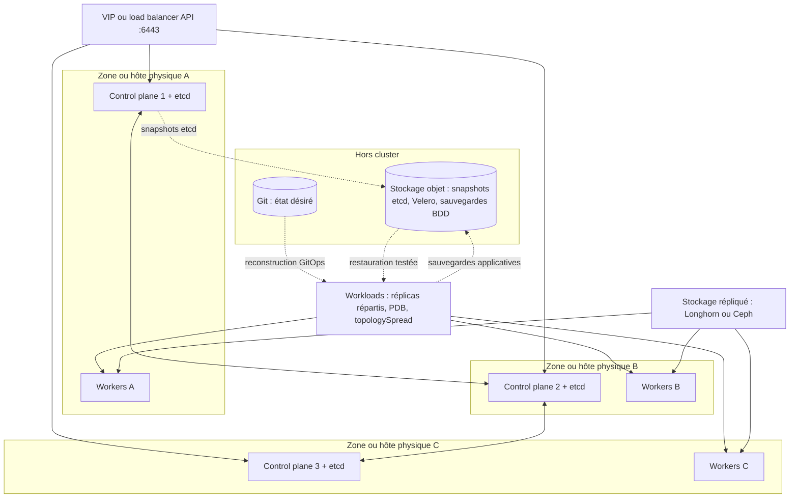

**Lecture du schéma.** La haute disponibilité (trois control planes sur trois hôtes physiques, réplicas répartis, stockage répliqué) absorbe la perte d'un composant. La reprise après sinistre (Git + sauvegardes externes testées) permet de reconstruire quand la haute disponibilité ne suffit plus. Sur Proxmox, trois VMs control plane sur un seul hyperviseur ne fournissent **aucune** haute disponibilité réelle.

| Objectif | Mécanisme | Vérification régulière |
|---|---|---|
| Perte d'un Node | Réplicas ≥ 2, PDB, répartition | Drain de test d'un Node |
| Perte d'un control plane | 3 membres etcd sur hôtes distincts | Arrêt d'un control plane en préproduction |
| Perte du cluster | GitOps + snapshots etcd + Velero + sauvegardes BDD | Restauration complète chronométrée (RTO) |
| Corruption logique des données | Sauvegardes versionnées immuables | Restauration ponctuelle (RPO) |

### K8S-071 — Release Helm en échec ou bloquée

> **Étape** 7 · **Couche** Packaging / déploiement · **Gravité typique** P3 · **Difficulté** ★★☆ · **Environnements** tous

**Le problème en langage simple.** `helm upgrade` échoue, ou refuse de démarrer avec `another operation (install/upgrade/rollback) is in progress`.

**Le fonctionnement normal.** Helm rend les modèles avec les valeurs, applique les objets et enregistre chaque révision (statut `deployed`, `failed`, `pending-*`) dans un Secret du namespace.

**L'analogie.** Un dossier de travaux avec un registre de versions : si une intervention est interrompue en plein milieu, le registre reste sur « travaux en cours » et personne n'ose rouvrir le chantier.

**Symptômes et impact.** Release en `failed` ou `pending-upgrade`, objets partiellement mis à jour, pipeline bloqué.

**Causes possibles (par probabilité).** 1. Pipeline interrompu pendant un upgrade (`pending-upgrade`). 2. Objet refusé par l'API (validation, admission, immuabilité). 3. Ressource existante non gérée par Helm. 4. `--wait` expiré car les Pods ne deviennent pas prêts.

**Diagnostic guidé.**

```bash
helm status crm -n assurance                  # 🟢 statut et dernière erreur
helm history crm -n assurance                 # 🟢 révisions et statuts
helm get values crm -n assurance --revision 7 # 🟢 valeurs d'une révision
helm template crm ./chart -f values-prod.yaml | kubectl apply --dry-run=server -f -   # 🟢 rendu + validation serveur
```

Résultat attendu : identifier la révision fautive et l'erreur. Si le résultat est différent : statut `pending-*` sans pipeline actif → opération interrompue.

**Lecture des résultats et cause racine.** Message de l'API dans `helm status` (refus d'admission, champ immuable) = cause ; `pending-upgrade` = interruption.

**Choix de la correction.** Revenir à la dernière révision `deployed` par `helm rollback`, puis corriger la cause et relancer via le pipeline.

**Résolution pas à pas.**

```bash
helm rollback crm 6 -n assurance --wait --timeout 10m     # 🟠 retour à la dernière révision "deployed"
helm history crm -n assurance | tail -3                   # 🟢 nouvelle révision "deployed"
```

Résultat attendu : release `deployed`. Si le résultat est différent : l'objet bloquant doit être corrigé (immuabilité : recréation planifiée).

**L'analogie de la réparation.** On remet le registre sur la dernière version validée du chantier, puis on reprend les travaux proprement.

**Risques et retour arrière.** Supprimer à la main les Secrets d'historique Helm est un dernier recours à haut risque (perte de l'historique, réinstallation possible). Les CRD ne sont pas gérées par `helm rollback`.

**Validation.** `helm status` = `deployed`, workloads prêts.

**Prévention.** Option de retour automatique en cas d'échec avec attente de disponibilité (`--atomic` en Helm 3 ; vérifier le nom de l'option pour Helm 4), `--history-max` raisonnable, verrouillage du pipeline (une seule exécution à la fois), validation serveur en CI.

**Niveau 2 — mécanisme et production.** Avec Argo CD, Helm sert uniquement de moteur de rendu : `helm status` ne reflète alors pas l'état réel, c'est Argo CD qui fait foi.

**Cas métier.** Assurance : un runner CI redémarré en plein upgrade laisse la release en `pending-upgrade` pendant une nuit.

**Sources.** [Helm — documentation](https://helm.sh/docs/) · [helm rollback](https://helm.sh/docs/helm/helm_rollback/)

### K8S-072 — Erreur de build Kustomize

> **Étape** 7 · **Couche** Gestion de configuration · **Gravité typique** P4 · **Difficulté** ★☆☆ · **Environnements** tous

**Le problème en langage simple.** La génération des manifestes échoue avant même d'atteindre le cluster.

**Le fonctionnement normal.** Kustomize assemble une base et des overlays (patches, générateurs, images) en manifestes finaux ; `kubectl kustomize` en intègre une version.

**L'analogie.** Un plan d'architecte avec des calques : si un calque fait référence à un mur qui n'existe pas sur le plan de base, la superposition est impossible.

**Symptômes et impact.** `accumulating resources: ... no such file or directory`, `failed to find unique target for patch`, déploiement bloqué en CI ou dans Argo CD (`ComparisonError`).

**Causes possibles (par probabilité).** 1. Chemin de ressource erroné. 2. Patch ciblant un objet renommé. 3. Écart de version entre la Kustomize locale et celle de l'outil de déploiement.

**Diagnostic guidé.**

```bash
kubectl kustomize overlays/prod > /tmp/rendu.yaml && echo OK    # 🟢 rendu local
kustomize version ; kubectl version --client                    # 🟢 versions (comparer avec Argo CD)
kubeconform -strict -summary /tmp/rendu.yaml                    # 🟢 validation du rendu
```

Résultat attendu : rendu sans erreur. Si le résultat est différent : le message nomme le fichier ou la cible du patch.

**Lecture des résultats et cause racine.** `failed to find unique target` = le `metadata.name`/`kind` du patch ne correspond à aucune (ou plusieurs) ressource de la base.

**Choix de la correction.** Corriger le chemin ou la cible ; aligner les versions d'outils.

**Résolution pas à pas.**

```yaml
# kustomization.yaml (overlay prod)
resources: [../../base]
patches:
- path: patch-replicas.yaml
  target: {kind: Deployment, name: crm-api}   # ✅ nom exact de la base (AVANT : crm)
```

Résultat attendu : `kubectl kustomize` réussit. Si le résultat est différent : rendre la base seule pour isoler.

**L'analogie de la réparation.** On aligne le calque sur le bon mur du plan de base.

**Risques et retour arrière.** Aucun (rendu local).

**Validation.** Rendu en CI + `kubectl diff` sur l'environnement cible.

**Prévention.** Rendu et validation de chaque overlay en CI, version de Kustomize épinglée.

**Niveau 2 — mécanisme et production.** Les générateurs ajoutent un suffixe de hachage aux noms : les références doivent passer par Kustomize pour être réécrites automatiquement.

**Cas métier.** Transport : le renommage d'un Deployment dans la base casse silencieusement trois overlays régionaux.

**Sources.** [Kustomize](https://kubectl.docs.kubernetes.io/references/kustomize/) · [Gestion par Kustomize](https://kubernetes.io/docs/tasks/manage-kubernetes-objects/kustomization/)

### K8S-073 — CRD manquante ou API retirée après une mise à niveau

> **Étape** 7 · **Couche** API / extensions · **Gravité typique** P2 · **Difficulté** ★★☆ · **Environnements** tous

**Le problème en langage simple.** `no matches for kind "X" in version "Y"` : le type d'objet n'existe pas (CRD non installée) ou la version d'API utilisée a été retirée.

**Le fonctionnement normal.** Les types natifs évoluent selon la politique de dépréciation (versions bêta retirées après un délai annoncé) ; les CRD ajoutent des types fournis par des opérateurs.

**L'analogie.** Un formulaire d'un modèle qui n'est plus accepté par l'administration, ou d'un service qui n'a pas encore ouvert dans cette ville.

**Symptômes et impact.** Échec d'apply ou de synchronisation GitOps après mise à niveau du cluster ou d'un opérateur.

**Causes possibles (par probabilité).** 1. Manifeste utilisant une apiVersion retirée (ex. historiques : `extensions/v1beta1` pour Ingress). 2. CRD non installée ou installée après les objets qui l'utilisent. 3. Version de CRD retirée par l'opérateur.

**Diagnostic guidé.**

```bash
kubectl api-resources | grep -i <type>                         # 🟢 le type est-il servi ? dans quel groupe ?
kubectl get crd | grep -i <groupe>                             # 🟢 CRD installée ?
kubectl get crd <nom-crd> -o jsonpath='{.spec.versions[*].name}'; echo   # 🟢 versions servies
kubectl get --raw /metrics | grep apiserver_requested_deprecated_apis | head   # 🟢 APIs dépréciées encore appelées
```

Résultat attendu : connaître les versions servies. Si le résultat est différent : type absent → installer la CRD (ordre de synchronisation).

**Lecture des résultats et cause racine.** Version utilisée absente de la liste servie = manifeste à migrer.

**Choix de la correction.** Migrer les manifestes vers la version servie (guide de migration officiel), installer les CRD en premier (vague de synchronisation).

**Résolution pas à pas.** Mettre à jour `apiVersion` et les champs modifiés selon le guide de migration, valider avec `--dry-run=server`. Résultat attendu : apply/sync réussi. Si le résultat est différent : champs renommés entre versions → relire le guide.

**L'analogie de la réparation.** On remplit le nouveau modèle de formulaire, en recopiant chaque information dans sa nouvelle case.

**Risques et retour arrière.** Retirer une CRD supprime **tous** les objets de ce type : ne jamais « réinstaller proprement » une CRD en la supprimant.

**Validation.** Dry-run serveur sur tout le dépôt GitOps.

**Prévention.** Avant chaque mise à niveau : analyse des APIs dépréciées (guide officiel, outils comme pluto), CRD gérées séparément des charts applicatifs.

**Niveau 2 — mécanisme et production.** La métrique `apiserver_requested_deprecated_apis` identifie les APIs dépréciées encore appelées par des clients, ce que l'analyse des fichiers ne voit pas (opérateurs, scripts).

**Cas métier.** Commerce : après la mise à niveau d'un opérateur de base de données, les objets `Backup` d'une ancienne version ne sont plus acceptés.

**Sources.** [Guide de migration des APIs dépréciées](https://kubernetes.io/docs/reference/using-api/deprecation-guide/) · [CustomResourceDefinitions](https://kubernetes.io/docs/tasks/extend-kubernetes/custom-resources/custom-resource-definitions/)

### K8S-074 — Operator défaillant : ressource personnalisée bloquée

> **Étape** 7 · **Couche** Operators / CRD · **Gravité typique** P2 · **Difficulté** ★★★ · **Environnements** tous

**Le problème en langage simple.** L'objet personnalisé (cluster de base de données, certificat, sauvegarde) reste dans un état intermédiaire : l'operator ne le fait pas avancer.

**Le fonctionnement normal.** Un operator est un contrôleur qui surveille ses CRD et réconcilie l'état réel ; il publie l'avancement dans `status.conditions`.

**L'analogie.** Un gestionnaire d'immeuble spécialisé : si le gestionnaire est absent ou n'a pas les clés, les demandes des locataires restent sans suite, même si elles sont bien enregistrées.

**Symptômes et impact.** Condition `Ready=False` sans évolution, objets enfants manquants, journaux de l'operator en erreur.

**Causes possibles (par probabilité).** 1. Pod de l'operator arrêté ou en CrashLoop. 2. RBAC insuffisant de son ServiceAccount (K8S-064). 3. Webhook de conversion/validation de l'operator indisponible. 4. Spécification invalide de la ressource.

**Diagnostic guidé.**

```bash
kubectl get cluster.postgresql.cnpg.io -n sante                                # 🟢 exemple CloudNativePG
kubectl describe cluster.postgresql.cnpg.io pg-sante -n sante | sed -n '/Status:/,$p'   # 🟢 conditions
kubectl logs -n cnpg-system deploy/cnpg-controller-manager --tail=50          # 🟢 journaux de l'operator
kubectl get events -n sante --sort-by=.lastTimestamp | tail                   # 🟢
```

Résultat attendu : une condition ou un journal explicite. Si le résultat est différent : operator sain mais aucune activité → il ne surveille pas ce namespace (configuration de portée).

**Lecture des résultats et cause racine.** Erreur `forbidden` dans les journaux = RBAC ; erreur de webhook = K8S-067 ; erreur de validation = spécification.

**Choix de la correction.** Réparer l'operator (pas les objets enfants à la main) ; corriger la spécification de la ressource.

**Résolution pas à pas.** Rétablir l'operator (version, RBAC, webhook), puis observer la reprise de la réconciliation. Résultat attendu : conditions qui progressent vers `Ready=True`. Si le résultat est différent : consulter la documentation de dépannage propre à l'operator.

**L'analogie de la réparation.** On rappelle le gestionnaire et on lui rend ses clés ; il traite lui-même les demandes en attente.

**Risques et retour arrière.** Modifier à la main les objets gérés par l'operator : il les écrasera ou entrera en conflit. Mettre à niveau un operator : lire les notes de version (migrations de CRD).

**Validation.** Ressource `Ready`, fonction métier vérifiée (connexion à la base, sauvegarde réussie).

**Prévention.** Supervision des operators (métriques, alertes sur conditions), mises à niveau testées, sauvegardes indépendantes.

**Niveau 2 — mécanisme et production.** Les operators à état (bases de données) codent un savoir d'exploitation : leur CLI dédiée (par exemple le plugin `kubectl cnpg`) est souvent la meilleure source de diagnostic.

**Cas métier.** Santé : voir le scénario PostgreSQL de la partie Cas métier.

**Sources.** [Operator pattern](https://kubernetes.io/docs/concepts/extend-kubernetes/operator/) · [CloudNativePG](https://cloudnative-pg.io/documentation/current/) · [Portfolio — CloudNativePG](https://devsecops-portfolio.netlify.app/guides/kubernetes/cnpg-provisionner/)

### K8S-075 — Namespace bloqué en Terminating

> **Étape** 7 · **Couche** API / finalizers · **Gravité typique** P4 · **Difficulté** ★★☆ · **Environnements** tous

**Le problème en langage simple.** La suppression d'un namespace ne se termine jamais.

**Le fonctionnement normal.** Le contrôleur de namespaces supprime tous les objets de tous les types (y compris les CRD) avant de retirer le namespace. Il doit pouvoir lister chaque type servi par l'API.

**L'analogie.** Le déménagement d'un bureau : on ne rend les clés qu'une fois toutes les armoires vidées ; si une armoire est verrouillée par un service fermé, le bureau ne peut pas être rendu.

**Symptômes et impact.** `STATUS Terminating` pendant des heures ; impossible de recréer un namespace du même nom.

**Causes possibles (par probabilité).** 1. `APIService` indisponible (par ex. metrics-server arrêté) : la découverte échoue. 2. Objets avec finalizers dont le contrôleur a disparu. 3. Webhook bloquant les suppressions.

**Diagnostic guidé.**

```bash
kubectl get ns ancien-projet -o jsonpath='{range .status.conditions[*]}{.type}={.status} {.message}{"\n"}{end}'   # 🟢 raison exacte
kubectl get apiservice | grep -v True                       # 🟢 extensions d'API indisponibles
kubectl api-resources --verbs=list --namespaced -o name \
  | xargs -n1 kubectl get -n ancien-projet --ignore-not-found --show-kind 2>/dev/null   # 🟢 objets restants
```

Résultat attendu : condition `NamespaceDeletionDiscoveryFailure` ou `NamespaceFinalizersRemaining` avec détails. Si le résultat est différent : aucun objet restant → finalizer du namespace lui-même.

**Lecture des résultats et cause racine.** La condition désigne le verrou : APIService ou objets à finalizers.

**Choix de la correction.** Rétablir l'APIService ou le contrôleur propriétaire du finalizer ; retirer un finalizer à la main seulement après avoir vérifié que la ressource externe associée (disque, DNS, compte cloud) est traitée.

**Résolution pas à pas.**

```bash
# 🟠 Cas APIService : rétablir le service (ex. redéployer metrics-server) — la suppression reprend seule
# 🔴 Dernier recours documenté : retirer le finalizer d'UN objet après vérification de la ressource externe
kubectl patch <type>/<nom> -n ancien-projet --type=merge -p '{"metadata":{"finalizers":[]}}'
```

Résultat attendu : namespace supprimé. Si le résultat est différent : relire les conditions mises à jour.

**L'analogie de la réparation.** On fait revenir le service qui détient la clé de l'armoire, ou, après inventaire, on force l'armoire en sachant ce qu'elle contenait.

**Risques et retour arrière.** Forcer la suppression (retrait des finalizers ou de l'objet namespace) peut laisser des ressources externes orphelines et facturées. Irréversible.

**Validation.** `kubectl get ns ancien-projet` → `NotFound` ; ressources externes vérifiées.

**Prévention.** Supprimer les applications avant leur namespace et leurs operators **après**, supervision des APIServices.

**Niveau 2 — mécanisme et production.** Un APIService agrégé indisponible bloque la suppression de **tous** les namespaces, pas seulement d'un seul.

**Cas métier.** SaaS : la désinstallation d'un client laisse son namespace bloqué ; l'operator de base avait été supprimé avant ses objets.

**Sources.** [Namespaces](https://kubernetes.io/docs/concepts/overview/working-with-objects/namespaces/) · [Finalizers](https://kubernetes.io/docs/concepts/overview/working-with-objects/finalizers/)

### K8S-076 — Argo CD : application OutOfSync en permanence

> **Étape** 7 · **Couche** GitOps · **Gravité typique** P3 · **Difficulté** ★★☆ · **Environnements** clusters GitOps

**Le problème en langage simple.** Argo CD affiche `OutOfSync` même juste après une synchronisation : l'état du cluster ne correspond jamais exactement à Git.

**Le fonctionnement normal.** Argo CD compare l'état désiré (Git) à l'état réel ; toute différence non ignorée donne `OutOfSync`. Avec `selfHeal`, il corrige automatiquement les modifications manuelles.

**L'analogie.** Un inventaire comparé à la liste de référence : si quelqu'un ajoute toujours un objet après coup (contrôleur, webhook de mutation), l'inventaire ne correspondra jamais à la liste.

**Symptômes et impact.** Statut `OutOfSync` persistant, synchronisations répétées, alertes, risque de masquer une vraie dérive.

**Causes possibles (par probabilité).** 1. Champ modifié par un autre acteur (HPA sur `replicas`, webhook de mutation, valeurs par défaut). 2. Modification manuelle en production (dérive réelle). 3. Différences de normalisation (ordre, formats).

**Diagnostic guidé.**

```bash
argocd app get crm                         # 🟢 ressources OutOfSync
argocd app diff crm                        # 🟢 différences exactes (Git vs cluster)
kubectl get deploy crm-api -n assurance --show-managed-fields -o yaml | grep -A3 'manager:'   # 🟢 qui a écrit les champs
```

Résultat attendu : la liste des champs divergents et leur « gestionnaire ». Si le résultat est différent : aucune différence visible → cache d'Argo CD (rafraîchissement dur).

**Lecture des résultats et cause racine.** Champ écrit par un contrôleur légitime (HPA, mutation) = différence à ignorer ou à retirer de Git. Champ écrit par `kubectl` = dérive humaine.

**Choix de la correction.** Dérive humaine → la corriger dans Git ou laisser Argo CD restaurer. Champ légitimement géré ailleurs → `ignoreDifferences` ciblé ou retrait du champ de Git.

**Résolution pas à pas.**

```yaml
# Application Argo CD : ignorer les replicas pilotés par le HPA
spec:
  ignoreDifferences:
  - group: apps
    kind: Deployment
    name: crm-api
    jsonPointers: [/spec/replicas]
  syncPolicy:
    syncOptions: [RespectIgnoreDifferences=true]   # ne pas réécrire ce champ lors des syncs
```

Résultat attendu : `Synced` stable. Si le résultat est différent : un autre champ diverge (relancer le diff).

**L'analogie de la réparation.** On précise dans la liste de référence que tel objet est géré par un autre service, au lieu de recompter indéfiniment.

**Risques et retour arrière.** Des exclusions trop larges masquent de vraies dérives : cibler par nom et chemin.

**Validation.** `argocd app get` → `Synced`/`Healthy` sur plusieurs cycles.

**Prévention.** Pas de `kubectl edit` en production, accès en écriture restreint, `selfHeal` activé, revue des exclusions.

**Niveau 2 — mécanisme et production.** L'option de synchronisation `ServerSideApply=true` réduit les faux écarts liés à la normalisation et aux champs gérés par d'autres acteurs.

**Cas métier.** SaaS : voir K8S-022, conflit entre HPA et `replicas` versionné.

**Sources.** [Argo CD — diffing](https://argo-cd.readthedocs.io/en/stable/user-guide/diffing/) · [Sync options](https://argo-cd.readthedocs.io/en/stable/user-guide/sync-options/)

### K8S-077 — Argo CD : application Degraded ou synchronisation en échec

> **Étape** 7 · **Couche** GitOps / santé applicative · **Gravité typique** P2 · **Difficulté** ★★☆ · **Environnements** clusters GitOps

**Le problème en langage simple.** Argo CD a appliqué les manifestes (ou tenté de le faire) mais l'application est `Degraded`, ou la synchronisation échoue.

**Le fonctionnement normal.** La synchronisation applique les objets par vagues ; l'état de santé (`Healthy`, `Progressing`, `Degraded`, `Missing`) est évalué par type d'objet (Deployment disponible, PVC lié…).

**L'analogie.** La livraison a été faite (synchronisation), mais le contrôle qualité constate que la machine livrée ne démarre pas (santé dégradée).

**Symptômes et impact.** `Degraded`, `SyncFailed`, `ComparisonError` (rendu impossible), application partiellement déployée.

**Causes possibles (par probabilité).** 1. Workload non sain (CrashLoop, ImagePull : fiches de l'étape 2). 2. Objet refusé par l'API (admission, validation). 3. Erreur de rendu (Helm/Kustomize : K8S-071/072). 4. Dépôt Git ou registre de charts injoignable.

**Diagnostic guidé.**

```bash
argocd app get crm --show-operation            # 🟢 dernière opération et message d'échec
argocd app resources crm | grep -v Healthy     # 🟢 ressources non saines
argocd app history crm                         # 🟢 révision Git synchronisée
```

Résultat attendu : la ressource fautive et son message. Si le résultat est différent : `ComparisonError` → rendu ou accès au dépôt.

**Lecture des résultats et cause racine.** Remonter de la ressource `Degraded` vers la fiche correspondante (Pod, PVC, Ingress).

**Choix de la correction.** Corriger dans Git (revert si régression) ; éviter `argocd app rollback` avec synchronisation automatique active, car elle réappliquerait Git.

**Résolution pas à pas.** `git revert` du commit fautif → synchronisation automatique ou `argocd app sync crm` (🟠). Résultat attendu : `Synced` + `Healthy`. Si le résultat est différent : la cause est hors de l'application (dépendance, cluster).

**L'analogie de la réparation.** On renvoie la machine défectueuse et on livre la version précédente qui fonctionnait, en corrigeant le bon de commande (Git).

**Risques et retour arrière.** Un revert de commit incluant une migration de schéma peut être incompatible avec les données : vérifier.

**Validation.** Santé `Healthy`, tests fonctionnels post-déploiement.

**Prévention.** Vagues et hooks de synchronisation, déploiement progressif, notifications Argo CD vers l'astreinte.

**Niveau 2 — mécanisme et production.** Argo CD dépend de Git et des registres : une panne de forge Git bloque les déploiements mais pas les applications en cours. Prévoir une procédure de déploiement d'urgence documentée.

**Cas métier.** SaaS : une Merge Request modifie un Secret externe inexistant ; l'application passe `Degraded`, le revert la rétablit en 4 minutes.

**Sources.** [Argo CD — santé des ressources](https://argo-cd.readthedocs.io/en/stable/operator-manual/health/) · [Argo CD — documentation](https://argo-cd.readthedocs.io/en/stable/)

### K8S-078 — Chaîne d'observabilité défaillante (métriques ou journaux absents)

> **Étape** 7 · **Couche** Observabilité · **Gravité typique** P2 (perte de visibilité) · **Difficulté** ★★☆ · **Environnements** tous

**Le problème en langage simple.** Les tableaux de bord sont vides ou les journaux d'une application n'arrivent plus : on est aveugle au moment où on en aurait besoin.

**Le fonctionnement normal.** Prometheus découvre ses cibles (ServiceMonitor/PodMonitor avec l'opérateur) et les interroge ; un agent par Node (Grafana Alloy, Fluent Bit…) collecte les journaux et les envoie à Loki.

**L'analogie.** Les caméras de surveillance d'un bâtiment : si l'enregistreur n'est plus branché à une caméra, l'écran reste noir pour cette zone sans déclencher d'alarme.

**Symptômes et impact.** Cible `down`, panneaux « No data », trous dans les journaux, alertes qui ne se déclenchent plus (silence trompeur).

**Causes possibles (par probabilité).** 1. ServiceMonitor non sélectionné par Prometheus (labels). 2. Port ou chemin de métriques erroné. 3. Agent de journaux absent sur certains Nodes (K8S-024) ou limité (débit). 4. Stockage de Prometheus/Loki saturé. 5. NetworkPolicy bloquant la collecte.

**Diagnostic guidé.**

```bash
kubectl get servicemonitor,podmonitor -A | grep -i crm                                     # 🟢 la cible est-elle déclarée ?
kubectl get prometheus -A -o jsonpath='{range .items[*]}{.metadata.name}{" "}{.spec.serviceMonitorSelector}{"\n"}{end}'   # 🟢 labels exigés
kubectl port-forward -n monitoring svc/prometheus-operated 9090 &                          # 🟢 puis http://127.0.0.1:9090/targets
kubectl get pods -n monitoring -o wide | grep -Ei 'alloy|fluent|promtail'                  # 🟢 agents de journaux par Node
```

PromQL : `up == 0` (cibles injoignables) ; LogQL : `sum by (namespace) (count_over_time({namespace="assurance"}[5m]))` pour vérifier l'arrivée des journaux.

Résultat attendu : cible `UP`, journaux récents. Si le résultat est différent : cible absente de la page `/targets` → sélection ; cible `DOWN` → réseau ou endpoint.

**Lecture des résultats et cause racine.** Absence de la cible = ServiceMonitor non sélectionné (label `release` manquant avec kube-prometheus-stack, par exemple). Erreurs `429` ou « rate limit » côté Loki = débit.

**Choix de la correction.** Ajouter le label attendu, corriger port/chemin, déployer l'agent manquant, ajuster les limites d'ingestion de façon maîtrisée.

**Résolution pas à pas.**

```yaml
apiVersion: monitoring.coreos.com/v1
kind: ServiceMonitor
metadata:
  name: crm-api
  namespace: assurance
  labels: {release: kube-prometheus-stack}   # ✅ label attendu par le serviceMonitorSelector (à vérifier sur votre instance)
spec:
  selector: {matchLabels: {app: crm-api}}
  endpoints: [{port: metrics, path: /metrics, interval: 30s}]
```

Résultat attendu : cible `UP` en moins d'une minute. Si le résultat est différent : tester `curl` du endpoint de métriques depuis le namespace de Prometheus.

**L'analogie de la réparation.** On rebranche la caméra sur l'enregistreur et on ajoute une alarme « caméra muette ».

**Risques et retour arrière.** Augmenter les limites d'ingestion augmente le coût et la charge de stockage.

**Validation.** Données visibles dans Grafana, test d'une alerte.

**Prévention.** Alerte `absent()` sur les métriques critiques, alerte sur `up == 0`, supervision de la supervision (watchdog Alertmanager), dashboards de santé de la chaîne.

**Niveau 2 — mécanisme et production.** Promtail est déprécié au profit de Grafana Alloy : une migration incomplète de l'agent explique souvent des trous de journaux sur une partie des Nodes.

**Cas métier.** Banque : la nouvelle version de l'API expose ses métriques sur un port renommé ; l'alerte de latence ne se déclenche plus pendant deux semaines.

**Sources.** [Prometheus Operator — troubleshooting](https://prometheus-operator.dev/docs/platform/troubleshooting/) · [Loki](https://grafana.com/docs/loki/latest/) · [Grafana Alloy](https://grafana.com/docs/alloy/latest/)

### K8S-079 — Sauvegarde inexploitable ou restauration échouée (Velero)

> **Étape** 7 · **Couche** Sauvegarde / reprise · **Gravité typique** P1 (découverte pendant une crise) · **Difficulté** ★★★ · **Environnements** tous

**Le problème en langage simple.** La sauvegarde existe sur le papier, mais elle est partielle, inaccessible ou impossible à restaurer.

**Le fonctionnement normal.** Velero sauvegarde les objets Kubernetes vers un stockage objet (BackupStorageLocation) et les volumes par instantanés CSI ou sauvegarde de système de fichiers ; la restauration recrée objets et données.

**L'analogie.** Une assurance habitation dont on découvre, après l'incendie, que le contrat ne couvrait pas la cave : seule une simulation de sinistre aurait révélé le trou.

**Symptômes et impact.** Sauvegardes `PartiallyFailed`, emplacement `Unavailable`, restauration avec avertissements ou volumes vides ; RPO/RTO non tenus.

**Causes possibles (par probabilité).** 1. Emplacement de stockage injoignable (identifiants, réseau). 2. Volumes non inclus (pas de snapshot ni de sauvegarde FS configurée). 3. Ressources déjà existantes ignorées à la restauration. 4. Incompatibilité de version de cluster/CRD.

**Diagnostic guidé.**

```bash
velero backup-location get                              # 🟢 PHASE Available ?
velero backup get | head                                # 🟢 statuts récents
velero backup describe sauvegarde-nuit-20261013 --details   # 🟢 ressources et volumes inclus
velero backup logs sauvegarde-nuit-20261013 | grep -iE 'error|warn' | head   # 🟢
velero restore describe <restauration> --details        # 🟢 avertissements de restauration
```

Résultat attendu : emplacement `Available`, sauvegardes `Completed` incluant les volumes. Si le résultat est différent : `PartiallyFailed` → lire les erreurs, ressource par ressource.

**Lecture des résultats et cause racine.** Volumes absents de `--details` = configuration de sauvegarde des volumes manquante ; avertissements « already exists » à la restauration = cible non vide.

**Choix de la correction.** Corriger la configuration de sauvegarde, puis prouver la restauration ; restaurer dans un namespace isolé avant d'écraser la production.

**Résolution pas à pas.**

```bash
# 🟠 Restauration de test dans un namespace séparé (n'écrase pas la production)
velero restore create test-restauration --from-backup sauvegarde-nuit-20261013 \
  --include-namespaces sante --namespace-mappings sante:sante-restore-test
velero restore describe test-restauration --details       # 🟢
```

Résultat attendu : application fonctionnelle dans `sante-restore-test`, données présentes. Si le résultat est différent : corriger et recommencer jusqu'à réussite, puis supprimer le namespace de test.

**L'analogie de la réparation.** On organise une simulation de sinistre pour vérifier que tout est réellement couvert, avant d'en avoir besoin.

**Risques et retour arrière.** Une restauration dans le namespace de production écrase ou mélange des données : toujours tester ailleurs d'abord. Les données restaurées sont sensibles (santé) : namespace de test protégé et supprimé après usage.

**Validation.** Test de restauration complet et chronométré (RTO mesuré), vérification de la fraîcheur des données (RPO).

**Prévention.** Tests de restauration planifiés (mensuels), alertes sur sauvegardes non `Completed`, sauvegardes applicatives cohérentes pour les bases (outils de l'operator) en plus de Velero.

**Niveau 2 — mécanisme et production.** Pour une base de données, un instantané de volume non coordonné peut être incohérent : préférer la sauvegarde native de l'operator (CloudNativePG vers stockage objet) et réserver Velero aux objets Kubernetes.

**Cas métier.** Santé : voir le scénario PostgreSQL de la partie Cas métier.

**Sources.** [Velero](https://velero.io/docs/) · [Portfolio — restauration après ransomware](https://devsecops-portfolio.netlify.app/guides/storage/restore/)

### K8S-080 — Mise à niveau du cluster : incompatibilités de versions

> **Étape** 7 · **Couche** Cycle de vie du cluster · **Gravité typique** P1 à P2 · **Difficulté** ★★★ · **Environnements** kubeadm, Talos, AKS

**Le problème en langage simple.** Après une mise à niveau, des composants ne fonctionnent plus : APIs retirées, labels changés, versions de composants incompatibles.

**Le fonctionnement normal.** Kubernetes se met à niveau une version mineure à la fois, control plane d'abord ; la politique de décalage de versions autorise le kubelet à avoir jusqu'à trois versions mineures de retard sur l'API Server (jamais d'avance), kubectl une de plus ou de moins. Il n'existe pas de procédure de retour arrière officielle.

**L'analogie.** La rénovation d'un immeuble étage par étage : on ne saute pas d'étage, on vérifie que les anciennes prises fonctionnent avec le nouveau tableau électrique, et on ne peut pas « dé-rénover » facilement.

**Symptômes et impact.** Échecs de synchronisation GitOps, CNI ou operators en erreur, Nodes refusés, comportement réseau modifié.

**Causes possibles (par probabilité).** 1. Manifestes ou charts utilisant des APIs retirées (K8S-073). 2. Composants tiers (CNI, CSI, operators) non compatibles avec la nouvelle version. 3. Dépendance à un label ou comportement modifié (cas Reddit). 4. Saut de plusieurs versions mineures.

**Diagnostic guidé.**

```bash
kubectl version                                                    # 🟢 client/serveur
kubectl get nodes -o custom-columns=NAME:.metadata.name,KUBELET:.status.nodeInfo.kubeletVersion   # 🟢 décalage
kubectl get --raw /metrics | grep apiserver_requested_deprecated_apis   # 🟢 APIs dépréciées utilisées
sudo kubeadm upgrade plan                                          # 🟢 kubeadm
talosctl -n 10.0.0.10 upgrade-k8s --to 1.36.4 --dry-run            # 🟢 Talos (version à adapter)
az aks get-upgrades -g RG -n CLUSTER -o table                      # 🟢 AKS
```

Résultat attendu : chemin de mise à niveau valide, aucune API retirée en usage, compatibilité confirmée des composants tiers. Si le résultat est différent : bloquer la mise à niveau jusqu'à correction.

**Lecture des résultats et cause racine.** Après coup : chercher dans les notes de version ce qui a été retiré ou modifié, et le comparer aux composants en erreur.

**Choix de la correction.** Corriger le composant incompatible (mise à jour, configuration) plutôt que tenter un retour arrière du cluster ; restaurer depuis sauvegarde seulement en dernier recours planifié.

**Résolution pas à pas.** Mettre à jour le composant tiers vers une version compatible, migrer les manifestes, valider. Résultat attendu : composants sains. Si le résultat est différent : déclencher le plan de reprise (cluster de remplacement + GitOps + restauration des données).

**L'analogie de la réparation.** On remplace les prises incompatibles avec le nouveau tableau, au lieu de démolir la rénovation.

**Risques et retour arrière.** Pas de downgrade officiel : la sauvegarde etcd d'avant mise à niveau et la capacité à reconstruire depuis GitOps sont les vrais filets de sécurité.

**Validation.** Tests de fumée complets, comparaison des métriques avant/après, vérification des flux réseau.

**Prévention.** Mises à niveau régulières en suivant le support des versions, répétition en préproduction identique, inventaire des labels et APIs utilisés par les composants système, sauvegarde etcd immédiatement avant.

**Niveau 2 — mécanisme et production.** L'incident Reddit (Pi-Day 2023) est l'exemple type : une configuration Calico non versionnée sélectionnait les route reflectors par un label retiré en 1.24. Un simple `grep` des configurations sur le label déprécié l'aurait détecté.

**Cas métier.** Administration publique : la montée de version du cluster casse le CNI d'un ancien environnement non mis à jour depuis deux ans.

**Sources.** [Politique de décalage de versions](https://kubernetes.io/releases/version-skew-policy/) · [Mise à niveau kubeadm](https://kubernetes.io/docs/tasks/administer-cluster/kubeadm/kubeadm-upgrade/) · [Talos — upgrade Kubernetes](https://www.talos.dev/latest/kubernetes-guides/upgrading-kubernetes/) · [AKS — upgrade](https://learn.microsoft.com/azure/aks/upgrade-aks-cluster)

## Partie X — Observabilité : diagnostiquer avec les métriques, les journaux et les traces

**Analogie.** Le tableau de bord d'un avion (métriques), la boîte noire (journaux), le plan de vol suivi minute par minute (traces) et le registre de bord (événements, audit). Sans eux, on pilote à vue ; avec eux, on voit la panne arriver.

### Architecture de référence

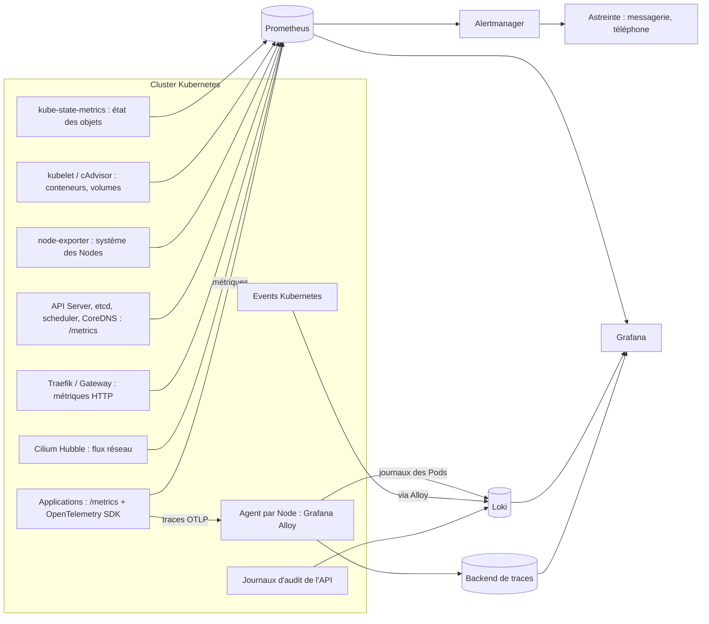

| Signal | Ce qu'il répond | Outil | À savoir |
|---|---|---|---|
| Métriques | Combien, à quelle vitesse, depuis quand ? | Prometheus + exporters | Aucune métrique n'existe « par défaut » : chaque famille dépend d'un composant précis (tableau suivant) |
| Journaux | Que s'est-il passé exactement ? | Loki (collecte par Grafana Alloy ; Promtail est déprécié) | Journaux `--previous` perdus si non collectés avant redémarrage |
| Événements | Que dit Kubernetes de ses objets ? | `kubectl events`, export vers Loki | Conservés environ une heure par défaut dans l'API : à exporter |
| Traces | Où la requête perd-elle son temps ? | OpenTelemetry + backend de traces | Nécessite l'instrumentation des applications |
| Audit | Qui a fait quoi via l'API ? | Politique d'audit de l'API Server | Sur AKS : paramètres de diagnostic `kube-audit` |
| Flux réseau | Quel paquet est rejeté et pourquoi ? | Hubble (Cilium) | Uniquement avec Cilium |

### Quelle métrique, quelle source ?

| Famille d'incidents | Métrique | Composant nécessaire |
|---|---|---|
| Redémarrages, OOM | `kube_pod_container_status_restarts_total`, `kube_pod_container_status_last_terminated_reason` | kube-state-metrics |
| Mémoire vs limite | `container_memory_working_set_bytes`, `kube_pod_container_resource_limits` | kubelet/cAdvisor + kube-state-metrics |
| Throttling CPU | `container_cpu_cfs_throttled_periods_total`, `container_cpu_cfs_periods_total` | kubelet/cAdvisor |
| Nodes | `kube_node_status_condition`, `node_memory_MemAvailable_bytes`, `node_filesystem_avail_bytes` | kube-state-metrics, node-exporter |
| Volumes | `kubelet_volume_stats_available_bytes`, `kubelet_volume_stats_capacity_bytes` | kubelet (volumes CSI qui exposent ces statistiques) |
| Control plane | `apiserver_request_total`, `apiserver_request_duration_seconds_bucket`, `apiserver_flowcontrol_rejected_requests_total` | Collecte de l'API Server (souvent impossible sur offre managée) |
| etcd | `etcd_server_has_leader`, `etcd_disk_wal_fsync_duration_seconds_bucket`, `etcd_mvcc_db_total_size_in_bytes`, `etcd_server_quota_backend_bytes` | Collecte d'etcd (certificats client nécessaires) |
| HTTP | `traefik_service_requests_total`, `traefik_service_request_duration_seconds_bucket` | Métriques Prometheus de Traefik activées |
| Certificats | `certmanager_certificate_expiration_timestamp_seconds` | cert-manager |
| DNS | `coredns_dns_responses_total`, `coredns_dns_request_duration_seconds_bucket` | CoreDNS (plugin prometheus) |
| Collecte | `up` | Prometheus lui-même |

### Règles d'alerte de référence

Ces règles supposent kube-prometheus-stack (Prometheus Operator, kube-state-metrics, node-exporter). Enregistrer ce bloc sous `prometheusrule-troubleshooting.yaml` et l'appliquer avec `kubectl apply -f` (🟠). Remplacer l'URL de base des `runbook_url` par l'emplacement réel du guide sur le portfolio.

```yaml
apiVersion: monitoring.coreos.com/v1
kind: PrometheusRule
metadata:
  name: k8s-troubleshooting
  namespace: monitoring
  labels:
    release: kube-prometheus-stack        # doit correspondre au ruleSelector de votre Prometheus
spec:
  groups:
  - name: workloads
    rules:
    - alert: PodRedemarrageAnormal
      expr: increase(kube_pod_container_status_restarts_total[15m]) > 3
      for: 5m
      labels: {severity: warning}
      annotations:
        summary: "{{ $labels.namespace }}/{{ $labels.pod }} : plus de 3 redémarrages en 15 min"
        runbook_url: "https://devsecops-portfolio.netlify.app/guides/kubernetes/k8s-troubleshooting/#k8s-011--crashloopbackoff"
    - alert: ConteneurOOMKilled
      expr: |
        (increase(kube_pod_container_status_restarts_total[10m]) > 0)
        and on (namespace, pod, container)
        (kube_pod_container_status_last_terminated_reason{reason="OOMKilled"} == 1)
      labels: {severity: warning}
      annotations:
        summary: "{{ $labels.namespace }}/{{ $labels.pod }}/{{ $labels.container }} tué pour dépassement mémoire"
    - alert: MemoireProcheDeLaLimite
      expr: |
        sum by (namespace, pod, container) (container_memory_working_set_bytes{container!="", image!=""})
          / sum by (namespace, pod, container) (kube_pod_container_resource_limits{resource="memory"}) > 0.9
      for: 15m
      labels: {severity: warning}
      annotations:
        summary: "{{ $labels.namespace }}/{{ $labels.pod }} au-dessus de 90 % de sa limite mémoire"
    - alert: ThrottlingCPUEleve
      expr: |
        sum by (namespace, pod, container) (rate(container_cpu_cfs_throttled_periods_total{container!=""}[5m]))
          / sum by (namespace, pod, container) (rate(container_cpu_cfs_periods_total{container!=""}[5m])) > 0.25
      for: 15m
      labels: {severity: info}
      annotations:
        summary: "{{ $labels.namespace }}/{{ $labels.pod }} bridé sur plus de 25 % des périodes CPU"
    - alert: PodNonPret
      expr: sum by (namespace, pod) (kube_pod_status_phase{phase=~"Pending|Unknown"}) > 0
      for: 15m
      labels: {severity: warning}
      annotations:
        summary: "{{ $labels.namespace }}/{{ $labels.pod }} en Pending/Unknown depuis 15 min"
    - alert: DeploymentReplicasManquants
      expr: kube_deployment_spec_replicas != kube_deployment_status_replicas_available
      for: 15m
      labels: {severity: warning}
      annotations:
        summary: "{{ $labels.namespace }}/{{ $labels.deployment }} n'a pas tous ses réplicas disponibles"
  - name: nodes-et-stockage
    rules:
    - alert: NodeNonPret
      expr: kube_node_status_condition{condition="Ready", status="true"} == 0
      for: 5m
      labels: {severity: critical}
      annotations:
        summary: "Node {{ $labels.node }} NotReady depuis 5 min"
    - alert: NodePressionMemoire
      expr: kube_node_status_condition{condition="MemoryPressure", status="true"} == 1
      for: 5m
      labels: {severity: warning}
      annotations:
        summary: "Node {{ $labels.node }} en MemoryPressure"
    - alert: VolumePresquePlein
      expr: kubelet_volume_stats_available_bytes / kubelet_volume_stats_capacity_bytes < 0.10
      for: 10m
      labels: {severity: warning}
      annotations:
        summary: "PVC {{ $labels.namespace }}/{{ $labels.persistentvolumeclaim }} : moins de 10 % libres"
    - alert: VolumePleinSous24h
      expr: predict_linear(kubelet_volume_stats_available_bytes[6h], 24 * 3600) < 0
      for: 30m
      labels: {severity: warning}
      annotations:
        summary: "PVC {{ $labels.namespace }}/{{ $labels.persistentvolumeclaim }} plein sous 24 h au rythme actuel"
  - name: control-plane
    rules:
    - alert: ApiServerLatenceElevee
      expr: |
        histogram_quantile(0.99,
          sum by (le, verb) (rate(apiserver_request_duration_seconds_bucket{verb!~"WATCH|CONNECT"}[5m]))) > 1
      for: 10m
      labels: {severity: warning}
      annotations:
        summary: "Latence p99 de l'API Server > 1 s pour le verbe {{ $labels.verb }}"
    - alert: ApiServerErreurs5xx
      expr: sum(rate(apiserver_request_total{code=~"5.."}[5m])) / sum(rate(apiserver_request_total[5m])) > 0.05
      for: 10m
      labels: {severity: critical}
      annotations:
        summary: "Plus de 5 % d'erreurs 5xx sur l'API Server"
    - alert: EtcdSansLeader
      expr: etcd_server_has_leader == 0
      for: 1m
      labels: {severity: critical}
      annotations:
        summary: "Membre etcd {{ $labels.instance }} sans leader"
    - alert: EtcdFsyncLent
      expr: histogram_quantile(0.99, sum by (le, instance) (rate(etcd_disk_wal_fsync_duration_seconds_bucket[5m]))) > 0.01
      for: 10m
      labels: {severity: warning}
      annotations:
        summary: "fsync WAL etcd p99 > 10 ms sur {{ $labels.instance }}"
    - alert: EtcdBaseProcheDuQuota
      expr: etcd_mvcc_db_total_size_in_bytes / etcd_server_quota_backend_bytes > 0.8
      for: 10m
      labels: {severity: warning}
      annotations:
        summary: "Base etcd de {{ $labels.instance }} à plus de 80 % du quota"
  - name: exposition
    rules:
    - alert: TauxErreurs5xxEleve
      expr: |
        sum by (service) (rate(traefik_service_requests_total{code=~"5.."}[5m]))
          / sum by (service) (rate(traefik_service_requests_total[5m])) > 0.05
      for: 5m
      labels: {severity: critical}
      annotations:
        summary: "Plus de 5 % de réponses 5xx sur {{ $labels.service }}"
    - alert: LatenceApplicativeElevee
      expr: |
        histogram_quantile(0.95,
          sum by (le, service) (rate(traefik_service_request_duration_seconds_bucket[5m]))) > 1
      for: 10m
      labels: {severity: warning}
      annotations:
        summary: "Latence p95 > 1 s sur {{ $labels.service }}"
    - alert: CertificatExpireBientot
      expr: certmanager_certificate_expiration_timestamp_seconds - time() < 14 * 24 * 3600
      for: 1h
      labels: {severity: warning}
      annotations:
        summary: "Certificat {{ $labels.namespace }}/{{ $labels.name }} expire dans moins de 14 jours"
  - name: supervision-de-la-supervision
    rules:
    - alert: CibleInjoignable
      expr: up == 0
      for: 10m
      labels: {severity: warning}
      annotations:
        summary: "Cible {{ $labels.job }} {{ $labels.instance }} injoignable"
    - alert: Watchdog
      expr: vector(1)
      labels: {severity: none}
      annotations:
        summary: "Alerte permanente : son absence côté réception signale une chaîne d'alerte en panne"
```

### Requêtes de journaux (LogQL) utiles

```logql
# Erreurs d'une application sur 15 minutes, par Pod
sum by (pod) (count_over_time({namespace="paiement", app="paiement"} |= "ERROR" [15m]))

# Traces d'OOM côté JVM
{namespace="banque"} |~ "OutOfMemoryError|java.lang.OutOfMemory"

# Événements Kubernetes exportés (étiquetage selon votre configuration Alloy)
{job="kubernetes-events"} |= "FailedScheduling"
```

Les étiquettes (`app`, `job`) dépendent de la configuration de l'agent : vérifier celles qui existent dans Grafana avant d'écrire des alertes sur les journaux.

### De l'alerte à l'investigation structurée

1. **Lire l'alerte** : quelle règle, quels labels (namespace, Pod, Node), depuis quand. Ouvrir le `runbook_url`.
2. **Mesurer l'impact** : taux d'erreurs et latence côté utilisateur (alertes d'exposition) ; une alerte technique sans impact est priorisée en conséquence.
3. **Délimiter** : la même alerte touche-t-elle un Pod, un Node, un namespace, tout le cluster ? (requête sans le filtre de l'alerte).
4. **Corréler dans le temps** : superposer dans Grafana la courbe de l'alerte, les déploiements (annotations Argo CD) et les événements.
5. **Basculer vers Kubernetes** : appliquer la fiche correspondante (tableau symptôme → composants de la Partie II), en commençant par les commandes 🟢.
6. **Clore la boucle** : si l'alerte a sonné tard, trop souvent ou pas du tout, ajuster la règle dans le cadre du post-mortem.

### Hubble pour l'observabilité réseau

```bash
cilium hubble port-forward &                                          # 🟢 accès au relais Hubble
hubble observe --namespace paiement --verdict DROPPED --last 50       # 🟢 paquets rejetés et raison
hubble observe --to-pod paiement/paiement-6c4 --protocol dns          # 🟢 requêtes DNS d'un Pod
```

Sources : [Prometheus](https://prometheus.io/docs/) · [kube-state-metrics](https://github.com/kubernetes/kube-state-metrics/tree/main/docs) · [Loki](https://grafana.com/docs/loki/latest/) · [Grafana Alloy](https://grafana.com/docs/alloy/latest/) · [OpenTelemetry](https://opentelemetry.io/docs/) · [Hubble](https://docs.cilium.io/en/stable/observability/hubble/) · [Portfolio — Prometheus/Grafana/Thanos](https://devsecops-portfolio.netlify.app/guides/observability/prometheus-thanos/) · [Portfolio — Cilium & Hubble](https://devsecops-portfolio.netlify.app/guides/observability/cilium-hubble/)

## Partie XI — Cas pratiques multisectoriels

> **Statut des scénarios.** Les dix scénarios sectoriels ci-dessous sont **construits à des fins pédagogiques** : architectures, noms et sorties sont fictifs et illustratifs. Les incidents réels publiquement documentés sont présentés séparément en fin de partie, avec leurs sources.

### Banque — service de paiement OOMKilled

**Architecture.** Traefik → Service `paiement` → Deployment `paiement` (3 réplicas, JVM) → PostgreSQL (CloudNativePG), namespace `banque`, cluster kubeadm on-premise.

**Ce que voit l'utilisateur.** Paiements refusés par intermittence (« transaction interrompue »), surtout le lundi matin.

**Démarche.** Alerte `PodRedemarrageAnormal` → impact mesuré (erreurs 5xx à 8 %) → incident P1 (transactions) → localisation : un seul Deployment touché.

```bash
kubectl get pods -n banque -l app=paiement                                   # 🟢 RESTARTS en hausse
kubectl get pod paiement-6c4 -n banque -o jsonpath='{.status.containerStatuses[0].lastState.terminated.reason}'; echo
# Sortie illustrative : OOMKilled
kubectl get pod paiement-6c4 -n banque -o jsonpath='{.spec.containers[0].resources.limits.memory} {.spec.containers[0].env[?(@.name=="JAVA_TOOL_OPTIONS")].value}'; echo
# Sortie illustrative : 512Mi -Xmx512m
```

**Cause racine.** Heap JVM fixée à 512 Mi dans un conteneur limité à 512 Mi : la mémoire hors heap (threads, métaspace, buffers) fait dépasser la limite dès que la concurrence monte. Confirmée par `dmesg` (« Memory cgroup out of memory ») et par la courbe working set qui touche la limite à chaque pic.

**Résolution.** Rétablissement : ajout d'un réplica et limite portée à 1 Gi via Git (marge du Node vérifiée). Correction durable : `-XX:MaxRAMPercentage=75`, request = limit (QoS mémoire `Guaranteed`), test de charge du lundi rejoué en recette. **Contrôles de reprise** : rapprochement des transactions interrompues avec le système central (idempotence des paiements), aucune double écriture.

**Prévention.** Alerte `MemoireProcheDeLaLimite`, règle d'équipe « jamais de `-Xmx` fixe en conteneur », test de charge dans la CI de release. Fiches : K8S-013, K8S-054.

### Assurance — erreur 503 après une mise à jour

**Architecture.** Gateway/Ingress → Service `contrats` → Deployment `contrats` (Argo CD), namespace `assurance`.

**Ce que voit l'utilisateur.** Le portail des contrats affiche « Service indisponible » juste après la mise en production de 14 h.

**Démarche.** Corrélation immédiate avec le déploiement (annotation Argo CD) → P2.

```bash
kubectl get pods -n assurance -l app=contrats            # Sortie illustrative : 3 Pods Running, READY 0/1
kubectl describe pod -n assurance -l app=contrats | grep -m3 'Readiness probe failed'
# Sortie illustrative : Readiness probe failed: HTTP probe failed with statuscode: 404
kubectl get endpointslices -n assurance -l kubernetes.io/service-name=contrats -o wide   # aucun endpoint prêt
```

**Cause racine.** La version 2 a renommé l'endpoint de santé `/health/ready` en `/ready`, mais la readiness probe du chart n'a pas suivi : aucun Pod n'est prêt, l'EndpointSlice est vide, le contrôleur renvoie 503. La stratégie RollingUpdate aurait dû protéger le service, mais `maxUnavailable: 100%` avait été configuré pour accélérer les déploiements.

**Résolution.** Rétablissement : `git revert` du commit, synchronisation Argo CD (retour à la v1 en 3 minutes). Correction durable : sonde alignée sur `/ready`, `maxUnavailable: 0` / `maxSurge: 1`, test de la sonde en CI.

**Prévention.** Contrat de santé versionné avec l'application, alerte `TauxErreurs5xxEleve`, analyse canary. Fiches : K8S-056, K8S-021, K8S-025.

### Transport — timeouts du service de consultation des horaires

**Architecture.** Application mobile → Traefik → `horaires-api` → `referentiel` (autre namespace) → cache Redis ; Cilium, NetworkPolicies par namespace.

**Ce que voit l'utilisateur.** Les horaires s'affichent après 5 à 10 secondes, ou pas du tout.

```bash
kubectl exec -n transport deploy/horaires-api -- getent hosts referentiel.referentiel.svc.cluster.local
# Sortie illustrative : (aucune réponse après 5 s)
kubectl exec -n default dnsutils -- nslookup referentiel.referentiel.svc.cluster.local     # OK depuis default
hubble observe --namespace transport --verdict DROPPED --last 10
# Sortie illustrative : transport/horaires-api → kube-system/coredns  UDP 53  DROPPED (Policy denied)
```

**Cause racine.** Une NetworkPolicy « default deny egress » ajoutée au namespace `transport` n'autorise pas le DNS. Les rares réponses obtenues venaient du cache applicatif.

**Résolution.** Ajout de la politique d'egress DNS (K8S-028), puis d'une règle d'egress vers `referentiel` sur le seul port nécessaire. Validation par test positif (DNS et API) et négatif (Internet toujours bloqué).

**Prévention.** Modèle de politiques « default deny + DNS » fourni par l'équipe plateforme, test de connectivité automatique après chaque changement de politique. Fiches : K8S-027, K8S-028.

### Énergie — Node NotReady portant une application critique

**Architecture.** Cluster Talos sur Proxmox, 3 control planes, 4 workers ; `telemesure` (StatefulSet, volume Longhorn RWO) qui agrège les mesures des postes électriques.

**Ce que voit l'utilisateur.** Le tableau de bord de supervision du réseau ne se met plus à jour.

```bash
kubectl get nodes                                         # Sortie illustrative : worker-2 NotReady
kubectl describe node worker-2 | grep -A1 'Ready '        # Kubelet stopped posting node status
talosctl -n 10.0.0.22 service kubelet                     # Sortie illustrative : pas de réponse
# La console Proxmox montre la VM arrêtée après une erreur d'hyperviseur
kubectl get pods -n energie -o wide                       # telemesure-0 Terminating sur worker-2
```

**Cause racine.** Arrêt brutal de la VM worker-2. Le Pod du StatefulSet reste `Terminating` (le kubelet ne peut pas confirmer) et son volume RWO reste attaché : l'autoguérison ne peut pas recréer `telemesure-0` ailleurs.

**Résolution.** VM confirmée arrêtée dans Proxmox → taint `node.kubernetes.io/out-of-service=nodeshutdown:NoExecute` sur worker-2 → détachement du volume et recréation de `telemesure-0` sur un autre Node → retrait du taint au retour de la VM. **Contraintes de disponibilité** : vérification que les répliques Longhorn du volume étaient saines (pas de perte de données).

**Prévention.** Alerte `NodeNonPret` à 5 minutes, procédure d'arrêt non gracieux documentée, workers répartis sur plusieurs hyperviseurs. Fiches : K8S-005, K8S-017, K8S-040, K8S-043.

### Santé — l'application médicale perd PostgreSQL après un incident de stockage

**Architecture.** Application de dossiers patients → CloudNativePG (3 instances, Longhorn), sauvegardes vers stockage objet S3 (Ceph RGW), namespace `sante` ; données de santé soumises à des exigences de confidentialité et d'intégrité.

**Ce que voit l'utilisateur.** Erreur « base indisponible » à l'ouverture des dossiers.

```bash
kubectl cnpg status pg-sante -n sante                     # Sortie illustrative : primaire indisponible, 1 réplica en retard
kubectl get pvc -n sante                                  # pg-sante-1 Bound, pg-sante-2 Bound, pg-sante-3 Bound
kubectl -n longhorn-system get volumes.longhorn.io -o wide | grep pg-sante
# Sortie illustrative : volume de pg-sante-1 "faulted"
kubectl describe pod pg-sante-1 -n sante | sed -n '/Events:/,$p'   # FailedMount
```

**Cause racine.** Un disque d'un Node est tombé alors que le volume de l'instance primaire n'avait plus qu'une réplique saine (réplique en reconstruction depuis la veille faute d'espace). Le volume passe `faulted`, le primaire ne peut plus monter ses données.

**Résolution.** L'operator promeut un réplica sain en primaire (basculement) : service rétabli en mode dégradé. L'instance défaillante est recréée par l'operator à partir du nouveau primaire, et non en « réparant » le volume à la main. Intégrité vérifiée par les contrôles applicatifs. La restauration depuis la sauvegarde S3 a été préparée dans un namespace isolé mais pas nécessaire.

**Prévention.** Alerte sur la robustesse Longhorn `degraded`, marge de capacité disque, test mensuel de restauration CloudNativePG (RTO mesuré), traces d'audit des accès au namespace. Fiches : K8S-043, K8S-074, K8S-079, K8S-023.

### Éducation — plateforme e-learning lente pendant un examen en ligne

**Architecture.** Plateforme d'examen (Deployment + HPA CPU), cluster AKS, 2 000 étudiants connectés simultanément à 9 h.

**Ce que voit l'utilisateur.** Pages qui mettent 8 secondes à charger, soumissions en échec.

```bash
kubectl get hpa examens -n education                       # Sortie illustrative : 45%/65%, REPLICAS 4 (min 4, max 30)
kubectl top pods -n education                              # consommation moyenne modérée
```

```promql
# Ratio de throttling : sortie illustrative 0.62 (62 % des périodes bridées)
sum(rate(container_cpu_cfs_throttled_periods_total{namespace="education",container="app"}[5m]))
  / sum(rate(container_cpu_cfs_periods_total{namespace="education",container="app"}[5m]))
```

**Cause racine.** Limite CPU à 500m pour une application qui traite les requêtes en rafales multi-thread : les Pods sont bridés 62 % du temps. L'utilisation **moyenne** (45 % de la request) ne déclenche pas le HPA, alors que la latence explose. S'y ajoute une liveness avec `timeoutSeconds: 1` qui redémarre des Pods bridés.

**Résolution.** Rétablissement : `minReplicas` passé à 12 avant l'épreuve suivante, liveness corrigée. Correction durable : request 500m / limite 2 CPU, cible HPA à 50 %, test de charge réaliste (2 000 utilisateurs) en recette.

**Prévention.** Alerte `ThrottlingCPUEleve`, préchauffage planifié avant les examens, SLO de latence suivi pendant les épreuves. Fiches : K8S-053, K8S-057, K8S-058.

### Télécommunications — latence DNS sur les appels sortants

**Architecture.** Microservices de facturation des communications appelant des API partenaires externes, cluster kubeadm, CoreDNS 2 réplicas.

**Ce que voit l'utilisateur.** Les rapports de consommation sont générés avec plusieurs heures de retard.

```bash
kubectl exec -n telecom deploy/facturation -- cat /etc/resolv.conf     # options ndots:5
kubectl exec -n default dnsutils -- dig +stats api.partenaire.exemple.com | grep 'Query time'
kubectl logs -n kube-system -l k8s-app=kube-dns --tail=20             # NXDOMAIN massifs sur des noms suffixés
```

**Cause racine.** Le nom externe `api.partenaire.exemple.com` (3 points) est d'abord recherché avec les suffixes du cluster à cause de `ndots:5` : chaque appel génère plusieurs requêtes inutiles ; CoreDNS, sous-dimensionné, sature et répond lentement.

**Résolution.** FQDN avec point final dans la configuration applicative (`api.partenaire.exemple.com.`), `dnsConfig` avec `ndots: 2` pour ce workload, CoreDNS passé à 3 réplicas répartis, NodeLocal DNSCache planifié.

**Prévention.** Alerte de latence CoreDNS, revue des appels externes, dimensionnement DNS dans la capacité. Fiche : K8S-027.

### Commerce électronique — cascade pendant les soldes

**Architecture.** Boutique (front, panier, paiement) sur AKS, images sur un registre public, Cluster Autoscaler.

**Ce que voit l'utilisateur.** À 8 h, le site devient très lent puis renvoie des 503.

```bash
kubectl get pods -n boutique | grep -c ImagePullBackOff               # Sortie illustrative : 37
kubectl describe pod front-79b-x -n boutique | grep -m1 Failed
# Sortie illustrative : ... 429 Too Many Requests ...
kubectl get nodes                                                      # 6 Nodes neufs ajoutés par l'autoscaler
```

**Cause racine.** Chaîne : le pic déclenche HPA → nouveaux Pods → Cluster Autoscaler ajoute 6 Nodes **sans image en cache** → chaque Node télécharge les images depuis le registre public → limite de débit (`429`) → `ImagePullBackOff` → les nouveaux réplicas n'arrivent jamais → les Pods existants saturent → 503.

**Résolution.** Rétablissement : bascule des images vers le registre privé (réplique déjà alimentée par la CI) via Git, références par digest. Correction durable : registre privé obligatoire (politique d'admission), préchauffage de capacité avant les soldes.

**Prévention.** Politique « registres autorisés », alerte sur `ImagePullBackOff`, exercice de montée en charge annuel. Fiches : K8S-012, K8S-058, K8S-066. Illustration directe des interactions entre incidents décrites en Partie II.

### Administration publique — certificat expiré du téléservice

**Architecture.** Téléservice de démarches en ligne, Traefik + cert-manager (ACME HTTP-01), pare-feu d'entreprise devant le cluster.

**Ce que voit l'utilisateur.** « Votre connexion n'est pas privée » sur le site des démarches, un lundi.

```bash
kubectl get certificate -n demarches                       # READY False
kubectl get challenge -n demarches
kubectl describe challenge -n demarches | grep -i reason
# Sortie illustrative : ... connection timed out (port 80) ...
```

**Cause racine.** Le renouvellement échoue depuis trois semaines : une règle de pare-feu ajoutée lors d'un durcissement bloque le port 80 entrant, nécessaire au défi HTTP-01. Aucune alerte d'expiration n'existait.

**Résolution.** Ouverture du port 80 limitée au chemin `/.well-known/acme-challenge/` (ou passage au défi DNS-01), renouvellement, vérification par `openssl s_client`.

**Prévention.** Alerte `CertificatExpireBientot` à 14 jours, sonde externe d'expiration, revue des impacts de chaque changement de pare-feu. Fiche : K8S-035.

### Entreprise SaaS — plus aucun déploiement possible

**Architecture.** Plateforme multi-clients, Kyverno (webhooks `failurePolicy: Fail`), Argo CD.

**Ce que voit l'utilisateur.** Rien au début ; puis les clients nouvellement inscrits n'ont pas d'environnement, et une correction urgente ne peut pas être déployée.

```bash
argocd app get onboarding --show-operation
# Sortie illustrative : failed calling webhook "validate.kyverno.svc-fail": ... connect: connection refused
kubectl get pods -n kyverno                                  # 0/3 prêts
kubectl get nodes -l pool=system                             # Node unique du pool système NotReady
```

**Cause racine.** Les 3 réplicas de Kyverno tournaient sur l'unique Node du pool système, tombé en panne. Les webhooks en mode `Fail` bloquent toute création d'objet, y compris le remplacement des Pods Kyverno sur un autre Node.

**Résolution.** Le namespace `kyverno` étant exclu de ses propres webhooks, les Pods ont pu être recréés après ajout d'une toleration et d'une répartition sur les pools applicatifs ; la procédure d'urgence (retrait temporaire des webhooks) n'a pas été nécessaire.

**Prévention.** `topologySpreadConstraints` et PDB pour les composants d'admission, au moins deux Nodes dans le pool système, alerte sur la disponibilité des backends de webhooks. Fiches : K8S-067, K8S-060, K8S-024.

### Incidents réels publiquement documentés

Ces incidents sont résumés d'après les post-mortems publiés par les entreprises concernées. Ils illustrent des mécanismes traités dans le guide.

| Incident | Mécanisme | Leçon | Fiches liées |
|---|---|---|---|
| **Reddit, « Pi-Day outage », mars 2023** | Mise à niveau 1.23 → 1.24 : le label `node-role.kubernetes.io/master` disparaît ; les route reflectors Calico, sélectionnés par ce label dans une configuration non versionnée, disparaissent ; le routage des Pods s'effondre alors que les Nodes restent `Ready`. Pas de procédure de downgrade : restauration depuis sauvegarde. | Versionner toute configuration système ; rechercher les labels et APIs dépréciés avant une mise à niveau. | K8S-036, K8S-080 |
| **Datadog, 8 mars 2023** | Une mise à jour de sécurité de systemd appliquée automatiquement redémarre `systemd-networkd`, qui supprime les routes installées par Cilium sur des dizaines de milliers de Nodes. | Maîtriser les mises à jour automatiques du système ; savoir « qui possède quoi » sur un Node. | K8S-029, K8S-005 |
| **OpenAI, 11 décembre 2024** | Un nouveau service de télémétrie, déployé sur tous les Nodes, génère des opérations coûteuses sur l'API Kubernetes ; les API Servers s'effondrent ; après expiration des caches, la découverte de services par DNS échoue ; l'accès au control plane pour corriger est lui-même bloqué. | Déploiements progressifs des agents à large empreinte ; accès « break-glass » au control plane ; dépendances circulaires DNS ↔ API. | K8S-045, K8S-027, K8S-044 |

Sources : [Reddit — You Broke Reddit: The Pi-Day Outage](https://www.reddit.com/r/RedditEng/comments/11xx5o0/you_broke_reddit_the_piday_outage/) · [Datadog — incident du 8 mars 2023](https://www.datadoghq.com/blog/engineering/2023-03-08-multiregion-infrastructure-connectivity-issue/) · [OpenAI — post-mortem du 11 décembre 2024](https://status.openai.com/incidents/ctrsv3lwd797) · [Recueil Kubernetes Failure Stories](https://k8s.af/)

## Partie XII — Guide opérationnel SRE et gestion des incidents

### Classification des incidents

| Priorité | Critères | Délai de prise en charge | Escalade | Exemples Kubernetes |
|---|---|---|---|---|
| **P1 — Critique** | Service de production indisponible ou perte/corruption de données, impact large | Immédiat, mobilisation | Responsable technique + direction, communication client | Quorum etcd perdu, 503 généralisé, compromission |
| **P2 — Majeur** | Dégradation forte, majorité des utilisateurs touchés, ou risque imminent de P1 | < 30 min | Responsable technique | Node critique `NotReady`, volume dégradé, certificat expirant sous 48 h |
| **P3 — Modéré** | Fonctionnalité partielle indisponible, contournement possible | < 2 h | Support N2 | Job batch en échec, HPA inactif |
| **P4 — Mineur** | Anomalie sans blocage | Planifié | Ticket | OutOfSync bénin, namespace bloqué en Terminating |

Grille alignée sur le [guide de gestion d'incident du portfolio](https://devsecops-portfolio.netlify.app/guides/incident/incident/).

### Rôles pendant un incident majeur

| Rôle | Responsabilité | Ce qu'il ne fait pas |
|---|---|---|
| Responsable d'incident | Coordonne, priorise, décide (rollback, escalade), tient le rythme des points | Taper les commandes lui-même |
| Responsable technique | Diagnostic et correction selon la méthode en 9 phases | Communiquer avec les clients |
| Communication | Messages internes et externes à intervalles réguliers | Promettre une heure de rétablissement non validée |
| Scribe | Chronologie horodatée des faits, décisions et commandes | Interpréter |

### Communication

Modèle de message d'état (toutes les 30 minutes pour un P1) : *« [P1 — 14 h 30] Le service de paiement est dégradé depuis 14 h 05 (environ 8 % des transactions en échec). Cause identifiée : saturation mémoire des instances. Action en cours : augmentation de capacité et retour à la configuration précédente. Prochain point : 15 h 00. »* Factuel, sans jargon, avec l'impact, l'action et l'heure du prochain point.

### Escalade et réduction du MTTR

| Levier | Effet sur le MTTR |
|---|---|
| Alertes reliées à un runbook (`runbook_url`) | Diagnostic démarré en minutes au lieu de dizaines de minutes |
| Rollback en un geste (Git revert + GitOps) | Rétablissement avant d'avoir compris la cause |
| Accès de secours testé (break-glass) | Intervention possible même si l'accès normal est cassé |
| Journaux et événements centralisés | Preuves disponibles après redémarrage des Pods |
| Exercices réguliers (game days) | Procédures connues sous stress |

**MTTD** (temps de détection), **MTTR** (temps de rétablissement), **MTBF** (temps entre pannes) se suivent ensemble : un MTTR bas avec un MTBF bas signifie qu'on éteint des feux sans traiter les causes racines. **RTO** (durée maximale d'interruption) et **RPO** (perte de données maximale) sont fixés **avant** l'incident et déterminent les choix de sauvegarde et de haute disponibilité.

### Rollback et validation

Décider le retour arrière dès qu'un incident suit un changement et que la cause n'est pas évidente en quelques minutes : le rollback est un moyen de rétablir, pas un aveu d'échec. Exceptions : migrations de données non réversibles (vérifier avant), mises à niveau du cluster (pas de downgrade officiel, voir K8S-080). La validation couvre l'état Kubernetes, les métriques utilisateur (erreurs, latence), un test fonctionnel réel et l'intégrité des données.

### Post-mortem sans recherche de coupable

Organisé sous 5 jours ouvrés pour tout P1/P2. On cherche **comment** le système a permis l'erreur, jamais **qui** l'a commise. Les actions correctives sont concrètes, attribuées et datées.

### Modèle de rapport d'incident

```markdown
# Rapport d'incident — <titre factuel>

| Champ | Valeur |
|---|---|
| Identifiant / priorité | INC-2026-0142 / P1 |
| Début / détection / rétablissement | 14:05 / 14:12 (MTTD 7 min) / 14:58 (MTTR 53 min) |
| Services et clients impactés | Paiement en ligne, ~8 % des transactions |
| Responsable d'incident / rédacteur | ... / ... |

## Résumé
Trois phrases : ce qui s'est passé, l'impact, comment le service a été rétabli.

## Chronologie
| Heure | Événement / décision / commande | Source |
|---|---|---|
| 14:05 | Premières erreurs 5xx | Métriques Traefik |
| 14:12 | Alerte PodRedemarrageAnormal | Alertmanager |
| 14:20 | Cause : OOMKilled (dmesg + métriques) | Diagnostic |
| 14:31 | Revert Git de la limite mémoire, ajout d'un réplica | Argo CD |
| 14:58 | Erreurs revenues à la normale, test de paiement réel OK | Validation |

## Preuves techniques
Extraits de `kubectl describe`, requêtes PromQL, journaux (sans données sensibles).

## Cause racine et facteurs contributifs
Cause racine confirmée et comment elle a été confirmée ; facteurs aggravants (absence d'alerte, test de charge manquant…).

## Ce qui a bien fonctionné / ce qui a manqué

## Actions
| Action | Type (corrective/préventive) | Responsable | Échéance | Suivi |
|---|---|---|---|---|

## Leçons et capitalisation
Fiches de runbook créées ou mises à jour, alertes ajoutées, tests ajoutés.
```

**Capitalisation.** Chaque incident met à jour au moins un élément : une fiche de ce guide, une alerte, un test CI ou une règle d'admission. Les runbooks vivent dans Git, à côté du code d'infrastructure.

## Partie XIII — Aides à la décision et outils de révision

### Matrice symptôme → causes → commandes → solution

| Symptôme | Causes possibles | Commandes de diagnostic | Solution envisageable | Fiche |
|---|---|---|---|---|
| `connection refused` sur 6443 | Mauvais kubeconfig, API arrêtée | `kubectl config view --minify`, `curl -k .../livez` | Régénérer le kubeconfig / rétablir l'API | 001, 044 |
| `x509` | Certificat expiré, SAN, proxy TLS | `openssl s_client`, `kubeadm certs check-expiration` | Renouveler, corriger le SAN | 002, 049 |
| 401 | Session/jeton expiré | `kubectl auth whoami` | Se réauthentifier | 003 |
| 403 | RBAC manquant | `kubectl auth can-i --list` | Rôle minimal via Git | 063, 064 |
| `Pending` + `Insufficient` | Requests > capacité | `describe pod`, `describe nodes` | Ajuster requests / capacité | 009 |
| `Pending` sans événement | Scheduler absent | Lease `kube-scheduler` | Rétablir le scheduler | 050 |
| `ContainerCreating` | Volume, Secret, CNI | Événements du Pod | Ressource manquante / CSI / CNI | 010, 039 |
| `CrashLoopBackOff` | Erreur appli, config, OOM, liveness | `logs --previous`, `lastState` | Selon la cause | 011 |
| `ImagePullBackOff` | Tag, auth, quota registre | Événements, `crictl pull` | Tag/digest, secret, miroir | 012 |
| `OOMKilled` | Limite basse, fuite, runtime | Métriques mémoire, `dmesg` | Dimensionner, corriger | 013 |
| `CreateContainerConfigError` | Clé/objet de config absent | Événements, noms de clés | Livrer la config | 014 |
| `Evicted` | Pression du Node | `status.message` | Requests, limites éphémères | 016 |
| `Terminating` sans fin | Node mort, finalizer | `deletionTimestamp`, `finalizers` | out-of-service, contrôleur | 017 |
| Rollout bloqué | Nouveaux Pods KO, quota | `rollout status`, RS events | Revert, corriger | 021 |
| `READY` < désiré, pas de Pending | Quota, admission, HPA | `describe rs` | Quota/conformité/HPA | 022 |
| Service sans endpoint | Selector, readiness | EndpointSlices | Corriger selector/sonde | 025 |
| Résolution DNS KO | CoreDNS, NetworkPolicy | `nslookup` depuis dnsutils | Réparer CoreDNS, autoriser 53 | 027 |
| Timeouts inter-namespaces | NetworkPolicy | `hubble observe --verdict DROPPED` | Règle minimale | 028 |
| `FailedCreatePodSandBox` | CNI | Agents CNI, `cilium status` | Réparer/revenir en arrière | 029 |
| Ingress 404 | Classe, hôte, chemin | `get ingress`, `curl -H Host:` | Corriger la règle | 030 |
| Ingress 502/503/504 | Backend absent, port, lenteur | EndpointSlices, test interne | Selon la cause | 031 |
| `EXTERNAL-IP` pending | Pas de contrôleur LB | Événements du Service | MetalLB/Cilium LB-IPAM | 032 |
| Gros transferts bloqués | MTU | `ping -M do -s` | Ajuster MTU | 033 |
| Erreur TLS navigateur | Renouvellement cert-manager | Chaîne Certificate → Challenge | Débloquer le défi | 035 |
| PVC `Pending` | Classe, provisionneur | `describe pvc`, `get sc` | Bonne classe, CSI | 038 |
| `Multi-Attach` | RWO sur deux Nodes | `get volumeattachment` | out-of-service, Recreate | 040 |
| `No space left` | Volume plein | `df -h`, métriques | Purger la cause, agrandir | 041 |
| Écritures etcd refusées | NOSPACE | `etcdctl alarm list` | Compacter, défragmenter | 048 |
| Throttling, latence | Limite CPU | Ratio CFS | Ajuster la limite | 053 |
| HPA `<unknown>` | metrics-server, requests | `describe hpa` | Métriques, requests | 058 |
| Drain bloqué | PDB | `get pdb` | Ajouter un réplica | 061 |
| `violates PodSecurity` | securityContext | `describe rs` | Rendre conforme | 065 |
| `failed calling webhook` | Backend webhook absent | Pods du webhook | Rétablir le backend | 067 |
| Helm `pending-upgrade` | Opération interrompue | `helm history` | `helm rollback` | 071 |
| Argo CD OutOfSync permanent | Champ géré ailleurs | `argocd app diff` | ignoreDifferences ciblé | 076 |
| « No data » Grafana | Cible non collectée | Page `/targets` | Label ServiceMonitor | 078 |

### Principaux états et messages Kubernetes

| État / message | Signification | Couche |
|---|---|---|
| `Pending` | Pod accepté, non planifié ou en préparation | Scheduler / Node |
| `ContainerCreating` | Préparation : réseau, volumes, image | Node |
| `PodInitializing` / `Init:N/M` | Init containers en cours | Pod |
| `Running` + `READY 0/1` | Processus actif mais non prêt | Sondes |
| `CrashLoopBackOff` | Redémarrages répétés avec délai croissant | Application |
| `Error` / `Completed` | Conteneur terminé en erreur / avec succès | Application |
| `ErrImagePull` / `ImagePullBackOff` | Échec de téléchargement / attente avant nouvel essai | Registre |
| `CreateContainerConfigError` | Référence de configuration introuvable | Configuration |
| `RunContainerError` / `StartError` | Exécution du point d'entrée impossible | Runtime / image |
| `OOMKilled` | Tué pour dépassement de limite mémoire | cgroups |
| `Evicted` | Expulsé pour pression du Node | kubelet |
| `Terminating` | Suppression en cours | Cycle de vie |
| `Unknown` | Node injoignable | Node / réseau |
| `NotReady` (Node) | Node non apte à recevoir des Pods | Node |
| `FailedScheduling` | Aucun Node compatible | Scheduler |
| `FailedMount` / `FailedAttachVolume` | Montage / attachement impossible | CSI |
| `FailedCreate` (ReplicaSet) | Création de Pod refusée | Admission / quota |
| `ProgressDeadlineExceeded` | Rollout sans progrès | Deployment |
| `BackoffLimitExceeded` / `DeadlineExceeded` | Job en échec définitif | Job |
| `Forbidden` / `Unauthorized` | Refus d'autorisation / d'authentification | API |
| `OutOfSync` / `Degraded` | Écart Git / santé dégradée | Argo CD |

### Antisèche kubectl par domaine

L'antisèche complète (avec les outils `crictl`, `etcdctl`, `talosctl`, `helm`, `argocd`, `cilium`, `velero`) figure en annexe A.

### Checklist de santé du cluster

- [ ] `kubectl get --raw='/readyz?verbose'` : tous les contrôles passent
- [ ] Tous les Nodes `Ready`, aucune pression (`kubectl describe nodes | grep Pressure`)
- [ ] etcd : un leader, tous les membres sains, taille < 80 % du quota, dernier snapshot < 24 h
- [ ] Pods système (`kube-system`, CNI, CSI, DNS, Ingress) tous prêts
- [ ] Aucun Pod `Pending`/`CrashLoopBackOff` depuis plus de 15 min (`kubectl get pods -A | grep -vE 'Running|Completed'`)
- [ ] PVC toutes `Bound`, volumes sans robustesse dégradée
- [ ] Certificats : expiration > 30 jours (cert-manager, control plane)
- [ ] Applications Argo CD `Synced`/`Healthy`
- [ ] Cibles Prometheus `up`, alerte Watchdog reçue

### Checklist avant intervention en production

- [ ] Contexte et namespace vérifiés, affichés dans le prompt
- [ ] Ticket/incident ouvert, intervention annoncée aux équipes concernées
- [ ] Droits vérifiés (`kubectl auth can-i`)
- [ ] Impact utilisateur évalué, fenêtre de maintenance si nécessaire
- [ ] Sauvegarde vérifiée si des données sont concernées (snapshot etcd, sauvegarde BDD)
- [ ] Plan de retour arrière écrit et testable
- [ ] Changement préparé dans Git (ou report dans Git prévu immédiatement après)
- [ ] Commandes relues, marquées 🟢/🟡/🟠/🔴, une étape à la fois

### Checklist post-déploiement

- [ ] `kubectl rollout status` réussi / Argo CD `Healthy`
- [ ] EndpointSlices peuplées, aucun Pod non prêt
- [ ] Taux d'erreurs et latence comparés à la ligne de base (15 min)
- [ ] Test fonctionnel réel (parcours utilisateur clé)
- [ ] Journaux sans nouvelles erreurs récurrentes
- [ ] Alertes non déclenchées, dashboards à jour

### Checklist sécurité

- [ ] Namespaces applicatifs en Pod Security `restricted` (ou `baseline` justifié)
- [ ] ServiceAccount dédié par application, aucun `cluster-admin` applicatif
- [ ] NetworkPolicies « default deny + autorisations explicites + DNS »
- [ ] Images depuis registres autorisés, scannées, référencées par digest
- [ ] Chiffrement des Secrets au repos activé, secrets externes (coffre)
- [ ] Journaux d'audit actifs et conservés
- [ ] Webhooks d'admission redondants, namespaces système exclus
- [ ] Détection runtime (Falco) active sur tous les Nodes

### Checklist sauvegarde et restauration

- [ ] Snapshots etcd planifiés, externalisés, chiffrés (sauf offre managée)
- [ ] État désiré complet dans Git (applications, infrastructure, politiques)
- [ ] Sauvegardes applicatives cohérentes des bases (operator) vers stockage objet
- [ ] Velero (ou équivalent) pour les objets et volumes non couverts
- [ ] Restauration testée ce trimestre, RTO et RPO mesurés et conformes
- [ ] Procédure de reprise documentée, accessible hors du cluster

### Glossaire

| Terme | Définition |
|---|---|
| Admission controller | Étape de l'API Server qui modifie ou valide les objets avant leur enregistrement |
| AKS | Azure Kubernetes Service, offre managée où Azure gère le control plane |
| Alertmanager | Composant qui route, regroupe et envoie les alertes Prometheus |
| Annotation | Métadonnée clé/valeur non utilisée pour la sélection |
| APF | API Priority and Fairness : files de priorité de l'API Server |
| Argo CD | Outil GitOps qui synchronise le cluster avec Git |
| cAdvisor | Collecteur de métriques de conteneurs intégré au kubelet |
| cert-manager | Contrôleur qui émet et renouvelle des certificats |
| cgroups | Mécanisme du noyau Linux qui limite et mesure les ressources d'un groupe de processus |
| Cilium | CNI basé sur eBPF, avec politiques réseau et observabilité (Hubble) |
| CNI | Container Network Interface : plugins réseau des Pods |
| ConfigMap | Objet de configuration non sensible |
| Control plane | Composants qui pilotent le cluster (API Server, etcd, scheduler, controller-manager) |
| CoreDNS | Serveur DNS du cluster |
| CRD | CustomResourceDefinition : nouveau type d'objet |
| CRI | Container Runtime Interface, entre kubelet et runtime |
| CSI | Container Storage Interface : plugins de stockage |
| DaemonSet | Un Pod par Node |
| Deployment | Gestion de réplicas sans état et de leurs mises à jour |
| Drain | Évacuation des Pods d'un Node avant maintenance |
| eBPF | Programmes exécutés dans le noyau Linux, utilisés par Cilium et Falco |
| EndpointSlice | Liste des adresses des Pods derrière un Service (remplace Endpoints) |
| etcd | Base clé-valeur distribuée stockant l'état du cluster |
| Finalizer | Marqueur qui retarde la suppression d'un objet jusqu'à un nettoyage |
| Gateway API | API de routage qui succède à Ingress |
| GitOps | Pratique où Git est la source de vérité, appliquée par réconciliation |
| Helm | Gestionnaire de paquets Kubernetes |
| HPA | Horizontal Pod Autoscaler |
| Hubble | Observabilité réseau de Cilium |
| Ingress | Règles d'entrée HTTP vers des Services |
| Init container | Conteneur exécuté avant l'application |
| Kustomize | Outil de personnalisation de manifestes par superposition |
| kubelet | Agent qui gère les Pods sur chaque Node |
| kube-proxy | Programme les règles de Services sur les Nodes |
| Lease | Objet de bail (battement des Nodes, élection de leader) |
| Limit / Request | Plafond appliqué / réservation pour le placement |
| Liveness / Readiness / Startup probe | Sondes de redémarrage / de trafic / de démarrage |
| Loki | Système d'agrégation de journaux |
| Longhorn | Stockage bloc distribué pour Kubernetes |
| MTBF / MTTD / MTTR | Temps moyen entre pannes / de détection / de rétablissement |
| MTU | Taille maximale d'un paquet sur un lien |
| Namespace | Partition logique du cluster |
| NetworkPolicy | Règles de filtrage réseau entre Pods |
| Node | Machine (physique ou virtuelle) du cluster |
| OOM killer | Mécanisme du noyau qui tue des processus en manque de mémoire |
| OpenTelemetry | Standard ouvert de collecte de traces, métriques et journaux |
| Operator | Contrôleur spécialisé qui automatise l'exploitation d'une application |
| PDB | PodDisruptionBudget : indisponibilité volontaire maximale |
| PersistentVolume / PVC | Volume de stockage / demande de volume |
| PLEG | Mécanisme du kubelet qui suit l'état des conteneurs |
| Pod | Plus petite unité déployable |
| Pod Security Standards | Profils `privileged`, `baseline`, `restricted` |
| Post-mortem | Analyse d'incident sans recherche de coupable |
| PromQL / LogQL | Langages de requête de Prometheus / Loki |
| QoS | Classe de qualité de service d'un Pod (Guaranteed, Burstable, BestEffort) |
| Quorum | Majorité nécessaire à une décision dans etcd (Raft) |
| Raft | Algorithme de consensus d'etcd |
| RBAC | Contrôle d'accès par rôles |
| ReplicaSet | Garantit un nombre de Pods identiques |
| RTO / RPO | Durée maximale d'interruption / perte de données maximale admissible |
| Runbook | Procédure opérationnelle documentée |
| Scheduler | Composant qui place les Pods sur les Nodes |
| Secret | Objet de données sensibles (encodé, chiffré au repos si configuré) |
| Selector | Requête sur des labels |
| Service | Point d'accès stable devant un ensemble de Pods |
| ServiceAccount | Identité d'un workload auprès de l'API |
| SLI / SLO / SLA | Indicateur / objectif / engagement contractuel de niveau de service |
| StatefulSet | Pods à identité et stockage stables |
| StorageClass | Modèle de provisionnement de volumes |
| Taint / Toleration | Répulsion d'un Node / autorisation d'un Pod à l'ignorer |
| Talos Linux | OS immuable dédié à Kubernetes, administré par API (`talosctl`) |
| Throttling CPU | Mise en pause d'un conteneur ayant épuisé son quota CFS |
| Velero | Outil de sauvegarde et restauration Kubernetes |
| VPA | Vertical Pod Autoscaler |
| Webhook | Appel HTTP de l'API Server vers un service externe (admission, conversion) |
| Working set | Mémoire non récupérable d'un conteneur, base des décisions d'OOM et d'éviction |

## Annexe — Index des incidents

| ID | Incident | Étape | Couche | Gravité typique | Difficulté |
|---|---|---|---|---|---|
| K8S-001 | [kubectl ne parvient pas à joindre l'API Server](#k8s-001--kubectl-ne-parvient-pas-à-joindre-lapi-server) | 1 | Accès au cluster | P2 (P1 si plus aucun opérateur n'accède au cluster) | ★☆☆ |
| K8S-002 | [Erreur TLS x509 entre kubectl et l'API Server](#k8s-002--erreur-tls-x509-entre-kubectl-et-lapi-server) | 1 | Accès au cluster / certificats | P2 | ★★☆ |
| K8S-003 | [Unauthorized (401) : identité refusée](#k8s-003--unauthorized-401--identité-refusée) | 1 | Authentification | P3 | ★☆☆ |
| K8S-004 | [Mauvais contexte ou mauvais namespace](#k8s-004--mauvais-contexte-ou-mauvais-namespace) | 1 | Accès au cluster | P3 (P1 si action destructive sur le mauvais cluster) | ★☆☆ |
| K8S-005 | [Node en état NotReady](#k8s-005--node-en-état-notready) | 1 | Node | P2 (P1 si plusieurs Nodes) | ★★☆ |
| K8S-006 | [Labels et selectors incohérents dans un Deployment](#k8s-006--labels-et-selectors-incohérents-dans-un-deployment) | 1 | Objets Kubernetes | P3 | ★☆☆ |
| K8S-007 | [Runtime de conteneurs défaillant (containerd, CRI-O)](#k8s-007--runtime-de-conteneurs-défaillant-containerd-cri-o) | 1 | Node / CRI | P2 | ★★☆ |
| K8S-008 | [Manifest YAML invalide (syntaxe, champ inconnu, apiVersion)](#k8s-008--manifest-yaml-invalide-syntaxe-champ-inconnu-apiversion) | 1 | Manifestes | P4 (bloque un déploiement) | ★☆☆ |
| K8S-009 | [Pod bloqué en Pending](#k8s-009--pod-bloqué-en-pending) | 2 | Scheduling | P2 à P3 | ★☆☆ |
| K8S-010 | [Pod bloqué en ContainerCreating](#k8s-010--pod-bloqué-en-containercreating) | 2 | Node / volumes / CNI | P2 | ★★☆ |
| K8S-011 | [CrashLoopBackOff](#k8s-011--crashloopbackoff) | 2 | Application / conteneur | P1 à P3 | ★★☆ |
| K8S-012 | [ImagePullBackOff / ErrImagePull](#k8s-012--imagepullbackoff--errimagepull) | 2 | Registre / réseau / authentification | P2 | ★☆☆ |
| K8S-013 | [OOMKilled : conteneur tué pour dépassement mémoire](#k8s-013--oomkilled--conteneur-tué-pour-dépassement-mémoire) | 2 | Conteneur / cgroups / Node | P1 à P2 | ★★★ |
| K8S-014 | [CreateContainerConfigError](#k8s-014--createcontainerconfigerror) | 2 | Configuration | P3 | ★☆☆ |
| K8S-015 | [RunContainerError / StartError](#k8s-015--runcontainererror--starterror) | 2 | Runtime / image | P3 | ★★☆ |
| K8S-016 | [Pod Evicted](#k8s-016--pod-evicted) | 2 | Node / ressources | P2 | ★★☆ |
| K8S-017 | [Pod bloqué en Terminating](#k8s-017--pod-bloqué-en-terminating) | 2 | Cycle de vie / Node / finalizers | P3 (P2 pour un StatefulSet) | ★★☆ |
| K8S-018 | [Init container bloqué (Init:0/1, Init:CrashLoopBackOff)](#k8s-018--init-container-bloqué-init01-initcrashloopbackoff) | 2 | Pod / dépendances | P3 | ★☆☆ |
| K8S-019 | [Job en échec (BackoffLimitExceeded, DeadlineExceeded)](#k8s-019--job-en-échec-backofflimitexceeded-deadlineexceeded) | 2 | Workload batch | P3 | ★☆☆ |
| K8S-020 | [CronJob qui ne s'exécute pas](#k8s-020--cronjob-qui-ne-sexécute-pas) | 2 | Workload planifié | P3 | ★★☆ |
| K8S-021 | [Rollout de Deployment bloqué](#k8s-021--rollout-de-deployment-bloqué) | 2 | Déploiement | P2 | ★★☆ |
| K8S-022 | [Replicas manquants : le ReplicaSet ne crée pas les Pods (quota, admission, HPA)](#k8s-022--replicas-manquants--le-replicaset-ne-crée-pas-les-pods-quota-admission-hpa) | 2 | Contrôleurs / quotas | P2 | ★★☆ |
| K8S-023 | [StatefulSet bloqué sur un ordinal](#k8s-023--statefulset-bloqué-sur-un-ordinal) | 2 | Workload stateful | P2 | ★★★ |
| K8S-024 | [DaemonSet absent de certains Nodes](#k8s-024--daemonset-absent-de-certains-nodes) | 2 | Workload système | P3 (P2 si agent de sécurité ou CNI) | ★☆☆ |
| K8S-025 | [Service sans endpoints](#k8s-025--service-sans-endpoints) | 3 | Service / EndpointSlices | P1 à P2 | ★☆☆ |
| K8S-026 | [Connexion refusée vers un Pod ou un Service (ports, écoute)](#k8s-026--connexion-refusée-vers-un-pod-ou-un-service-ports-écoute) | 3 | Service / application | P2 | ★☆☆ |
| K8S-027 | [Résolution DNS défaillante ou lente dans le cluster](#k8s-027--résolution-dns-défaillante-ou-lente-dans-le-cluster) | 3 | CoreDNS / réseau | P1 à P2 | ★★☆ |
| K8S-028 | [NetworkPolicy trop restrictive](#k8s-028--networkpolicy-trop-restrictive) | 3 | Réseau / sécurité | P2 | ★★☆ |
| K8S-029 | [CNI défaillant : Pods sans réseau](#k8s-029--cni-défaillant--pods-sans-réseau) | 3 | CNI / Node | P1 | ★★★ |
| K8S-030 | [Ingress renvoie 404](#k8s-030--ingress-renvoie-404) | 3 | Ingress / contrôleur | P2 | ★☆☆ |
| K8S-031 | [Ingress renvoie 502, 503 ou 504](#k8s-031--ingress-renvoie-502-503-ou-504) | 3 | Ingress → Service → Pod | P1 à P2 | ★★☆ |
| K8S-032 | [Service LoadBalancer bloqué en pending](#k8s-032--service-loadbalancer-bloqué-en-pending) | 3 | Cloud provider / répartiteur | P2 | ★★☆ |
| K8S-033 | [Problèmes MTU/MSS : petites requêtes OK, grosses bloquées](#k8s-033--problèmes-mtumss--petites-requêtes-ok-grosses-bloquées) | 3 | Réseau sous-jacent / encapsulation | P2 | ★★★ |
| K8S-034 | [Épuisement des adresses IP (Pods ou Nodes)](#k8s-034--épuisement-des-adresses-ip-pods-ou-nodes) | 3 | IPAM / sous-réseaux | P2 | ★★☆ |
| K8S-035 | [Certificat TLS d'Ingress invalide ou expiré (cert-manager)](#k8s-035--certificat-tls-dingress-invalide-ou-expiré-cert-manager) | 3 | TLS / cert-manager | P1 (site public) | ★★☆ |
| K8S-036 | [Communication inter-Nodes défaillante](#k8s-036--communication-inter-nodes-défaillante) | 3 | Réseau sous-jacent / overlay | P1 | ★★★ |
| K8S-037 | [Gateway API : HTTPRoute non attachée](#k8s-037--gateway-api--httproute-non-attachée) | 3 | Gateway API | P2 | ★★☆ |
| K8S-038 | [PVC en état Pending](#k8s-038--pvc-en-état-pending) | 3 | Stockage / provisionnement | P2 | ★★☆ |
| K8S-039 | [Échec de montage d'un volume (FailedMount)](#k8s-039--échec-de-montage-dun-volume-failedmount) | 3 | CSI / Node | P2 | ★★☆ |
| K8S-040 | [Multi-Attach error / FailedAttachVolume](#k8s-040--multi-attach-error--failedattachvolume) | 3 | CSI / attachement | P2 | ★★★ |
| K8S-041 | [Volume saturé (No space left on device)](#k8s-041--volume-saturé-no-space-left-on-device) | 3 | Stockage | P1 (base de données) | ★★☆ |
| K8S-042 | [Permission refusée sur un volume](#k8s-042--permission-refusée-sur-un-volume) | 3 | Stockage / securityContext | P3 | ★★☆ |
| K8S-043 | [Volume Longhorn dégradé ou en panne](#k8s-043--volume-longhorn-dégradé-ou-en-panne) | 3 | Stockage distribué | P2 (dégradé), P1 (faulted) | ★★★ |
| K8S-044 | [API Server indisponible](#k8s-044--api-server-indisponible) | 4 | Control plane | P1 | ★★★ |
| K8S-045 | [API Server lent ou qui renvoie 429](#k8s-045--api-server-lent-ou-qui-renvoie-429) | 4 | Control plane / API Priority and Fairness | P2 | ★★★ |
| K8S-046 | [etcd : perte de quorum](#k8s-046--etcd--perte-de-quorum) | 4 | etcd / Raft | P1 | ★★★ |
| K8S-047 | [etcd : latence disque et changements de leader fréquents](#k8s-047--etcd--latence-disque-et-changements-de-leader-fréquents) | 4 | etcd / stockage du control plane | P2 | ★★★ |
| K8S-048 | [etcd : quota dépassé (alarme NOSPACE)](#k8s-048--etcd--quota-dépassé-alarme-nospace) | 4 | etcd | P1 | ★★★ |
| K8S-049 | [Certificats du control plane expirés](#k8s-049--certificats-du-control-plane-expirés) | 4 | PKI du cluster | P1 | ★★★ |
| K8S-050 | [Le scheduler ne planifie plus les Pods](#k8s-050--le-scheduler-ne-planifie-plus-les-pods) | 4 | kube-scheduler | P1 | ★★☆ |
| K8S-051 | [kube-controller-manager non fonctionnel](#k8s-051--kube-controller-manager-non-fonctionnel) | 4 | Contrôleurs | P1 | ★★☆ |
| K8S-052 | [kubelet ne remonte plus l'état des Pods](#k8s-052--kubelet-ne-remonte-plus-létat-des-pods) | 4 | kubelet / Node | P2 | ★★★ |
| K8S-053 | [CPU throttling : application ralentie par sa limite CPU](#k8s-053--cpu-throttling--application-ralentie-par-sa-limite-cpu) | 5 | Conteneur / cgroups CPU | P2 à P3 | ★★★ |
| K8S-054 | [Node en MemoryPressure / OOM au niveau du Node](#k8s-054--node-en-memorypressure--oom-au-niveau-du-node) | 5 | Node / noyau | P1 à P2 | ★★★ |
| K8S-055 | [Node en DiskPressure](#k8s-055--node-en-diskpressure) | 5 | Node / disque | P2 | ★★☆ |
| K8S-056 | [Readiness probe mal configurée : service retiré du trafic](#k8s-056--readiness-probe-mal-configurée--service-retiré-du-trafic) | 5 | Sondes / Service | P1 à P2 | ★★☆ |
| K8S-057 | [Liveness probe qui tue l'application](#k8s-057--liveness-probe-qui-tue-lapplication) | 5 | Sondes | P2 | ★★☆ |
| K8S-058 | [Le HPA ne déclenche pas de scaling](#k8s-058--le-hpa-ne-déclenche-pas-de-scaling) | 5 | Autoscaling / métriques | P2 | ★★☆ |
| K8S-059 | [Configuration modifiée mais non prise en compte](#k8s-059--configuration-modifiée-mais-non-prise-en-compte) | 5 | ConfigMaps / Secrets / déploiement | P3 | ★☆☆ |
| K8S-060 | [Répartition déséquilibrée des Pods](#k8s-060--répartition-déséquilibrée-des-pods) | 5 | Scheduling / topologie | P3 (P1 en cas de panne de zone) | ★★☆ |
| K8S-061 | [Drain bloqué par un PodDisruptionBudget](#k8s-061--drain-bloqué-par-un-poddisruptionbudget) | 5 | Disponibilité / maintenance | P3 | ★★☆ |
| K8S-062 | [VPA : recommandations absentes ou redémarrages inattendus](#k8s-062--vpa--recommandations-absentes-ou-redémarrages-inattendus) | 5 | Autoscaling vertical (add-on) | P3 | ★★☆ |
| K8S-063 | [Forbidden : erreur RBAC pour un utilisateur](#k8s-063--forbidden--erreur-rbac-pour-un-utilisateur) | 6 | Autorisation (RBAC) | P3 | ★☆☆ |
| K8S-064 | [ServiceAccount insuffisamment autorisé](#k8s-064--serviceaccount-insuffisamment-autorisé) | 6 | Identité des workloads | P2 | ★★☆ |
| K8S-065 | [Pod refusé par la Pod Security Admission](#k8s-065--pod-refusé-par-la-pod-security-admission) | 6 | Admission / Pod Security Standards | P3 | ★★☆ |
| K8S-066 | [Workload refusé par Kyverno ou OPA Gatekeeper](#k8s-066--workload-refusé-par-kyverno-ou-opa-gatekeeper) | 6 | Politiques d'admission | P3 | ★★☆ |
| K8S-067 | [Admission webhook indisponible](#k8s-067--admission-webhook-indisponible) | 6 | Admission / extensions | P1 à P2 | ★★★ |
| K8S-068 | [Image contenant une vulnérabilité critique](#k8s-068--image-contenant-une-vulnérabilité-critique) | 6 | Chaîne d'approvisionnement | P2 (P1 si exploitée) | ★★☆ |
| K8S-069 | [Secret exposé ou mal configuré](#k8s-069--secret-exposé-ou-mal-configuré) | 6 | Gestion des secrets | P1 (exposé), P3 (mal configuré) | ★★☆ |
| K8S-070 | [Compromission potentielle d'un conteneur (alerte runtime)](#k8s-070--compromission-potentielle-dun-conteneur-alerte-runtime) | 6 | Sécurité d'exécution | P1 | ★★★ |
| K8S-071 | [Release Helm en échec ou bloquée](#k8s-071--release-helm-en-échec-ou-bloquée) | 7 | Packaging / déploiement | P3 | ★★☆ |
| K8S-072 | [Erreur de build Kustomize](#k8s-072--erreur-de-build-kustomize) | 7 | Gestion de configuration | P4 | ★☆☆ |
| K8S-073 | [CRD manquante ou API retirée après une mise à niveau](#k8s-073--crd-manquante-ou-api-retirée-après-une-mise-à-niveau) | 7 | API / extensions | P2 | ★★☆ |
| K8S-074 | [Operator défaillant : ressource personnalisée bloquée](#k8s-074--operator-défaillant--ressource-personnalisée-bloquée) | 7 | Operators / CRD | P2 | ★★★ |
| K8S-075 | [Namespace bloqué en Terminating](#k8s-075--namespace-bloqué-en-terminating) | 7 | API / finalizers | P4 | ★★☆ |
| K8S-076 | [Argo CD : application OutOfSync en permanence](#k8s-076--argo-cd--application-outofsync-en-permanence) | 7 | GitOps | P3 | ★★☆ |
| K8S-077 | [Argo CD : application Degraded ou synchronisation en échec](#k8s-077--argo-cd--application-degraded-ou-synchronisation-en-échec) | 7 | GitOps / santé applicative | P2 | ★★☆ |
| K8S-078 | [Chaîne d'observabilité défaillante (métriques ou journaux absents)](#k8s-078--chaîne-dobservabilité-défaillante-métriques-ou-journaux-absents) | 7 | Observabilité | P2 (perte de visibilité) | ★★☆ |
| K8S-079 | [Sauvegarde inexploitable ou restauration échouée (Velero)](#k8s-079--sauvegarde-inexploitable-ou-restauration-échouée-velero) | 7 | Sauvegarde / reprise | P1 (découverte pendant une crise) | ★★★ |
| K8S-080 | [Mise à niveau du cluster : incompatibilités de versions](#k8s-080--mise-à-niveau-du-cluster--incompatibilités-de-versions) | 7 | Cycle de vie du cluster | P1 à P2 | ★★★ |

## Annexe — Matrice de couverture pédagogique

Contrôle automatique au moment de l'assemblage : **80/80 fiches complètes** (18 éléments vérifiés par fiche, dont les deux analogies, le diagnostic commenté avec résultat attendu et conduite à tenir si le résultat diffère, les risques et la validation).

| Fiche | Problème simple | Fonctionnement normal | Analogie du problème | Symptômes/impact | Causes possibles | Diagnostic guidé | Résultat attendu | Si différent | Lecture/cause racine | Choix de la correction | Résolution pas à pas | Analogie de la réparation | Risques/rollback | Validation | Prévention | Niveau 2 | Cas métier | Sources |
|---|---|---|---|---|---|---|---|---|---|---|---|---|---|---|---|---|---|---|
| K8S-001 | ✔ | ✔ | ✔ | ✔ | ✔ | ✔ | ✔ | ✔ | ✔ | ✔ | ✔ | ✔ | ✔ | ✔ | ✔ | ✔ | ✔ | ✔ |
| K8S-002 | ✔ | ✔ | ✔ | ✔ | ✔ | ✔ | ✔ | ✔ | ✔ | ✔ | ✔ | ✔ | ✔ | ✔ | ✔ | ✔ | ✔ | ✔ |
| K8S-003 | ✔ | ✔ | ✔ | ✔ | ✔ | ✔ | ✔ | ✔ | ✔ | ✔ | ✔ | ✔ | ✔ | ✔ | ✔ | ✔ | ✔ | ✔ |
| K8S-004 | ✔ | ✔ | ✔ | ✔ | ✔ | ✔ | ✔ | ✔ | ✔ | ✔ | ✔ | ✔ | ✔ | ✔ | ✔ | ✔ | ✔ | ✔ |
| K8S-005 | ✔ | ✔ | ✔ | ✔ | ✔ | ✔ | ✔ | ✔ | ✔ | ✔ | ✔ | ✔ | ✔ | ✔ | ✔ | ✔ | ✔ | ✔ |
| K8S-006 | ✔ | ✔ | ✔ | ✔ | ✔ | ✔ | ✔ | ✔ | ✔ | ✔ | ✔ | ✔ | ✔ | ✔ | ✔ | ✔ | ✔ | ✔ |
| K8S-007 | ✔ | ✔ | ✔ | ✔ | ✔ | ✔ | ✔ | ✔ | ✔ | ✔ | ✔ | ✔ | ✔ | ✔ | ✔ | ✔ | ✔ | ✔ |
| K8S-008 | ✔ | ✔ | ✔ | ✔ | ✔ | ✔ | ✔ | ✔ | ✔ | ✔ | ✔ | ✔ | ✔ | ✔ | ✔ | ✔ | ✔ | ✔ |
| K8S-009 | ✔ | ✔ | ✔ | ✔ | ✔ | ✔ | ✔ | ✔ | ✔ | ✔ | ✔ | ✔ | ✔ | ✔ | ✔ | ✔ | ✔ | ✔ |
| K8S-010 | ✔ | ✔ | ✔ | ✔ | ✔ | ✔ | ✔ | ✔ | ✔ | ✔ | ✔ | ✔ | ✔ | ✔ | ✔ | ✔ | ✔ | ✔ |
| K8S-011 | ✔ | ✔ | ✔ | ✔ | ✔ | ✔ | ✔ | ✔ | ✔ | ✔ | ✔ | ✔ | ✔ | ✔ | ✔ | ✔ | ✔ | ✔ |
| K8S-012 | ✔ | ✔ | ✔ | ✔ | ✔ | ✔ | ✔ | ✔ | ✔ | ✔ | ✔ | ✔ | ✔ | ✔ | ✔ | ✔ | ✔ | ✔ |
| K8S-013 | ✔ | ✔ | ✔ | ✔ | ✔ | ✔ | ✔ | ✔ | ✔ | ✔ | ✔ | ✔ | ✔ | ✔ | ✔ | ✔ | ✔ | ✔ |
| K8S-014 | ✔ | ✔ | ✔ | ✔ | ✔ | ✔ | ✔ | ✔ | ✔ | ✔ | ✔ | ✔ | ✔ | ✔ | ✔ | ✔ | ✔ | ✔ |
| K8S-015 | ✔ | ✔ | ✔ | ✔ | ✔ | ✔ | ✔ | ✔ | ✔ | ✔ | ✔ | ✔ | ✔ | ✔ | ✔ | ✔ | ✔ | ✔ |
| K8S-016 | ✔ | ✔ | ✔ | ✔ | ✔ | ✔ | ✔ | ✔ | ✔ | ✔ | ✔ | ✔ | ✔ | ✔ | ✔ | ✔ | ✔ | ✔ |
| K8S-017 | ✔ | ✔ | ✔ | ✔ | ✔ | ✔ | ✔ | ✔ | ✔ | ✔ | ✔ | ✔ | ✔ | ✔ | ✔ | ✔ | ✔ | ✔ |
| K8S-018 | ✔ | ✔ | ✔ | ✔ | ✔ | ✔ | ✔ | ✔ | ✔ | ✔ | ✔ | ✔ | ✔ | ✔ | ✔ | ✔ | ✔ | ✔ |
| K8S-019 | ✔ | ✔ | ✔ | ✔ | ✔ | ✔ | ✔ | ✔ | ✔ | ✔ | ✔ | ✔ | ✔ | ✔ | ✔ | ✔ | ✔ | ✔ |
| K8S-020 | ✔ | ✔ | ✔ | ✔ | ✔ | ✔ | ✔ | ✔ | ✔ | ✔ | ✔ | ✔ | ✔ | ✔ | ✔ | ✔ | ✔ | ✔ |
| K8S-021 | ✔ | ✔ | ✔ | ✔ | ✔ | ✔ | ✔ | ✔ | ✔ | ✔ | ✔ | ✔ | ✔ | ✔ | ✔ | ✔ | ✔ | ✔ |
| K8S-022 | ✔ | ✔ | ✔ | ✔ | ✔ | ✔ | ✔ | ✔ | ✔ | ✔ | ✔ | ✔ | ✔ | ✔ | ✔ | ✔ | ✔ | ✔ |
| K8S-023 | ✔ | ✔ | ✔ | ✔ | ✔ | ✔ | ✔ | ✔ | ✔ | ✔ | ✔ | ✔ | ✔ | ✔ | ✔ | ✔ | ✔ | ✔ |
| K8S-024 | ✔ | ✔ | ✔ | ✔ | ✔ | ✔ | ✔ | ✔ | ✔ | ✔ | ✔ | ✔ | ✔ | ✔ | ✔ | ✔ | ✔ | ✔ |
| K8S-025 | ✔ | ✔ | ✔ | ✔ | ✔ | ✔ | ✔ | ✔ | ✔ | ✔ | ✔ | ✔ | ✔ | ✔ | ✔ | ✔ | ✔ | ✔ |
| K8S-026 | ✔ | ✔ | ✔ | ✔ | ✔ | ✔ | ✔ | ✔ | ✔ | ✔ | ✔ | ✔ | ✔ | ✔ | ✔ | ✔ | ✔ | ✔ |
| K8S-027 | ✔ | ✔ | ✔ | ✔ | ✔ | ✔ | ✔ | ✔ | ✔ | ✔ | ✔ | ✔ | ✔ | ✔ | ✔ | ✔ | ✔ | ✔ |
| K8S-028 | ✔ | ✔ | ✔ | ✔ | ✔ | ✔ | ✔ | ✔ | ✔ | ✔ | ✔ | ✔ | ✔ | ✔ | ✔ | ✔ | ✔ | ✔ |
| K8S-029 | ✔ | ✔ | ✔ | ✔ | ✔ | ✔ | ✔ | ✔ | ✔ | ✔ | ✔ | ✔ | ✔ | ✔ | ✔ | ✔ | ✔ | ✔ |
| K8S-030 | ✔ | ✔ | ✔ | ✔ | ✔ | ✔ | ✔ | ✔ | ✔ | ✔ | ✔ | ✔ | ✔ | ✔ | ✔ | ✔ | ✔ | ✔ |
| K8S-031 | ✔ | ✔ | ✔ | ✔ | ✔ | ✔ | ✔ | ✔ | ✔ | ✔ | ✔ | ✔ | ✔ | ✔ | ✔ | ✔ | ✔ | ✔ |
| K8S-032 | ✔ | ✔ | ✔ | ✔ | ✔ | ✔ | ✔ | ✔ | ✔ | ✔ | ✔ | ✔ | ✔ | ✔ | ✔ | ✔ | ✔ | ✔ |
| K8S-033 | ✔ | ✔ | ✔ | ✔ | ✔ | ✔ | ✔ | ✔ | ✔ | ✔ | ✔ | ✔ | ✔ | ✔ | ✔ | ✔ | ✔ | ✔ |
| K8S-034 | ✔ | ✔ | ✔ | ✔ | ✔ | ✔ | ✔ | ✔ | ✔ | ✔ | ✔ | ✔ | ✔ | ✔ | ✔ | ✔ | ✔ | ✔ |
| K8S-035 | ✔ | ✔ | ✔ | ✔ | ✔ | ✔ | ✔ | ✔ | ✔ | ✔ | ✔ | ✔ | ✔ | ✔ | ✔ | ✔ | ✔ | ✔ |
| K8S-036 | ✔ | ✔ | ✔ | ✔ | ✔ | ✔ | ✔ | ✔ | ✔ | ✔ | ✔ | ✔ | ✔ | ✔ | ✔ | ✔ | ✔ | ✔ |
| K8S-037 | ✔ | ✔ | ✔ | ✔ | ✔ | ✔ | ✔ | ✔ | ✔ | ✔ | ✔ | ✔ | ✔ | ✔ | ✔ | ✔ | ✔ | ✔ |
| K8S-038 | ✔ | ✔ | ✔ | ✔ | ✔ | ✔ | ✔ | ✔ | ✔ | ✔ | ✔ | ✔ | ✔ | ✔ | ✔ | ✔ | ✔ | ✔ |
| K8S-039 | ✔ | ✔ | ✔ | ✔ | ✔ | ✔ | ✔ | ✔ | ✔ | ✔ | ✔ | ✔ | ✔ | ✔ | ✔ | ✔ | ✔ | ✔ |
| K8S-040 | ✔ | ✔ | ✔ | ✔ | ✔ | ✔ | ✔ | ✔ | ✔ | ✔ | ✔ | ✔ | ✔ | ✔ | ✔ | ✔ | ✔ | ✔ |
| K8S-041 | ✔ | ✔ | ✔ | ✔ | ✔ | ✔ | ✔ | ✔ | ✔ | ✔ | ✔ | ✔ | ✔ | ✔ | ✔ | ✔ | ✔ | ✔ |
| K8S-042 | ✔ | ✔ | ✔ | ✔ | ✔ | ✔ | ✔ | ✔ | ✔ | ✔ | ✔ | ✔ | ✔ | ✔ | ✔ | ✔ | ✔ | ✔ |
| K8S-043 | ✔ | ✔ | ✔ | ✔ | ✔ | ✔ | ✔ | ✔ | ✔ | ✔ | ✔ | ✔ | ✔ | ✔ | ✔ | ✔ | ✔ | ✔ |
| K8S-044 | ✔ | ✔ | ✔ | ✔ | ✔ | ✔ | ✔ | ✔ | ✔ | ✔ | ✔ | ✔ | ✔ | ✔ | ✔ | ✔ | ✔ | ✔ |
| K8S-045 | ✔ | ✔ | ✔ | ✔ | ✔ | ✔ | ✔ | ✔ | ✔ | ✔ | ✔ | ✔ | ✔ | ✔ | ✔ | ✔ | ✔ | ✔ |
| K8S-046 | ✔ | ✔ | ✔ | ✔ | ✔ | ✔ | ✔ | ✔ | ✔ | ✔ | ✔ | ✔ | ✔ | ✔ | ✔ | ✔ | ✔ | ✔ |
| K8S-047 | ✔ | ✔ | ✔ | ✔ | ✔ | ✔ | ✔ | ✔ | ✔ | ✔ | ✔ | ✔ | ✔ | ✔ | ✔ | ✔ | ✔ | ✔ |
| K8S-048 | ✔ | ✔ | ✔ | ✔ | ✔ | ✔ | ✔ | ✔ | ✔ | ✔ | ✔ | ✔ | ✔ | ✔ | ✔ | ✔ | ✔ | ✔ |
| K8S-049 | ✔ | ✔ | ✔ | ✔ | ✔ | ✔ | ✔ | ✔ | ✔ | ✔ | ✔ | ✔ | ✔ | ✔ | ✔ | ✔ | ✔ | ✔ |
| K8S-050 | ✔ | ✔ | ✔ | ✔ | ✔ | ✔ | ✔ | ✔ | ✔ | ✔ | ✔ | ✔ | ✔ | ✔ | ✔ | ✔ | ✔ | ✔ |
| K8S-051 | ✔ | ✔ | ✔ | ✔ | ✔ | ✔ | ✔ | ✔ | ✔ | ✔ | ✔ | ✔ | ✔ | ✔ | ✔ | ✔ | ✔ | ✔ |
| K8S-052 | ✔ | ✔ | ✔ | ✔ | ✔ | ✔ | ✔ | ✔ | ✔ | ✔ | ✔ | ✔ | ✔ | ✔ | ✔ | ✔ | ✔ | ✔ |
| K8S-053 | ✔ | ✔ | ✔ | ✔ | ✔ | ✔ | ✔ | ✔ | ✔ | ✔ | ✔ | ✔ | ✔ | ✔ | ✔ | ✔ | ✔ | ✔ |
| K8S-054 | ✔ | ✔ | ✔ | ✔ | ✔ | ✔ | ✔ | ✔ | ✔ | ✔ | ✔ | ✔ | ✔ | ✔ | ✔ | ✔ | ✔ | ✔ |
| K8S-055 | ✔ | ✔ | ✔ | ✔ | ✔ | ✔ | ✔ | ✔ | ✔ | ✔ | ✔ | ✔ | ✔ | ✔ | ✔ | ✔ | ✔ | ✔ |
| K8S-056 | ✔ | ✔ | ✔ | ✔ | ✔ | ✔ | ✔ | ✔ | ✔ | ✔ | ✔ | ✔ | ✔ | ✔ | ✔ | ✔ | ✔ | ✔ |
| K8S-057 | ✔ | ✔ | ✔ | ✔ | ✔ | ✔ | ✔ | ✔ | ✔ | ✔ | ✔ | ✔ | ✔ | ✔ | ✔ | ✔ | ✔ | ✔ |
| K8S-058 | ✔ | ✔ | ✔ | ✔ | ✔ | ✔ | ✔ | ✔ | ✔ | ✔ | ✔ | ✔ | ✔ | ✔ | ✔ | ✔ | ✔ | ✔ |
| K8S-059 | ✔ | ✔ | ✔ | ✔ | ✔ | ✔ | ✔ | ✔ | ✔ | ✔ | ✔ | ✔ | ✔ | ✔ | ✔ | ✔ | ✔ | ✔ |
| K8S-060 | ✔ | ✔ | ✔ | ✔ | ✔ | ✔ | ✔ | ✔ | ✔ | ✔ | ✔ | ✔ | ✔ | ✔ | ✔ | ✔ | ✔ | ✔ |
| K8S-061 | ✔ | ✔ | ✔ | ✔ | ✔ | ✔ | ✔ | ✔ | ✔ | ✔ | ✔ | ✔ | ✔ | ✔ | ✔ | ✔ | ✔ | ✔ |
| K8S-062 | ✔ | ✔ | ✔ | ✔ | ✔ | ✔ | ✔ | ✔ | ✔ | ✔ | ✔ | ✔ | ✔ | ✔ | ✔ | ✔ | ✔ | ✔ |
| K8S-063 | ✔ | ✔ | ✔ | ✔ | ✔ | ✔ | ✔ | ✔ | ✔ | ✔ | ✔ | ✔ | ✔ | ✔ | ✔ | ✔ | ✔ | ✔ |
| K8S-064 | ✔ | ✔ | ✔ | ✔ | ✔ | ✔ | ✔ | ✔ | ✔ | ✔ | ✔ | ✔ | ✔ | ✔ | ✔ | ✔ | ✔ | ✔ |
| K8S-065 | ✔ | ✔ | ✔ | ✔ | ✔ | ✔ | ✔ | ✔ | ✔ | ✔ | ✔ | ✔ | ✔ | ✔ | ✔ | ✔ | ✔ | ✔ |
| K8S-066 | ✔ | ✔ | ✔ | ✔ | ✔ | ✔ | ✔ | ✔ | ✔ | ✔ | ✔ | ✔ | ✔ | ✔ | ✔ | ✔ | ✔ | ✔ |
| K8S-067 | ✔ | ✔ | ✔ | ✔ | ✔ | ✔ | ✔ | ✔ | ✔ | ✔ | ✔ | ✔ | ✔ | ✔ | ✔ | ✔ | ✔ | ✔ |
| K8S-068 | ✔ | ✔ | ✔ | ✔ | ✔ | ✔ | ✔ | ✔ | ✔ | ✔ | ✔ | ✔ | ✔ | ✔ | ✔ | ✔ | ✔ | ✔ |
| K8S-069 | ✔ | ✔ | ✔ | ✔ | ✔ | ✔ | ✔ | ✔ | ✔ | ✔ | ✔ | ✔ | ✔ | ✔ | ✔ | ✔ | ✔ | ✔ |
| K8S-070 | ✔ | ✔ | ✔ | ✔ | ✔ | ✔ | ✔ | ✔ | ✔ | ✔ | ✔ | ✔ | ✔ | ✔ | ✔ | ✔ | ✔ | ✔ |
| K8S-071 | ✔ | ✔ | ✔ | ✔ | ✔ | ✔ | ✔ | ✔ | ✔ | ✔ | ✔ | ✔ | ✔ | ✔ | ✔ | ✔ | ✔ | ✔ |
| K8S-072 | ✔ | ✔ | ✔ | ✔ | ✔ | ✔ | ✔ | ✔ | ✔ | ✔ | ✔ | ✔ | ✔ | ✔ | ✔ | ✔ | ✔ | ✔ |
| K8S-073 | ✔ | ✔ | ✔ | ✔ | ✔ | ✔ | ✔ | ✔ | ✔ | ✔ | ✔ | ✔ | ✔ | ✔ | ✔ | ✔ | ✔ | ✔ |
| K8S-074 | ✔ | ✔ | ✔ | ✔ | ✔ | ✔ | ✔ | ✔ | ✔ | ✔ | ✔ | ✔ | ✔ | ✔ | ✔ | ✔ | ✔ | ✔ |
| K8S-075 | ✔ | ✔ | ✔ | ✔ | ✔ | ✔ | ✔ | ✔ | ✔ | ✔ | ✔ | ✔ | ✔ | ✔ | ✔ | ✔ | ✔ | ✔ |
| K8S-076 | ✔ | ✔ | ✔ | ✔ | ✔ | ✔ | ✔ | ✔ | ✔ | ✔ | ✔ | ✔ | ✔ | ✔ | ✔ | ✔ | ✔ | ✔ |
| K8S-077 | ✔ | ✔ | ✔ | ✔ | ✔ | ✔ | ✔ | ✔ | ✔ | ✔ | ✔ | ✔ | ✔ | ✔ | ✔ | ✔ | ✔ | ✔ |
| K8S-078 | ✔ | ✔ | ✔ | ✔ | ✔ | ✔ | ✔ | ✔ | ✔ | ✔ | ✔ | ✔ | ✔ | ✔ | ✔ | ✔ | ✔ | ✔ |
| K8S-079 | ✔ | ✔ | ✔ | ✔ | ✔ | ✔ | ✔ | ✔ | ✔ | ✔ | ✔ | ✔ | ✔ | ✔ | ✔ | ✔ | ✔ | ✔ |
| K8S-080 | ✔ | ✔ | ✔ | ✔ | ✔ | ✔ | ✔ | ✔ | ✔ | ✔ | ✔ | ✔ | ✔ | ✔ | ✔ | ✔ | ✔ | ✔ |

## Annexe A — Antisèche des commandes

### Lire cette antisèche

Chaque commande porte un marqueur : 🟢 lecture, 🟡 diagnostic avancé, 🟠 modification, 🔴 destructif. Les valeurs en `<chevrons>` sont à remplacer. Les fiches K8S-xxx du guide expliquent quand et pourquoi utiliser chaque commande.

#### Où chaque outil est disponible

| Outil | Où l'exécuter | Limites |
|---|---|---|
| `kubectl` | Poste d'administration | Dépend de l'API Server : inutilisable si l'API est en panne |
| `kubectl debug` | Poste d'administration | Pod de Node : namespace autorisé `privileged` (Talos, PSA) ; image d'outillage à épingler |
| `crictl`, `journalctl`, `systemctl` | Sur un Node Linux classique (kubeadm, k3s) | **Absents sur Talos** (pas de shell) ; sur AKS via `kubectl debug node` |
| `talosctl` | Poste d'administration avec `talosconfig` | Talos uniquement |
| `etcdctl` / `etcdutl` | Control plane (kubeadm) ou conteneur etcd | etcd ≥ 3.6 : `snapshot status/restore` uniquement avec `etcdutl` ; sans objet sur AKS |
| `az aks` | Poste avec Azure CLI | AKS uniquement |
| `curl`, `dig`, `nslookup`, `ss`, `tcpdump` | Pod outillé (`nicolaka/netshoot`), conteneur éphémère | **Absents des images minimales (distroless)** : utiliser un conteneur éphémère |
| `cilium`, `hubble` | Poste d'administration | Clusters Cilium ; Hubble Relay activé |
| `helm`, `argocd`, `kustomize`, `velero` | Poste d'administration ou CI | Droits sur les namespaces concernés |

#### Contexte et accès

```bash
kubectl config current-context                     # 🟢 cluster actif
kubectl config get-contexts                        # 🟢 contextes disponibles
kubectl config use-context <contexte>              # 🟠 local : change de cluster
kubectl config set-context --current --namespace=<ns>   # 🟠 local : namespace par défaut
kubectl auth whoami                                # 🟢 identité vue par l'API
kubectl auth can-i <verbe> <ressource> -n <ns>     # 🟢 suis-je autorisé ?
kubectl auth can-i --list -n <ns>                  # 🟢 tout ce que je peux faire
kubectl auth can-i get pods --as=system:serviceaccount:<ns>:<sa> -n <ns>   # 🟢 simuler une identité (admin)
kubectl cluster-info                               # 🟢 adresses du control plane et des services système
kubectl get --raw='/readyz?verbose'                # 🟢 santé détaillée de l'API Server
kubectl version                                    # 🟢 versions client/serveur
kubectl api-resources                              # 🟢 types servis
kubectl api-versions                               # 🟢 groupes et versions servis
kubectl explain <type>.<champ>                     # 🟢 documentation de schéma
```

#### Observer les objets

```bash
kubectl get pods -A -o wide                                # 🟢 tous les Pods, Nodes, IP
kubectl get pods -A --field-selector=status.phase!=Running # 🟢 Pods hors Running
kubectl get pods -n <ns> -l app=<app> --show-labels        # 🟢 sélection par label
kubectl describe pod <pod> -n <ns>                         # 🟢 détail + événements
kubectl get pod <pod> -n <ns> -o yaml                      # 🟢 objet complet (spec + status)
kubectl get pod <pod> -n <ns> -o jsonpath='{.status.containerStatuses[*].lastState}'   # 🟢 dernière terminaison
kubectl events -n <ns> --for pod/<pod>                     # 🟢 événements d'un objet
kubectl get events -A --sort-by=.lastTimestamp | tail -30  # 🟢 événements récents
kubectl get events -A --field-selector type=Warning        # 🟢 avertissements seulement
kubectl top nodes ; kubectl top pods -A --sort-by=memory   # 🟢 consommation (metrics-server requis)
kubectl get all,ingress,pvc,netpol -n <ns>                 # 🟢 inventaire d'un namespace
```

#### Journaux et debug de Pods

```bash
kubectl logs <pod> -n <ns> -c <conteneur> --tail=100       # 🟢 journaux
kubectl logs <pod> -n <ns> --previous                      # 🟢 exécution précédente (après crash)
kubectl logs -n <ns> -l app=<app> --prefix --since=15m     # 🟢 plusieurs Pods
kubectl exec -it <pod> -n <ns> -- sh                       # 🟡 shell dans le conteneur (si présent)
kubectl debug -it <pod> -n <ns> --image=busybox:1.36 --target=<conteneur>   # 🟡 conteneur éphémère (distroless)
kubectl debug <pod> -n <ns> -it --copy-to=<pod>-debug --container=<conteneur> -- sh   # 🟡 copie avec commande remplacée
kubectl debug node/<node> -it --image=busybox:1.36 --profile=sysadmin   # 🟡 accès au système du Node (/host)
kubectl port-forward -n <ns> pod/<pod> 18080:<port>        # 🟢 contourner Service et Ingress
kubectl run tmp --rm -it --restart=Never --image=nicolaka/netshoot:v0.13 -n <ns> -- bash   # 🟡 Pod outillé jetable
```

#### Déploiements

```bash
kubectl rollout status deploy/<d> -n <ns> --timeout=120s   # 🟢 suivi
kubectl rollout history deploy/<d> -n <ns>                 # 🟢 révisions
kubectl rollout undo deploy/<d> -n <ns>                    # 🟠 retour arrière (hors GitOps)
kubectl rollout restart deploy/<d> -n <ns>                 # 🟠 redémarrage progressif
kubectl diff -f <fichier.yaml>                             # 🟢 ce qu'un apply changerait
kubectl apply --dry-run=server -f <fichier.yaml>           # 🟢 validation serveur sans écriture
kubectl apply -f <fichier.yaml>                            # 🟠
kubectl wait --for=condition=Available deploy/<d> -n <ns> --timeout=5m   # 🟢 attente d'une condition
kubectl scale deploy/<d> -n <ns> --replicas=<n>            # 🟠 (à reporter dans Git)
kubectl get rs -n <ns> -l app=<app> ; kubectl describe rs <rs> -n <ns>   # 🟢 FailedCreate ?
```

#### Nodes

```bash
kubectl get nodes -o wide                                  # 🟢
kubectl describe node <node>                               # 🟢 conditions, allocations, taints
kubectl get node <node> -o jsonpath='{range .status.conditions[*]}{.type}={.status} {.reason}{"\n"}{end}'   # 🟢
kubectl -n kube-node-lease get lease <node> -o jsonpath='{.spec.renewTime}'   # 🟢 dernier battement
kubectl cordon <node>                                      # 🟠 plus de nouveaux Pods
kubectl drain <node> --ignore-daemonsets --delete-emptydir-data --timeout=10m   # 🟠 évacuation
kubectl uncordon <node>                                    # 🟠
kubectl taint nodes <node> node.kubernetes.io/out-of-service=nodeshutdown:NoExecute   # 🟠 Node confirmé éteint
```

#### Linux sur le Node (kubeadm, k3s)

```bash
sudo systemctl status kubelet containerd --no-pager         # 🟢
sudo journalctl -u kubelet --since "30 min ago" --no-pager  # 🟢
sudo dmesg -T | grep -iE 'out of memory|oom'                # 🟢 OOM conteneur vs global
df -h ; df -i                                               # 🟢 espace et inodes
free -m ; uptime                                            # 🟢 mémoire, charge
sudo crictl ps -a                                           # 🟢 conteneurs connus du runtime
sudo crictl logs --tail=50 <id>                             # 🟢
sudo crictl inspect <id>                                    # 🟢
sudo crictl images ; sudo crictl pull <image>               # 🟢 / 🟠 test de téléchargement
sudo crictl rmi --prune                                     # 🟠 supprime les images inutilisées
```

#### Talos

```bash
talosctl -n <ip> health                                     # 🟢 santé globale
talosctl -n <ip> services                                   # 🟢 services système
talosctl -n <ip> service kubelet                            # 🟢 état d'un service
talosctl -n <ip> logs kubelet | tail -50                    # 🟢 journaux d'un service
talosctl -n <ip> dmesg | tail -50                           # 🟢 noyau
talosctl -n <ip> containers -k                              # 🟢 conteneurs Kubernetes
talosctl -n <ip> logs -k <id-conteneur>                     # 🟢
talosctl -n <ip> etcd status ; talosctl -n <ip> etcd members   # 🟢
talosctl -n <ip> etcd alarm list                            # 🟢
talosctl -n <ip> etcd snapshot ./etcd.snapshot              # 🟠 sauvegarde
talosctl -n <ip> service kubelet restart                    # 🟠
talosctl -n <ip> upgrade-k8s --to <version> --dry-run       # 🟢 simulation de mise à niveau
talosctl -n <ip> kubeconfig ./kubeconfig                    # 🟠 régénérer un kubeconfig
```

#### etcd (kubeadm)

```bash
export ETCDCTL_API=3 ETCDCTL_ENDPOINTS=https://127.0.0.1:2379 \
  ETCDCTL_CACERT=/etc/kubernetes/pki/etcd/ca.crt \
  ETCDCTL_CERT=/etc/kubernetes/pki/etcd/server.crt \
  ETCDCTL_KEY=/etc/kubernetes/pki/etcd/server.key
sudo -E etcdctl endpoint health --cluster                   # 🟢
sudo -E etcdctl endpoint status --cluster -w table          # 🟢 leader, taille
sudo -E etcdctl member list -w table                        # 🟢
sudo -E etcdctl alarm list                                  # 🟢
sudo -E etcdctl snapshot save /var/backups/etcd/etcd.db     # 🟠
sudo etcdutl snapshot status /var/backups/etcd/etcd.db -w table   # 🟢
sudo -E etcdctl defrag --endpoints=https://<ip>:2379        # 🟠 un membre à la fois
sudo -E etcdctl alarm disarm                                # 🟠 après libération d'espace
sudo kubeadm certs check-expiration                         # 🟢 certificats du control plane
```

#### Réseau et DNS

```bash
kubectl get svc,endpointslices -n <ns>                     # 🟢
kubectl get endpointslices -n <ns> -l kubernetes.io/service-name=<svc> -o wide   # 🟢
kubectl get ingress,ingressclass -A                        # 🟢
kubectl get gateway,httproute -A                           # 🟢 Gateway API
kubectl get networkpolicy -A ; kubectl describe networkpolicy -n <ns>   # 🟢
kubectl apply -f https://k8s.io/examples/admin/dns/dnsutils.yaml   # 🟠 Pod de test DNS officiel
kubectl exec -it dnsutils -- nslookup kubernetes.default   # 🟢
kubectl logs -n kube-system -l k8s-app=kube-dns --tail=50  # 🟢
# depuis un Pod netshoot :
dig +stats <nom>                                            # 🟢 temps de réponse DNS
curl -sv -m 5 http://<svc>.<ns>.svc:<port>/                 # 🟢
ss -lntp                                                    # 🟢 ports en écoute
ping -M do -s 1372 <ip>                                     # 🟢 test MTU sans fragmentation
traceroute <ip>                                             # 🟢
tcpdump -ni eth0 port 53                                    # 🟡 capture (données potentiellement sensibles)
openssl s_client -connect <hôte>:443 -servername <hôte> </dev/null | openssl x509 -noout -dates -issuer   # 🟢 certificat présenté
```

#### Cilium et Hubble

```bash
cilium status --wait=false                                  # 🟢
kubectl -n kube-system exec ds/cilium -- cilium-dbg status --brief   # 🟢
cilium hubble port-forward &                                # 🟢
hubble observe --namespace <ns> --verdict DROPPED --last 50 # 🟢 paquets rejetés
hubble observe --pod <ns>/<pod> --protocol dns              # 🟢
cilium connectivity test                                    # 🟠 laboratoire : crée ses propres workloads
```

#### Stockage

```bash
kubectl get pvc,pv -A                                       # 🟢
kubectl describe pvc <pvc> -n <ns>                          # 🟢
kubectl get storageclass                                    # 🟢 classe par défaut
kubectl get volumeattachment                                # 🟢 attachements CSI
kubectl get csinode <node> -o yaml                          # 🟢 drivers CSI du Node
kubectl -n longhorn-system get volumes.longhorn.io -o wide  # 🟢 Longhorn : état, robustesse
kubectl patch pvc <pvc> -n <ns> -p '{"spec":{"resources":{"requests":{"storage":"<taille>"}}}}'   # 🟠 agrandir (irréversible)
```

#### Ressources, autoscaling et disponibilité

```bash
kubectl get hpa -A ; kubectl describe hpa <hpa> -n <ns>     # 🟢 conditions
kubectl get apiservice v1beta1.metrics.k8s.io               # 🟢 metrics-server
kubectl get vpa -A                                          # 🟢 si VPA installé
kubectl get pdb -A                                          # 🟢 ALLOWED DISRUPTIONS
kubectl describe resourcequota -n <ns>                      # 🟢
kubectl get limitrange -n <ns> -o yaml                      # 🟢
```

#### Sécurité

```bash
kubectl get rolebinding,clusterrolebinding -A -o wide       # 🟢
kubectl get ns <ns> --show-labels                           # 🟢 profil Pod Security
kubectl label --dry-run=server --overwrite ns <ns> pod-security.kubernetes.io/enforce=restricted   # 🟢 simulation
kubectl get validatingwebhookconfigurations,mutatingwebhookconfigurations   # 🟢
kubectl get clusterpolicy ; kubectl get policyreport -A     # 🟢 Kyverno
kubectl get constraints                                     # 🟢 Gatekeeper
kubectl get vulnerabilityreports -A                         # 🟢 Trivy Operator
kubectl get secret <s> -n <ns> -o jsonpath='{.data}' | tr ',' '\n' | cut -d: -f1   # 🟢 NOMS de clés seulement
```

#### Helm, Kustomize, Argo CD

```bash
helm list -A                                                # 🟢
helm status <rel> -n <ns> ; helm history <rel> -n <ns>      # 🟢
helm get values <rel> -n <ns> ; helm get manifest <rel> -n <ns>   # 🟢
helm template <rel> <chart> -f <valeurs.yaml>               # 🟢 rendu local
helm rollback <rel> <révision> -n <ns> --wait               # 🟠
kubectl kustomize <répertoire>                              # 🟢 rendu
argocd app list                                             # 🟢
argocd app get <app> --show-operation                       # 🟢
argocd app diff <app>                                       # 🟢
argocd app history <app>                                    # 🟢
argocd app sync <app>                                       # 🟠
```

#### Sauvegarde (Velero)

```bash
velero backup-location get                                  # 🟢 emplacement disponible ?
velero backup get ; velero backup describe <b> --details    # 🟢
velero backup logs <b>                                      # 🟢
velero restore create <nom> --from-backup <b> --namespace-mappings <ns>:<ns>-test   # 🟠 restauration isolée
velero restore describe <nom> --details                     # 🟢
```

#### AKS

```bash
az aks show -g <rg> -n <cluster> --query "{etat:provisioningState, power:powerState.code, version:kubernetesVersion}"   # 🟢
az aks get-credentials -g <rg> -n <cluster>                 # 🟠 local
kubelogin convert-kubeconfig -l azurecli                    # 🟠 local (Entra ID)
az aks show -g <rg> -n <cluster> --query apiServerAccessProfile   # 🟢 plages autorisées, cluster privé
az aks nodepool list -g <rg> --cluster-name <cluster> -o table   # 🟢
az aks get-upgrades -g <rg> -n <cluster> -o table           # 🟢
az aks command invoke -g <rg> -n <cluster> --command "kubectl get nodes"   # 🟢 cluster privé
```

#### Commandes destructives : rappel

| Commande | Quand elle est acceptable | Condition préalable |
|---|---|---|
| `kubectl delete pod --grace-period=0 --force` | Node confirmé arrêté, Pod fantôme | Preuve que le conteneur ne tourne plus ; jamais en réflexe pour un StatefulSet |
| Retrait de finalizers | Contrôleur définitivement absent | Ressource externe traitée |
| Suppression de webhook d'admission | Procédure break-glass approuvée | Sauvegarde YAML, restauration immédiate |
| `etcdutl snapshot restore` | Quorum perdu définitivement | Procédure répétée, RPO accepté |
| Suppression de PVC | Volume jamais utilisé ou données sauvegardées | Vérification de la `reclaimPolicy` |
## Annexe B — Travaux pratiques

### Préparer le laboratoire

> ⚠️ **Règle absolue.** Ces TP provoquent volontairement des pannes. Ils s'exécutent **uniquement** dans un cluster de laboratoire dédié et jetable, séparé de tout cluster existant (homelab compris) et de toute production. Aucun TP ne simule une panne de control plane, de quorum etcd ou de stockage partagé : ces scénarios s'étudient avec les fiches K8S-044 à 049 et en environnement de reprise dédié.

**Prérequis.** Docker, `kubectl` (version proche de celle du cluster), `k3d` (recommandé) ou `kind`. Le TP 11 demande en plus l'installation d'Argo CD dans le cluster de laboratoire.

```bash
# 🟠 Cluster de laboratoire dédié (1 serveur + 2 agents) — k3d inclut metrics-server,
#    la StorageClass local-path, Traefik et un contrôleur de NetworkPolicies
k3d cluster create tshoot --agents 2 --wait
kubectl config use-context k3d-tshoot          # 🟠 local
kubectl config current-context                 # 🟢 doit afficher k3d-tshoot avant CHAQUE TP
kubectl get nodes                              # 🟢 3 Nodes Ready
```

Avec kind, vérifier que le CNI applique les NetworkPolicies (selon la version de kindnet, sinon installer Calico ou Cilium) et installer metrics-server pour les TP 2 et 12.

Chaque manifeste est reproduit en entier dans son TP : l'enregistrer sous le chemin indiqué (par exemple `mkdir -p manifests/tp01-crashloop` puis copier le bloc dans `manifests/tp01-crashloop/probleme.yaml`) avant d'exécuter les commandes. `probleme.yaml` crée la situation de panne, `solution.yaml` contient la correction commentée. Chaque TP suit la même trame : objectif, symptômes, pistes d'investigation, solution, validation, nettoyage.

**Nettoyage global** en fin de session :

```bash
k3d cluster delete tshoot                      # 🔴 supprime le cluster de laboratoire (et seulement lui)
```

#### TP 01 — CrashLoopBackOff

**Objectif.** Distinguer le symptôme (`CrashLoopBackOff`) de la cause, avec les journaux de l'exécution précédente (fiche K8S-011).

*À enregistrer sous `manifests/tp01-crashloop/probleme.yaml`*

```yaml
# TP01 — CrashLoopBackOff : l'application exige DB_HOST, absente de la configuration
apiVersion: v1
kind: Namespace
metadata:
  name: tp01
---
apiVersion: apps/v1
kind: Deployment
metadata:
  name: api
  namespace: tp01
spec:
  replicas: 1
  selector:
    matchLabels: {app: api}
  template:
    metadata:
      labels: {app: api}
    spec:
      containers:
      - name: app
        image: busybox:1.36
        command: ["sh", "-c", "if [ -z \"$DB_HOST\" ]; then echo 'FATAL: variable DB_HOST non definie'; exit 1; fi; echo \"connexion a $DB_HOST\"; while true; do sleep 3600; done"]
        resources:
          requests: {cpu: 10m, memory: 16Mi}
          limits: {memory: 32Mi}
```

```bash
kubectl apply -f manifests/tp01-crashloop/probleme.yaml     # 🟠
kubectl get pods -n tp01 -w                                 # 🟢 observer RESTARTS augmenter
```

**Symptômes attendus.** `Error` puis `CrashLoopBackOff`, délai entre redémarrages croissant.

**Pistes d'investigation.** Quel est le code de sortie ? Que disent les journaux **de l'exécution précédente** ? La variable existe-t-elle dans le conteneur ?

```bash
kubectl get pod -n tp01 -l app=api -o jsonpath='{.items[0].status.containerStatuses[0].lastState.terminated.exitCode}'; echo   # 🟢 1
kubectl logs -n tp01 -l app=api --previous                  # 🟢 FATAL: variable DB_HOST non definie
```

**Solution.** La cause est une configuration manquante ; on la fournit par un ConfigMap.

*À enregistrer sous `manifests/tp01-crashloop/solution.yaml`*

```yaml
# TP01 — Solution : fournir la configuration attendue par un ConfigMap
apiVersion: v1
kind: ConfigMap
metadata:
  name: api-config
  namespace: tp01
data:
  DB_HOST: postgres.tp01.svc.cluster.local
---
apiVersion: apps/v1
kind: Deployment
metadata:
  name: api
  namespace: tp01
spec:
  replicas: 1
  selector:
    matchLabels: {app: api}
  template:
    metadata:
      labels: {app: api}
    spec:
      containers:
      - name: app
        image: busybox:1.36
        command: ["sh", "-c", "if [ -z \"$DB_HOST\" ]; then echo 'FATAL: variable DB_HOST non definie'; exit 1; fi; echo \"connexion a $DB_HOST\"; while true; do sleep 3600; done"]
        envFrom:
        - configMapRef: {name: api-config}   # ✅ ajout : toutes les clés du ConfigMap deviennent des variables
        resources:
          requests: {cpu: 10m, memory: 16Mi}
          limits: {memory: 32Mi}
```

```bash
kubectl apply -f manifests/tp01-crashloop/solution.yaml     # 🟠
kubectl rollout status deploy/api -n tp01                   # 🟢 successfully rolled out
kubectl logs -n tp01 -l app=api                             # 🟢 connexion a postgres.tp01...
kubectl delete ns tp01                                      # 🔴 nettoyage du TP
```

#### TP 02 — OOMKilled

**Objectif.** Confirmer un OOM de conteneur et le distinguer d'un OOM de Node (fiche K8S-013).

*À enregistrer sous `manifests/tp02-oomkilled/probleme.yaml`*

```yaml
# TP02 — OOMKilled : le processus alloue ~250 Mo dans un conteneur limité à 100 Mi
# Image et arguments repris de la documentation officielle "Assign Memory Resources"
apiVersion: v1
kind: Namespace
metadata:
  name: tp02
---
apiVersion: v1
kind: Pod
metadata:
  name: memoire
  namespace: tp02
spec:
  containers:
  - name: stress
    image: polinux/stress
    command: ["stress"]
    args: ["--vm", "1", "--vm-bytes", "250M", "--vm-hang", "1"]
    resources:
      requests: {memory: 50Mi}
      limits: {memory: 100Mi}
```

```bash
kubectl apply -f manifests/tp02-oomkilled/probleme.yaml     # 🟠
kubectl get pod memoire -n tp02 -w                          # 🟢 OOMKilled puis CrashLoopBackOff
```

**Pistes.** Quelle est la raison de terminaison ? Quelle limite ? Le Node est-il en pression mémoire (non) ?

```bash
kubectl get pod memoire -n tp02 -o jsonpath='{.status.containerStatuses[0].lastState.terminated.reason} {.status.containerStatuses[0].lastState.terminated.exitCode}'; echo   # 🟢 OOMKilled 137
kubectl describe node "$(kubectl get pod memoire -n tp02 -o jsonpath='{.spec.nodeName}')" | grep MemoryPressure   # 🟢 False
docker exec "$(kubectl get pod memoire -n tp02 -o jsonpath='{.spec.nodeName}')" dmesg 2>/dev/null | grep -i 'memory cgroup' | tail -2   # 🟡 k3d : Node = conteneur Docker (selon droits)
```

**Solution.** Le besoin est connu (250 Mo) : limite dimensionnée avec marge. Les ressources d'un Pod nu ne se modifient pas par `apply` : on le recrée.

*À enregistrer sous `manifests/tp02-oomkilled/solution.yaml`*

```yaml
# TP02 — Solution : limite dimensionnée sur le besoin mesuré (250 Mo + marge), request = limit
# (Les champs de ressources d'un Pod nu se recréent : kubectl delete pod puis apply.)
apiVersion: v1
kind: Pod
metadata:
  name: memoire
  namespace: tp02
spec:
  containers:
  - name: stress
    image: polinux/stress
    command: ["stress"]
    args: ["--vm", "1", "--vm-bytes", "250M", "--vm-hang", "1"]
    resources:
      requests: {memory: 320Mi}
      limits: {memory: 320Mi}
```

```bash
kubectl delete pod memoire -n tp02                          # 🔴 (laboratoire) recréation nécessaire
kubectl apply -f manifests/tp02-oomkilled/solution.yaml     # 🟠
kubectl get pod memoire -n tp02                             # 🟢 Running, RESTARTS 0
kubectl top pod memoire -n tp02                             # 🟢 ~250Mi, sous la limite
kubectl delete ns tp02                                      # 🔴 nettoyage
```

**Pour aller plus loin.** Sur Kubernetes ≥ 1.35, refaire l'exercice avec un Pod dont on augmente la mémoire par `kubectl patch pod ... --subresource resize` et observer le comportement (redémarrage ou non selon `resizePolicy`).

#### TP 03 — Pod Pending

**Objectif.** Lire un événement `FailedScheduling` et raisonner en requests (fiche K8S-009).

*À enregistrer sous `manifests/tp03-pending/probleme.yaml`*

```yaml
# TP03 — Pending : requête CPU impossible à satisfaire
apiVersion: v1
kind: Namespace
metadata:
  name: tp03
---
apiVersion: apps/v1
kind: Deployment
metadata:
  name: calcul
  namespace: tp03
spec:
  replicas: 1
  selector:
    matchLabels: {app: calcul}
  template:
    metadata:
      labels: {app: calcul}
    spec:
      containers:
      - name: app
        image: busybox:1.36
        command: ["sh", "-c", "while true; do sleep 3600; done"]
        resources:
          requests: {cpu: "64", memory: 64Mi}
          limits: {memory: 64Mi}
```

```bash
kubectl apply -f manifests/tp03-pending/probleme.yaml       # 🟠
kubectl get pods -n tp03                                    # 🟢 Pending
kubectl describe pod -n tp03 -l app=calcul | sed -n '/Events:/,$p'   # 🟢 Insufficient cpu
kubectl describe nodes | grep -A5 'Allocated resources'     # 🟢 capacité réservable
```

**Solution.**

*À enregistrer sous `manifests/tp03-pending/solution.yaml`*

```yaml
# TP03 — Solution : request alignée sur le besoin réel
apiVersion: apps/v1
kind: Deployment
metadata:
  name: calcul
  namespace: tp03
spec:
  replicas: 1
  selector:
    matchLabels: {app: calcul}
  template:
    metadata:
      labels: {app: calcul}
    spec:
      containers:
      - name: app
        image: busybox:1.36
        command: ["sh", "-c", "while true; do sleep 3600; done"]
        resources:
          requests: {cpu: 50m, memory: 64Mi}
          limits: {memory: 64Mi}
```

```bash
kubectl apply -f manifests/tp03-pending/solution.yaml       # 🟠
kubectl get pods -n tp03 -o wide                            # 🟢 Running avec un Node
kubectl delete ns tp03                                      # 🔴
```

#### TP 04 — Image impossible à télécharger

**Objectif.** Interpréter le message du registre (fiche K8S-012).

*À enregistrer sous `manifests/tp04-imagepull/probleme.yaml`*

```yaml
# TP04 — ImagePullBackOff : tag inexistant
apiVersion: v1
kind: Namespace
metadata:
  name: tp04
---
apiVersion: apps/v1
kind: Deployment
metadata:
  name: front
  namespace: tp04
spec:
  replicas: 1
  selector:
    matchLabels: {app: front}
  template:
    metadata:
      labels: {app: front}
    spec:
      containers:
      - name: web
        image: nginx:1.27-tag-inexistant
        ports:
        - containerPort: 80
        resources:
          requests: {cpu: 10m, memory: 32Mi}
          limits: {memory: 64Mi}
```

```bash
kubectl apply -f manifests/tp04-imagepull/probleme.yaml     # 🟠
kubectl get pods -n tp04                                    # 🟢 ErrImagePull puis ImagePullBackOff
kubectl describe pod -n tp04 -l app=front | grep -A2 Failed # 🟢 not found
```

**Solution.**

*À enregistrer sous `manifests/tp04-imagepull/solution.yaml`*

```yaml
# TP04 — Solution : tag existant (en production : épingler aussi le digest)
apiVersion: apps/v1
kind: Deployment
metadata:
  name: front
  namespace: tp04
spec:
  replicas: 1
  selector:
    matchLabels: {app: front}
  template:
    metadata:
      labels: {app: front}
    spec:
      containers:
      - name: web
        image: nginx:1.27-alpine
        ports:
        - containerPort: 80
        resources:
          requests: {cpu: 10m, memory: 32Mi}
          limits: {memory: 64Mi}
```

```bash
kubectl apply -f manifests/tp04-imagepull/solution.yaml     # 🟠
kubectl rollout status deploy/front -n tp04                 # 🟢
kubectl delete ns tp04                                      # 🔴
```

#### TP 05 — Sonde readiness incorrecte

**Objectif.** Comprendre pourquoi un Pod `Running` ne reçoit pas de trafic (fiches K8S-056 et K8S-025).

*À enregistrer sous `manifests/tp05-readiness/probleme.yaml`*

```yaml
# TP05 — Readiness incorrecte : nginx renvoie 404 sur /healthz, le Pod n'est jamais prêt
apiVersion: v1
kind: Namespace
metadata:
  name: tp05
---
apiVersion: apps/v1
kind: Deployment
metadata:
  name: web
  namespace: tp05
spec:
  replicas: 2
  selector:
    matchLabels: {app: web}
  template:
    metadata:
      labels: {app: web}
    spec:
      containers:
      - name: web
        image: nginx:1.27-alpine
        ports:
        - containerPort: 80
        readinessProbe:
          httpGet: {path: /healthz, port: 80}
          periodSeconds: 5
          failureThreshold: 3
        resources:
          requests: {cpu: 10m, memory: 32Mi}
          limits: {memory: 64Mi}
---
apiVersion: v1
kind: Service
metadata:
  name: web
  namespace: tp05
spec:
  selector: {app: web}
  ports:
  - port: 80
    targetPort: 80
```

```bash
kubectl apply -f manifests/tp05-readiness/probleme.yaml     # 🟠
kubectl get pods -n tp05                                    # 🟢 Running, READY 0/1
kubectl get endpointslices -n tp05 -l kubernetes.io/service-name=web \
  -o jsonpath='{range .items[*].endpoints[*]}{.addresses[0]} ready={.conditions.ready}{"\n"}{end}'   # 🟢 ready=false
kubectl describe pod -n tp05 -l app=web | grep -m2 'Readiness probe failed'   # 🟢 statuscode: 404
kubectl run -n tp05 tmp --rm -it --restart=Never --image=busybox:1.36 -- wget -qO- -T 3 http://web   # 🟢 échec
```

**Solution.**

*À enregistrer sous `manifests/tp05-readiness/solution.yaml`*

```yaml
# TP05 — Solution : sonde alignée sur un chemin réellement servi
apiVersion: apps/v1
kind: Deployment
metadata:
  name: web
  namespace: tp05
spec:
  replicas: 2
  selector:
    matchLabels: {app: web}
  template:
    metadata:
      labels: {app: web}
    spec:
      containers:
      - name: web
        image: nginx:1.27-alpine
        ports:
        - containerPort: 80
        readinessProbe:
          httpGet: {path: /, port: 80}   # ✅ nginx répond 200 sur /
          periodSeconds: 5
          failureThreshold: 3
        resources:
          requests: {cpu: 10m, memory: 32Mi}
          limits: {memory: 64Mi}
```

```bash
kubectl apply -f manifests/tp05-readiness/solution.yaml     # 🟠
kubectl rollout status deploy/web -n tp05                   # 🟢
kubectl run -n tp05 tmp --rm -it --restart=Never --image=busybox:1.36 -- wget -qO- -T 3 http://web | head -3   # 🟢 page nginx
kubectl delete ns tp05                                      # 🔴
```

#### TP 06 — Service avec selector incorrect

**Objectif.** Trouver un Service sans endpoints (fiche K8S-025).

*À enregistrer sous `manifests/tp06-service-selector/probleme.yaml`*

```yaml
# TP06 — Service sans endpoints : le selector ne correspond pas aux labels des Pods
apiVersion: v1
kind: Namespace
metadata:
  name: tp06
---
apiVersion: apps/v1
kind: Deployment
metadata:
  name: catalogue
  namespace: tp06
spec:
  replicas: 2
  selector:
    matchLabels: {app: catalogue}
  template:
    metadata:
      labels: {app: catalogue}
    spec:
      containers:
      - name: web
        image: nginx:1.27-alpine
        ports:
        - containerPort: 80
        resources:
          requests: {cpu: 10m, memory: 32Mi}
          limits: {memory: 64Mi}
---
apiVersion: v1
kind: Service
metadata:
  name: catalogue
  namespace: tp06
spec:
  selector: {app: catalog}   # ❌ les Pods portent app: catalogue
  ports:
  - port: 80
    targetPort: 80
```

```bash
kubectl apply -f manifests/tp06-service-selector/probleme.yaml   # 🟠
kubectl get endpointslices -n tp06 -l kubernetes.io/service-name=catalogue   # 🟢 aucun endpoint
kubectl get svc catalogue -n tp06 -o jsonpath='{.spec.selector}'; echo        # 🟢 {"app":"catalog"}
kubectl get pods -n tp06 --show-labels                                         # 🟢 app=catalogue
```

**Solution.**

*À enregistrer sous `manifests/tp06-service-selector/solution.yaml`*

```yaml
# TP06 — Solution : selector corrigé
apiVersion: v1
kind: Service
metadata:
  name: catalogue
  namespace: tp06
spec:
  selector: {app: catalogue}   # ✅
  ports:
  - port: 80
    targetPort: 80
```

```bash
kubectl apply -f manifests/tp06-service-selector/solution.yaml   # 🟠
kubectl get endpointslices -n tp06 -l kubernetes.io/service-name=catalogue -o wide   # 🟢 2 adresses
kubectl delete ns tp06                                           # 🔴
```

#### TP 07 — Résolution DNS défaillante

**Objectif.** Diagnostiquer le DNS depuis le Pod concerné et comparer avec un Pod sain (fiche K8S-027).

*À enregistrer sous `manifests/tp07-dns/probleme.yaml`*

```yaml
# TP07 — Résolution DNS défaillante : le Pod interroge un serveur DNS inexistant
apiVersion: v1
kind: Namespace
metadata:
  name: tp07
---
apiVersion: v1
kind: Pod
metadata:
  name: client
  namespace: tp07
spec:
  dnsPolicy: "None"
  dnsConfig:
    nameservers: ["10.255.255.254"]       # ❌ aucune résolution possible à cette adresse
    searches: ["tp07.svc.cluster.local", "svc.cluster.local", "cluster.local"]
  containers:
  - name: outils
    image: busybox:1.36
    command: ["sh", "-c", "while true; do sleep 3600; done"]
    resources:
      requests: {cpu: 10m, memory: 16Mi}
      limits: {memory: 32Mi}
```

```bash
kubectl apply -f manifests/tp07-dns/probleme.yaml           # 🟠
kubectl exec -n tp07 client -- cat /etc/resolv.conf         # 🟢 nameserver 10.255.255.254
kubectl exec -n tp07 client -- nslookup kubernetes.default  # 🟢 échec (timeout)
kubectl run -n tp07 temoin --rm -it --restart=Never --image=busybox:1.36 -- nslookup kubernetes.default   # 🟢 succès : CoreDNS fonctionne
```

**Interprétation.** Le DNS du cluster fonctionne (Pod témoin) ; seul ce Pod est configuré pour interroger un serveur inexistant.

*À enregistrer sous `manifests/tp07-dns/solution.yaml`*

```yaml
# TP07 — Solution : politique DNS par défaut du cluster (CoreDNS)
# La spécification d'un Pod est immuable : supprimer le Pod puis appliquer ce fichier.
apiVersion: v1
kind: Pod
metadata:
  name: client
  namespace: tp07
spec:
  dnsPolicy: ClusterFirst      # ✅ /etc/resolv.conf pointe vers le Service kube-dns
  containers:
  - name: outils
    image: busybox:1.36
    command: ["sh", "-c", "while true; do sleep 3600; done"]
    resources:
      requests: {cpu: 10m, memory: 16Mi}
      limits: {memory: 32Mi}
```

```bash
kubectl delete pod client -n tp07                           # 🔴 (laboratoire) spec immuable
kubectl apply -f manifests/tp07-dns/solution.yaml           # 🟠
kubectl exec -n tp07 client -- nslookup kubernetes.default  # 🟢 adresse du Service API
kubectl delete ns tp07                                      # 🔴
```

#### TP 08 — NetworkPolicy bloquante

**Objectif.** Reconnaître le timeout caractéristique d'une politique et écrire l'autorisation minimale (fiche K8S-028).

*À enregistrer sous `manifests/tp08-networkpolicy/probleme.yaml`*

```yaml
# TP08 — NetworkPolicy bloquante : tout l'ingress vers le serveur est refusé
apiVersion: v1
kind: Namespace
metadata:
  name: tp08
---
apiVersion: apps/v1
kind: Deployment
metadata:
  name: serveur
  namespace: tp08
spec:
  replicas: 1
  selector:
    matchLabels: {app: serveur}
  template:
    metadata:
      labels: {app: serveur}
    spec:
      containers:
      - name: web
        image: nginx:1.27-alpine
        ports:
        - containerPort: 80
        resources:
          requests: {cpu: 10m, memory: 32Mi}
          limits: {memory: 64Mi}
---
apiVersion: v1
kind: Service
metadata:
  name: serveur
  namespace: tp08
spec:
  selector: {app: serveur}
  ports:
  - port: 80
    targetPort: 80
---
apiVersion: v1
kind: Pod
metadata:
  name: client
  namespace: tp08
  labels: {role: client}
spec:
  containers:
  - name: outils
    image: busybox:1.36
    command: ["sh", "-c", "while true; do sleep 3600; done"]
    resources:
      requests: {cpu: 10m, memory: 16Mi}
      limits: {memory: 32Mi}
---
apiVersion: networking.k8s.io/v1
kind: NetworkPolicy
metadata:
  name: refuser-tout-ingress
  namespace: tp08
spec:
  podSelector: {matchLabels: {app: serveur}}
  policyTypes: ["Ingress"]     # aucune règle ingress : tout est refusé vers le serveur
```

```bash
kubectl apply -f manifests/tp08-networkpolicy/probleme.yaml       # 🟠
kubectl wait --for=condition=Ready pod/client -n tp08 --timeout=60s   # 🟢
kubectl exec -n tp08 client -- wget -qO- -T 3 http://serveur      # 🟢 timeout (pas de "refused")
kubectl get networkpolicy -n tp08                                 # 🟢 refuser-tout-ingress
```

**Solution.** On ajoute une règle (les NetworkPolicies s'additionnent) au lieu de supprimer la politique existante.

*À enregistrer sous `manifests/tp08-networkpolicy/solution.yaml`*

```yaml
# TP08 — Solution : autorisation minimale du client vers le serveur, port 80 uniquement
apiVersion: networking.k8s.io/v1
kind: NetworkPolicy
metadata:
  name: autoriser-client-vers-serveur
  namespace: tp08
spec:
  podSelector: {matchLabels: {app: serveur}}
  policyTypes: ["Ingress"]
  ingress:
  - from:
    - podSelector: {matchLabels: {role: client}}
    ports:
    - {protocol: TCP, port: 80}
```

```bash
kubectl apply -f manifests/tp08-networkpolicy/solution.yaml       # 🟠
kubectl exec -n tp08 client -- wget -qO- -T 3 http://serveur | head -3   # 🟢 réponse nginx
kubectl run -n tp08 intrus --rm -it --restart=Never --image=busybox:1.36 -- wget -qO- -T 3 http://serveur   # 🟢 toujours bloqué (test négatif)
kubectl delete ns tp08                                            # 🔴
```

#### TP 09 — PVC en attente

**Objectif.** Distinguer une classe inexistante d'une attente normale `WaitForFirstConsumer` (fiche K8S-038).

*À enregistrer sous `manifests/tp09-pvc-pending/probleme.yaml`*

```yaml
# TP09 — PVC Pending : StorageClass inexistante
apiVersion: v1
kind: Namespace
metadata:
  name: tp09
---
apiVersion: v1
kind: PersistentVolumeClaim
metadata:
  name: donnees
  namespace: tp09
spec:
  accessModes: ["ReadWriteOnce"]
  storageClassName: rapide-inexistante    # ❌
  resources:
    requests: {storage: 1Gi}
---
apiVersion: v1
kind: Pod
metadata:
  name: app
  namespace: tp09
spec:
  containers:
  - name: app
    image: busybox:1.36
    command: ["sh", "-c", "echo ok > /donnees/test && while true; do sleep 3600; done"]
    volumeMounts:
    - {name: donnees, mountPath: /donnees}
    resources:
      requests: {cpu: 10m, memory: 16Mi}
      limits: {memory: 32Mi}
  volumes:
  - name: donnees
    persistentVolumeClaim: {claimName: donnees}
```

```bash
kubectl apply -f manifests/tp09-pvc-pending/probleme.yaml   # 🟠
kubectl get pvc -n tp09                                     # 🟢 Pending
kubectl describe pvc donnees -n tp09 | sed -n '/Events:/,$p'   # 🟢 storageclass "rapide-inexistante" not found
kubectl get storageclass                                    # 🟢 local-path (default)
```

**Solution.** `storageClassName` est immuable : on recrée la PVC (vide, aucune donnée perdue).

*À enregistrer sous `manifests/tp09-pvc-pending/solution.yaml`*

```yaml
# TP09 — Solution : PVC sans storageClassName = classe par défaut du cluster (local-path sur k3d, standard sur kind)
# storageClassName est immuable : supprimer le Pod et la PVC (vide) puis appliquer ce fichier.
apiVersion: v1
kind: PersistentVolumeClaim
metadata:
  name: donnees
  namespace: tp09
spec:
  accessModes: ["ReadWriteOnce"]
  resources:
    requests: {storage: 1Gi}
---
apiVersion: v1
kind: Pod
metadata:
  name: app
  namespace: tp09
spec:
  containers:
  - name: app
    image: busybox:1.36
    command: ["sh", "-c", "echo ok > /donnees/test && while true; do sleep 3600; done"]
    volumeMounts:
    - {name: donnees, mountPath: /donnees}
    resources:
      requests: {cpu: 10m, memory: 16Mi}
      limits: {memory: 32Mi}
  volumes:
  - name: donnees
    persistentVolumeClaim: {claimName: donnees}
```

```bash
kubectl delete pod app -n tp09 ; kubectl delete pvc donnees -n tp09   # 🔴 (laboratoire, PVC jamais liée)
kubectl apply -f manifests/tp09-pvc-pending/solution.yaml   # 🟠
kubectl get pvc -n tp09 -w                                  # 🟢 Pending (waiting for first consumer) puis Bound
kubectl exec -n tp09 app -- cat /donnees/test               # 🟢 ok
kubectl delete ns tp09                                      # 🔴
```

**Point d'attention.** Avec `local-path`, l'état `Pending` initial avec le message « waiting for first consumer » est **normal** : la PVC attend que le Pod soit planifié.

#### TP 10 — RBAC insuffisant

**Objectif.** Utiliser `kubectl auth can-i --as` pour diagnostiquer sans toucher aux workloads (fiche K8S-064).

*À enregistrer sous `manifests/tp10-rbac/probleme.yaml`*

```yaml
# TP10 — RBAC insuffisant : le ServiceAccount peut "get" mais pas "list" les Pods
apiVersion: v1
kind: Namespace
metadata:
  name: tp10
---
apiVersion: v1
kind: ServiceAccount
metadata:
  name: lecteur
  namespace: tp10
---
apiVersion: rbac.authorization.k8s.io/v1
kind: Role
metadata:
  name: lecture-pods
  namespace: tp10
rules:
- apiGroups: [""]
  resources: ["pods"]
  verbs: ["get"]            # ❌ list et watch manquants
---
apiVersion: rbac.authorization.k8s.io/v1
kind: RoleBinding
metadata:
  name: lecteur-lecture-pods
  namespace: tp10
subjects:
- kind: ServiceAccount
  name: lecteur
  namespace: tp10
roleRef:
  kind: Role
  name: lecture-pods
  apiGroup: rbac.authorization.k8s.io
```

```bash
kubectl apply -f manifests/tp10-rbac/probleme.yaml          # 🟠
kubectl auth can-i get pods -n tp10 --as=system:serviceaccount:tp10:lecteur    # 🟢 yes
kubectl auth can-i list pods -n tp10 --as=system:serviceaccount:tp10:lecteur   # 🟢 no
kubectl get pods -n tp10 --as=system:serviceaccount:tp10:lecteur               # 🟢 Forbidden
```

**Solution.**

*À enregistrer sous `manifests/tp10-rbac/solution.yaml`*

```yaml
# TP10 — Solution : verbes minimaux nécessaires à une lecture complète
apiVersion: rbac.authorization.k8s.io/v1
kind: Role
metadata:
  name: lecture-pods
  namespace: tp10
rules:
- apiGroups: [""]
  resources: ["pods", "pods/log"]
  verbs: ["get", "list", "watch"]   # ✅
```

```bash
kubectl apply -f manifests/tp10-rbac/solution.yaml          # 🟠
kubectl auth can-i list pods -n tp10 --as=system:serviceaccount:tp10:lecteur   # 🟢 yes
kubectl auth can-i delete pods -n tp10 --as=system:serviceaccount:tp10:lecteur # 🟢 no (test négatif)
kubectl delete ns tp10                                      # 🔴
```

#### TP 11 — Application Argo CD non synchronisée

**Objectif.** Provoquer une dérive manuelle, la lire avec Argo CD, puis la corriger par la configuration GitOps (fiche K8S-076).

**Prérequis.** Installer Argo CD dans le cluster de laboratoire, selon la documentation officielle (épingler une version plutôt que `stable` hors laboratoire) :

```bash
kubectl create namespace argocd                                                  # 🟠
kubectl apply -n argocd --server-side --force-conflicts \
  -f https://raw.githubusercontent.com/argoproj/argo-cd/stable/manifests/install.yaml   # 🟠
kubectl wait --for=condition=Available deploy --all -n argocd --timeout=5m       # 🟢
```

*À enregistrer sous `manifests/tp11-argocd/application.yaml`*

```yaml
# TP11 — Application Argo CD de démonstration (dépôt d'exemples officiel argoproj/argocd-example-apps)
# selfHeal désactivé : une modification manuelle reste visible en OutOfSync
apiVersion: argoproj.io/v1alpha1
kind: Application
metadata:
  name: tp11-guestbook
  namespace: argocd
spec:
  project: default
  source:
    repoURL: https://github.com/argoproj/argocd-example-apps.git
    targetRevision: HEAD
    path: guestbook
  destination:
    server: https://kubernetes.default.svc
    namespace: tp11
  syncPolicy:
    automated:
      prune: true
      selfHeal: false
    syncOptions: ["CreateNamespace=true"]
```

```bash
kubectl apply -f manifests/tp11-argocd/application.yaml                          # 🟠
kubectl get application tp11-guestbook -n argocd                                 # 🟢 Synced
kubectl scale deploy guestbook-ui -n tp11 --replicas=3                           # 🟠 dérive volontaire
kubectl get application tp11-guestbook -n argocd \
  -o jsonpath='{.status.sync.status} {.status.health.status}{"\n"}'              # 🟢 OutOfSync
```

**Pistes.** Quel champ diffère de Git (`argocd app diff tp11-guestbook` si le CLI est installé, ou l'interface) ? Pourquoi Argo CD ne le corrige-t-il pas tout seul ? (`selfHeal: false`).

**Remarque.** Si l'image de l'application d'exemple n'est plus téléchargeable, l'application peut apparaître `Degraded` : le statut de **synchronisation** (objet du TP) est indépendant de la **santé** ; diagnostiquer la santé est alors un bon exercice K8S-012.

*À enregistrer sous `manifests/tp11-argocd/solution.yaml`*

```yaml
# TP11 — Solution : Git reste la source de vérité, Argo CD corrige toute dérive manuelle
apiVersion: argoproj.io/v1alpha1
kind: Application
metadata:
  name: tp11-guestbook
  namespace: argocd
spec:
  project: default
  source:
    repoURL: https://github.com/argoproj/argocd-example-apps.git
    targetRevision: HEAD
    path: guestbook
  destination:
    server: https://kubernetes.default.svc
    namespace: tp11
  syncPolicy:
    automated:
      prune: true
      selfHeal: true      # ✅ la dérive est annulée automatiquement
    syncOptions: ["CreateNamespace=true"]
```

```bash
kubectl apply -f manifests/tp11-argocd/solution.yaml                             # 🟠
kubectl get deploy guestbook-ui -n tp11 -w                                       # 🟢 retour à la valeur de Git
kubectl get application tp11-guestbook -n argocd -o jsonpath='{.status.sync.status}{"\n"}'   # 🟢 Synced
kubectl delete application tp11-guestbook -n argocd ; kubectl delete ns tp11     # 🔴
```

#### TP 12 — Saturation CPU et throttling

**Objectif.** Mesurer le throttling et comprendre la différence entre consommation moyenne et limitation (fiches K8S-053 et K8S-058).

*À enregistrer sous `manifests/tp12-cpu/probleme.yaml`*

```yaml
# TP12 — Saturation CPU : le processus veut 1 CPU, sa limite est 200m (throttling)
# Image et arguments repris de la documentation officielle "Assign CPU Resources"
apiVersion: v1
kind: Namespace
metadata:
  name: tp12
---
apiVersion: apps/v1
kind: Deployment
metadata:
  name: charge
  namespace: tp12
spec:
  replicas: 1
  selector:
    matchLabels: {app: charge}
  template:
    metadata:
      labels: {app: charge}
    spec:
      containers:
      - name: stress
        image: vish/stress
        args: ["-cpus", "1"]
        resources:
          requests: {cpu: 100m, memory: 32Mi}
          limits: {cpu: 200m, memory: 64Mi}
```

```bash
kubectl apply -f manifests/tp12-cpu/probleme.yaml           # 🟠
kubectl top pod -n tp12                                     # 🟢 ~200m : plafonné par la limite
kubectl exec -n tp12 deploy/charge -- cat /sys/fs/cgroup/cpu.stat   # 🟢 nr_throttled qui augmente (cgroup v2)
```

**Pistes.** Le processus demande un CPU entier ; sa limite est 200m. `kubectl top` ne montre pas le throttling, `cpu.stat` (ou la métrique `container_cpu_cfs_throttled_periods_total`) le montre.

**Solution.** Limite au-dessus du besoin, request réaliste, et HPA pour absorber la charge.

*À enregistrer sous `manifests/tp12-cpu/solution.yaml`*

```yaml
# TP12 — Solution : limite CPU au-dessus du besoin réel + HPA pour absorber la charge
apiVersion: apps/v1
kind: Deployment
metadata:
  name: charge
  namespace: tp12
spec:
  selector:
    matchLabels: {app: charge}
  template:
    metadata:
      labels: {app: charge}
    spec:
      containers:
      - name: stress
        image: vish/stress
        args: ["-cpus", "1"]
        resources:
          requests: {cpu: 500m, memory: 32Mi}
          limits: {cpu: 1500m, memory: 64Mi}
---
apiVersion: autoscaling/v2
kind: HorizontalPodAutoscaler
metadata:
  name: charge
  namespace: tp12
spec:
  scaleTargetRef: {apiVersion: apps/v1, kind: Deployment, name: charge}
  minReplicas: 1
  maxReplicas: 3
  metrics:
  - type: Resource
    resource:
      name: cpu
      target: {type: Utilization, averageUtilization: 80}
```

```bash
kubectl apply -f manifests/tp12-cpu/solution.yaml           # 🟠
kubectl exec -n tp12 deploy/charge -- cat /sys/fs/cgroup/cpu.stat   # 🟢 nr_throttled stable
kubectl get hpa charge -n tp12 -w                           # 🟢 montée des réplicas (charge constante)
kubectl delete ns tp12                                      # 🔴
```

**Remarque.** Si `cat` n'existe pas dans l'image `vish/stress`, utiliser un conteneur éphémère : `kubectl debug -n tp12 -it <pod> --image=busybox:1.36 --target=stress -- cat /sys/fs/cgroup/cpu.stat`.

#### Grille d'auto-évaluation

| TP | Compétence visée | Réussi si… |
|---|---|---|
| 01 | Journaux de l'exécution précédente | Cause trouvée sans redémarrer le Pod |
| 02 | Raison de terminaison, OOM conteneur vs Node | `OOMKilled` + Node sans pression expliqués |
| 03 | Lecture de `FailedScheduling` | Raison et capacité réservable expliquées |
| 04 | Messages du registre | Différence `not found` / `unauthorized` connue |
| 05 | Readiness et EndpointSlices | Lien sonde → endpoint → trafic expliqué |
| 06 | Selectors | Correction sans toucher aux Pods |
| 07 | DNS du Pod vs DNS du cluster | Pod témoin utilisé pour isoler |
| 08 | NetworkPolicies | Tests positif **et** négatif réalisés |
| 09 | Provisionnement de volumes | `WaitForFirstConsumer` reconnu comme normal |
| 10 | RBAC | Diagnostic par `--as`, moindre privilège |
| 11 | GitOps | Dérive corrigée par Git/Argo CD, pas par kubectl |
| 12 | Throttling | Différence `top` / `cpu.stat` expliquée |
## Annexe C — Préparation aux entretiens et certifications

### Utiliser ce recueil

Chaque question est suivie des éléments attendus d'une bonne réponse. En entretien, la méthode compte autant que la réponse : annoncer comment on vérifierait (commande 🟢), distinguer symptôme et cause, citer le risque d'une action. Les numéros K8S-xxx renvoient aux fiches du guide.

#### Niveau débutant

**1. Quelle différence entre un Pod, un Deployment et un Service ?** Pod : unité d'exécution éphémère. Deployment : maintient N Pods identiques et gère les mises à jour via des ReplicaSets. Service : adresse et nom stables devant des Pods sélectionnés par labels.

**2. Un Pod est `Pending`. Que regardez-vous en premier ?** `kubectl describe pod` et l'événement `FailedScheduling` : ressources (requests), taints, affinités, PVC. Sans événement : le scheduler (K8S-009, 050).

**3. Que signifie `CrashLoopBackOff` ?** Le conteneur s'arrête et redémarre avec un délai croissant. C'est un symptôme ; la cause se lit avec `kubectl logs --previous` et `lastState.terminated` (K8S-011).

**4. Code de sortie 137 ?** Processus tué par SIGKILL : OOM (vérifier `reason: OOMKilled`), liveness probe, arrêt forcé.

**5. Différence entre request et limit ?** Request : réservation utilisée par le scheduler. Limit : plafond appliqué à l'exécution (OOM pour la mémoire, throttling pour le CPU).

**6. Comment voir les journaux d'un conteneur qui a redémarré ?** `kubectl logs <pod> --previous` (et `-c` pour un conteneur précis).

**7. Qu'est-ce qu'un namespace ?** Une partition logique (noms, quotas, RBAC, politiques) ; ce n'est pas une isolation réseau à lui seul.

**8. `ImagePullBackOff` : causes ?** Tag inexistant, identifiants de registre manquants, limite de débit, registre injoignable (K8S-012).

**9. Comment exposer une application HTTP ?** Service ClusterIP + Ingress ou Gateway API ; LoadBalancer pour un service non HTTP ou une exposition directe.

**10. Comment vérifier que vous êtes sur le bon cluster ?** `kubectl config current-context` ; afficher le contexte dans le prompt (K8S-004).

#### Niveau intermédiaire

**11. Liveness, readiness, startup : différences et pièges ?** Liveness redémarre, readiness retire du trafic, startup protège le démarrage. Piège : liveness qui dépend d'une base ou trop stricte sous charge → redémarrages en cascade (K8S-056, 057).

**12. Le Service répond 503 alors que les Pods sont `Running`.** Vérifier les EndpointSlices : readiness en échec ou selector erroné (K8S-025, 056).

**13. Comment savoir si un OOM vient du conteneur ou du Node ?** `dmesg` (« Memory cgroup out of memory » vs « Out of memory »), événement `SystemOOM`, condition `MemoryPressure`, ratio working set / limite (K8S-013, 054).

**14. Le HPA affiche `<unknown>`.** metrics-server absent ou requests non définies ; `kubectl describe hpa` donne la condition (K8S-058).

**15. Les applications d'un namespace ne résolvent plus aucun nom, celles des autres si.** NetworkPolicy « default deny egress » sans autorisation du port 53 vers kube-dns (K8S-028).

**16. Différence entre un 401 et un 403 ?** 401 : identité non reconnue (authentification). 403 : identité reconnue mais action non autorisée (RBAC) ; diagnostic par `kubectl auth can-i` (K8S-003, 063).

**17. Un drain ne se termine pas.** PDB sans perturbation autorisée (`kubectl get pdb`) : ajouter un réplica plutôt que contourner (K8S-061).

**18. Pourquoi une modification de ConfigMap n'est-elle pas prise en compte ?** Variables d'environnement figées au démarrage, `subPath` jamais mis à jour ; déclencher un rollout lié au contenu (K8S-059).

**19. `Multi-Attach error` : que se passe-t-il ?** Volume RWO encore attaché à un autre Node (Node mort, RollingUpdate) ; taint `out-of-service` si le Node est confirmé arrêté, stratégie `Recreate` (K8S-040).

**20. Argo CD reste `OutOfSync` après chaque synchronisation.** Un autre acteur modifie un champ (HPA sur `replicas`, webhook de mutation) : `argocd app diff`, puis retrait du champ de Git ou `ignoreDifferences` ciblé (K8S-076).

#### Niveau expert

**21. Décrivez ce qui se passe entre `kubectl apply` d'un Deployment et le premier paquet reçu par le Pod.** Authentification, RBAC, admission (mutation, validation), persistance etcd, contrôleur Deployment → ReplicaSet → Pods, scheduler (filtrage, notation, binding), kubelet (sandbox CNI, volumes CSI, pull, start), sondes, EndpointSlice, programmation du dataplane, routage depuis l'Ingress.

**22. Le cluster est figé, `etcdserver: request timed out`. Démarche ?** Vérifier le quorum (`endpoint status`, `talosctl etcd status`), la latence disque (fsync WAL), l'alarme NOSPACE. Prioriser le rétablissement du quorum sur la restauration ; restauration depuis snapshot seulement en dernier recours, avec `etcdutl` et les options de révision (K8S-046 à 048).

**23. Une mise à niveau 1.x → 1.x+1 casse le routage alors que les Nodes sont `Ready`. Hypothèses ?** Composant réseau dépendant d'un label ou d'une API modifiés (cas Reddit 2023), CNI incompatible ; vérifier notes de version, APIs dépréciées appelées (`apiserver_requested_deprecated_apis`), configurations non versionnées (K8S-080, 036).

**24. L'API Server renvoie des 429.** API Priority and Fairness : identifier le client dominant (métriques, audit), le corriger ou le retirer ; ne pas désactiver APF ; prévoir l'accès de secours (cas OpenAI 2024, K8S-045).

**25. Un webhook d'admission en `failurePolicy: Fail` est tombé et plus aucun Pod n'est créé, y compris les siens.** Exclusion du namespace du webhook via `namespaceSelector`, redondance, procédure break-glass tracée (sauvegarde puis retrait temporaire de la configuration), alternative ValidatingAdmissionPolicy (K8S-067).

**26. Throttling CPU élevé avec 40 % d'utilisation moyenne : comment est-ce possible ?** Le quota CFS est consommé en rafales en début de période (applications multi-thread) ; la moyenne masque les pics ; mesurer le ratio `throttled_periods / periods` (K8S-053).

**27. Comment concevoir les sauvegardes d'une plateforme Kubernetes avec une base PostgreSQL critique ?** GitOps pour l'état désiré, snapshots etcd (si non managé), sauvegardes natives cohérentes de la base via l'operator vers stockage objet, Velero pour le reste, tests de restauration chronométrés (RTO/RPO) (K8S-079).

**28. Une alerte Falco signale un shell dans un conteneur de production.** Qualifier via l'audit (`exec` légitime ?), sinon confinement (NetworkPolicy de quarantaine, cordon), préservation des preuves avant suppression, rotation des identifiants, reconstruction depuis une image de confiance (K8S-070).

**29. Pourquoi trois control planes sur le même hyperviseur ne suffisent-ils pas ?** Domaine de panne unique : la perte de l'hôte fait perdre le quorum etcd ; répartir sur des hôtes physiques distincts.

**30. Quels indicateurs suivez-vous pour juger la maturité opérationnelle ?** MTTD, MTTR, MTBF ensemble, taux de changements en échec, respect des SLO, proportion d'incidents avec runbook, tests de restauration réalisés.

#### Mises en situation (exercices)

Pour chaque exercice : expliquer la démarche à voix haute, les commandes, ce qu'on attend, et la décision suivante.

**Exercice 1 — « Le site est lent depuis 9 h ».** Données : latence p95 de 4 s, aucun Pod en erreur, HPA à 40 %. *Démarche attendue :* qualification (impact, début, changements), hypothèses CPU throttling, dépendance lente (base), DNS ; mesures : ratio de throttling, traces, latence DNS ; correction selon la cause (K8S-053, 027). *Piège :* augmenter les réplicas sans mesurer.

**Exercice 2 — « Le déploiement de 14 h a cassé le portail ».** Données : Pods `Running 0/1`, 503. *Attendu :* rollback immédiat par Git, puis enquête sur la readiness (K8S-021, 056). *Piège :* modifier la sonde à la main en production.

**Exercice 3 — « Un Node est NotReady et la base ne redémarre pas ailleurs ».** *Attendu :* vérifier l'état réel du Node (hyperviseur), comprendre `Terminating` + volume RWO attaché, taint `out-of-service` seulement si le Node est confirmé arrêté (K8S-005, 017, 040). *Piège :* suppression forcée du Pod du StatefulSet sans preuve.

**Exercice 4 — « Plus personne ne peut utiliser kubectl ce matin ».** *Attendu :* distinguer réseau, x509, 401 ; penser à l'expiration annuelle des certificats kubeadm (K8S-001, 002, 049).

**Exercice 5 — « Après activation d'une politique de sécurité, une application ne se déploie plus ».** *Attendu :* lire le message de refus (`FailedCreate` du ReplicaSet), rendre le manifeste conforme, simuler avec `--dry-run=server` ; refuser de désactiver la politique (K8S-065, 066).

**Exercice 6 — « Les métriques d'une application ont disparu de Grafana ».** *Attendu :* page `/targets`, ServiceMonitor et labels sélectionnés, port renommé ; ajouter une alerte `absent()` (K8S-078).

**Exercice 7 — « Le site public affiche une erreur de certificat ».** *Attendu :* chaîne Certificate → CertificateRequest → Order → Challenge, cause du défi en échec, alerte d'expiration à 14 jours (K8S-035).

**Exercice 8 — Post-mortem.** À partir du scénario « cascade pendant les soldes » (partie Cas métier), rédiger chronologie, cause racine, facteurs contributifs et cinq actions correctives priorisées, sans désigner de coupable.

#### Correspondance avec les certifications

| Domaine | CKA | CKAD | CKS | Fiches et parties du guide |
|---|---|---|---|---|
| Architecture, installation, mise à niveau | ✔ | | | Partie I, K8S-044 à 052, 080 |
| Sauvegarde/restauration etcd | ✔ | | | Section etcd de l'étape 4, K8S-046 à 048 |
| Workloads, scheduling | ✔ | ✔ | | K8S-009 à 024, 060 à 062 |
| Services et réseau | ✔ | ✔ | | K8S-025 à 037 |
| Stockage | ✔ | ✔ | | K8S-038 à 043 |
| Troubleshooting | ✔ (domaine le plus pondéré) | ✔ | | Partie II et toutes les fiches |
| Configuration, sondes, ressources | | ✔ | | K8S-013, 014, 053 à 059 |
| Observabilité applicative | | ✔ | | Partie X, K8S-078 |
| RBAC, ServiceAccounts | ✔ | ✔ | ✔ | K8S-063, 064 |
| Pod Security, admission, politiques | | | ✔ | K8S-065 à 067 |
| NetworkPolicies | ✔ | ✔ | ✔ | K8S-028, TP 08 |
| Supply chain, images | | | ✔ | K8S-068 |
| Secrets, chiffrement au repos | | | ✔ | K8S-069 |
| Sécurité runtime, audit | | | ✔ | K8S-070 |

Les pondérations et programmes exacts évoluent : vérifier le curriculum en vigueur sur le site de la Linux Foundation avant l'examen. Les examens se passent sur des clusters réels en ligne de commande : les TP du guide sont un bon entraînement au geste.
## Annexe — Sources de référence

Chaque fiche cite ses sources propres. Cette liste regroupe les références principales par famille.

| Famille | Références |
|---|---|
| Kubernetes — dépannage | [Debug (tâches)](https://kubernetes.io/docs/tasks/debug/) · [Debug des Pods](https://kubernetes.io/docs/tasks/debug/debug-application/debug-pods/) · [Debug des Services](https://kubernetes.io/docs/tasks/debug/debug-application/debug-service/) · [Debug d'un cluster](https://kubernetes.io/docs/tasks/debug/debug-cluster/) · [Documentation en français](https://kubernetes.io/fr/docs/home/) |
| Kubernetes — concepts | [Concepts](https://kubernetes.io/docs/concepts/) · [Scheduling et éviction](https://kubernetes.io/docs/concepts/scheduling-eviction/) · [Référence](https://kubernetes.io/docs/reference/) |
| Versions et API | [Politique de décalage de versions](https://kubernetes.io/releases/version-skew-policy/) · [Guide des APIs dépréciées](https://kubernetes.io/docs/reference/using-api/deprecation-guide/) · [Dépréciation de l'API Endpoints](https://kubernetes.io/blog/2025/04/24/endpoints-deprecation/) · [Retrait d'Ingress NGINX](https://kubernetes.io/blog/2025/11/11/ingress-nginx-retirement/) |
| etcd | [Disaster recovery](https://etcd.io/docs/latest/op-guide/recovery/) · [Maintenance](https://etcd.io/docs/latest/op-guide/maintenance/) · [Matériel](https://etcd.io/docs/latest/op-guide/hardware/) · [Annonce etcd 3.6](https://etcd.io/blog/2025/announcing-etcd-3.6/) |
| Distributions | [Talos](https://www.talos.dev/latest/) · [Talos disaster recovery](https://www.talos.dev/latest/advanced/disaster-recovery/) · [AKS](https://learn.microsoft.com/azure/aks/) · [Dépannage AKS](https://learn.microsoft.com/troubleshoot/azure/azure-kubernetes/welcome-azure-kubernetes) · [kind](https://kind.sigs.k8s.io/) · [k3d](https://k3d.io/) |
| Réseau | [Cilium](https://docs.cilium.io/en/stable/) · [CoreDNS](https://coredns.io/manual/toc/) · [Traefik](https://doc.traefik.io/traefik/) · [Gateway API](https://gateway-api.sigs.k8s.io/) · [cert-manager](https://cert-manager.io/docs/troubleshooting/) |
| Stockage | [Longhorn](https://longhorn.io/docs/latest/) · [CloudNativePG](https://cloudnative-pg.io/documentation/current/) · [Velero](https://velero.io/docs/) |
| Déploiement | [Helm](https://helm.sh/docs/) · [Kustomize](https://kubectl.docs.kubernetes.io/references/kustomize/) · [Argo CD](https://argo-cd.readthedocs.io/en/stable/) |
| Observabilité | [Prometheus](https://prometheus.io/docs/) · [kube-state-metrics](https://github.com/kubernetes/kube-state-metrics/tree/main/docs) · [Grafana](https://grafana.com/docs/grafana/latest/) · [Loki](https://grafana.com/docs/loki/latest/) · [Alloy](https://grafana.com/docs/alloy/latest/) · [OpenTelemetry](https://opentelemetry.io/docs/) |
| Sécurité | [Falco](https://falco.org/docs/) · [Kyverno](https://kyverno.io/docs/) · [Gatekeeper](https://open-policy-agent.github.io/gatekeeper/website/docs/) · [Trivy](https://trivy.dev/) · [Pod Security Standards](https://kubernetes.io/docs/concepts/security/pod-security-standards/) |
| SRE et retours d'expérience | [Google SRE — culture du post-mortem](https://sre.google/sre-book/postmortem-culture/) · [Kubernetes Failure Stories](https://k8s.af/) · [Reddit Pi-Day](https://www.reddit.com/r/RedditEng/comments/11xx5o0/you_broke_reddit_the_piday_outage/) · [Datadog 2023](https://www.datadoghq.com/blog/engineering/2023-03-08-multiregion-infrastructure-connectivity-issue/) · [OpenAI 2024](https://status.openai.com/incidents/ctrsv3lwd797) |
| Portfolio DevSecOps | [Outils Kubernetes](https://devsecops-portfolio.netlify.app/guides/kubernetes/k8s-outils/) · [Kubernetes et etcd](https://devsecops-portfolio.netlify.app/guides/kubernetes/kube-etcd/) · [Gestion d'incident](https://devsecops-portfolio.netlify.app/guides/incident/incident/) · [Talos](https://devsecops-portfolio.netlify.app/guides/linux/talos/) · [Talos Longhorn](https://devsecops-portfolio.netlify.app/guides/kubernetes/talos-longhorn/) · [Cilium & Hubble](https://devsecops-portfolio.netlify.app/guides/observability/cilium-hubble/) |

## Annexe — Publication sur Astro Starlight

**Frontmatter.** Le document commence par un frontmatter `title` / `description` : Starlight affiche le titre en tête de page, le document ne contient donc pas de titre de niveau 1. Les ancres des fiches suivent la règle de Starlight (minuscules, ponctuation retirée) : `#k8s-013--oomkilled--conteneur-tué-pour-dépassement-mémoire`.

**Mermaid.** Starlight ne rend pas Mermaid nativement : sans intégration, les blocs `mermaid` s'affichent comme du code. Deux options :

1. **Rendu côté navigateur** avec l'intégration `astro-mermaid`, déclarée **avant** Starlight :

```js
// astro.config.mjs
import { defineConfig } from 'astro/config';
import starlight from '@astrojs/starlight';
import mermaid from 'astro-mermaid';

export default defineConfig({
  integrations: [
    mermaid({ theme: 'default', autoTheme: true }),   // doit précéder starlight()
    starlight({ title: 'DevSecOps & Cloud-Native — Notes de production' }),
  ],
});
```

```bash
npm install astro-mermaid mermaid
```

2. **Images pré-rendues** (méthode déjà employée sur le portfolio pour d'autres guides) : générer une image par diagramme avec `@mermaid-js/mermaid-cli` et l'insérer au-dessus du bloc de code.

Tous les diagrammes de ce guide ont été validés syntaxiquement avec la bibliothèque Mermaid 11 et n'utilisent que les types `flowchart` et `sequenceDiagram`.

**Emplacement suggéré.** `src/content/docs/guides/kubernetes/kubernetes-troubleshooting-guide-complet.md`. Le guide est autonome : les manifests des TP et la règle d'alerte sont reproduits en entier dans le texte. Les blocs de code utilisent les langages `bash`, `yaml`, `promql`, `logql`, `text`, `js` et `markdown` : les langages non reconnus par le moteur de coloration s'affichent sans coloration, sans erreur.

**Barre latérale (exemple).**

```js
// extrait de la configuration starlight()
sidebar: [
  {
    label: 'Kubernetes',
    items: [
      { label: 'Troubleshooting — guide complet', slug: 'guides/kubernetes/kubernetes-troubleshooting-guide-complet' },
    ],
  },
],
```
